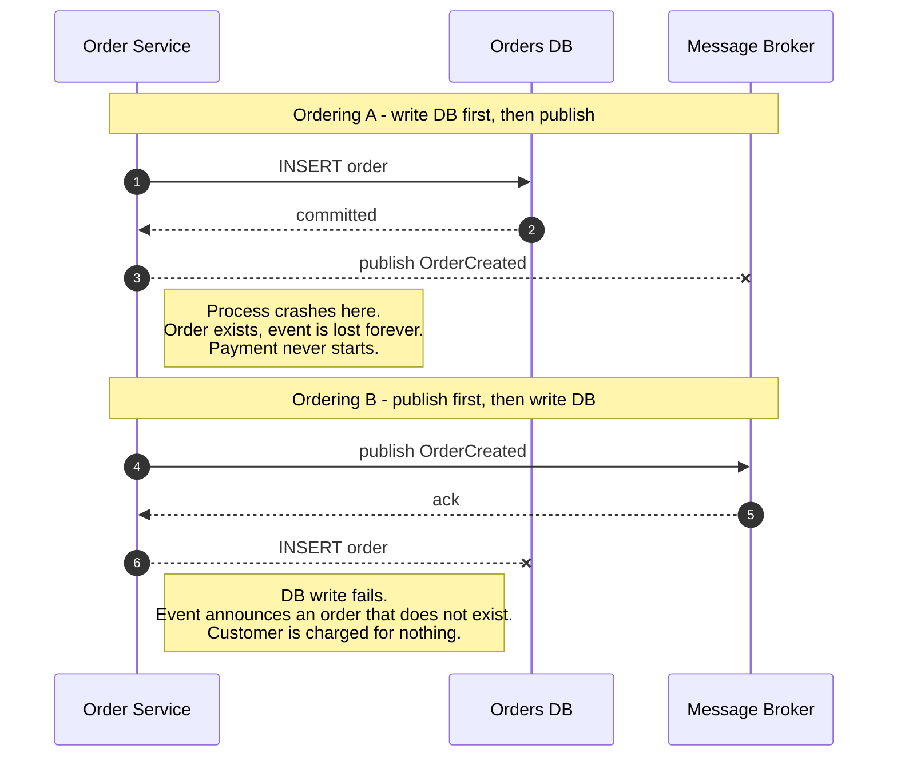
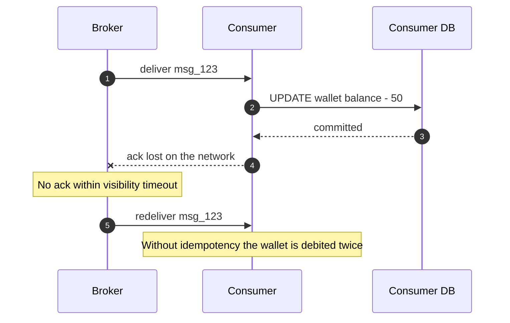
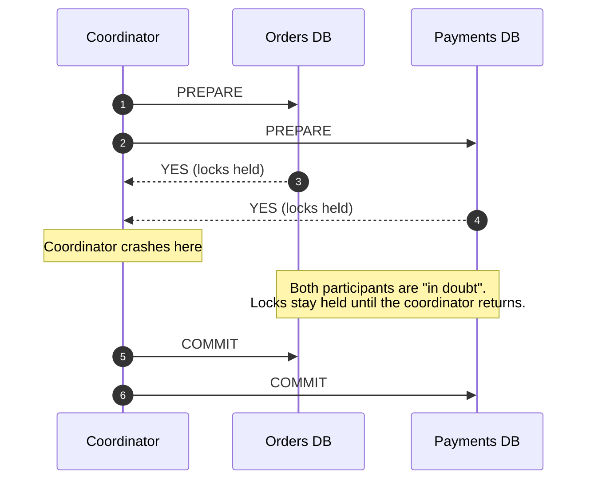
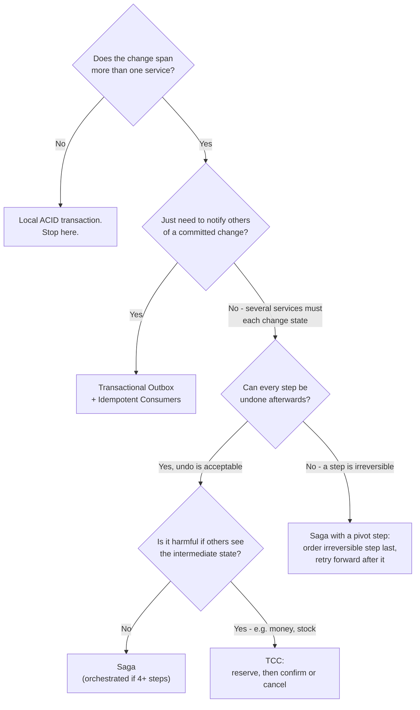

# 1.1 Distributed Transactions Primer

[← Handbook index](../README.md) · Next: [Transactional Outbox →](../02-data-consistency/01-transactional-outbox.md)

Everything else in this handbook exists because of three facts introduced here: the
**dual-write problem**, the limits of **delivery guarantees**, and the cost of **two-phase commit**.

---

## 1. The Dual-Write Problem

A service needs to do two things: change its database **and** tell the rest of the system.
Those are two separate network operations against two separate systems. No ordering of them is safe.

| Attempted fix | Why it fails |
|---|---|
| Publish inside the DB transaction, before commit | Broker ack can arrive and the commit can still fail (or vice versa) |
| `try { commit } catch { publish compensating event }` | The process can die between the two lines |
| Retry publish in a loop after commit | The retry state lives in memory; a crash erases it |
| Distributed (XA) transaction across DB and broker | See [section 3](#3-why-not-two-phase-commit-2pc) |

**The only durable fix** is to turn two writes into one: record the *intent to publish* in the
same database transaction as the business change → [Transactional Outbox](../02-data-consistency/01-transactional-outbox.md).

---

## 2. Delivery Guarantees

| Guarantee | What it means | How you get it | Risk |
|---|---|---|---|
| **At-most-once** | Message delivered 0 or 1 times | Ack before processing | Silent loss |
| **At-least-once** | Message delivered 1..n times | Ack after processing; redeliver on timeout | Duplicates |
| **Exactly-once delivery** | Delivered exactly 1 time | Not achievable across independent systems | — |
| **Effectively-once processing** | Delivered 1..n times, *effect* applied once | At-least-once **+** idempotent handler | Requires discipline in every consumer |

Why duplicates are unavoidable:

> "Exactly-once" features in brokers (for example Kafka transactions) cover
> *read-process-write inside that broker*. The moment a handler touches an external database
> or HTTP API, you are back to at-least-once and need an
> [idempotent consumer](../03-messaging/01-idempotent-consumer.md).

---

## 3. Why Not Two-Phase Commit (2PC)?

2PC makes several resource managers commit or abort together, coordinated by a transaction manager.

| Limitation | Consequence |
|---|---|
| **Blocking protocol** | Participants hold row locks while in doubt; a coordinator crash freezes them |
| **Availability multiplies** | All participants must be up: 99.9% × 99.9% × 99.9% ≈ 99.7% |
| **Latency** | Two synchronous round-trips to every participant, with locks held throughout |
| **Limited support** | Many brokers, NoSQL stores and third-party HTTP APIs (payment gateways) do not speak XA |
| **Tight coupling** | Breaks *database per service*: one service's lock duration depends on another's |

2PC is still right **inside** one trust boundary with XA-capable resources and low throughput.
Across microservices, the industry moved to patterns that give up isolation or atomicity in
exchange for availability.

---

## 4. The Alternatives at a Glance

| | 2PC / XA | Saga | TCC | Outbox |
|---|---|---|---|---|
| **Solves** | Atomic commit across resources | Multi-step business transaction | Multi-step with resource reservation | Atomic "DB write + publish" |
| **Consistency** | Strong | Eventual | Eventual, with reserved state | Eventual (seconds) |
| **Isolation** | Yes (locks) | **No** — intermediate state visible | Partial — reserved state hides from others | n/a |
| **On failure** | Abort | Compensate (semantic undo) | Cancel (release reservation) | Retry publish |
| **Participant effort** | XA driver | Action + compensation | Try + Confirm + Cancel | Outbox table + relay |
| **Lock duration** | Whole transaction | None (local tx only) | Business-level hold with TTL | None |
| **Typical use** | Legacy, single data centre | Order → payment → shipping | Wallets, inventory holds, seat booking | Any service that emits events |

They compose rather than compete: a **Saga** step usually publishes its events through an
**Outbox**, and each participant is an **Idempotent Consumer**. **TCC** is a Saga variant for
resources that can be reserved.

---

## 5. Choosing

---

## 6. Vocabulary Used in Later Chapters

| Term | Meaning |
|---|---|
| **Compensating transaction** | A *new* forward operation that semantically reverses an earlier committed one (refund, not rollback) |
| **Pivot transaction** | The saga step after which the saga can no longer be compensated and must run to completion |
| **Idempotent** | Applying the operation N times has the same effect as applying it once |
| **Eventual consistency** | Replicas/services converge if no new updates arrive; readers may see stale data meanwhile |
| **Poison message** | A message that can never be processed successfully, no matter how often it is retried |
| **Fencing token** | A monotonically increasing number that lets a resource reject writes from a stale leader |

Full list: [Glossary](../08-reference/02-glossary.md).

---

## Key Takeaways

- You cannot atomically write to two systems. Stop trying; write to one and derive the other.
- Assume every message arrives **at least** once and possibly out of order.
- 2PC trades availability for consistency; Saga/TCC/Outbox trade isolation for availability.
- Timeouts are *unknown*, not *failed*. Design every step so that retrying is safe.

Next: [Transactional Outbox →](../02-data-consistency/01-transactional-outbox.md)
