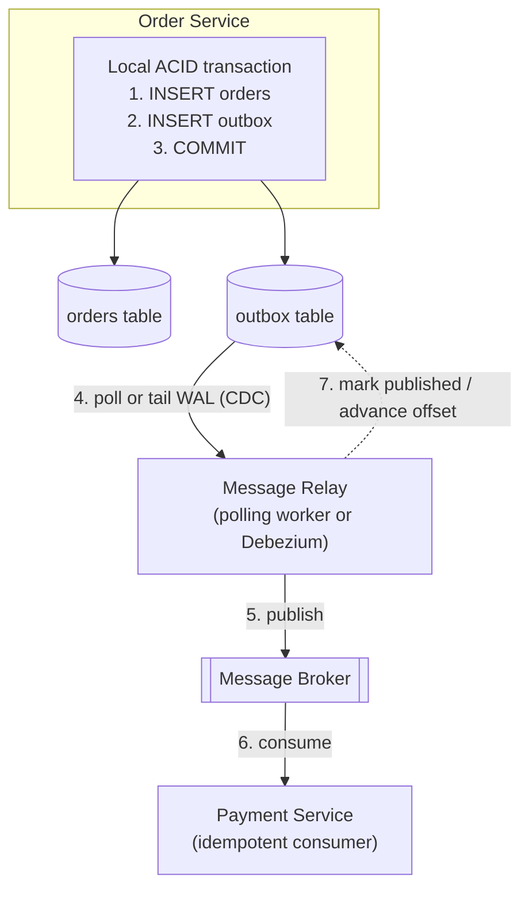
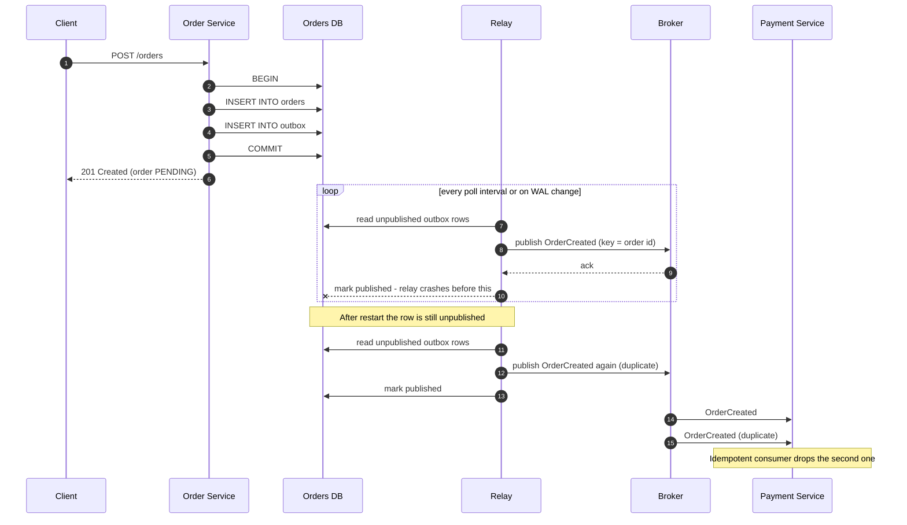
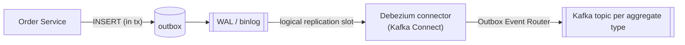

# 2.1 Transactional Outbox

[← Primer](../01-foundations/01-distributed-transactions-primer.md) · [Index](../README.md) · Next: [Saga →](02-saga-pattern.md)

> **In one line:** write the business row and the event row in the same local transaction;
> let a separate relay publish the event row to the broker.

---

## 1. Problem

Saving to a database and publishing to a broker are two network operations. A crash between
them loses the event (or publishes an event for data that was never saved). See the
[dual-write problem](../01-foundations/01-distributed-transactions-primer.md#1-the-dual-write-problem).

## 2. Mechanism

The service **never talks to the broker directly**. It only writes to its own database.



### Sequence, including the crash that matters



**Guarantee:** at-least-once publication. The outbox removes *loss*; it does not remove
*duplicates*. Consumers must be [idempotent](../03-messaging/01-idempotent-consumer.md).

---

## 3. Schema

```sql
CREATE TABLE outbox (
    id              UUID PRIMARY KEY DEFAULT gen_random_uuid(),  -- becomes the message/event ID
    seq             BIGINT GENERATED ALWAYS AS IDENTITY,        -- relay read order
    aggregate_type  TEXT        NOT NULL,                       -- 'ORDER'  → topic routing
    aggregate_id    TEXT        NOT NULL,                       -- order id → partition key
    event_type      TEXT        NOT NULL,                       -- 'OrderCreated'
    payload         JSONB       NOT NULL,
    headers         JSONB       NOT NULL DEFAULT '{}',          -- trace id, schema version, tenant
    created_at      TIMESTAMPTZ NOT NULL DEFAULT now(),
    published_at    TIMESTAMPTZ                                 -- NULL = not yet published (polling only)
);

-- Partial index: the relay only ever scans unpublished rows, so keep that set tiny.
CREATE INDEX outbox_unpublished_idx ON outbox (seq) WHERE published_at IS NULL;
```

## 4. Code — the Write Side (Node.js / PostgreSQL)

```javascript
async function createOrder(orderData) {
  const client = await db.connect();
  try {
    await client.query('BEGIN');

    const orderRes = await client.query(
      'INSERT INTO orders (user_id, total, status) VALUES ($1, $2, $3) RETURNING id',
      [orderData.userId, orderData.total, 'PENDING']
    );
    const orderId = orderRes.rows[0].id;

    // Same transaction, same connection: both rows commit or neither does.
    await client.query(
      `INSERT INTO outbox (aggregate_type, aggregate_id, event_type, payload, headers)
       VALUES ($1, $2, $3, $4, $5)`,
      ['ORDER', orderId, 'OrderCreated',
       JSON.stringify({ orderId, total: orderData.total }),
       JSON.stringify({ traceId: orderData.traceId, schemaVersion: 1 })]
    );

    await client.query('COMMIT');
    return orderId;
  } catch (error) {
    await client.query('ROLLBACK');
    throw error;
  } finally {
    client.release();
  }
}
```

## 5. The Relay — Two Implementations

### 5a. Polling publisher

```javascript
async function relayOnce(batchSize = 100) {
  const client = await db.connect();
  try {
    await client.query('BEGIN');

    // SKIP LOCKED lets several relay instances run without blocking or double-reading.
    const { rows } = await client.query(
      `SELECT id, aggregate_type, aggregate_id, event_type, payload, headers
         FROM outbox
        WHERE published_at IS NULL
        ORDER BY seq
        LIMIT $1
        FOR UPDATE SKIP LOCKED`,
      [batchSize]
    );
    if (rows.length === 0) { await client.query('COMMIT'); return 0; }

    // Publish and WAIT for broker acks before marking anything as sent.
    await producer.send({
      topic: 'orders.events',
      messages: rows.map((r) => ({
        key: r.aggregate_id,                          // same order → same partition → ordered
        value: JSON.stringify(r.payload),
        headers: { ...r.headers, messageId: r.id, eventType: r.event_type },
      })),
    });

    await client.query(
      'UPDATE outbox SET published_at = now() WHERE id = ANY($1)',
      [rows.map((r) => r.id)]
    );
    await client.query('COMMIT');
    return rows.length;
  } catch (err) {
    await client.query('ROLLBACK');   // rows stay unpublished → retried next tick
    throw err;
  } finally {
    client.release();
  }
}
```

### 5b. Log-based CDC (Debezium)

Debezium reads the database's transaction log (PostgreSQL WAL, MySQL binlog) and turns each
`INSERT` on `outbox` into a broker message. Its *Outbox Event Router* transform maps columns
to topic, key and payload.



### 5c. Which relay?

| | Polling publisher | Log-based CDC |
|---|---|---|
| **Latency** | Poll interval (typically 100 ms – 1 s) | Near real time |
| **DB load** | Repeated `SELECT` + `UPDATE` per batch | Reads the log; no queries against the table |
| **Ordering** | By `seq`, but see caveat below | Exact commit order from the log |
| **Operational cost** | A small worker you own | Kafka Connect + connector + replication slot to run and monitor |
| **Works with** | Any SQL database | Databases with a readable log |
| **Good for** | Low/medium volume, simple stacks | High volume, strict ordering, many services |

> **Ordering caveat for polling:** identity/sequence values are assigned at `INSERT`, not at
> `COMMIT`. Transaction A can take `seq = 10`, transaction B takes `seq = 11` and commits first.
> A relay that remembers "last seq seen = 11" will skip 10 forever. Use the
> `published_at IS NULL` filter (as above) rather than a high-water mark, and rely on the
> partition key — not global `seq` — for per-aggregate ordering.

---

## 6. Failure Modes

| Failure | What happens | Why it is safe |
|---|---|---|
| App crashes before `COMMIT` | Neither order nor outbox row exists | Atomic rollback |
| App crashes after `COMMIT` | Both rows exist; relay picks it up later | Durable in DB |
| Relay crashes after publish, before mark | Event is published again | Consumers are idempotent |
| Broker is down | Outbox rows accumulate | DB is the buffer; alert on lag |
| Relay falls behind | Events are late, never lost | Scale relay; watch oldest unpublished age |
| Outbox table grows without bound | Slow scans, bloated backups | Delete/partition published rows |
| CDC slot not consumed | **WAL grows until the disk fills** | Alert on replication-slot lag; this is the #1 CDC incident |

## 7. Security

| Risk | Control |
|---|---|
| Payload contains PII / card data that now lives in DB, WAL, broker and every consumer's logs | Publish identifiers, not full records ("claim check"); encrypt sensitive fields; never put secrets or PANs in events |
| Relay credentials are a high-value target (read all events, publish to all topics) | Dedicated DB role with `SELECT`/`UPDATE` on `outbox` only; broker ACL scoped to the service's topics |
| CDC user needs replication privilege | Separate replication role; restrict the publication to the `outbox` table only, not the whole schema |
| Forged events from a compromised producer | Broker ACLs per topic; mTLS between relay and broker; consumers validate schema and tenant |
| Cross-tenant leakage | Carry `tenantId` in headers; consumers enforce it, do not trust the payload alone |
| Tampering with history | Outbox rows are append-only from the app's role (no `UPDATE payload` grant) |

More: [cross-cutting security](../07-cross-cutting/01-security.md).

## 8. Performance

- **Write cost:** one extra `INSERT` in a transaction you were already running. Usually negligible next to the commit `fsync`.
- **Keep the hot set small:** the partial index on unpublished rows keeps relay scans O(batch), independent of table size.
- **Cleanup:** delete published rows in small batches, or partition by day and `DROP PARTITION`. Bulk `DELETE` causes bloat and vacuum pressure.
- **Batching:** publish in batches (100–1000) with broker-side batching/compression; one ack per batch, not per message.
- **Throughput ceiling for polling:** roughly `batchSize / (poll + publish + update time)` per relay. Run several relays with `SKIP LOCKED`, or move to CDC.
- **Payload size:** large JSON payloads inflate the WAL and replication traffic. Keep events small.

## 9. Observability

| Signal | Why | Alert when |
|---|---|---|
| `outbox_unpublished_count` | Backlog size | Rising for > 5 min |
| `outbox_oldest_unpublished_age_seconds` | End-to-end lag — the most useful single metric | > your event-freshness SLO (for example 30 s) |
| `outbox_publish_errors_total` | Broker/serialization failures | Any sustained rate |
| Replication-slot lag bytes (CDC) | Disk-fill risk | Above a fixed byte threshold |
| Relay heartbeat | Relay silently dead | Missing for > 2 poll intervals |

Propagate the trace ID in `headers` so one trace spans HTTP request → outbox → broker → consumer.

## 10. Checklist

- [ ] Business row and outbox row are written on the **same connection, same transaction**
- [ ] Event has a stable unique ID that travels with the message
- [ ] Partition key = aggregate ID (per-aggregate ordering)
- [ ] Relay marks rows only **after** broker ack
- [ ] Every consumer is idempotent
- [ ] Published rows are purged or partitioned
- [ ] Lag and (for CDC) replication-slot size are alerted on
- [ ] No secrets or raw card data in payloads

---

Next: [Saga →](02-saga-pattern.md) · Related: [Idempotent Consumer](../03-messaging/01-idempotent-consumer.md) · [Frameworks](../06-putting-it-together/02-frameworks-and-tooling.md)
