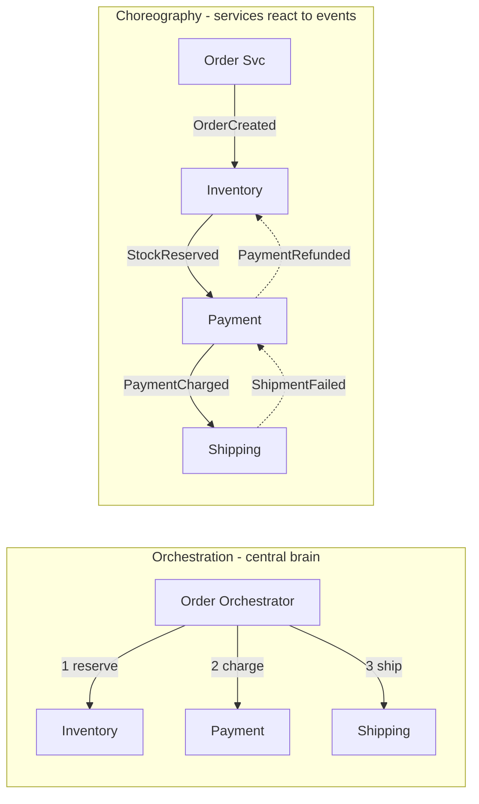
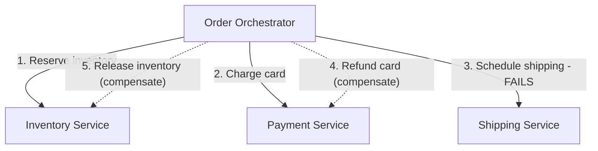
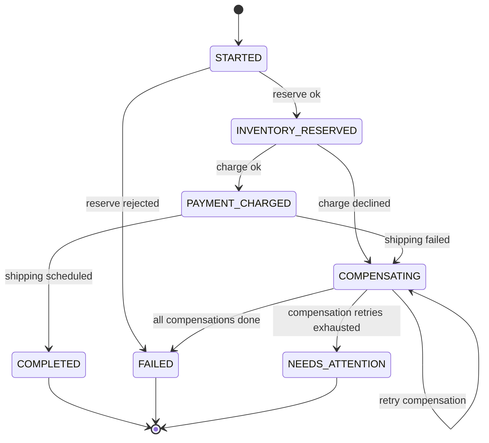
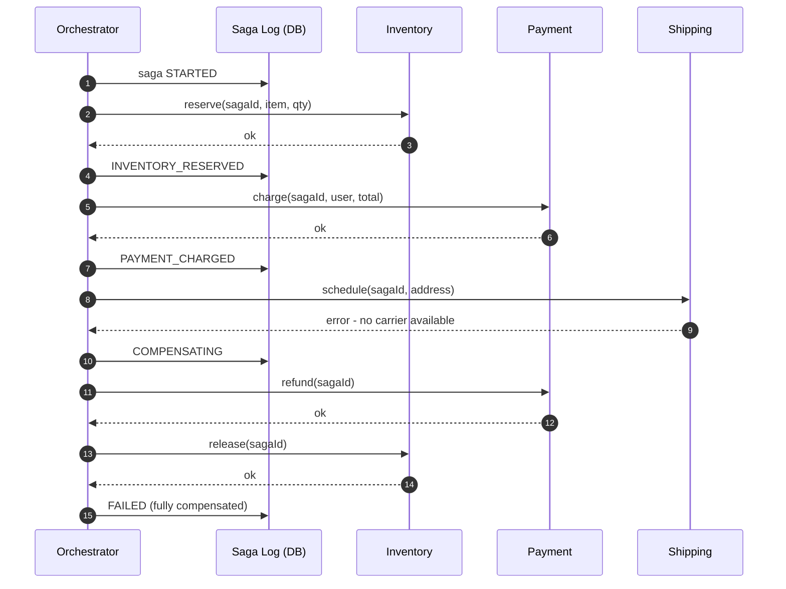

# 2.2 Saga Pattern

[← Outbox](01-transactional-outbox.md) · [Index](../README.md) · Next: [TCC →](03-try-confirm-cancel.md)

> **In one line:** split a cross-service transaction into a sequence of local transactions;
> if one fails, run **compensating transactions** for the completed ones in reverse order.

---

## 1. Problem

Placing an order touches Inventory, Payment and Shipping — three services, three databases.
There is no shared transaction to roll back. A saga gives **atomicity by compensation**:
either all steps complete, or the completed ones are semantically undone.

A saga gives you **A, C and D but not I**: there is no isolation. Other requests can see the
order while it is half-done.

## 2. Two Coordination Styles



| | Orchestration | Choreography |
|---|---|---|
| **Control flow lives in** | One orchestrator (explicit state machine) | Spread across services' event handlers |
| **Visibility** | "Where is order 42?" → look at one row | Reconstruct from events across services |
| **Coupling** | Orchestrator knows all participants | Services know each other's events |
| **Risk** | Orchestrator becomes a god-service | Cyclic event dependencies; hard to change |
| **Best for** | 4+ steps, branching, timeouts, human approval | 2–3 steps, simple linear flows |
| **Tooling** | Temporal, Camunda, Step Functions, MassTransit state machines | Plain broker + outbox |

The rest of this chapter focuses on orchestration, the more common choice in production.

---

## 3. Orchestrated Saga — Flow



### State machine



### Sequence with compensation



---

## 4. Step Types

| Type | Definition | Example | Rule |
|---|---|---|---|
| **Compensable** | Can be undone by a compensating action | Reserve stock, charge card | Must have an idempotent compensation |
| **Pivot** | The go/no-go point; after it the saga must finish | Hand parcel to courier, send bank transfer | At most one; place irreversible work here or later |
| **Retriable** | Comes after the pivot; cannot fail permanently | Send confirmation email, award points | Retry until success; must be idempotent |

**Design rule:** order steps so that the ones most likely to fail and cheapest to undo come
first, and irreversible ones come last.

---

## 5. Code

### 5a. The in-memory version (from the reading notes)

```python
class OrderSagaOrchestrator:
    def execute_order_saga(self, order):
        completed_steps = []
        try:
            inventory_service.reserve(order.item_id, order.qty)
            completed_steps.append("INVENTORY_RESERVED")

            payment_service.charge(order.user_id, order.total)
            completed_steps.append("PAYMENT_CHARGED")

            shipping_service.schedule(order.id, order.address)
            completed_steps.append("SHIPPING_SCHEDULED")

            order_service.mark_completed(order.id)
        except Exception as e:
            self.compensate(order, completed_steps)

    def compensate(self, order, completed_steps):
        if "PAYMENT_CHARGED" in completed_steps:
            payment_service.refund(order.user_id, order.total)
        if "INVENTORY_RESERVED" in completed_steps:
            inventory_service.release(order.item_id, order.qty)
        order_service.mark_failed(order.id)
```

> **Notes on the original snippet** — it shows the idea well, but is not safe in production:
>
> 1. **`completed_steps` lives in memory.** If the orchestrator process dies after charging
>    the card, nobody remembers a refund is owed. Saga state must be persisted *before and
>    after* every step.
> 2. **A timeout is not a failure.** If `charge()` times out, the charge may have succeeded.
>    The step is not in `completed_steps`, so it is never refunded. On an unknown outcome you
>    must compensate anyway (and compensation must tolerate "nothing to undo").
> 3. **Compensation can fail too.** If `refund()` throws, `release()` never runs and the order
>    is never marked failed. Compensations must be retried until they succeed, or escalated.
> 4. **No idempotency keys.** Retrying `charge()` can double-charge.

### 5b. A durable version

```python
STEPS = [
    # (name, action, compensation)
    ("INVENTORY", lambda o, k: inventory.reserve(k, o.item_id, o.qty), lambda o, k: inventory.release(k)),
    ("PAYMENT",   lambda o, k: payment.charge(k, o.user_id, o.total),  lambda o, k: payment.refund(k)),
    ("SHIPPING",  lambda o, k: shipping.schedule(k, o.id, o.address),  lambda o, k: shipping.cancel(k)),
]

class DurableOrderSaga:
    def run(self, saga_id, order):
        """Safe to call again after a crash: resumes from the persisted state."""
        saga = saga_repo.load_or_create(saga_id, order)        # one row per saga

        if saga.status == "RUNNING":
            for index, (name, action, _) in enumerate(STEPS):
                if index < saga.next_step:
                    continue                                    # already done before the crash
                key = f"{saga_id}:{name}"                       # idempotency key per step
                saga_repo.mark_attempting(saga_id, index)       # persist BEFORE the call
                try:
                    action(order, key)
                except BusinessRejection:                       # definite "no" (declined, out of stock)
                    saga_repo.set_status(saga_id, "COMPENSATING")
                    break
                except TransientError:                          # timeout / 5xx: outcome UNKNOWN
                    raise                                       # let the runner retry the same step
                saga_repo.mark_done(saga_id, index)             # persist AFTER the call
            else:
                saga_repo.set_status(saga_id, "COMPLETED")
                return

        if saga_repo.load(saga_id).status == "COMPENSATING":
            self.compensate(saga_id, order)

    def compensate(self, saga_id, order):
        saga = saga_repo.load(saga_id)
        # Undo every step that was ATTEMPTED (not just confirmed done), in reverse order.
        for index in reversed(range(saga.last_attempted_step + 1)):
            name, _, compensation = STEPS[index]
            if index in saga.compensated:
                continue
            compensation(order, f"{saga_id}:{name}")            # must be idempotent + tolerate "nothing to undo"
            saga_repo.mark_compensated(saga_id, index)
        saga_repo.set_status(saga_id, "FAILED")
```

A background runner re-invokes `run()` for sagas stuck in `RUNNING`/`COMPENSATING` with
backoff, and moves them to `NEEDS_ATTENTION` after a retry budget — the saga equivalent of a
[dead-letter queue](../03-messaging/03-dead-letter-queues.md).

Workflow engines such as Temporal give you exactly this persistence and resume logic for
free; see [Frameworks](../06-putting-it-together/02-frameworks-and-tooling.md).

---

## 6. Lack of Isolation — Anomalies and Countermeasures

| Anomaly | Example | Countermeasure |
|---|---|---|
| **Dirty read** | "My Orders" shows an order that is later cancelled | **Semantic lock**: mark the row `PENDING`; other flows treat pending as not-yet-real |
| **Lost update** | Two sagas both change the same order | **Version column** / conditional `UPDATE ... WHERE version = ?` |
| **Non-repeatable read** | Price changes between step 1 and step 3 | **Re-read value** before the pivot and abort if changed; or carry the value in the saga |
| Compensation interferes with concurrent work | Refund issued while a partial shipment is leaving | **Commutative updates** (debit/credit are order-independent); **pivot** placement |
| High-value flow needs extra care | Large payout | **By-value**: route risky requests to a stricter mechanism (TCC, manual approval) |

---

## 7. Failure Modes

| Failure | Handling |
|---|---|
| Participant returns business rejection | Compensate completed steps |
| Participant times out | Outcome unknown → retry with same idempotency key, then compensate |
| Orchestrator crashes mid-saga | Resume from persisted state on restart |
| Compensation fails | Retry with backoff indefinitely → escalate to human queue with full context |
| Compensation arrives before the action | Participant records a tombstone ("empty compensation") — see [TCC edge cases](03-try-confirm-cancel.md#5-the-three-edge-cases) |
| Duplicate command | Participant deduplicates on `sagaId:step` |
| Saga never finishes | Per-saga deadline; alert on age of oldest in-flight saga |

## 8. Security

- **Authorize compensations as strictly as actions.** A `refund` endpoint that trusts any
  caller is a money printer. Only the orchestrator's service identity (mTLS / signed service
  token) may call it, and the participant verifies the saga actually charged that amount.
- **Do not take amounts from the compensation request.** Look them up from the participant's
  own record of the original action keyed by `sagaId`.
- **Carry the original user context** (subject, tenant, scopes) in the saga, and re-check
  authorization at each participant — the orchestrator is not a privilege-escalation path.
- **Saga state holds business data** (addresses, amounts). Encrypt at rest, restrict read
  access, apply retention.
- **Audit trail:** the saga log *is* your audit record. Make it append-only and include actor,
  timestamps and each step's outcome.
- **Replay protection:** idempotency keys must be unguessable or bound to the caller identity
  so one tenant cannot collide with another's keys.

## 9. Performance

- **Latency** = sum of step latencies when sequential. Run independent steps in parallel
  (for example reserve stock and run fraud check together) and join before the pivot.
- **Throughput** is limited by the slowest participant; put a
  [bulkhead](../04-resilience/03-bulkhead.md) around each one so a slow shipping API cannot
  stall all sagas.
- **Don't hold the user's HTTP request open** for the whole saga. Return `202 Accepted` with
  the order in `PENDING`, complete asynchronously, and push status (WebSocket/poll).
- **Saga table growth:** archive completed sagas; index on `(status, updated_at)` for the
  recovery scanner.
- **Compensation cost:** real refunds cost money and gateway rate limit. Put cheap, likely-to-fail
  validation steps first to minimise compensations.

## 10. Observability

| Metric | Alert when |
|---|---|
| Sagas started / completed / failed per minute | Completion ratio drops |
| Compensation rate by failing step | Sudden rise → that participant is unhealthy |
| Age of oldest in-flight saga | Exceeds business deadline |
| Count in `NEEDS_ATTENTION` | > 0 (page: money or stock may be stuck) |
| Step latency histogram per participant | p99 above budget |

Use `sagaId` as the correlation ID in every log line, trace and outgoing request.

## 11. Checklist

- [ ] Saga state is persisted before and after every step
- [ ] Every action and every compensation is idempotent, keyed by `sagaId:step`
- [ ] Compensations tolerate "action never happened"
- [ ] Timeouts are treated as *unknown*, not *failed*
- [ ] Irreversible steps are last (pivot identified)
- [ ] `PENDING` state is visible in the domain model (semantic lock)
- [ ] Stuck sagas have a recovery scanner, a deadline and a human escalation path
- [ ] Refund/release endpoints are authorized for the orchestrator only

---

Next: [Try-Confirm/Cancel →](03-try-confirm-cancel.md)
