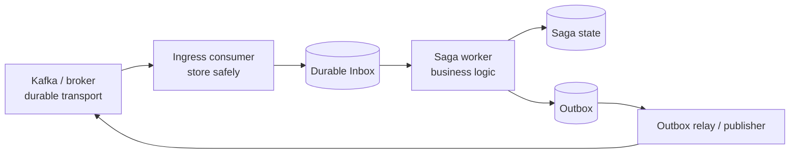
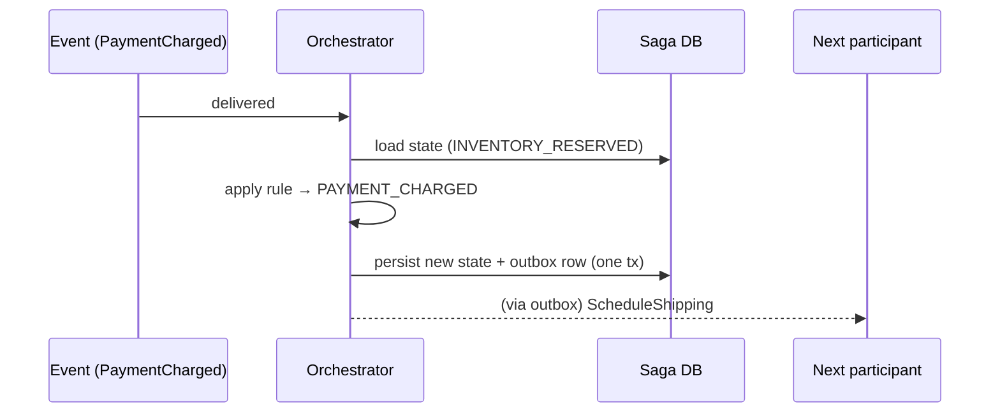
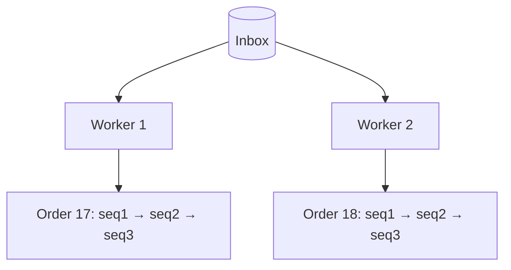
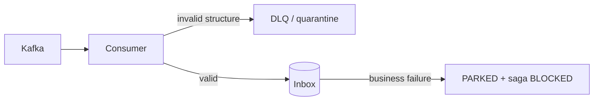

# 2.2a Saga — Durable Execution: State Machine, Outbox Relay, Durable Inbox

[← Saga Pattern](02-saga-pattern.md) · [Index](../README.md) · Next: [TCC →](03-try-confirm-cancel.md)

> **In one line:** a saga survives crashes only if four things hold — its **state is in a DB**,
> its **outgoing messages leave via an outbox**, its **incoming messages land in a durable inbox**,
> and **every step is idempotent**.

This is a companion to [2.2 Saga Pattern](02-saga-pattern.md). That chapter explains *what* a saga is;
this one explains *how it runs reliably* (reading notes reorganised for revision).

**Contents**
1. [Big picture](#1-big-picture)
2. [State machine vs. database vs. orchestrator](#2-state-machine-vs-database-vs-orchestrator)
3. [Outbox and the relay](#3-outbox-and-the-relay)
4. [Trace-context propagation through the relay](#4-trace-context-propagation-through-the-relay)
5. [Durable inbox (Kafka → Saga)](#5-durable-inbox-kafka--saga)
6. [Poison messages: DLQ vs. parked](#6-poison-messages-dlq-vs-parked)
7. [Inbox + Outbox together (end to end)](#7-inbox--outbox-together-end-to-end)
8. [.NET implementation choices](#8-net-implementation-choices)
9. [Revision cheat sheet](#9-revision-cheat-sheet)

---

## 1. Big picture



| Component | Responsibility | Guarantee it gives |
|---|---|---|
| Broker (Kafka, RabbitMQ, Service Bus) | Transport | At-least-once delivery to your app |
| Ingress consumer | Persist message, *then* commit offset | No message lost |
| **Durable inbox** | Work queue in your DB, unique `message_id` | Dedup + isolation of failures per saga |
| Saga worker | Apply transition, write new state | Per-saga ordering |
| **Saga state (DB)** | Current progress | Resume after crash |
| **Outbox** | Follow-up messages written in the *same* transaction as state | No "state saved, message lost" |
| Outbox relay | Publish committed outbox rows | Eventual publish |

---

## 2. State machine vs. database vs. orchestrator

Four roles, easily confused:

| Role | What it is | Example |
|---|---|---|
| **State machine** | The *rules*: named states + allowed transitions | `RUNNING → COMPENSATING → FAILED` |
| **Database** | Stores the *current state and progress* | row `saga_id=17, status=RUNNING, next_step=2` |
| **Events / responses** | *Inputs* that may trigger a transition | "payment charged", "shipping failed" |
| **Orchestrator** | *Executes* the rules: reads state, applies transition, persists new state, sends next command | on `ShippingFailed` → set `COMPENSATING`, send `Refund` |

Key points:

- The state machine does **not** store or manage events — it defines *how to react* to them; the orchestrator does the work.
- Because state is in the DB, a restarted orchestrator **resumes** instead of forgetting a refund is owed.
- Example transitions: reservation ok → continue to payment; reservation rejected → start compensation.
- Diagram of the full state machine: [Saga Pattern §3](02-saga-pattern.md#state-machine).



---

## 3. Outbox and the relay

**Failure the outbox prevents:** DB commits the saga update, the app crashes *before* sending the message → saga says "payment charged", nobody tells Shipping.

### Flow

1. **API request** — in **one DB transaction** save: order, saga state (`RUNNING`), outbox row (`ReserveInventory`).
2. **Outbox relay** (background publisher) — publishes the row to the broker, marks it published.
3. **Worker** — consumes the message, calls the participant, saves result + next saga state; if another step is needed, writes the next outbox row **in the same transaction**.
4. **Recovery scanner** — periodically finds sagas stuck too long → retry or escalate.

Workers consume **from the broker**; they do not poll the saga table for work.

### Polling latency

| Poll interval | Worst-case added delay | Average | Cost |
|---|---|---|---|
| 500 ms | ~500 ms | ~250 ms | low DB load |
| 100 ms | ~100 ms | ~50 ms | more queries |

Shorter interval = lower delay, more DB queries. Add broker + processing time on top. Measure real delay and load before tuning.

### What "relay" can be

- a .NET `BackgroundService` polling the outbox table,
- a messaging library's built-in outbox (MassTransit, NServiceBus),
- a CDC connector (Debezium) tailing the outbox table.

It does not have to be a separate service.

---

## 4. Trace-context propagation through the relay

Goal: one distributed trace across API → outbox → broker → consumer.

```text
API span
  └─ trace context persisted in outbox row
       └─ relay producer span
            └─ broker message headers: traceparent, tracestate
                 └─ consumer processing span
```

- API runs under an `Activity` (.NET's span).
- In the **same transaction** as the saga update, store `traceparent` (+ `tracestate`) in the outbox row.
- The relay **must use the saved context** — `Activity.Current` from the original request is gone by publish time.
- Relay extracts saved context, starts a producer span, injects its context into **message headers**.
- With OpenTelemetry broker instrumentation, injection is automatic; otherwise the relay sets headers itself.
- Headers are **broker metadata**, not HTTP headers: RabbitMQ message headers, Azure Service Bus application properties, Kafka record headers (W3C names reused).
- **Debezium:** configure outbox event routing to map the stored trace columns into Kafka headers — it won't infer them.

---

## 5. Durable inbox (Kafka → Saga)

**Analogy:** Kafka = courier, inbox = warehouse shelf, saga workers = warehouse staff. The courier only needs to put the parcel on the shelf; one broken parcel doesn't stop the others.

```text
Without inbox:  Kafka ──► Saga worker      (bad message can block everything behind it)
With inbox:     Kafka ──► Inbox ──► Worker (Kafka's job ends once the message is stored)
```

### Ingress consumer: order of operations

```text
1. Read Kafka message
2. Save to inbox   (unique constraint on message_id)
3. Commit offset
```

| Crash point | Result | Safe? |
|---|---|---|
| Before save | Offset not committed → Kafka resends | ✅ nothing lost |
| After save, before commit | Kafka resends → duplicate insert **rejected by unique `message_id`** | ✅ |
| After commit | Already stored; worker processes later | ✅ |
| *(wrong order)* commit → crash → save | Message **lost forever** | ❌ never do this |

### Inbox table

| Column | Purpose |
|---|---|
| `message_id` (unique) | dedup |
| `order_id` / `saga_id` | partition work per saga |
| `event_type` | what happened |
| `sequence` | per-saga ordering |
| `payload` | body |
| `status` | `Pending / Processing / Done / Parked` |
| `attempt_count`, `last_error` | retry budget, diagnosis |
| `received_at` | age, SLA alerts |

### Workers: parallel across sagas, ordered within one



- Different orders run simultaneously.
- Within one order, seq 3 never runs before seq 2.

### When one order fails (the key benefit)

```text
O-17  seq1 ✅   seq2 ❌ PARKED   seq3 ⏸ waiting      (saga BLOCKED)
O-18  seq1 ✅   seq2 ✅          seq3 ✅              (unaffected)
```

Only the failing saga is blocked; all other sagas keep flowing.

---

## 6. Poison messages: DLQ vs. parked

| Type | Example | Where it goes | Why |
|---|---|---|---|
| **Invalid structure** | JSON missing `orderId` — can't identify the saga | **DLQ / quarantine** (before the inbox) | No saga to attach it to |
| **Valid message, business failure** | `InventoryReserved` for O-17 but inventory record corrupted | **Stay in inbox**, `status=PARKED`, saga `BLOCKED` | It belongs to a saga; keep order and context; fix then resume |



See also [Dead-Letter Queues](../03-messaging/03-dead-letter-queues.md) and [Idempotent Consumer](../03-messaging/01-idempotent-consumer.md).

---

## 7. Inbox + Outbox together (end to end)

Processing one event = update saga **and** emit the next command. Without an outbox:

```text
Update saga ✅ → crash ❌ → PaymentRequested never published → inconsistent
```

With both, inside one DB transaction the worker does: *mark inbox row done + update saga + insert outbox row*. Then the relay publishes later.

| Pattern | Protects against |
|---|---|
| Ingress: save → commit offset | losing an **incoming** message |
| Unique `message_id` | duplicate processing |
| Per-saga sequence | out-of-order execution |
| Parked status | one bad saga blocking all |
| Outbox in same tx | losing an **outgoing** message |
| Recovery scanner | silently stuck sagas |

> Kafka guarantees delivery to your app; the durable inbox guarantees safe storage; saga workers guarantee per-order sequencing; the transactional outbox guarantees follow-up events aren't lost.

---

## 8. .NET implementation choices

Default stack: **ASP.NET Core + DB outbox + broker + background consumers.**

| Option | When | Notes |
|---|---|---|
| **MassTransit + EF Core transactional outbox** + RabbitMQ / Azure Service Bus | Common starting point | Consumers, retries, outbox, saga state machines built in; verify outbox config fits your DB and delivery needs |
| **Hand-rolled outbox + `BackgroundService`** polling 100–500 ms | Simpler / lower volume | Reasonable trade-off; measure delay and DB load |
| **Debezium (CDC) + Kafka** | Kafka + CDC already running | Low latency; extra operational complexity if added only to save a small polling delay |

Regardless of option:
- Assume **at-least-once** delivery → duplicates happen.
- Give each step a **stable idempotency key** (`sagaId:step`), persist its outcome, make retries safe.
- Keep a **recovery scanner** even with broker/CDC — it catches delayed or stuck work.

Tooling overview: [Frameworks](../06-putting-it-together/02-frameworks-and-tooling.md).

---

## 9. Revision cheat sheet

- State machine = rules; DB = current state; events = inputs; orchestrator = executor.
- Persist state **before and after** each step; resume after crash.
- Outbox: state + message in **one tx**; relay publishes; polling adds up to one interval of delay.
- Relay must carry **saved trace context** into broker headers.
- Inbox: **save, then commit offset**; unique `message_id` dedups.
- Order **per saga**, parallel **across sagas**.
- Bad structure → DLQ; bad business processing → **park in inbox**, block only that saga.
- Everything idempotent; timeout ≠ failure.

---

Next: [Try-Confirm/Cancel →](03-try-confirm-cancel.md)
