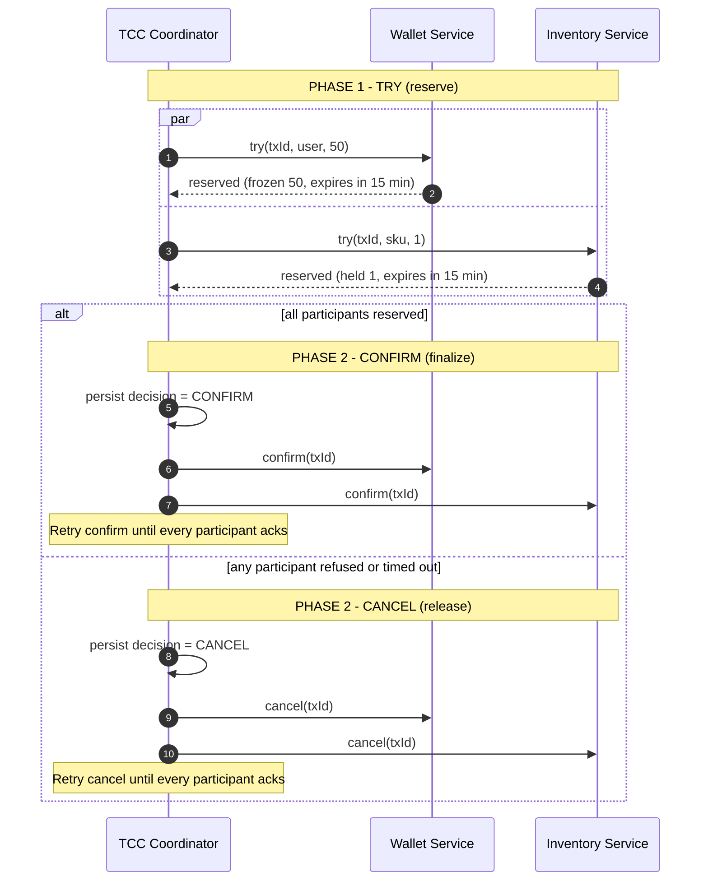
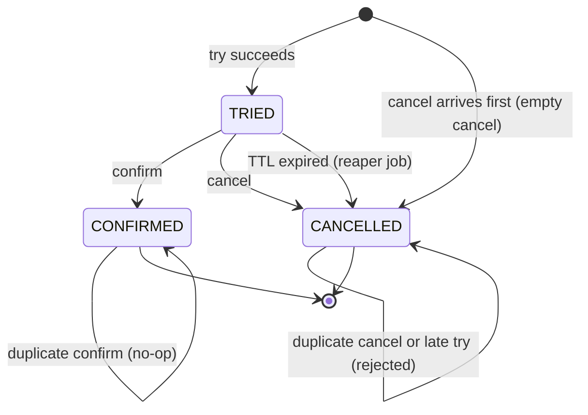
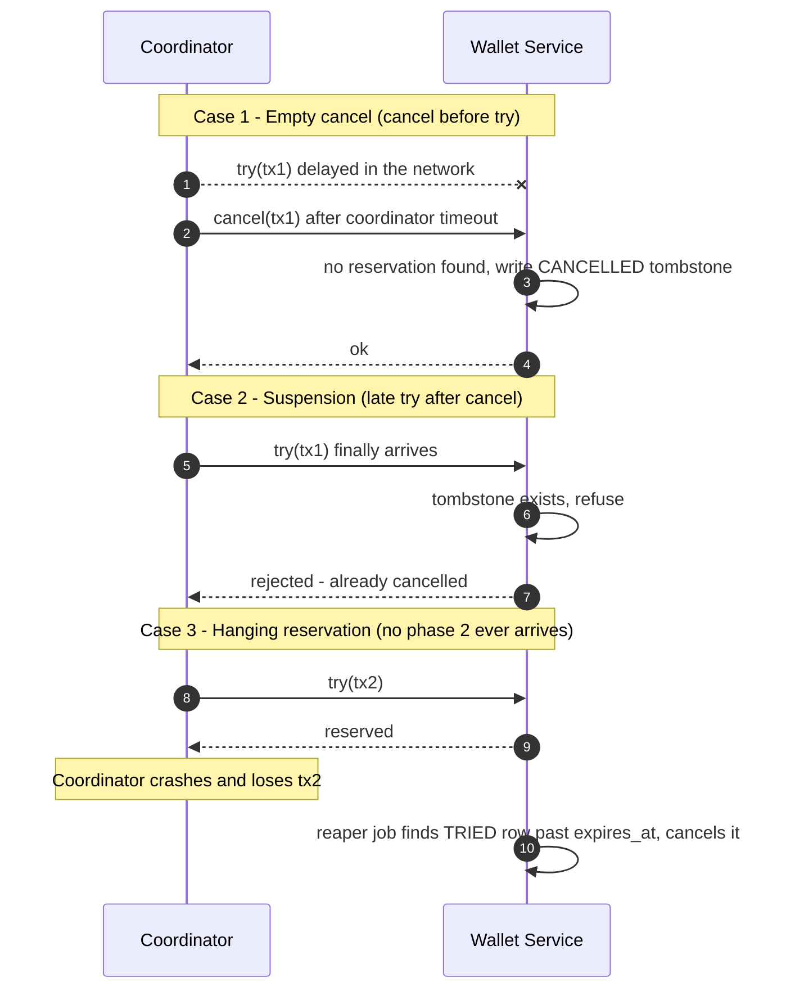

# 2.3 Try-Confirm/Cancel (TCC)

[← Saga](02-saga-pattern.md) · [Index](../README.md) · Next: [Database per Service →](04-database-per-service.md)

> **In one line:** every participant first **reserves** the resource (Try); the coordinator
> then either **finalizes** all reservations (Confirm) or **releases** them (Cancel).

---

## 1. Problem

A saga commits each step immediately and undoes it later. For some resources that is
unacceptable: you do not want to *actually* debit a wallet and then refund it, because in
between the customer sees money missing and other transactions see the wrong balance.

TCC adds a **reserved** state. Resources are held, not consumed, until everyone has said yes.

## 2. Saga vs TCC

| | Saga | TCC |
|---|---|---|
| First call does | The real change (commit) | A reservation (hold) |
| Failure path | Compensate — a new business operation (refund) | Cancel — release the hold |
| Intermediate state visible to others | Yes (dirty reads possible) | No — held amount is neither available nor spent |
| Participant API | `action`, `compensate` | `try`, `confirm`, `cancel` |
| Works with third-party APIs | Often (if they have a reverse operation) | Only if they support holds (e.g. card *authorize* / *capture* / *void*) |
| Cost | Lower implementation effort | Three operations + reservation state per participant |

Card payments are the classic real-world TCC: **authorize** (try) → **capture** (confirm) or **void** (cancel).

---

## 3. Flow



**Key rule:** once the coordinator has durably recorded its decision, phase 2 **must
eventually succeed**. Confirm and Cancel can be retried forever, so they must be idempotent
and must not fail for business reasons — every business check belongs in Try.

### Reservation state machine (per participant, per transaction)



---

## 4. Code

### 4a. Schema

```sql
CREATE TABLE wallets (
    user_id   BIGINT PRIMARY KEY,
    available NUMERIC(12,2) NOT NULL CHECK (available >= 0),
    frozen    NUMERIC(12,2) NOT NULL DEFAULT 0 CHECK (frozen >= 0)
);

-- One row per (transaction, participant). This row is what makes every phase idempotent.
CREATE TABLE tcc_reservations (
    transaction_id UUID PRIMARY KEY,
    user_id        BIGINT        NOT NULL,
    amount         NUMERIC(12,2) NOT NULL,
    status         TEXT          NOT NULL CHECK (status IN ('TRIED','CONFIRMED','CANCELLED')),
    expires_at     TIMESTAMPTZ   NOT NULL,
    updated_at     TIMESTAMPTZ   NOT NULL DEFAULT now()
);
CREATE INDEX tcc_expiry_idx ON tcc_reservations (expires_at) WHERE status = 'TRIED';
```

### 4b. Service

```javascript
class WalletTCCService {
  // PHASE 1: reserve. All business validation happens here.
  async tryCharge(transactionId, userId, amount, ttlSeconds = 900) {
    return withTransaction(async (tx) => {
      // Record the reservation first. If the row already exists we learn why.
      const ins = await tx.query(
        `INSERT INTO tcc_reservations (transaction_id, user_id, amount, status, expires_at)
         VALUES ($1, $2, $3, 'TRIED', now() + make_interval(secs => $4))
         ON CONFLICT (transaction_id) DO NOTHING`,
        [transactionId, userId, amount, ttlSeconds]
      );
      if (ins.rowCount === 0) {
        const { rows } = await tx.query(
          'SELECT status FROM tcc_reservations WHERE transaction_id = $1', [transactionId]);
        if (rows[0].status === 'TRIED') return 'ALREADY_TRIED';        // duplicate try → success
        throw new Error(`Transaction already ${rows[0].status}`);      // late try after cancel → refuse
      }

      // Check-and-move in ONE statement: no window between reading and updating the balance.
      const upd = await tx.query(
        `UPDATE wallets
            SET available = available - $1, frozen = frozen + $1
          WHERE user_id = $2 AND available >= $1`,
        [amount, userId]
      );
      if (upd.rowCount === 0) throw new Error('Insufficient funds');   // rolls back the reservation row too
      return 'TRIED';
    });
  }

  // PHASE 2A: finalize. Must not fail for business reasons; safe to call repeatedly.
  async confirmCharge(transactionId) {
    return withTransaction(async (tx) => {
      const res = await tx.query(
        `UPDATE tcc_reservations SET status = 'CONFIRMED', updated_at = now()
          WHERE transaction_id = $1 AND status = 'TRIED'
        RETURNING user_id, amount`,
        [transactionId]
      );
      if (res.rowCount === 0) return this.#explain(tx, transactionId, 'CONFIRMED');
      const { user_id, amount } = res.rows[0];        // amount comes from OUR record, not the caller
      await tx.query('UPDATE wallets SET frozen = frozen - $1 WHERE user_id = $2', [amount, user_id]);
      return 'CONFIRMED';
    });
  }

  // PHASE 2B: release. Also handles "cancel arrived before try".
  async cancelCharge(transactionId, userId) {
    return withTransaction(async (tx) => {
      const res = await tx.query(
        `UPDATE tcc_reservations SET status = 'CANCELLED', updated_at = now()
          WHERE transaction_id = $1 AND status = 'TRIED'
        RETURNING user_id, amount`,
        [transactionId]
      );
      if (res.rowCount === 1) {
        const { user_id, amount } = res.rows[0];
        await tx.query(
          'UPDATE wallets SET available = available + $1, frozen = frozen - $1 WHERE user_id = $2',
          [amount, user_id]);
        return 'CANCELLED';
      }
      // No TRIED row. Either already finished, or the try has not arrived yet.
      // Insert a tombstone so a late try is refused (empty cancel + anti-suspension).
      await tx.query(
        `INSERT INTO tcc_reservations (transaction_id, user_id, amount, status, expires_at)
         VALUES ($1, $2, 0, 'CANCELLED', now())
         ON CONFLICT (transaction_id) DO NOTHING`,
        [transactionId, userId]
      );
      return this.#explain(tx, transactionId, 'CANCELLED');
    });
  }

  async #explain(tx, transactionId, expected) {
    const { rows } = await tx.query(
      'SELECT status FROM tcc_reservations WHERE transaction_id = $1', [transactionId]);
    if (rows[0]?.status === expected) return expected;                 // duplicate → idempotent success
    throw new Error(`Cannot move to ${expected}: reservation is ${rows[0]?.status ?? 'missing'}`);
  }
}
```

> **Notes on the original snippet**
>
> - `tryCharge` read the balance, compared it in application code, then ran an unconditional
>   `UPDATE`. Two concurrent tries can both pass the check and drive `available` negative.
>   The fix is the conditional update `WHERE available >= $1` (plus a `CHECK` constraint as a backstop).
> - `confirmCharge` / `cancelCharge` were not idempotent: a retried confirm subtracted from
>   `frozen` twice. The status transition `WHERE status = 'TRIED'` makes each run exactly once.
> - Confirm and cancel took `amount` from the caller. They should use the amount recorded at Try.
> - The TCC log write and the wallet update must be in the **same** local transaction.

---

## 5. The Three Edge Cases

Network delay and retries reorder messages. Every TCC participant must handle all three.



| Edge case | Cause | Guard |
|---|---|---|
| **Empty cancel** (a.k.a. empty rollback / empty compensation) | Cancel arrives; Try never did | Cancel succeeds and writes a `CANCELLED` tombstone |
| **Suspension** (late Try) | Try arrives after Cancel | Try sees the tombstone and refuses — otherwise funds freeze with nobody to release them |
| **Hanging reservation** | Try succeeded; Confirm/Cancel never arrives | `expires_at` + background reaper that cancels expired `TRIED` rows |
| **Duplicate phase call** | Retry | Status transition guarded by `WHERE status = 'TRIED'` |

### Reaper job

```sql
-- Run every minute (on the elected leader only - see Leader Election).
WITH expired AS (
    UPDATE tcc_reservations
       SET status = 'CANCELLED', updated_at = now()
     WHERE status = 'TRIED' AND expires_at < now()
    RETURNING user_id, amount
)
UPDATE wallets w
   SET available = w.available + e.total, frozen = w.frozen - e.total
  FROM (SELECT user_id, SUM(amount) AS total FROM expired GROUP BY user_id) e
 WHERE w.user_id = e.user_id;
```

> **TTL vs late Confirm:** if the reaper cancels a reservation and a Confirm then arrives, the
> participant must refuse it and the coordinator must surface an inconsistency. Choose the TTL
> much longer than the coordinator's maximum retry window, and have the coordinator stop
> confirming after its own shorter deadline.

---

## 6. Failure Modes

| Failure | Handling |
|---|---|
| A Try is refused | Coordinator cancels all participants (including ones whose Try outcome is unknown) |
| A Try times out | Treat as unknown → Cancel; empty-cancel handling makes this safe |
| Coordinator crashes before deciding | Reservations expire via TTL |
| Coordinator crashes after deciding | On restart, read the persisted decision and keep retrying phase 2 |
| Confirm keeps failing | Retry with backoff; never switch to Cancel after another participant confirmed; page a human |
| Participant down during phase 2 | Coordinator retries; reservation stays held (TTL must outlast this) |

## 7. Security

- **Bind the reservation to the caller.** `confirm(txId)` must verify the transaction belongs
  to the calling coordinator/tenant; transaction IDs alone are bearer tokens.
- **Never accept the amount in Confirm/Cancel.** Use the value stored at Try.
- **Denial-of-inventory:** an attacker (or a buggy client) can call Try repeatedly and freeze
  all stock or funds without ever confirming. Mitigate with short TTLs, per-user reservation
  limits, [rate limiting](../04-resilience/04-rate-limiting.md), and authentication before Try.
- **Database constraints as a last line:** `CHECK (available >= 0)` and `CHECK (frozen >= 0)`
  turn logic bugs into errors instead of negative balances.
- **Audit:** keep `tcc_reservations` rows (or archive them) — they prove who held what and when.

## 8. Performance

- **Two round-trips per participant** (Try + Confirm) versus one for a saga step. Run Try
  calls in parallel; run Confirm calls in parallel.
- **Held resources reduce effective capacity.** Stock on hold cannot be sold. Shorter TTLs
  return capacity sooner but risk cancelling slow legitimate checkouts.
- **Hot rows:** every transaction for a popular SKU updates the same row. Keep the local
  transaction tiny; consider bucketed/striped inventory counters for very hot items.
- **Reaper efficiency:** the partial index on `expires_at WHERE status = 'TRIED'` keeps the
  scan proportional to open reservations, not history.
- **Confirm can be asynchronous** once the decision is persisted: respond to the user after
  phase 1 + decision, finish phase 2 in the background.

## 9. Observability

| Metric | Alert when |
|---|---|
| Reservations by status | `TRIED` count grows without bound |
| Reaper-cancelled reservations per minute | Above baseline → coordinator is losing transactions |
| Empty cancels / rejected late tries per minute | Spike → network or timeout misconfiguration |
| Phase-2 retry count | Any transaction retrying > N times |
| `sum(frozen)` vs `sum(amount) WHERE status = 'TRIED'` | Not equal → **data-integrity alarm** |

## 10. Checklist

- [ ] All business validation is in Try; Confirm/Cancel cannot fail for business reasons
- [ ] Balance check and move are one conditional statement
- [ ] Reservation row and resource update share one local transaction
- [ ] Duplicate Try / Confirm / Cancel are no-ops
- [ ] Cancel-before-Try writes a tombstone; late Try is refused
- [ ] Every reservation has `expires_at` and a reaper
- [ ] Coordinator persists its decision before starting phase 2
- [ ] Reconciliation job compares frozen totals with open reservations

---

Next: [Database per Service →](04-database-per-service.md) · Related: [Idempotent Consumer](../03-messaging/01-idempotent-consumer.md) · [Leader Election](../05-performance-api-coordination/03-leader-election.md)
