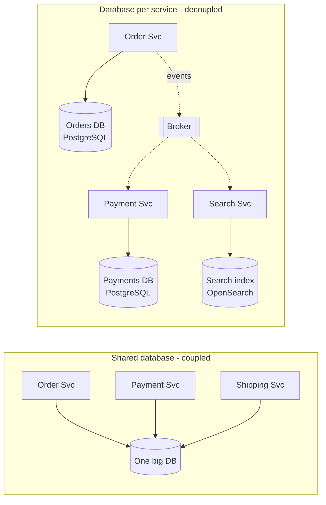
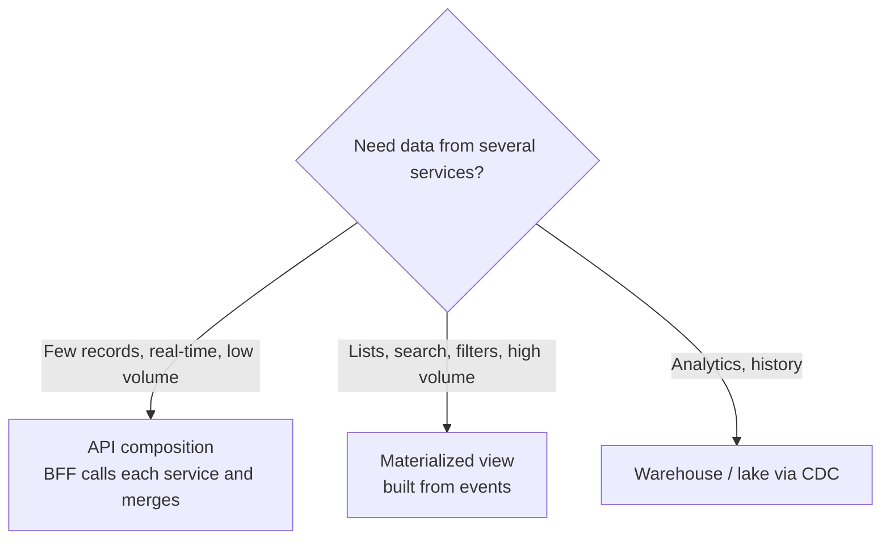

# 2.4 Database per Service

[← TCC](03-try-confirm-cancel.md) · [Index](../README.md) · Next: [Event Sourcing, CQRS & Materialized Views →](05-event-sourcing-cqrs-materialized-views.md)

> **In one line:** each service is the only reader and writer of its own data store; everyone
> else goes through its API or its events.

---

## 1. Problem

With a shared database, services are coupled through tables: one team's schema change breaks
another team's queries, one service's slow query starves the others, and nobody can deploy or
scale independently.

## 2. Mechanism

"Database per service" is about **ownership**, not hardware. The isolation level is a choice:

| Level | Isolation | Cost | Use when |
|---|---|---|---|
| Private **tables** in a shared schema | Convention only | Lowest | Never for long; migration step only |
| Private **schema** per service, shared server | Enforced by DB grants | Low | Small teams, early stage |
| Private **database server** per service | Full: resources, failure, version | Highest | Independent scaling, different engines, strict compliance |

## 3. What You Give Up — and the Pattern That Replaces It

| Lost capability | Replacement |
|---|---|
| Cross-service ACID transaction | [Saga](02-saga-pattern.md) / [TCC](03-try-confirm-cancel.md) |
| Atomic "save and notify" | [Transactional Outbox](01-transactional-outbox.md) |
| Cross-service `JOIN` | [Materialized View / CQRS](05-event-sourcing-cqrs-materialized-views.md), or API composition in a [BFF](../05-performance-api-coordination/02-backend-for-frontend.md) |
| Foreign keys across services | Store the other service's ID as a plain value; validate via events; tolerate dangling references |
| One consistent backup | Per-service backups + idempotent event replay to reconcile |
| Ad-hoc reporting over everything | Stream events/CDC into a warehouse or lake |

### Querying across services

## 4. Failure Modes

| Failure | Mitigation |
|---|---|
| Someone "just reads" another service's tables | Separate credentials per service; DB grants deny it; review network policy |
| Dangling reference (customer deleted, order remains) | Soft-delete + `CustomerDeleted` event; consumers decide what to do |
| Replicated copy is stale | Show freshness; fall back to owner API for critical reads |
| N+1 API composition | Batch endpoints; materialized view |
| Schema change breaks consumers | Version the **event/API contract**, not the tables; consumer-driven contract tests |

## 5. Security

- **One credential per service, least privilege.** Compromise of the Recommendation service
  must not grant `SELECT` on card tokens. This is one of the strongest security arguments for the pattern.
- **Network segmentation:** each database accepts connections only from its owning service.
- **Data minimisation in replicas:** when a service keeps a local copy of another's data,
  copy only the fields it needs. Every copy of PII is another place to protect and to erase.
- **Right to erasure:** a deletion must propagate (as an event) to every service holding a copy.
  Keep a data map of who stores what.
- **Per-service encryption keys** limit blast radius and enable crypto-shredding per domain.

## 6. Performance

- **Right engine for the job:** relational for orders, key-value for sessions, search index
  for catalogue, time-series for metrics.
- **Independent scaling:** scale the read-heavy catalogue DB without touching payments.
- **No noisy neighbours:** one service's table scan cannot exhaust another's connection pool
  (this is a [bulkhead](../04-resilience/03-bulkhead.md) at the data layer).
- **Cost:** more instances, more connection pools, more backups. Network calls replace
  in-database joins — budget latency for it.

## 7. Checklist

- [ ] Every table has exactly one owning service
- [ ] No service holds credentials to another service's store
- [ ] Cross-service reads use an API, a materialized view or the warehouse — never a direct query
- [ ] Cross-service writes use a saga/TCC with outbox events
- [ ] Event and API contracts are versioned and contract-tested
- [ ] Data map exists for PII copies; deletion events are handled everywhere

---

Next: [Event Sourcing, CQRS & Materialized Views →](05-event-sourcing-cqrs-materialized-views.md)
