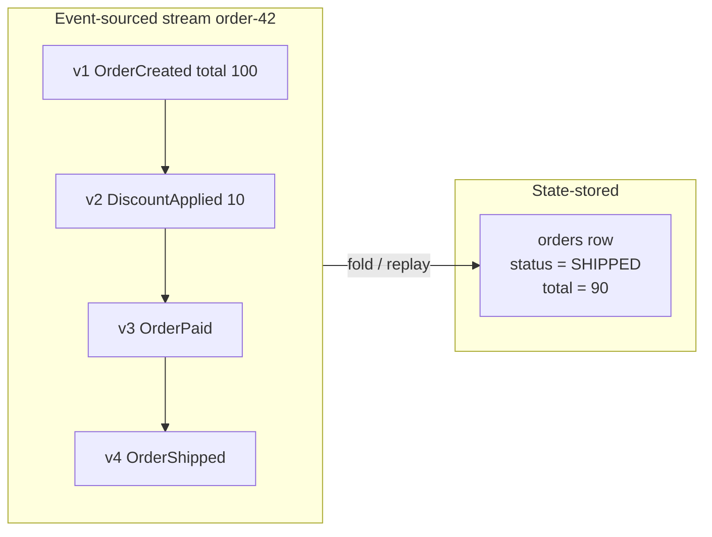
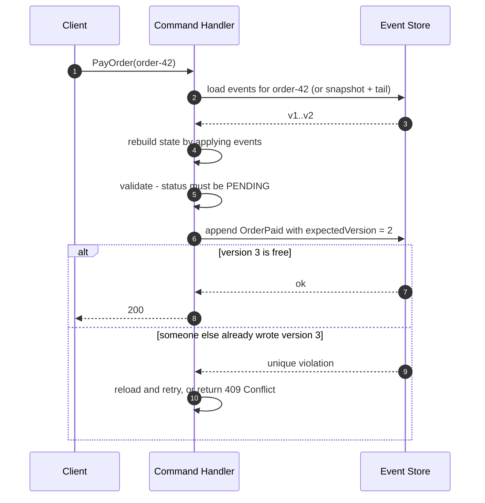
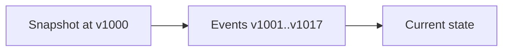
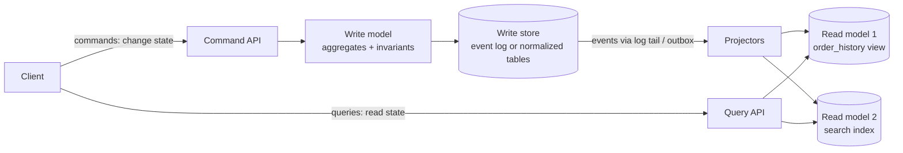
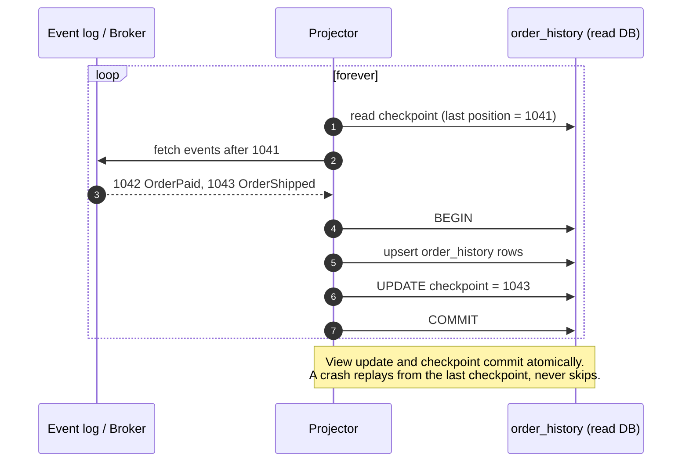
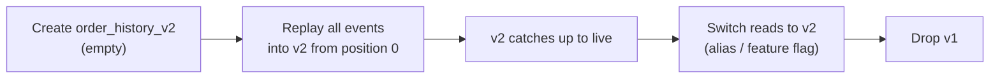

# 2.5 Event Sourcing, CQRS & Materialized Views

[← Database per Service](04-database-per-service.md) · [Index](../README.md) · Next: [Idempotent Consumer →](../03-messaging/01-idempotent-consumer.md)

Three patterns that are independent but fit together:

| Pattern | Idea | Can be used alone? |
|---|---|---|
| **Event Sourcing** | Store *what happened* (events), derive current state | Yes |
| **CQRS** | Separate the write model from the read model(s) | Yes |
| **Materialized View** | Precompute a denormalized table for a query | Yes |

Combined: commands append events → events feed projections → projections maintain
materialized views → queries read the views.

---

## 1. Problem

| Pain | Pattern that addresses it |
|---|---|
| "Why is this balance 40?" — current-state tables lose history | Event Sourcing |
| Audit/regulatory need for a tamper-evident trail | Event Sourcing |
| One model cannot be good at both validation and flexible queries | CQRS |
| "My Orders" needs data from Orders, Payments and Shipping | Materialized View |
| Read load is 100× write load | CQRS + Materialized View |

---

## 2. Event Sourcing

### State-stored vs event-sourced



Current state is a **left fold** over the events: `state = events.reduce(apply, initialState)`.

### Event store schema

```sql
CREATE TABLE events (
    global_seq  BIGINT GENERATED ALWAYS AS IDENTITY PRIMARY KEY,  -- read order for projections
    stream_id   TEXT        NOT NULL,                             -- 'order-42'
    version     INT         NOT NULL,                             -- 1, 2, 3 ... per stream
    event_type  TEXT        NOT NULL,
    payload     JSONB       NOT NULL,
    metadata    JSONB       NOT NULL DEFAULT '{}',                -- actor, traceId, causationId, schemaVersion
    occurred_at TIMESTAMPTZ NOT NULL DEFAULT now(),
    UNIQUE (stream_id, version)                                   -- optimistic concurrency guard
);

-- Append-only: the application role gets INSERT and SELECT, never UPDATE or DELETE.
REVOKE UPDATE, DELETE ON events FROM app_role;
```

### Command handling



```javascript
// --- Pure domain logic: no I/O, trivially unit-testable -------------------------------
const initial = { status: 'NONE', total: 0 };

function apply(state, event) {
  switch (event.type) {
    case 'OrderCreated':    return { status: 'PENDING', total: event.data.total };
    case 'DiscountApplied': return { ...state, total: state.total - event.data.amount };
    case 'OrderPaid':       return { ...state, status: 'PAID' };
    case 'OrderShipped':    return { ...state, status: 'SHIPPED' };
    default:                return state;                 // unknown events are ignored, not fatal
  }
}

function decidePay(state) {
  if (state.status === 'PAID') return [];                 // idempotent command: nothing new to record
  if (state.status !== 'PENDING') throw new Error(`Cannot pay order in status ${state.status}`);
  return [{ type: 'OrderPaid', data: {} }];
}

// --- Infrastructure --------------------------------------------------------------------
async function handlePayOrder(streamId, metadata) {
  const { rows } = await db.query(
    'SELECT event_type AS type, payload AS data, version FROM events WHERE stream_id = $1 ORDER BY version',
    [streamId]
  );
  const state = rows.reduce(apply, initial);
  const expectedVersion = rows.length ? rows[rows.length - 1].version : 0;

  const newEvents = decidePay(state);
  let version = expectedVersion;
  await withTransaction(async (tx) => {
    for (const e of newEvents) {
      version += 1;
      // UNIQUE (stream_id, version) rejects the insert if a concurrent writer got there first.
      await tx.query(
        `INSERT INTO events (stream_id, version, event_type, payload, metadata)
         VALUES ($1, $2, $3, $4, $5)`,
        [streamId, version, e.type, e.data, metadata]
      );
    }
  });
}
```

Because the event store *is* a table in the service's database, appending an event is already
a single local transaction: an event-sourced service gets the
[outbox](01-transactional-outbox.md) guarantee for free — the event log is the outbox.

### Snapshots

Replaying 50,000 events for every command is slow. Periodically store the folded state.



- Snapshots are a **cache**, never the source of truth. You must be able to delete them all and rebuild.
- Take one every N events (for example 100–500) or when load time exceeds a budget.
- Store the snapshot's schema version; discard and rebuild when the `apply` logic changes.

### Schema evolution

Events are immutable and live forever, so their shape must evolve carefully.

| Technique | Use |
|---|---|
| Additive change with defaults | New optional field — old events still parse |
| **Upcasting** | Transform `OrderCreated v1` → `v2` at read time |
| New event type | Meaning changed — don't overload the old name |
| Copy-and-transform stream | Last resort for a badly modelled stream |

Never edit stored events to "fix" data. Append a correcting event (`OrderTotalCorrected`).

---

## 3. CQRS



| | Command side | Query side |
|---|---|---|
| Optimised for | Correctness, invariants | Speed, shape of the screen |
| Data shape | Normalized / event streams | Denormalized, one table per screen |
| Consistency | Strong within an aggregate | Eventually consistent with the write side |
| Scaling | Usually modest | Scale out with replicas/caches |
| Storage | One | As many as you have query patterns |

CQRS does **not** require event sourcing (you can project from CDC of normal tables), nor
separate databases (a read-optimised table in the same DB is the simplest form). Start small.

---

## 4. Materialized Views (Projections)

A projector is just an [idempotent consumer](../03-messaging/01-idempotent-consumer.md)
whose side effect is updating a read table.



```sql
CREATE TABLE order_history (              -- shaped exactly like the "My Orders" screen
    order_id        TEXT PRIMARY KEY,
    user_id         BIGINT NOT NULL,
    status          TEXT   NOT NULL,
    total           NUMERIC(12,2),
    payment_method  TEXT,                 -- from Payment events
    tracking_number TEXT,                 -- from Shipping events
    last_event_seq  BIGINT NOT NULL,      -- per-row guard against stale/out-of-order events
    updated_at      TIMESTAMPTZ NOT NULL
);
CREATE INDEX order_history_user_idx ON order_history (user_id, updated_at DESC);

CREATE TABLE projection_checkpoints (
    projection_name TEXT PRIMARY KEY,
    position        BIGINT NOT NULL
);
```

```javascript
async function projectBatch(events) {
  await withTransaction(async (tx) => {
    for (const e of events) {
      if (e.type === 'OrderShipped') {
        // last_event_seq guard: replays and reordered events cannot move the row backwards.
        await tx.query(
          `UPDATE order_history
              SET status = 'SHIPPED', tracking_number = $2, last_event_seq = $3, updated_at = now()
            WHERE order_id = $1 AND last_event_seq < $3`,
          [e.data.orderId, e.data.trackingNumber, e.globalSeq]
        );
      }
      // ...other event types
    }
    await tx.query(
      `UPDATE projection_checkpoints SET position = $1 WHERE projection_name = 'order_history'`,
      [events[events.length - 1].globalSeq]
    );
  });
}
```

### Rebuilding a view

The superpower of event-driven read models: a new or broken view is rebuilt by replaying.



### Handling eventual consistency in the UI

The view lags the write by milliseconds to seconds. A user who pays and is immediately shown
"unpaid" will pay again.

| Technique | How |
|---|---|
| **Return the result from the command** | The command response contains the new state; the UI doesn't re-query |
| **Read-your-writes token** | Command returns the event position; query waits until the view's checkpoint ≥ that position (with a timeout) |
| **Optimistic UI** | Client shows the expected state and reconciles later |
| **Read from the write side** for that one screen | Fall back when freshness is mandatory |
| **Show freshness** | "Updated 3 s ago" for dashboards |

### Other ways to build a materialized view

| Mechanism | Freshness | Notes |
|---|---|---|
| Event-driven projector (this chapter) | Near real time | Works across services |
| CDC from normal tables | Near real time | No event sourcing needed |
| Database `MATERIALIZED VIEW` + `REFRESH` | Periodic | Single database only; refresh can be heavy |
| Scheduled batch job | Minutes–hours | Simplest; fine for reporting |

---

## 5. When *Not* to Event-Source

Event sourcing has real cost. Prefer plain state + outbox when:

- The domain is simple CRUD with no audit or temporal requirements.
- The team is new to eventual consistency.
- You need ad-hoc queries over current state and do not want to maintain projections.
- Data must be hard-deleted routinely (possible, but needs crypto-shredding — below).

Apply it **per aggregate/bounded context** (ledger, order lifecycle), not system-wide.

---

## 6. Failure Modes

| Failure | Handling |
|---|---|
| Concurrent commands on one stream | `UNIQUE (stream_id, version)` → reload and retry, or 409 |
| Projector crashes mid-batch | Transaction rolls back view + checkpoint together; replay |
| Projector processes an event twice | `last_event_seq` guard / upsert makes it a no-op |
| Projector bug corrupts the view | Fix code, rebuild the view from position 0 |
| Poison event stalls a projector | Park it ([DLQ](../03-messaging/03-dead-letter-queues.md)), alert, continue *only if* later events don't depend on it |
| Projector reads by `global_seq` and misses a late-committing lower number | Read with a small safety lag, or tail the WAL/CDC for true commit order (same caveat as the [outbox poller](01-transactional-outbox.md#5c-which-relay)) |
| Unbounded stream length | Snapshots; close and roll over long-lived streams (e.g. one stream per account-month) |
| Event schema change breaks old events | Upcasters + replay test over production-shaped history in CI |

## 7. Security

| Concern | Control |
|---|---|
| **Immutability vs right to erasure (GDPR)** | **Crypto-shredding**: encrypt personal fields with a per-subject key; delete the key to make the data unreadable. Or keep PII in a separate mutable store and reference it by ID from events |
| Tampering with history | No `UPDATE`/`DELETE` grant; optionally hash-chain events (each stores the hash of the previous) and anchor checkpoints externally |
| Sensitive data spreads to every projection | Project only needed fields; apply the same access control to read models as to the source |
| Read model bypasses authorization | Query API enforces tenant/user filters; add row-level security on view tables |
| Forged events | Only the owning service's role can `INSERT`; record authenticated actor in `metadata` |
| Replay re-triggers side effects (emails, payments) | Projectors that cause external effects must be idempotent and must be *disabled or dry-run during rebuilds* |
| Secrets in events | Never. Events are forever and widely replicated |

## 8. Performance

- **Writes are cheap:** append-only inserts, no in-place updates, minimal lock contention.
- **Command latency** is dominated by stream load → use snapshots; keep aggregates small
  (one order, not one customer's whole history).
- **Reads are O(1)** against a view shaped for the screen — no joins, no cross-service calls.
- **Projection throughput:** batch events per transaction; partition projectors by stream key
  to parallelise while keeping per-aggregate order.
- **Rebuild time** grows with history. Measure it; keep it within your recovery objective;
  parallelise by partition; consider snapshotting views.
- **Storage:** events grow forever. Tier old partitions to cheaper storage; compress JSON.
- **Combine with [Cache-Aside](../05-performance-api-coordination/01-cache-aside.md)** in front
  of read models for hot keys.

## 9. Observability

| Metric | Alert when |
|---|---|
| **Projection lag** = head position − checkpoint (events and seconds) | Above freshness SLO |
| Concurrency conflicts per stream | Sustained rate → aggregate too coarse or a hot key |
| Stream load time p99 / events per stream | Rising → snapshot threshold needed |
| Rebuild duration (tested regularly) | Exceeds recovery objective |
| Parked/poison events | > 0 |

## 10. Checklist

- [ ] Event names are past-tense business facts (`OrderPaid`), not CRUD (`OrderUpdated`)
- [ ] `apply` is pure and ignores unknown event types
- [ ] Appends use an expected-version check
- [ ] Event store role cannot update or delete
- [ ] Every projector is idempotent and commits view + checkpoint atomically
- [ ] Views can be rebuilt from zero, and you have actually done it
- [ ] Projection lag is monitored; UI has a read-your-writes strategy
- [ ] PII strategy (crypto-shredding or external reference) decided before the first event is stored
- [ ] Upcasters and replay are tested in CI

---

Next: [Idempotent Consumer →](../03-messaging/01-idempotent-consumer.md)
