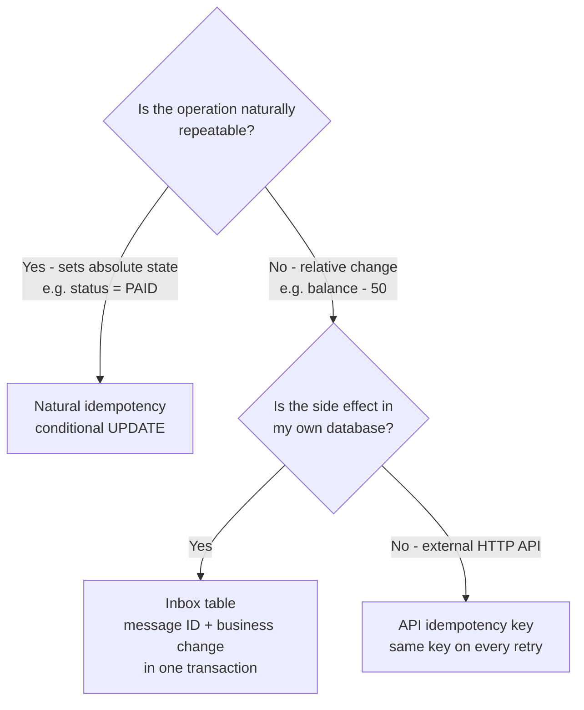
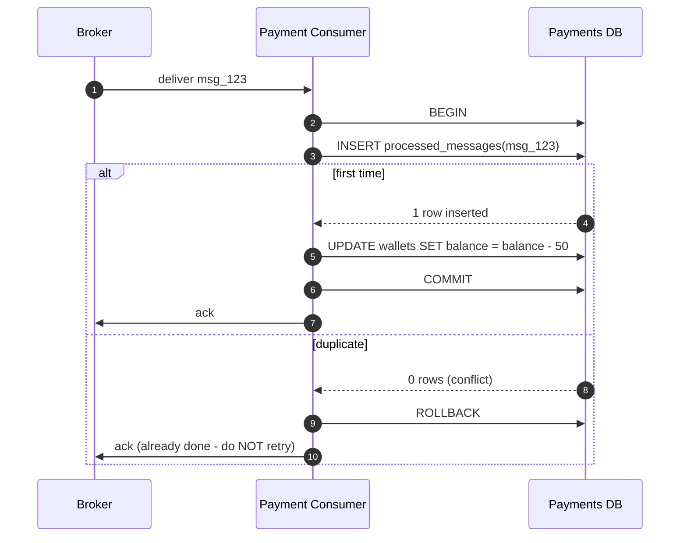
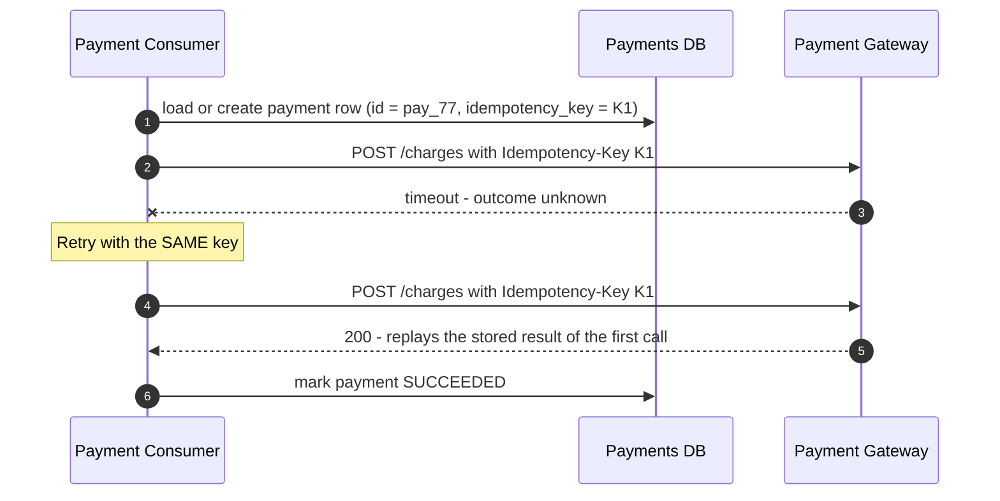
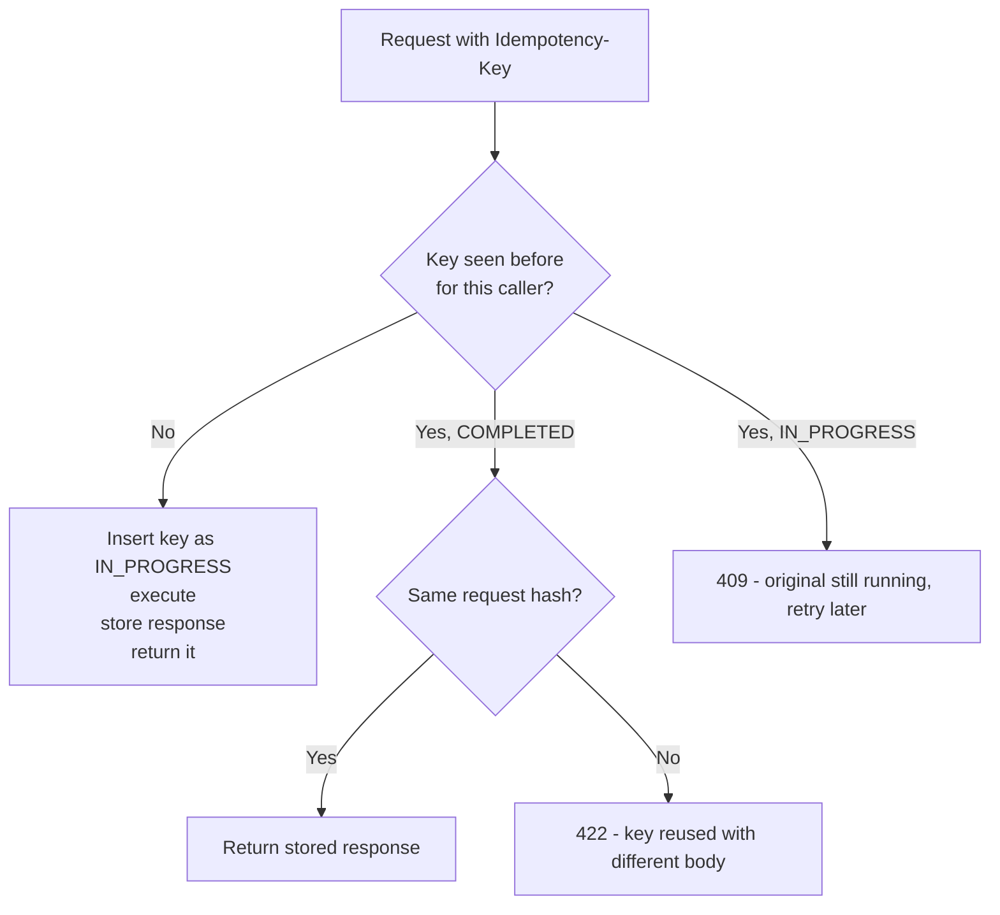

# 3.1 Idempotent Consumer

[← Event Sourcing & CQRS](../02-data-consistency/05-event-sourcing-cqrs-materialized-views.md) · [Index](../README.md) · Next: [Competing Consumers →](02-competing-consumers.md)

> **In one line:** give every message a unique ID and record it in the **same transaction** as
> the business change, so a redelivered message changes nothing.

---

## 1. Problem

Brokers and the [outbox relay](../02-data-consistency/01-transactional-outbox.md) deliver
**at least once**. Retries, lost acks, consumer rebalances and replays all produce duplicates.
Without protection: double charges, double emails, double stock decrements.

## 2. Three Strategies



| Strategy | Best used when… | Pros | Cons |
|---|---|---|---|
| **Inbox table (event ID)** | Non-repeatable math (`balance - 50`, `points + 10`) inside your DB | Works for any DB operation; effect applied exactly once | Extra table; periodic cleanup |
| **Natural idempotency** | Status transitions, overwriting fields | No extra storage; fastest | Not usable for relative increments/decrements |
| **API idempotency key** | Calling external gateways over HTTP (e.g. Stripe) | Provider stores the first result and replays it | Must persist and reuse the same client-generated key across retries; provider retention is finite |

> **Precision on "exactly-once":** the inbox guarantees exactly-once *for effects written in
> the same database transaction*. It cannot make an email send or an HTTP call atomic with
> your commit. For external effects, combine the inbox with a provider idempotency key (below).

---

## 3. Inbox Table

The mirror image of the outbox.



```sql
CREATE TABLE processed_messages (
    consumer     TEXT        NOT NULL,          -- several handlers may consume the same message
    message_id   TEXT        NOT NULL,
    processed_at TIMESTAMPTZ NOT NULL DEFAULT now(),
    PRIMARY KEY (consumer, message_id)
);
```

```javascript
async function handlePaymentEvent(event) {
  const client = await db.connect();
  try {
    await client.query('BEGIN');

    // ON CONFLICT DO NOTHING: a duplicate is a normal outcome, not an exception.
    const inbox = await client.query(
      `INSERT INTO processed_messages (consumer, message_id)
       VALUES ('payment-debit', $1)
       ON CONFLICT DO NOTHING`,
      [event.messageId]
    );
    if (inbox.rowCount === 0) {
      await client.query('ROLLBACK');
      metrics.increment('consumer_duplicates_total');
      return;                                   // caller acks the message
    }

    const res = await client.query(
      'UPDATE wallets SET balance = balance - $1 WHERE user_id = $2 AND balance >= $1',
      [event.amount, event.userId]
    );
    if (res.rowCount === 0) throw new PermanentError('Insufficient funds or unknown wallet');

    await client.query('COMMIT');               // message record + debit commit together
  } catch (error) {
    await client.query('ROLLBACK');
    throw error;                                // transient → broker retries; permanent → DLQ
  } finally {
    client.release();
  }
}
```

> **Notes on the original snippet** — catching Postgres error `23505` (unique violation) also
> works and is a common idiom. `ON CONFLICT DO NOTHING` is slightly safer: a `23505` can also
> come from a *different* unique constraint touched by the business logic, which would then be
> silently swallowed as "duplicate message". If you keep the exception approach, check
> `error.constraint` as well as `error.code`.

### Cleanup

The table grows forever unless pruned. Delete rows older than the **longest possible
redelivery window** (broker retention + max retry schedule + DLQ replay horizon), for example
7–30 days. Partition by day to make cleanup a cheap `DROP PARTITION`.

---

## 4. Natural Idempotency

Design the operation so repeating it is harmless.

```sql
-- Absolute state instead of relative math: running this ten times leaves the same row.
UPDATE orders SET status = 'PAID' WHERE id = 10;

-- Conditional update (optimistic locking): first run updates 1 row, duplicates update 0.
UPDATE orders
   SET status = 'PAID', version = 2
 WHERE id = 10 AND status = 'PENDING' AND version = 1;

-- Upsert keyed by business identity.
INSERT INTO shipments (order_id, carrier) VALUES (10, 'DHL')
ON CONFLICT (order_id) DO NOTHING;
```

| Naturally idempotent | Not idempotent |
|---|---|
| `SET status = 'PAID'` | `SET balance = balance - 50` |
| `INSERT ... ON CONFLICT DO NOTHING` | Plain `INSERT` |
| `DELETE WHERE id = 10` | `INSERT INTO audit_log` |
| `PUT /users/7` | `POST /payments` |
| "Set quantity to 3" | "Add 1 to quantity" |

Conditional updates also protect against **out-of-order** delivery: a late `OrderPaid`
arriving after `OrderCancelled` updates zero rows instead of resurrecting the order.

---

## 5. API Idempotency Keys (External Calls)



Rules:

1. **Generate the key once and persist it** before the first call (derive it from the message
   ID or store a UUID on the payment row). A fresh key per retry defeats the purpose.
2. **Same key ⇒ same request body.** Providers reject or misbehave on mismatches.
3. Keys expire at the provider (commonly on the order of a day). For retries beyond that
   window, query the provider for the original charge first.

### Implementing the server side

If *you* are the API, store `(caller, key) → request hash, status, response`:



---

## 6. Sagas and TCC: Ordering Edge Cases

Deduplication handles *the same message twice*. Sagas and TCC also face *different messages
in the wrong order*:

| Case | Guard |
|---|---|
| **Empty compensation** — Cancel arrives before Try | Record the transaction as `CANCELLED` anyway (tombstone) |
| **Late Try** after Cancel | Try sees the tombstone and refuses |
| **Hanging reservation** — Try with no Confirm/Cancel | TTL + background reaper |

Full treatment with code: [TCC edge cases](../02-data-consistency/03-try-confirm-cancel.md#5-the-three-edge-cases).

---

## 7. Failure Modes

| Failure | Result |
|---|---|
| Crash after business update, before commit | Whole transaction rolls back; redelivery processes normally |
| Crash after commit, before ack | Redelivery hits the inbox row → skipped |
| Two workers get the same message concurrently | Second `INSERT` blocks on the first's row lock, then sees the conflict → skipped |
| Inbox pruned too early | An old replay is processed again → size retention to the replay horizon |
| Producer assigns a new ID on its retry | Dedup fails silently → ID must be assigned once at the source (outbox row ID) |
| Handler has an external side effect + DB write | Use provider idempotency key; write "intent" row first, call, then mark done |

## 8. Security

- **Scope keys by caller.** Store `(tenant, key)`, never a global key, or one tenant can read
  another's cached response by guessing keys or block their requests by pre-registering them.
- **Validate the request hash** on replay; otherwise a key can be reused to replay a response
  for a different, unauthorised request body.
- **Don't trust message IDs from untrusted producers** for dedup of valuable operations; an
  attacker who can publish could *suppress* a legitimate message by sending its ID first.
  Authenticate producers (broker ACLs, signed messages).
- **Stored responses may contain sensitive data** — apply the same encryption, retention and
  access rules as the primary data.
- **Deduplication is not replay protection for auth.** A valid old message replayed after the
  inbox is pruned will be processed. Include timestamps/expiry in security-sensitive commands.

## 9. Performance

- **Inbox cost:** one primary-key insert per message in a transaction you already have —
  typically well under a millisecond. Keep the key narrow; use `(consumer, message_id)`.
- **Natural idempotency is free** — prefer it wherever the operation allows.
- **Batch consumers:** insert all IDs with one multi-row `INSERT ... ON CONFLICT DO NOTHING
  RETURNING message_id` and process only the returned ones.
- **Don't use a cache as the only dedup store** for money. A Redis `SET NX` check is not atomic
  with your database commit: a crash between the two either loses the message or duplicates it.
  A cache is fine as a *fast pre-filter* in front of the transactional check.
- **Index bloat:** time-partition the inbox so pruning is a metadata operation.

## 10. Observability

| Metric | Meaning |
|---|---|
| `consumer_duplicates_total` | Normal at a low rate; a spike means upstream retry storm or rebalance loop |
| Processing latency, by handler | Slow handlers cause redelivery (visibility timeout) → more duplicates |
| Inbox table size / oldest row | Cleanup job health |
| Zero-row conditional updates | Out-of-order or stale messages |

## 11. Checklist

- [ ] Every message carries an ID assigned **once** by the producer
- [ ] Dedup record and business change commit in one transaction
- [ ] Duplicate → ack, not retry, not DLQ
- [ ] External calls use a persisted idempotency key
- [ ] Inbox retention ≥ maximum redelivery/replay window
- [ ] Handlers tolerate out-of-order delivery (conditional updates / version checks)
- [ ] Keys are scoped per tenant/caller

---

Next: [Competing Consumers →](02-competing-consumers.md)
