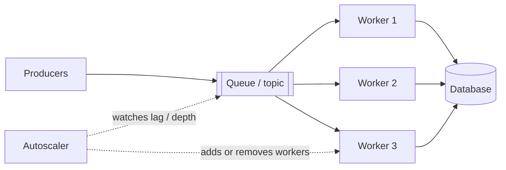
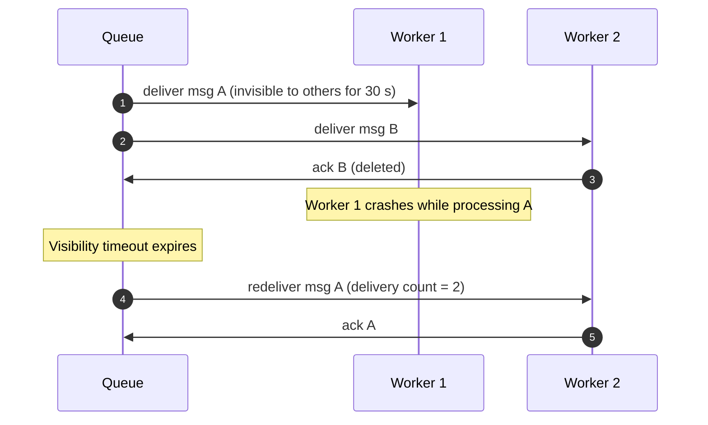
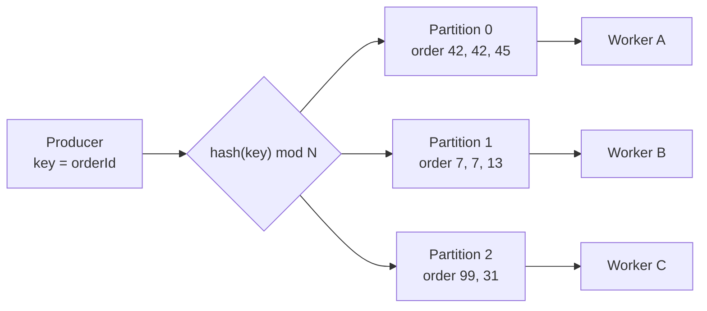

# 3.2 Competing Consumers

[← Idempotent Consumer](01-idempotent-consumer.md) · [Index](../README.md) · Next: [Dead-Letter Queues →](03-dead-letter-queues.md)

> **In one line:** attach several worker instances to one queue so messages are processed in
> parallel and the pool can scale with the backlog.

---

## 1. Problem

A single consumer caps throughput at `1 / processing time` and is a single point of failure.
During a traffic spike the queue grows faster than it drains.

## 2. Mechanism



Each message goes to **one** worker in the group. Two broker families implement this differently:

| | Queue brokers (RabbitMQ, SQS, Azure Service Bus) | Log brokers (Kafka, Event Hubs, Pulsar partitioned topics) |
|---|---|---|
| Unit of distribution | Individual message | Partition |
| Max useful workers | Unlimited | **= number of partitions** per consumer group |
| Ordering | None by default (FIFO/session features opt-in) | Guaranteed within a partition |
| Ack model | Per message, with visibility timeout / lock | Commit offset per partition |
| Slow message effect | Only that worker is busy | Blocks everything behind it in the partition |
| Redelivery | Broker redelivers after timeout / nack | Consumer re-reads from last committed offset |

### Message lifecycle (queue broker)



---

## 3. Ordering vs Parallelism

Parallel workers destroy global ordering. Decide what ordering you actually need.

| Need | Technique |
|---|---|
| No ordering | Plain competing consumers |
| Order **per entity** (all events for order 42 in sequence) | Partition key = entity ID (Kafka key, SQS FIFO message group, Service Bus session) |
| Global order | Single partition, single consumer — accept the throughput ceiling |
| Tolerate disorder | Version/sequence number in the message + conditional update ([natural idempotency](01-idempotent-consumer.md#4-natural-idempotency)) |



---

## 4. Worker Skeleton

```javascript
async function runWorker({ queue, handler, concurrency = 10, shutdownSignal }) {
  const inFlight = new Set();

  while (!shutdownSignal.aborted) {
    // Backpressure: never pull more than we can process.
    if (inFlight.size >= concurrency) { await Promise.race(inFlight); continue; }

    const msg = await queue.receive({ waitSeconds: 20 });       // long poll
    if (!msg) continue;

    const task = (async () => {
      try {
        await withTimeout(handler(msg), 25_000);                // must be < visibility timeout
        await queue.ack(msg);
      } catch (err) {
        if (err instanceof PermanentError) await queue.deadLetter(msg, err.message);
        else await queue.nack(msg, { delaySeconds: backoff(msg.deliveryCount) });
      }
    })().finally(() => inFlight.delete(task));
    inFlight.add(task);
  }

  await Promise.allSettled(inFlight);                           // graceful drain on SIGTERM
}
```

Essentials shown: bounded concurrency, handler timeout shorter than the visibility timeout,
ack **after** success, permanent vs transient classification, graceful shutdown.

---

## 5. Failure Modes

| Failure | Effect | Mitigation |
|---|---|---|
| Worker dies mid-message | Redelivery to another worker | [Idempotent handler](01-idempotent-consumer.md) |
| Handler slower than visibility timeout | Message delivered to a second worker **while the first is still running** | Timeout < visibility; extend the lock (heartbeat) for long jobs |
| Poison message | Retried forever, wastes capacity (blocks the partition on Kafka) | Max delivery count → [DLQ](03-dead-letter-queues.md) |
| Rebalance storm (Kafka) | Consumers repeatedly lose partitions; duplicates; no progress | Tune session/poll timeouts; cooperative rebalancing; static membership |
| Hot partition | One worker saturated, others idle | Better key choice; more partitions; split the hot tenant |
| More workers than the DB can take | Downstream collapses | Cap concurrency; [bulkhead](../04-resilience/03-bulkhead.md) on the DB pool |
| Scale-in kills in-flight work | Redeliveries, wasted work | Handle `SIGTERM`: stop pulling, finish, ack, exit |
| Prefetch too high | One worker hoards messages while others starve | Lower prefetch / `max.poll.records` |

## 6. Security

- **Least-privilege broker credentials:** consumers get *consume* on their queue only;
  producers get *publish* only. A compromised worker should not be able to read other queues
  or publish forged commands.
- **Authenticate and authorize every connection** (TLS + SASL/mTLS/IAM). Queues inside the
  "trusted network" are a classic lateral-movement path.
- **Treat message content as untrusted input:** validate schema, size and tenant before
  acting. Deserialization of attacker-controlled payloads is a remote-code-execution vector in
  some formats — use data-only formats (JSON, Avro, Protobuf) with strict schemas.
- **Tenant isolation:** do not let one tenant's backlog starve others — per-tenant queues or
  weighted fair consumption — and never mix tenants' data in a worker's in-memory state.
- **Encrypt payloads at rest** in the broker; keep secrets out of messages.
- **Workers run with the union of all permissions the handlers need** — split high-privilege
  handlers (refunds, payouts) into their own worker pool with their own identity.

## 7. Performance

- **Capacity formula:** `workers needed ≈ arrival rate × mean processing time / target utilisation`.
  Example: 200 msg/s × 50 ms ÷ 0.7 ≈ 15 concurrent handlers.
- **Scale on lag, not CPU.** I/O-bound consumers can be backlogged at 10% CPU. Use queue depth,
  consumer lag or — best — *age of the oldest message*.
- **Batch** receives, acks and DB writes; one round-trip per message is the usual bottleneck.
- **Long polling** instead of tight polling loops (cost and latency).
- **Kafka:** partitions cap parallelism — provision more partitions than you need today
  (increasing later reshuffles keys and breaks per-key ordering for in-flight data).
- **The slowest dependency sets the ceiling.** Adding workers beyond what the database or
  downstream API can absorb only moves the queue somewhere worse.
- **Prefetch** trades throughput for fairness; small for slow/uneven jobs, larger for fast uniform ones.

## 8. Observability

| Metric | Alert when |
|---|---|
| Queue depth / consumer lag | Growing for N minutes |
| **Age of oldest message** | Exceeds processing SLO |
| Processing time p50/p99 per handler | p99 approaches visibility timeout |
| Redelivery rate | Above baseline |
| Rebalances per hour (Kafka) | Frequent |
| Active workers vs desired | Autoscaler pinned at max |
| DLQ arrival rate | > 0 (see next chapter) |

## 9. Checklist

- [ ] Handlers are idempotent
- [ ] Ack only after successful processing
- [ ] Handler timeout < visibility/lock timeout (or lock is renewed)
- [ ] Concurrency per worker is bounded
- [ ] Ordering requirement is explicit; partition key chosen accordingly
- [ ] Max delivery count and DLQ configured
- [ ] Graceful shutdown drains in-flight messages
- [ ] Autoscaling is driven by lag or message age

---

Next: [Dead-Letter Queues →](03-dead-letter-queues.md)
