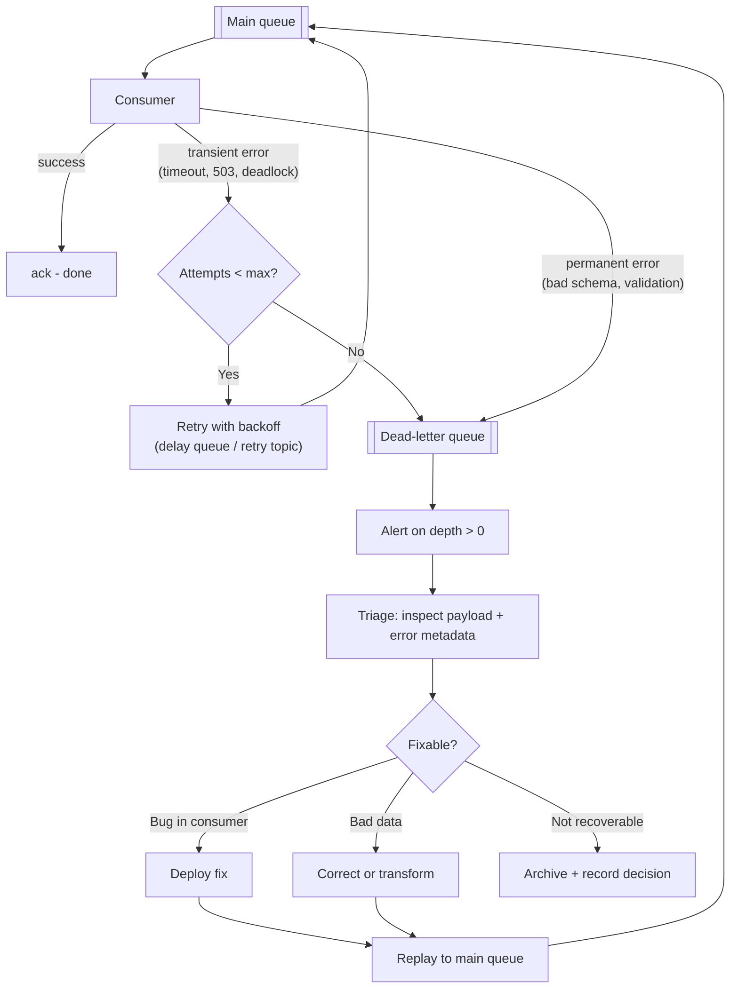
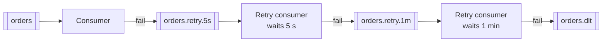
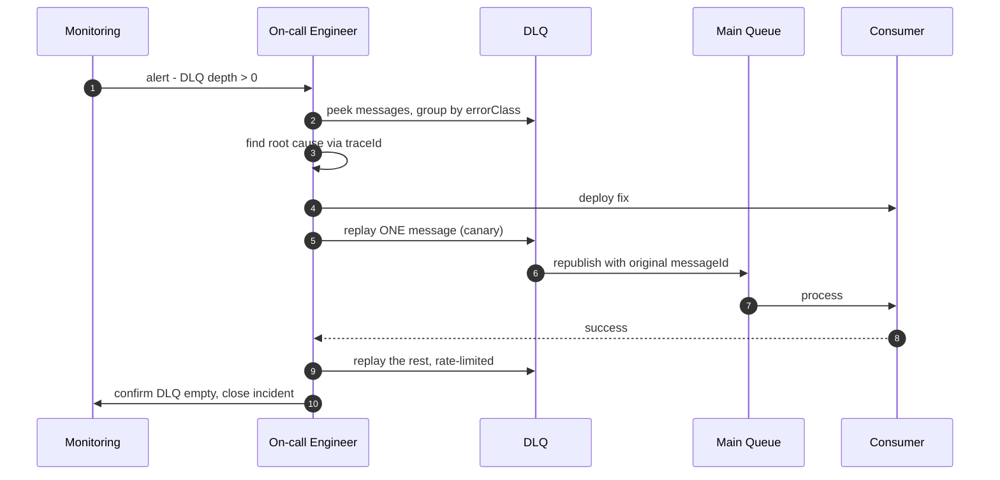

# 3.3 Dead-Letter Queues (DLQ)

[← Competing Consumers](02-competing-consumers.md) · [Index](../README.md) · Next: [Retry with Backoff →](../04-resilience/01-retry-backoff-jitter.md)

> **In one line:** after a message has failed too many times, move it aside so healthy traffic
> keeps flowing, then inspect, fix and replay it.

---

## 1. Problem

A **poison message** can never succeed — malformed JSON, a schema the consumer doesn't know,
a reference to a deleted account. Retrying it forever wastes capacity and, on an ordered
stream, blocks every message behind it.

## 2. Mechanism



### How brokers implement it

| Broker | Mechanism |
|---|---|
| **AWS SQS** | Native: redrive policy with `maxReceiveCount`; built-in redrive back to source |
| **RabbitMQ** | Native: dead-letter exchange (DLX) on reject/expiry/length limit; quorum queues add a delivery limit |
| **Azure Service Bus** | Native: `MaxDeliveryCount`; every queue has a `$DeadLetterQueue` sub-queue |
| **Kafka** | **Not native.** Kafka has no per-message delivery count. The *consumer application* (or Kafka Connect, Spring Kafka, etc.) publishes failed records to a dead-letter **topic** and commits the offset |

> **Correction to the reading notes:** Kafka itself does not track delivery attempts or move
> messages to a DLQ. On Kafka, the DLQ is a convention implemented in client code/framework.

### Non-blocking retries on Kafka (retry topics)

Because a failed record blocks its partition, retries are done by re-publishing to delay topics:



Trade-off: the failed message is now processed **out of order** relative to later messages for
the same key. If strict per-key order matters, either block the partition (and alert fast) or
park *all subsequent messages for that key* too.

---

## 3. Classify Errors First

Sending everything through the full retry schedule delays detection and wastes capacity.

| Class | Examples | Action |
|---|---|---|
| **Transient** | Timeout, 503, connection reset, DB deadlock, rate-limited | Retry with [backoff + jitter](../04-resilience/01-retry-backoff-jitter.md) |
| **Permanent** | Deserialization failure, schema validation, unknown enum, 400/422 from downstream | Straight to DLQ — retrying cannot help |
| **Business rejection** | Insufficient funds, out of stock | **Not** a DLQ case — handle in the domain (emit `PaymentDeclined`) |
| **Dependency down** | [Circuit breaker](../04-resilience/02-circuit-breaker.md) open | Pause consumption; do not flood the DLQ with healthy messages |

That last row matters: a 20-minute outage of a downstream service should **not** dead-letter
20 minutes of valid orders. Pause the consumer while the breaker is open.

---

## 4. What to Put in a Dead Letter

Wrap the original, unmodified message with diagnostic metadata:

```json
{
  "originalTopic": "orders.events",
  "originalPartition": 3,
  "originalOffset": 918273,
  "originalKey": "order-42",
  "messageId": "0b8f6c1e-...",
  "payloadBase64": "eyJvcmRlcklkIjo0Miw...",
  "headers": { "traceId": "4bf92f35...", "schemaVersion": "3" },
  "failure": {
    "consumer": "payment-worker",
    "consumerVersion": "2.14.1",
    "errorClass": "SchemaValidationError",
    "errorMessage": "Unknown field 'currencyCode'",
    "attempts": 3,
    "firstFailedAt": "2026-11-13T09:14:02Z",
    "lastFailedAt": "2026-11-13T09:14:39Z"
  }
}
```

Keep the original bytes — re-serialising may hide the very defect you are investigating.
Keep stack traces in logs (linked by `traceId`), not in the message.

---

## 5. Recovery Workflow



Replay rules:

1. **Preserve the original message ID** so [idempotent consumers](01-idempotent-consumer.md)
   don't double-apply anything that partially succeeded.
2. **Canary first**, then replay **rate-limited** — a bulk redrive is a self-inflicted
   [thundering herd](../04-resilience/05-thundering-herd.md).
3. **Check staleness.** Replaying a three-day-old `ReserveStock` may be wrong; some messages
   should be discarded or converted into a compensating action instead.
4. **Record who replayed/discarded what and why** (audit).

---

## 6. Failure Modes

| Failure | Mitigation |
|---|---|
| DLQ that nobody watches ("message graveyard") | Alert on depth > 0 and on age; assign an owner per DLQ |
| Outage floods the DLQ with good messages | Classify errors; pause consumer when breaker is open |
| DLQ retention expires before triage | Retention ≥ worst-case response time; archive to object storage |
| Replay causes duplicates | Idempotent consumers; preserve message ID |
| Replay loop (message fails again → DLQ → auto-replay) | No automatic infinite redrive; cap replay count in a header |
| Dead-lettering breaks per-key ordering | Decide explicitly: block, or park the whole key |
| Publishing to the DLQ itself fails | Do not ack the original; retry; alert |

## 7. Security

- **A DLQ is a copy of production data** — often the *least* protected copy. Apply the same
  encryption, retention and access controls as the source queue.
- **Restrict who can read and replay.** Replay is effectively "inject messages into
  production". Require authorization, log every replay, consider two-person approval for
  financial flows.
- **Scrub error metadata.** Exception messages and stack traces can leak connection strings,
  SQL and PII. Sanitise before attaching.
- **Malicious poison messages:** an attacker who can publish may craft payloads that crash
  consumers (oversized, deeply nested, decompression bombs). Enforce size and depth limits at
  the edge; a sudden DLQ spike from one producer is a security signal.
- **Retention and erasure:** personal data in DLQs and their archives is in scope for deletion
  requests.

## 8. Performance

- **Retry budget = detection delay.** 5 retries with exponential backoff to 5 minutes means a
  permanent failure takes > 10 minutes to reach the DLQ and alert. Send known-permanent
  errors there immediately.
- **In-place retries hold a worker slot** (and block a Kafka partition). Prefer delayed
  redelivery / retry topics for waits beyond a second or two.
- **Rate-limit replays** to protect downstream systems.
- **DLQ consumers are rarely on the hot path** — optimise for inspectability, not throughput.

## 9. Observability

| Metric | Alert |
|---|---|
| **DLQ depth** | **> 0** for critical flows (ticket for low-priority ones) |
| DLQ arrival rate | Spike → bad deploy or upstream contract change |
| Age of oldest dead letter | > triage SLA |
| Breakdown by `errorClass` / `consumerVersion` / producer | Points straight at the cause |
| Replay success ratio | < 100% → fix is incomplete |

Useful correlation: DLQ spike immediately after a deploy ⇒ roll back first, investigate second.

## 10. Checklist

- [ ] Every consumer has a max attempt count and a DLQ destination
- [ ] Errors are classified transient / permanent / business
- [ ] Business rejections produce domain events, not dead letters
- [ ] Dead letters carry original bytes + failure metadata + trace ID
- [ ] Depth and age alerts exist, with a named owner
- [ ] A tested, rate-limited, audited replay tool exists
- [ ] DLQ access and retention match the source queue's data classification
- [ ] Consumers pause instead of dead-lettering during dependency outages

---

Next: [Retry with Backoff →](../04-resilience/01-retry-backoff-jitter.md)
