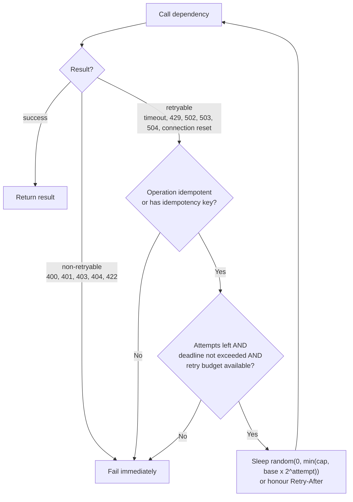
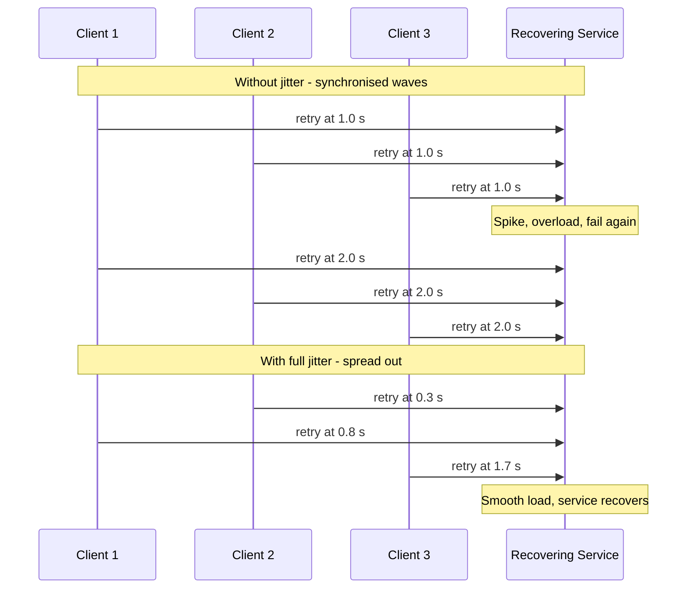

# 4.1 Retry with Exponential Backoff and Jitter

[← Dead-Letter Queues](../03-messaging/03-dead-letter-queues.md) · [Index](../README.md) · Next: [Circuit Breaker →](02-circuit-breaker.md)

> **In one line:** retry transient failures, wait exponentially longer each time, and
> randomise the wait so clients do not retry in lockstep.

---

## 1. Problem

Networks drop packets, leaders fail over, pods restart. Many failures disappear if you simply
try again. But naive retries are dangerous:

- **Immediate retries** hammer a struggling service exactly when it is weakest.
- **Fixed-delay retries** from many clients arrive in synchronised waves.
- **Retrying non-idempotent calls** duplicates side effects.
- **Retrying at every layer** multiplies load.

## 2. Mechanism



### Why jitter



| Strategy | Delay before attempt *n* (base `b`, cap `c`) | Notes |
|---|---|---|
| Fixed | `b` | Synchronised waves |
| Exponential | `min(c, b · 2ⁿ)` | Still synchronised across clients |
| **Full jitter** | `random(0, min(c, b · 2ⁿ))` | Best spread; recommended default |
| Equal jitter | `d/2 + random(0, d/2)` where `d = min(c, b · 2ⁿ)` | Guarantees a minimum wait |
| Decorrelated jitter | `min(c, random(b, previous · 3))` | Good spread without tracking attempt count |

---

## 3. Code

```javascript
const RETRYABLE_STATUS = new Set([408, 429, 500, 502, 503, 504]);

async function retry(operation, {
  maxAttempts = 4,          // 1 initial + 3 retries
  baseDelayMs = 200,
  maxDelayMs = 10_000,
  deadlineMs = 15_000,      // total time budget for all attempts
  isRetryable = (err) => err.isTimeout || err.isNetworkError || RETRYABLE_STATUS.has(err.status),
  signal,                   // AbortSignal from the caller
} = {}) {
  const deadline = Date.now() + deadlineMs;

  for (let attempt = 0; ; attempt += 1) {
    try {
      return await operation({ attempt, signal });
    } catch (err) {
      const lastAttempt = attempt >= maxAttempts - 1;
      if (lastAttempt || !isRetryable(err) || signal?.aborted) throw err;

      // Server-provided hint wins over our own schedule.
      const hinted = err.retryAfterMs;
      const exponential = Math.min(maxDelayMs, baseDelayMs * 2 ** attempt);
      const delay = hinted ?? Math.random() * exponential;            // full jitter

      if (Date.now() + delay > deadline) throw err;                   // no point waiting past the deadline
      metrics.increment('retries_total', { operation: operation.name, attempt: attempt + 1 });
      await sleep(delay, signal);
    }
  }
}

// Usage: the SAME idempotency key is sent on every attempt.
const key = crypto.randomUUID();
await retry(() => gateway.charge({ amount: 50, idempotencyKey: key }));
```

---

## 4. Retry Amplification

Retries at every layer multiply. Three layers each making 3 attempts turn one user request
into up to 27 calls on the bottom service — precisely when it is already failing.


| Control | How it limits amplification |
|---|---|
| **Retry at one layer only** | Usually the layer closest to the failure, or the outermost — not both |
| **Retry budget** | Allow retries only up to e.g. 10% of recent request volume per client; beyond that, fail fast |
| **Deadline propagation** | Pass the remaining time budget downstream (`grpc-timeout`, a deadline header); stop when it is spent |
| **Circuit breaker** | Stops retries entirely when the dependency is clearly down → [next chapter](02-circuit-breaker.md) |
| **Honour `Retry-After` / 429** | Let the server shape client behaviour |

---

## 5. What to Retry

| Outcome | Retry? | Why |
|---|---|---|
| Connection refused / reset, DNS failure | Yes | Request likely never processed |
| Timeout | Yes, **if idempotent** | Outcome unknown — the call may have succeeded |
| 429 Too Many Requests | Yes, after `Retry-After` | Explicit back-pressure |
| 502 / 503 / 504 | Yes | Transient infrastructure |
| 500 | Sometimes | May be a deterministic bug — cap attempts low |
| 400 / 422 | **No** | Request is wrong; it will be wrong again |
| 401 / 403 | **No** (refresh the token once, at most) | Retrying is noise — and looks like credential stuffing |
| 404 | No (unless read-after-write lag is expected) | |
| 409 Conflict | Reload state, then decide | Optimistic-lock conflicts need a fresh read |
| Business rejection (card declined) | **No** | Not a technical failure |

---

## 6. Failure Modes

| Failure | Mitigation |
|---|---|
| Retry storm / thundering herd | Jitter, budgets, breaker — see [Thundering Herd](05-thundering-herd.md) |
| Duplicate side effects | Idempotency keys; [idempotent consumers](../03-messaging/01-idempotent-consumer.md) |
| User waits through all retries | Overall deadline; return a fallback or 503 quickly |
| Retries hide a real problem | Emit retry metrics; alert on retry ratio |
| Long in-process sleeps hold threads/connections | For waits > a few seconds, re-queue with a delay instead of sleeping |
| Retrying a request whose body stream is already consumed | Buffer the body or rebuild the request per attempt |

## 7. Security

- **Retries amplify attacks.** An attacker who makes your backend slow gets free multiplication
  from your own retry logic. Budgets and breakers are DoS defences, not just reliability features.
- **Never auto-retry authentication failures.** Repeated 401s can lock out accounts and look
  like brute force. Refresh the token once; then stop.
- **Idempotency keys are security-relevant:** a retried payment without one is a double charge.
- **Don't log full request bodies on each retry** — you multiply the exposure of secrets/PII in logs.
- **Respect upstream 429s.** Ignoring them gets your client IP/API key blocked.
- **Jitter needs no cryptographic randomness**, but do not derive it from predictable
  client-controlled values that an attacker could align.

## 8. Performance

- **Tail latency:** worst-case latency ≈ `Σ(timeouts) + Σ(delays)`. With a 2 s timeout and 4
  attempts you may hold a request for > 8 s. Set per-attempt timeouts from the dependency's
  p99, not from a round number.
- **Hedged requests** (send a second attempt after the p95 latency, take the first reply) cut
  tail latency for *idempotent reads* at the cost of a few percent extra load. Never hedge writes.
- **Load added by retries** ≈ `error rate × retries`. At 50% errors with 3 retries you add up
  to 150% load to a service that is already failing.
- **Connection reuse:** retry on a fresh connection if the failure was at connection level.

## 9. Observability

| Metric | Alert when |
|---|---|
| `retries_total` by operation and attempt | Retry ratio (retries / requests) > 10% |
| Requests exhausting all attempts | Any sustained rate |
| Retry budget exhausted events | Indicates systemic failure, not blips |
| Latency split: first-attempt vs with-retries | Retries dominating p99 |

Tag spans with the attempt number so traces show retries as siblings, not as one slow call.

## 10. Checklist

- [ ] Only retryable errors are retried; 4xx (except 408/429) fail fast
- [ ] Operation is idempotent or carries an idempotency key
- [ ] Exponential backoff **with jitter** and a delay cap
- [ ] Max attempts **and** an overall deadline
- [ ] Retries happen at one layer, or a retry budget is enforced
- [ ] `Retry-After` is honoured
- [ ] Retry counts are exported as metrics
- [ ] Wrapped by a circuit breaker for sustained failures

---

Next: [Circuit Breaker →](02-circuit-breaker.md)
