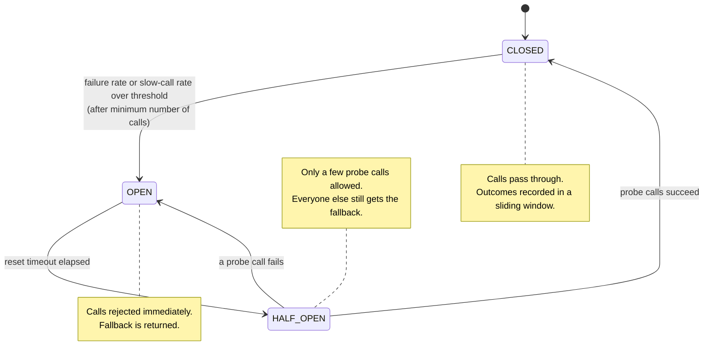
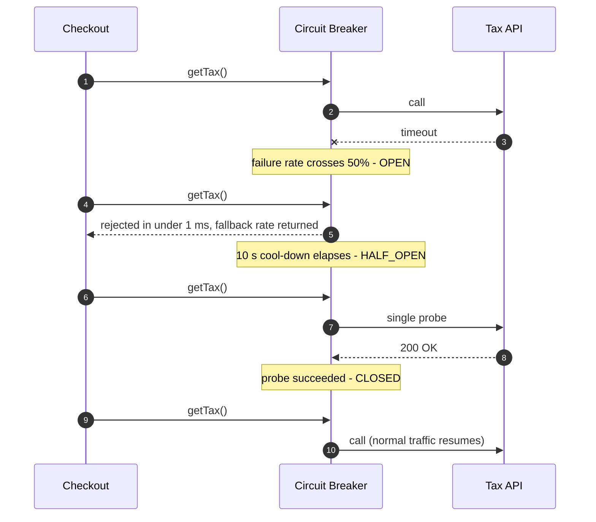
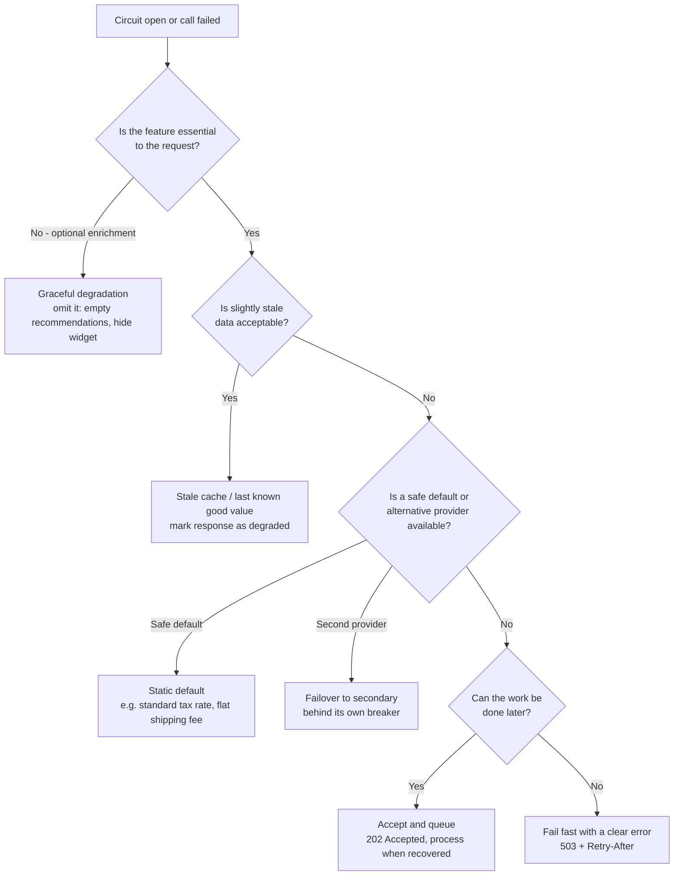
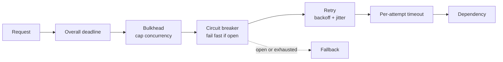
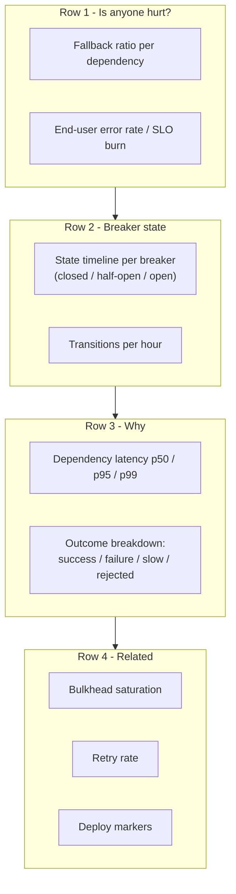

# 4.2 Circuit Breaker — States, Fallbacks, Monitoring

[← Retry](01-retry-backoff-jitter.md) · [Index](../README.md) · Next: [Bulkhead →](03-bulkhead.md)

> **In one line:** when a dependency keeps failing, stop calling it and fail fast; probe
> occasionally to see whether it has recovered.

---

## 1. Problem

A dependency that is *down* fails quickly. A dependency that is *slow* is far worse: every
caller waits for its timeout, holding a thread, a connection and memory. Callers back up, their
callers back up, and one sick service takes down the chain — a **cascading failure**.

Retries make this worse. A circuit breaker makes the caller give up early.

## 2. State Machine



| State | Behaviour | Leaves when |
|---|---|---|
| **CLOSED** | Normal traffic; record success/failure/slow | Failure rate ≥ threshold over the window |
| **OPEN** | Reject instantly without calling | Cool-down timer expires |
| **HALF_OPEN** | Let a small number of probes through | Probes succeed → CLOSED; any fails → OPEN |

### Sequence



---

## 3. Code

### 3a. Minimal version (from the reading notes)

```javascript
class CircuitBreaker {
  constructor(action, { failureThreshold = 3, resetTimeoutMs = 5000 } = {}) {
    this.action = action;
    this.failureThreshold = failureThreshold;
    this.resetTimeoutMs = resetTimeoutMs;
    this.state = 'CLOSED';
    this.failureCount = 0;
    this.nextAttemptTime = Date.now();
  }

  async execute(...args) {
    if (this.state === 'OPEN') {
      if (Date.now() < this.nextAttemptTime) {
        throw new Error('Circuit is OPEN: Failing fast to protect system');
      }
      this.state = 'HALF_OPEN';
    }
    try {
      const result = await this.action(...args);
      this.onSuccess();
      return result;
    } catch (error) {
      this.onFailure();
      throw error;
    }
  }

  onSuccess() { this.failureCount = 0; this.state = 'CLOSED'; }

  onFailure() {
    this.failureCount += 1;
    if (this.failureCount >= this.failureThreshold || this.state === 'HALF_OPEN') {
      this.state = 'OPEN';
      this.nextAttemptTime = Date.now() + this.resetTimeoutMs;
    }
  }
}
```

> **Notes on the original snippet** — good for learning the three states; gaps for production:
>
> | Gap | Consequence | Fix |
> |---|---|---|
> | HALF_OPEN lets **every** concurrent caller through | The "single probe" becomes a stampede on a recovering service | Count in-flight probes; reject the rest |
> | Consecutive-failure counter | 1 success among 99 failures resets it; never trips under partial failure | Sliding-window **failure rate** with a minimum call count |
> | No timeout around `action` | A hung call never counts as a failure | Wrap with a timeout; also count **slow** calls |
> | All errors count | A burst of 400/404s (caller's fault) opens the circuit | `isFailure(err)` predicate |
> | No fallback, no events | Callers get raw errors; nobody knows it opened | Fallback hook + state-change events → metrics |

### 3b. Production-shaped version

```javascript
const { EventEmitter } = require('node:events');

class CircuitOpenError extends Error {}

class CircuitBreaker extends EventEmitter {
  constructor(name, action, {
    windowSize = 20,              // evaluate the last N calls
    minimumCalls = 10,            // do not judge on tiny samples
    failureRateThreshold = 0.5,   // open at >= 50% failures (or slow calls)
    slowCallMs = 2000,            // a success slower than this counts as "slow"
    timeoutMs = 3000,             // hard per-call timeout
    resetTimeoutMs = 10_000,      // OPEN → HALF_OPEN cool-down
    halfOpenMaxCalls = 3,         // concurrent probes allowed in HALF_OPEN
    isFailure = (err) => !(err.status >= 400 && err.status < 500),   // 4xx = caller's problem
    fallback = null,              // (error, ...args) => value
  } = {}) {
    super();
    Object.assign(this, { name, action, windowSize, minimumCalls, failureRateThreshold,
      slowCallMs, timeoutMs, resetTimeoutMs, halfOpenMaxCalls, isFailure, fallback });
    this.state = 'CLOSED';
    this.window = [];             // ring of booleans: true = bad outcome
    this.openedAt = 0;
    this.halfOpenInFlight = 0;
    this.halfOpenSuccesses = 0;
  }

  async execute(...args) {
    if (this.state === 'OPEN') {
      if (Date.now() - this.openedAt < this.resetTimeoutMs) return this.#reject(args);
      this.#transition('HALF_OPEN');
    }
    if (this.state === 'HALF_OPEN') {
      if (this.halfOpenInFlight >= this.halfOpenMaxCalls) return this.#reject(args);
      this.halfOpenInFlight += 1;
    }

    const wasProbe = this.state === 'HALF_OPEN';
    const started = Date.now();
    try {
      const result = await withTimeout(this.action(...args), this.timeoutMs);
      this.#record(Date.now() - started > this.slowCallMs, wasProbe);
      return result;
    } catch (err) {
      if (!this.isFailure(err)) {                         // e.g. 404/422: dependency is healthy,
        this.#record(false, wasProbe);                    // the caller's request was the problem
        throw err;
      }
      this.#record(true, wasProbe);
      if (this.fallback) { this.emit('fallback', { name: this.name, reason: 'error' }); return this.fallback(err, ...args); }
      throw err;
    } finally {
      if (wasProbe) this.halfOpenInFlight -= 1;
    }
  }

  #record(bad, wasProbe) {
    this.emit(bad ? 'failure' : 'success', { name: this.name });
    if (wasProbe && this.state === 'HALF_OPEN') {
      if (bad) return this.#transition('OPEN');
      this.halfOpenSuccesses += 1;
      if (this.halfOpenSuccesses >= this.halfOpenMaxCalls) this.#transition('CLOSED');
      return;
    }
    if (this.state !== 'CLOSED') return;
    this.window.push(bad);
    if (this.window.length > this.windowSize) this.window.shift();
    if (this.window.length >= this.minimumCalls) {
      const rate = this.window.filter(Boolean).length / this.window.length;
      if (rate >= this.failureRateThreshold) this.#transition('OPEN');
    }
  }

  #transition(next) {
    const previous = this.state;
    this.state = next;
    if (next === 'OPEN') this.openedAt = Date.now();
    if (next === 'HALF_OPEN') { this.halfOpenInFlight = 0; this.halfOpenSuccesses = 0; }
    if (next === 'CLOSED') this.window = [];
    this.emit('stateChange', { name: this.name, from: previous, to: next });
  }

  #reject(args) {
    this.emit('rejected', { name: this.name });
    const err = new CircuitOpenError(`Circuit '${this.name}' is open`);
    if (this.fallback) { this.emit('fallback', { name: this.name, reason: 'open' }); return this.fallback(err, ...args); }
    throw err;
  }
}
```

In real services use a maintained library — **Resilience4j** (Java), **Polly** (.NET),
**Opossum** (Node.js) — or push the breaker into the service mesh (Envoy/Istio outlier
detection). The mechanics are the same as above.

---

## 4. Fallback Strategies

An open circuit answers *"don't call"*. The fallback answers *"what do we return instead?"*.
It is a **product decision**, not just a technical one.



| Strategy | Example | Watch out for |
|---|---|---|
| **Graceful degradation** | Product page without recommendations | UI must render cleanly without the piece |
| **Stale cache** | Last known exchange rate, cached catalogue | Bound the staleness; show "as of" if it matters |
| **Static default** | Default tax rate, standard delivery estimate | Financial/legal correctness — reconcile afterwards |
| **Alternative provider** | Secondary payment processor or SMS gateway | Needs its own breaker and capacity; consistency between providers |
| **Queue for later** | Accept the order, charge the card when the gateway returns | Must be idempotent; tell the user it is pending |
| **Fail fast** | "Payments are temporarily unavailable" | Correct choice when a wrong answer is worse than no answer |

### Wiring a fallback

```javascript
const taxBreaker = new CircuitBreaker('tax-api', callExternalTaxApi, {
  failureRateThreshold: 0.5,
  resetTimeoutMs: 10_000,
  fallback: async (err, order) => {
    const cached = await cache.get(`tax-rate:${order.region}`);       // 1. stale cache
    if (cached) return { ...cached, degraded: true, source: 'cache' };
    return { rate: DEFAULT_TAX_RATE[order.region], degraded: true, source: 'default' };  // 2. safe default
  },
});

const tax = await taxBreaker.execute(order);
if (tax.degraded) order.flags.push('TAX_ESTIMATED');                  // reconcile later
```

### Fallback rules

1. **A fallback must not depend on the thing that failed** — or on anything that fails with it
   (same database, same region, same network path).
2. **Fallbacks must be cheap and local.** A fallback that makes a remote call needs its own
   timeout, breaker and bulkhead.
3. **Make degradation visible:** flag the response (`degraded: true`), count it in metrics,
   surface it to the user when it affects correctness.
4. **Never fall back silently on writes that matter.** Queue them or fail; do not pretend.
5. **Test the fallback path regularly** (fault injection) — untested fallbacks fail when needed.
6. **Security decisions fail closed** (see section 7).

---

## 5. Configuration Guide

| Setting | Guidance |
|---|---|
| **Granularity** | One breaker per dependency *and* per logical operation or host. One global breaker for "all HTTP" is useless. In a multi-tenant system consider per-tenant-per-dependency if one tenant's bad data causes the failures |
| **Window** | Count-based (last 20–100 calls) for steady traffic; time-based (last 10–60 s) for bursty |
| **Minimum calls** | 10–20. Prevents opening on 1 failure out of 2 calls at 3 a.m. |
| **Failure-rate threshold** | 50% is a common start; lower for critical paths with good fallbacks |
| **Slow-call threshold** | Just above the dependency's healthy p99. Slowness is the dangerous failure |
| **Per-call timeout** | Required. Without it a hung call is never counted |
| **Cool-down** | 5–60 s. Shorter than typical recovery ⇒ flapping; longer ⇒ slow recovery. Consider exponential increase on repeated re-opens |
| **Half-open probes** | 1–10. Require several successes before closing |
| **What counts as failure** | Timeouts, connection errors, 5xx, 429. **Not** 4xx validation errors |

### Composition order



- **Bulkhead outside the breaker:** even healthy-but-slow calls cannot exhaust shared resources.
- **Breaker outside retry** (as drawn): the breaker sees one outcome per *logical* call, and an
  open breaker stops retries immediately. The opposite order (retry outside breaker) is also
  used — then make sure `CircuitOpenError` is **non-retryable**.

---

## 6. Monitoring and Alerts

### What to emit

| Metric | Type | Labels | Purpose |
|---|---|---|---|
| `circuit_breaker_state` | gauge (0 closed, 1 half-open, 2 open) | `name` | Dashboard state timeline |
| `circuit_breaker_transitions_total` | counter | `name`, `from`, `to` | Detect opens and flapping |
| `circuit_breaker_calls_total` | counter | `name`, `outcome` = success / failure / slow / rejected | Failure rate, traffic lost |
| `circuit_breaker_call_duration_seconds` | histogram | `name` | Slow-call trend *before* it trips |
| `circuit_breaker_fallback_total` | counter | `name`, `reason`, `source` | How many users are getting degraded answers |

```javascript
function instrument(breaker) {
  const STATE = { CLOSED: 0, HALF_OPEN: 1, OPEN: 2 };
  breaker.on('stateChange', ({ name, from, to }) => {
    metrics.gauge('circuit_breaker_state', STATE[to], { name });
    metrics.increment('circuit_breaker_transitions_total', { name, from, to });
    log.warn({ event: 'circuit_state_change', breaker: name, from, to });   // structured, searchable
  });
  for (const outcome of ['success', 'failure', 'rejected'])
    breaker.on(outcome, ({ name }) => metrics.increment('circuit_breaker_calls_total', { name, outcome }));
  breaker.on('fallback', ({ name, reason }) => metrics.increment('circuit_breaker_fallback_total', { name, reason }));
}
```

### Alert rules (Prometheus syntax, using the metric names above)

```yaml
groups:
  - name: circuit-breakers
    rules:
      # 1. Sustained open circuit on a critical dependency → page.
      - alert: CircuitBreakerOpen
        expr: circuit_breaker_state{name=~"payment-gateway|order-db"} == 2
        for: 2m
        labels: { severity: page }
        annotations:
          summary: "Circuit {{ $labels.name }} has been OPEN for 2 minutes"
          runbook: "https://runbooks.example.com/circuit-breaker-open"

      # 2. Non-critical dependency open → ticket, not a page.
      - alert: CircuitBreakerOpenNonCritical
        expr: circuit_breaker_state{name!~"payment-gateway|order-db"} == 2
        for: 15m
        labels: { severity: ticket }

      # 3. Flapping: opening repeatedly means thresholds are wrong or recovery is partial.
      - alert: CircuitBreakerFlapping
        expr: increase(circuit_breaker_transitions_total{to="OPEN"}[15m]) > 4
        labels: { severity: ticket }

      # 4. Early warning: failure rate climbing but breaker not open yet.
      - alert: DependencyFailureRateHigh
        expr: |
          sum by (name) (rate(circuit_breaker_calls_total{outcome=~"failure|slow"}[5m]))
            /
          sum by (name) (rate(circuit_breaker_calls_total{outcome!="rejected"}[5m])) > 0.2
        for: 5m
        labels: { severity: ticket }

      # 5. User impact: a large share of requests is being served by fallbacks.
      - alert: HighFallbackRatio
        expr: |
          sum by (name) (rate(circuit_breaker_fallback_total[5m]))
            /
          sum by (name) (rate(circuit_breaker_calls_total[5m])) > 0.1
        for: 10m
        labels: { severity: page }

      # 6. Fleet-wide: many instances open the same breaker → the dependency is down, not one pod.
      - alert: CircuitOpenFleetWide
        expr: count by (name) (circuit_breaker_state == 2) / count by (name) (circuit_breaker_state) > 0.5
        for: 1m
        labels: { severity: page }
```

Library note: Resilience4j, Polly and Opossum all expose equivalent state, call-outcome and
duration metrics under their own names — map the rules above to whatever your library emits.

### Alert design principles

| Principle | Reason |
|---|---|
| Alert on **user impact** (fallback ratio, error ratio), not only on state | An open breaker with a perfect fallback may be a ticket, not a page |
| Use `for:` durations | A breaker that opens for 10 s and recovers did its job — don't wake anyone |
| Separate critical from optional dependencies | Recommendations down ≠ payments down |
| Alert on **flapping** | It signals mis-tuned thresholds or a half-recovered dependency |
| Aggregate across instances | Each pod has its own breaker; one pod open = that pod's network; half the fleet open = dependency down |
| Link a runbook | The alert should say what to check first |

### Dashboard layout



### Runbook: "Circuit X is open"

1. **Is the dependency actually down?** Check its own dashboard/status page.
2. **One instance or the fleet?** One → local network/pod problem; restart or drain it.
3. **What changed?** Deploy markers for both caller and dependency in the last 30 minutes.
4. **Is the fallback holding?** Check fallback ratio and user-facing error rate.
5. **Slow or failing?** Slow-call ratio high ⇒ dependency overloaded; check for a retry storm.
6. **After recovery:** confirm breaker closed, clear queued work at a controlled rate,
   reconcile anything served by default values.

Do **not** force the breaker closed while the dependency is unhealthy. Manual override
switches (force-open, force-closed) are useful but must be audited and time-limited.

---

## 7. Security

| Concern | Guidance |
|---|---|
| **Fail-closed for security decisions** | If the authorization, fraud-check or token-introspection service is unavailable, the fallback is **deny** (or a strictly limited mode), never "allow". A fallback of "assume OK" turns an outage into a bypass |
| **Attacker-induced opening** | If client-controlled input can cause failures that count toward the breaker (e.g. requests that make the dependency return 500), an attacker can open the circuit for everyone. Count only dependency-health failures; scope breakers per tenant where feasible; rate-limit first |
| **Stale-cache fallbacks and authorization** | Cached responses must be keyed by user/tenant; never serve one user's cached data to another during degradation. Revoked permissions must not be resurrected from a stale cache |
| **Information leakage** | Return a generic 503 to clients. Do not expose breaker names, internal hostnames or stack traces in error bodies |
| **Override switches** | Admin endpoints that force breaker state need authentication, authorization and audit logs |
| **Default-value fraud** | If the fallback is "default tax/shipping/price", make sure a user cannot benefit by deliberately triggering it; reconcile and flag such orders |
| **Queue-for-later** | Queued requests must keep the original user's identity and be re-authorized at processing time |

## 8. Performance

- **Open-circuit cost:** a state check and a rejection — microseconds, no I/O, no thread held.
  That is the point: compare with holding a thread for a 3 s timeout.
- **Closed-circuit overhead:** recording an outcome in a ring buffer; negligible next to a network call.
- **Timeout tuning dominates.** `threads held ≈ request rate × timeout` while a dependency
  hangs. At 200 req/s and a 3 s timeout that is 600 in-flight calls before the breaker opens.
  A tight timeout plus a [bulkhead](03-bulkhead.md) bounds this.
- **Recovery ramp:** closing instantly sends 100% of traffic to a service with cold caches.
  Prefer multiple successful probes, and ideally a gradual ramp (or rate limit) after closing.
- **Per-instance state** means each pod learns independently. That is usually fine and avoids
  a shared-state dependency; do not put breaker state in a remote store on the hot path.
- **Fallback capacity:** if the fallback is a cache or secondary provider, make sure it can
  absorb 100% of traffic, not the 5% it normally sees.

## 9. Failure Modes

| Failure | Mitigation |
|---|---|
| Never opens (threshold too lax, 4xx ignored but 5xx rare) | Include slow calls; review window/minimum |
| Opens on low traffic noise | Minimum-calls setting |
| Flapping open/closed | Longer cool-down, more probe successes, exponential cool-down |
| Half-open stampede | Limit concurrent probes |
| Breaker too coarse — one bad endpoint/tenant blocks all | Finer granularity |
| Fallback fails too | Independent fallback; fail fast as last resort |
| Open circuit dead-letters healthy messages | Pause the consumer instead — see [DLQ](../03-messaging/03-dead-letter-queues.md#3-classify-errors-first) |
| Thundering herd on close | Jitter + rate limit + bulkhead — see [Thundering Herd](05-thundering-herd.md) |

## 10. Checklist

- [ ] One breaker per dependency/operation, each with an explicit timeout
- [ ] Failure **rate** over a window with a minimum call count; slow calls included
- [ ] Client errors (4xx) do not count as failures
- [ ] HALF_OPEN allows a bounded number of probes
- [ ] Every breaker has a deliberate, tested fallback — or deliberately fails fast
- [ ] Security-relevant fallbacks fail closed
- [ ] State, transitions, outcomes and fallback counts are exported
- [ ] Alerts: sustained open (critical), flapping, fallback ratio, fleet-wide open
- [ ] Runbook exists and is linked from the alert
- [ ] Fault-injection test exercises open → half-open → closed

---

Next: [Bulkhead →](03-bulkhead.md) · Related: [Observability](../07-cross-cutting/03-observability-and-alerting.md)
