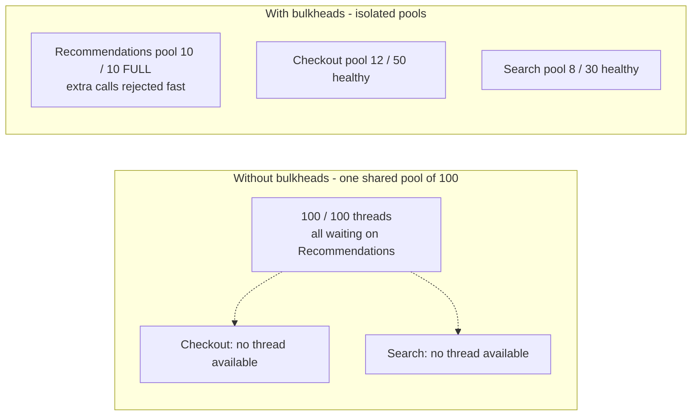
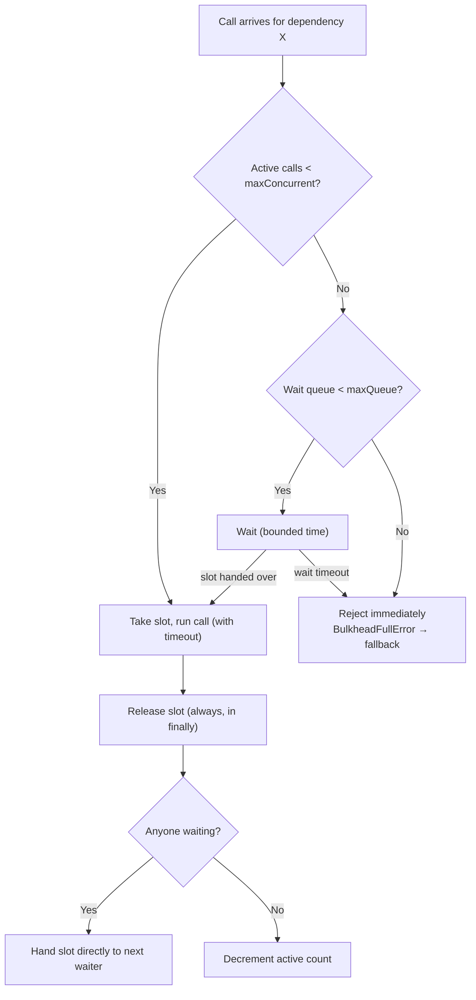

# 4.3 Bulkhead

[← Circuit Breaker](02-circuit-breaker.md) · [Index](../README.md) · Next: [Rate Limiting →](04-rate-limiting.md)

> **In one line:** give each dependency (or workload) its own bounded pool of resources so one
> that misbehaves cannot starve the others.

Named after the watertight compartments in a ship's hull: one flooded compartment does not sink the ship.

---

## 1. Problem

A web server has finite threads, sockets, DB connections and memory. If they are shared, a
single slow dependency — say a lagging Recommendation API — gradually captures all of them.
Checkout, which never calls Recommendations, stops responding too.



## 2. Bulkhead vs Transactional Outbox

The reading notes compare these two; they protect different layers and are complementary.

| | Transactional Outbox | Bulkhead |
|---|---|---|
| Layer | Data | Compute / resources |
| Protects against | Lost or phantom events (dual write) | Resource exhaustion from one slow dependency |
| Guarantee | Consistency: state change and event are atomic | Availability: failure stays in its compartment |
| Mechanism | Same-transaction `outbox` insert + async relay | Separate concurrency limits / pools per dependency |
| When it "fires" | On every write | Only under stress |

## 3. Types of Bulkhead

| Type | Isolates | Notes |
|---|---|---|
| **Semaphore** | Concurrent calls (a counter) | Cheap; caller's thread still does the work; needs timeouts to free slots |
| **Thread pool** | Threads + queue | Stronger isolation, can abandon a stuck call; costs context switches and memory |
| **Connection pool** per dependency | Sockets / DB connections | Separate pools for OLTP vs reporting queries |
| **Process / container / node pool** | CPU, memory, crash blast radius | Dedicated deployment for critical or risky workloads |
| **Per-tenant / per-priority** | One customer or traffic class | Stops a noisy neighbour; keeps paid/critical traffic alive |
| **Cell / shard** | Whole stack per customer group | A bad deploy or poison request hurts one cell only |

---

## 4. Flow



## 5. Code — Semaphore Bulkhead

### 5a. From the reading notes

```javascript
class Bulkhead {
  constructor(maxConcurrent, maxQueueSize = 0) {
    this.maxConcurrent = maxConcurrent;
    this.maxQueueSize = maxQueueSize;
    this.activeCount = 0;
    this.queue = [];
  }

  async execute(task) {
    if (this.activeCount >= this.maxConcurrent) {
      if (this.queue.length >= this.maxQueueSize) {
        throw new Error('Bulkhead capacity exceeded: Request rejected');
      }
      await new Promise((resolve) => this.queue.push(resolve));
    }
    this.activeCount += 1;
    try {
      return await task();
    } finally {
      this.activeCount -= 1;
      if (this.queue.length > 0) this.queue.shift()();
    }
  }
}
```

> **Notes on the original snippet**
>
> 1. **It can exceed `maxConcurrent`.** On release it decrements `activeCount` and *then* wakes
>    a waiter. The waiter resumes in a later microtask; if a new caller runs `execute()` in
>    between, it sees a free slot and takes it — then the woken waiter also increments. Fix:
>    **hand the slot over** without decrementing.
> 2. **Queued callers can wait forever.** There is no wait timeout.
> 3. **No timeout on the task.** A bulkhead bounds *how many* calls are stuck, not *how long*.
>    Without a timeout the pool fills permanently.
> 4. **No visibility.** Saturation and rejections are the key signals and are not exposed.

### 5b. Corrected

```javascript
class BulkheadFullError extends Error {}

class Bulkhead {
  constructor(name, { maxConcurrent, maxQueue = 0, maxWaitMs = 500 }) {
    Object.assign(this, { name, maxConcurrent, maxQueue, maxWaitMs });
    this.active = 0;
    this.waiters = [];            // FIFO of { grant, timer }
  }

  async execute(task) {
    await this.#acquire();
    try {
      return await task();        // task MUST enforce its own timeout
    } finally {
      this.#release();
    }
  }

  #acquire() {
    if (this.active < this.maxConcurrent) { this.active += 1; return Promise.resolve(); }
    if (this.waiters.length >= this.maxQueue) {
      metrics.increment('bulkhead_rejected_total', { name: this.name, reason: 'full' });
      return Promise.reject(new BulkheadFullError(`Bulkhead '${this.name}' is full`));
    }
    return new Promise((resolve, reject) => {
      const waiter = { grant: resolve };
      waiter.timer = setTimeout(() => {
        this.waiters.splice(this.waiters.indexOf(waiter), 1);
        metrics.increment('bulkhead_rejected_total', { name: this.name, reason: 'wait_timeout' });
        reject(new BulkheadFullError(`Bulkhead '${this.name}' wait timed out`));
      }, this.maxWaitMs);
      this.waiters.push(waiter);
    });
  }

  #release() {
    const next = this.waiters.shift();
    if (next) { clearTimeout(next.timer); next.grant(); }   // slot handed over: `active` unchanged
    else this.active -= 1;
  }

  get stats() { return { active: this.active, queued: this.waiters.length, max: this.maxConcurrent }; }
}

// Isolate pools so Recommendations cannot starve Checkout.
const checkoutBulkhead       = new Bulkhead('checkout',        { maxConcurrent: 50, maxQueue: 20, maxWaitMs: 300 });
const recommendationBulkhead = new Bulkhead('recommendations', { maxConcurrent: 10, maxQueue: 0 });   // fail fast
```

### 5c. Combined with a circuit breaker

```javascript
async function getRecommendations(userId) {
  try {
    return await recommendationBulkhead.execute(() =>      // 1. cap concurrency
      recommendationBreaker.execute(userId));              // 2. fail fast if dependency is down
  } catch (err) {
    if (err instanceof BulkheadFullError) return [];       // optional feature → degrade to empty
    throw err;
  }
}
```

1. The **bulkhead** caps how many calls can be waiting on the slow service.
2. When those calls start timing out, the **circuit breaker** opens, so new calls do not even
   wait for a timeout — they fail in well under a millisecond and take the fallback.

---

## 6. Sizing

Start from measurements, not round numbers.

| Quantity | Rule of thumb |
|---|---|
| **Concurrency needed** | `peak request rate × p99 latency` (Little's Law). 100 req/s × 0.2 s = 20 in flight; add headroom → ~30 |
| **Upper bound** | What the *dependency* can take: its connection limit ÷ number of caller instances |
| **Sum of all bulkheads** | ≤ what the host can serve concurrently (threads, sockets, memory) |
| **Queue length** | Small. `queue wait ≈ queue length × mean latency ÷ concurrency`; a long queue just converts rejections into timeouts |
| **Critical vs optional** | Critical: modest queue. Optional: `maxQueue = 0` — fail fast and degrade |

Static limits drift as systems change. Adaptive concurrency limiting (limits that shrink when
latency rises, in the style of TCP congestion control) removes most hand-tuning.

---

## 7. Failure Modes

| Failure | Mitigation |
|---|---|
| Limit too low → healthy traffic rejected | Size from peak × p99; alert on rejections during normal load |
| Limit too high → no protection | Sum of limits must fit host capacity |
| Slots leak (release not called) | Always release in `finally`; expose `active` as a gauge and watch for a rising floor |
| No task timeout → pool permanently full | Per-call timeout is mandatory |
| Long queue hides overload | Short queue + wait timeout |
| Bulkhead per instance, but dependency limit is global | `limit × instances ≤ dependency capacity`; revisit after autoscaling changes |
| Shared resource *behind* the bulkhead (same DB pool) | Isolate the underlying pools too, or the bulkhead is cosmetic |
| Everything in one bulkhead | Split by dependency and by criticality |

## 8. Security

- **Bulkheads are a DoS containment control.** An attacker who finds one expensive endpoint
  can otherwise exhaust the whole service. Put costly operations (report generation, search,
  export, file conversion) in their own small pools.
- **Per-tenant bulkheads** stop one customer — malicious or just buggy — from consuming all
  capacity. Without them, multi-tenant fairness is on the honour system.
- **Separate pools for authenticated vs anonymous traffic** so an unauthenticated flood cannot
  starve logged-in users, and so **login/health/admin endpoints stay reachable** during an attack.
- **Isolate untrusted work** (parsing uploads, rendering user content, running plugins) at the
  process/container level with CPU and memory limits — a semaphore does not contain a memory bomb.
- **Rejections must be generic** (`503`), without revealing pool names or sizes.
- **Bulkhead ≠ rate limit:** a bulkhead caps concurrency, not who uses it. A single abusive
  client can still take every slot — pair with [rate limiting](04-rate-limiting.md).

## 9. Performance

- **Semaphore:** near-zero overhead (a counter). Best default for async I/O runtimes.
- **Thread pool:** extra context switch and hand-off per call, plus memory per thread; buys the
  ability to time out and walk away from a blocking call. Use for blocking client libraries.
- **Utilisation trade-off:** partitioning capacity means idle slots in one pool cannot help a
  busy one. Isolation costs some efficiency — that is the deal.
- **Fail fast is fast:** a rejection costs microseconds; a queued request that later times out
  costs a full timeout of user latency plus the resources it held.
- **Watch for coordinated omission** in load tests: measure latency from intended send time,
  or queueing inside the bulkhead will be invisible.

## 10. Observability

| Metric | Alert when |
|---|---|
| `bulkhead_active` / `bulkhead_max` (saturation) | > 80% sustained |
| `bulkhead_queued` | > 0 sustained for fail-fast pools |
| `bulkhead_rejected_total` by reason | Any sustained rate on critical pools |
| Wait time in queue (histogram) | p99 approaching `maxWaitMs` |
| Active count floor over time | Rising without traffic → slot leak |

Saturation climbing *before* the circuit breaker opens is your earliest warning that a
dependency is slowing down.

## 11. Checklist

- [ ] Each remote dependency has its own concurrency limit
- [ ] Critical and optional workloads never share a pool
- [ ] Every call inside a bulkhead has a timeout
- [ ] Queues are short and waits are bounded
- [ ] Slots are released in `finally`; the slot is handed over, not re-raced
- [ ] Limits derived from peak rate × p99 and from the dependency's capacity
- [ ] Rejections have a defined fallback
- [ ] Saturation and rejection metrics are on a dashboard
- [ ] Underlying pools (DB, HTTP agent) are isolated too

---

Next: [Rate Limiting →](04-rate-limiting.md) · Related: [Thundering Herd](05-thundering-herd.md)
