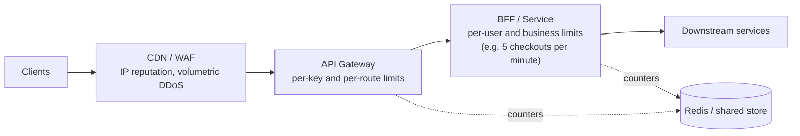
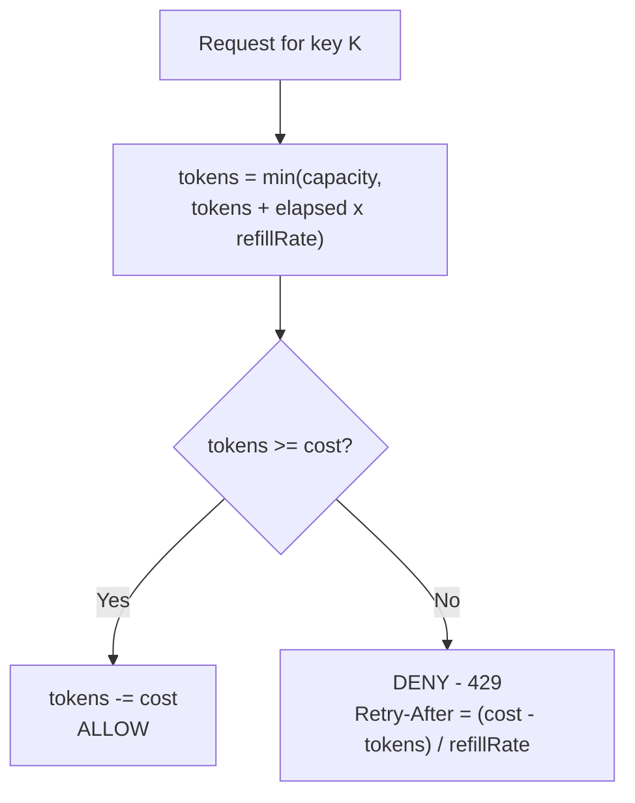
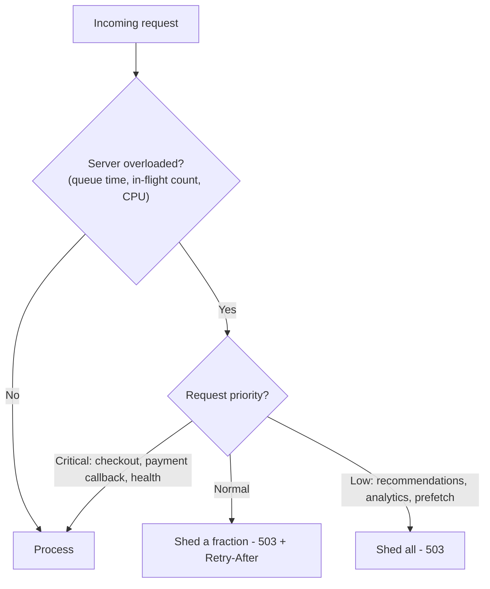

# 4.4 Rate Limiting and Load Shedding

[← Bulkhead](03-bulkhead.md) · [Index](../README.md) · Next: [Thundering Herd →](05-thundering-herd.md)

> **In one line:** cap how many requests each client may make per unit of time, and drop
> excess load at the edge before it reaches application logic.

---

## 1. Problem

Without limits, one client — a bot, a buggy retry loop, a misconfigured integration, an
attacker — can consume capacity that belongs to everyone ("noisy neighbour"), run up cost, or
brute-force credentials.

| | Rate limiting | Load shedding | Bulkhead |
|---|---|---|---|
| Question it answers | "Is *this client* over its quota?" | "Is *the server* overloaded right now?" | "Is *this dependency's pool* full?" |
| Keyed by | Client / API key / IP / tenant | Server health (queue time, CPU, concurrency) | Dependency |
| Response | `429 Too Many Requests` | `503 Service Unavailable` | `503` / fallback |

## 2. Where It Sits



Layer the limits: coarse and cheap at the edge, fine-grained and business-aware inside.

---

## 3. Algorithms

| Algorithm | How it works | Burst behaviour | Memory | Notes |
|---|---|---|---|---|
| **Fixed window** | Counter per key per window (e.g. per minute) | Up to 2× limit across a window boundary | Tiny | Simplest; boundary spike |
| **Sliding window log** | Store timestamp of every request | Exact | High (one entry per request) | Accurate but expensive |
| **Sliding window counter** | Weighted blend of current + previous window counters | Smooth approximation | Tiny | Good general default |
| **Token bucket** | Bucket refills at rate *r* up to capacity *b*; each request takes a token | Allows bursts up to *b* | Tiny | Most common for APIs |
| **Leaky bucket** | Queue drained at constant rate | Smooths bursts into steady output | Queue | Good for shaping outbound traffic |
| **Concurrency limit** | Cap in-flight requests per key | n/a | Tiny | Protects against slow, expensive requests |

### Token bucket



---

## 4. Code — Distributed Token Bucket (Redis + Lua)

Many gateway instances must share one counter, and the read-modify-write must be atomic.
A Lua script runs atomically inside Redis.

```lua
-- KEYS[1] = bucket key        ARGV[1] = capacity     ARGV[2] = refill tokens per second
-- ARGV[3] = now (ms)          ARGV[4] = cost
local capacity = tonumber(ARGV[1])
local rate     = tonumber(ARGV[2])
local now      = tonumber(ARGV[3])
local cost     = tonumber(ARGV[4])

local state  = redis.call('HMGET', KEYS[1], 'tokens', 'ts')
local tokens = tonumber(state[1]) or capacity
local ts     = tonumber(state[2]) or now

tokens = math.min(capacity, tokens + math.max(0, now - ts) / 1000 * rate)

local allowed = 0
if tokens >= cost then
  tokens = tokens - cost
  allowed = 1
end

redis.call('HSET', KEYS[1], 'tokens', tokens, 'ts', now)
redis.call('PEXPIRE', KEYS[1], math.ceil(capacity / rate * 1000) * 2)   -- idle buckets expire
return { allowed, math.floor(tokens) }
```

```javascript
async function rateLimit(req, res, next) {
  const key = `rl:${req.auth?.tenantId ?? 'anon:' + req.ip}:${req.route.path}`;
  const { capacity, refillPerSec } = limitsFor(req);          // plan-based limits

  let allowed, remaining;
  try {
    [allowed, remaining] = await redis.evalsha(SCRIPT_SHA, 1, key, capacity, refillPerSec, Date.now(), 1);
  } catch (err) {
    metrics.increment('rate_limiter_errors_total');
    return failOpenOrClosed(req, res, next);                  // see "Fail open or closed?" below
  }

  res.set('RateLimit-Limit', capacity);
  res.set('RateLimit-Remaining', remaining);
  if (!allowed) {
    res.set('Retry-After', Math.ceil(1 / refillPerSec));
    metrics.increment('rate_limited_total', { route: req.route.path });
    return res.status(429).json({ error: 'rate_limit_exceeded' });
  }
  next();
}
```

### Fail open or closed?

| Endpoint | Limiter store down → | Why |
|---|---|---|
| Normal read/write APIs | **Fail open** (allow), with a coarse local in-memory limit as backstop | Availability over strictness |
| Login, password reset, OTP verify, payment | **Fail closed** or fall back to a strict local limit | The limiter *is* the security control |

---

## 5. Load Shedding

Rate limiting is per client; load shedding protects the server when *total* demand exceeds capacity.



- Shed **early** (before parsing, auth and DB work) so rejected requests are nearly free.
- Shed by **priority**, not randomly: keep the money path alive.
- Prefer shedding on **queue time** ("this request already waited longer than its client's
  timeout — the client has gone") over raw CPU.
- Always send `Retry-After` and expect clients to back off with jitter.

---

## 6. Failure Modes

| Failure | Mitigation |
|---|---|
| Legitimate users behind one NAT/corporate IP are throttled together | Key on authenticated identity; use IP only for anonymous traffic |
| Client retries immediately on 429 → more load | `Retry-After`; client-side backoff + jitter |
| Fixed-window boundary burst | Sliding window or token bucket |
| Limiter store is a single point of failure | Fail-open policy with local fallback; replicate the store |
| Clock skew between gateways | Use the store's clock (`redis.call('TIME')`) for strict limits |
| Each instance limits locally → effective limit = limit × instances | Shared store, or divide the limit by instance count |
| Limit applied after expensive work | Enforce at the edge, before auth/DB where possible |
| Batch/webhook traffic trips user limits | Separate limits per traffic class |

## 7. Security

Rate limiting is primarily a security control.

| Threat | Limit design |
|---|---|
| **Credential stuffing / brute force** | Limit per *account* **and** per IP on login; progressive delays; lockout with care (lockout itself is a DoS vector) |
| **OTP / reset-code guessing** | Very low per-account attempt limits; invalidate the code after N failures |
| **Enumeration** (user exists? coupon valid?) | Low limits + identical responses and timing for hit and miss |
| **Scraping** | Per-key quotas, pagination caps, anomaly detection |
| **Expensive-query DoS** | Cost-based tokens (a search costs 10, a GET costs 1); concurrency caps |
| **Distributed attacks** (many IPs) | Limit per target account/resource as well as per source; WAF/bot management upstream |
| **Limit bypass via header spoofing** | Trust `X-Forwarded-For` only from your own proxies; take the right-most untrusted hop |
| **Limit bypass via key rotation** | Limit per account/tenant, not only per API key; throttle key creation |
| **Resource exhaustion of the limiter** | Attackers can create millions of keys (random IPs/paths); expire idle keys and normalise route patterns in the key |

Additional points:

- **Don't leak internals** in 429 bodies; the standard headers are enough.
- **Per-tenant limits** are also a *fairness and billing* control — tie them to plans.
- **Log rate-limit events** with client identity; sustained 429s from one actor are a detection signal.
- **Rate limits do not replace authentication/authorization**, input validation or WAF rules.

## 8. Performance

- **Cost per request:** one Redis round-trip (~sub-millisecond on a local network). Pipeline
  or co-locate; avoid multiple round-trips per check.
- **Local-first hybrid:** keep a small local token allowance per instance and sync with the
  central store periodically — trades a little accuracy for no hot-path network call.
- **Hot keys:** one very busy tenant hammers one Redis key. Usually fine; shard by tenant if not.
- **Memory:** token bucket/sliding counter need O(1) per key; sliding log needs O(requests).
- **Rejecting is cheap, and should be:** do it before TLS-terminated requests reach app servers
  where possible (CDN/gateway).
- **Limits define capacity planning:** `Σ(per-tenant limits)` is your theoretical worst-case
  load. If it exceeds real capacity, you also need global limits and load shedding.

## 9. Observability

| Metric | Alert when |
|---|---|
| `rate_limited_total` by route / tenant / reason | Spike on auth endpoints (attack?) or for a paying tenant (limit too low?) |
| Share of traffic receiving 429 | Above baseline |
| Top-N throttled clients | Review regularly |
| Limiter latency and error rate | Store degradation |
| Shed requests by priority class | Any shedding of critical class → page |

## 10. Checklist

- [ ] Limits keyed on authenticated identity; IP only for anonymous traffic
- [ ] Token bucket or sliding window (not naive fixed window) for user-facing APIs
- [ ] Stricter, fail-closed limits on login / OTP / reset / payment
- [ ] 429 with `Retry-After` and rate-limit headers
- [ ] Counter store shared across instances; atomic update
- [ ] Explicit fail-open/closed policy per endpoint class
- [ ] Global load shedding with priorities, in addition to per-client limits
- [ ] Forwarded-IP headers trusted only from known proxies
- [ ] Throttling events logged and monitored

---

Next: [Thundering Herd →](05-thundering-herd.md)
