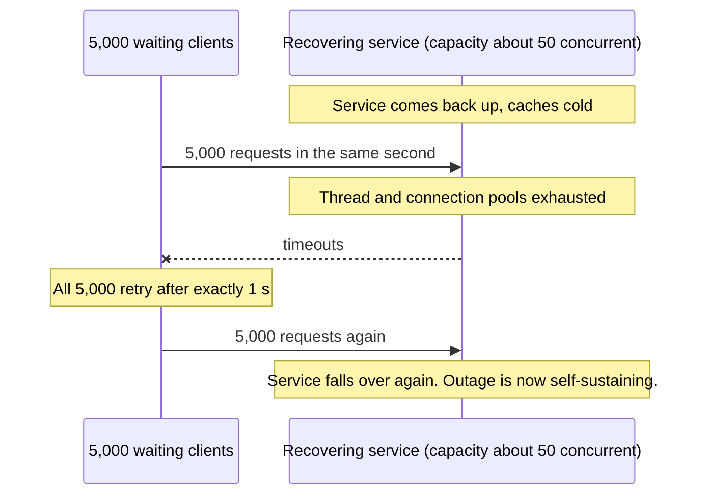
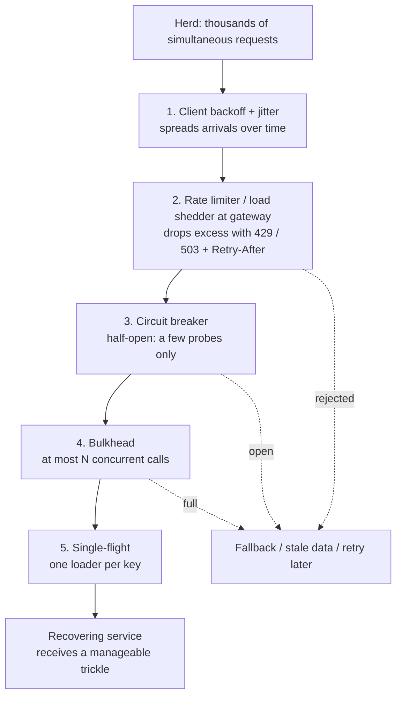
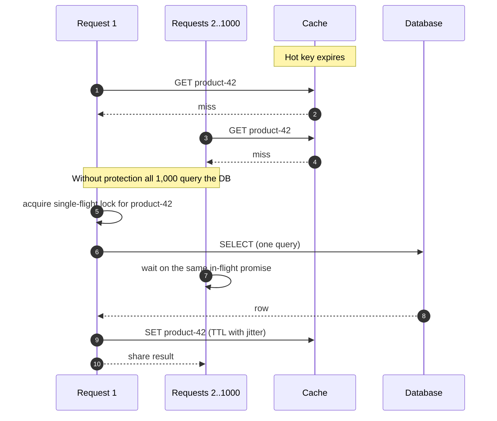

# 4.5 Thundering Herd — How the Resilience Patterns Combine

[← Rate Limiting](04-rate-limiting.md) · [Index](../README.md) · Next: [Cache-Aside →](../05-performance-api-coordination/01-cache-aside.md)

> **In one line:** a thundering herd is many clients acting at the same instant. No single
> pattern stops it; each one handles a different part of the problem.

---

## 1. What It Is

A large number of waiting or retrying callers are released simultaneously onto a resource
that can serve only a few of them.

| Trigger | Example |
|---|---|
| Service recovers after an outage | All clients' retries and queued requests land together |
| Circuit breaker closes | 100% of traffic returns instantly to a cold service |
| Popular cache key expires | Thousands of requests miss and hit the database at once (cache stampede) |
| Synchronised schedule | Every client's cron fires at `:00`; all tokens expire at the same time |
| Mass reconnect | Load balancer restart → every WebSocket/DB client reconnects |
| DLQ / backlog replay | An operator redrives 500,000 messages in one go |
| Deploy / autoscale | New instances with cold caches and empty connection pools take full traffic |



This last point is the important one: the system can be stuck in a **metastable failure** —
the original cause is gone, but the retry load alone keeps it down.

---

## 2. Does a Bulkhead Help?

**Yes — it contains the damage, but it does not stop the burst.**

| How the bulkhead helps | Detail |
|---|---|
| **Caps concurrent execution** | If 5,000 requests arrive and the limit is 50, only 50 run; 4,950 are rejected fast or briefly queued |
| **Prevents cascading failure** | The spike cannot consume the threads/connections that other features need |
| **Protects warm-up** | The recovering service handles a trickle while caches fill and pools open |

What it does **not** do: the 4,950 rejected requests still arrived, still cost a little to
reject, and will come back unless the *clients* behave differently.

---

## 3. Division of Labour

| Pattern | Role during a thundering herd | Acts on |
|---|---|---|
| [**Exponential backoff + jitter**](01-retry-backoff-jitter.md) | **Stops the burst** — spreads retries over time | Client behaviour |
| [**Rate limiting / load shedding**](04-rate-limiting.md) | **Controls the flow** — drops excess at the gateway before application logic | Edge |
| [**Bulkhead**](03-bulkhead.md) | **Contains the damage** — caps concurrency so one spike cannot exhaust everything | Server resources |
| [**Circuit breaker (half-open)**](02-circuit-breaker.md) | **Tests recovery** — lets a few probes through before reopening | Caller → dependency |
| **Request coalescing / single-flight** | **Removes duplicate work** — one loader per cache key, everyone else waits for its result | Cache layer |
| **Gradual ramp / warm-up** | **Eases back in** — traffic to a recovered or new instance rises over time | Load balancer |

### Layered defence



Each layer assumes the one before it might fail: clients you don't control won't have jitter,
so you need the gateway; the gateway limit is per client, so you need the bulkhead; and so on.

---

## 4. Cache Stampede Specifically



```javascript
const inFlight = new Map();                         // key → Promise

async function getWithSingleFlight(key, loader, ttlSeconds) {
  const cached = await cache.get(key);
  if (cached !== null) return cached;

  if (inFlight.has(key)) return inFlight.get(key);  // someone is already loading it

  const promise = (async () => {
    try {
      const value = await loader();
      const jitteredTtl = ttlSeconds * (0.9 + Math.random() * 0.2);   // ±10% → keys don't expire together
      await cache.set(key, value, jitteredTtl);
      return value;
    } finally {
      inFlight.delete(key);
    }
  })();
  inFlight.set(key, promise);
  return promise;
}
```

This coalesces within one process. Across many instances add a short distributed lock, or use
**stale-while-revalidate** (serve the old value while one worker refreshes) — details in
[Cache-Aside](../05-performance-api-coordination/01-cache-aside.md).

---

## 5. Prevention Checklist by Trigger

| Trigger | Prevention |
|---|---|
| Client retries | Backoff + **jitter**; retry budgets; `Retry-After` |
| Breaker closing | Limited half-open probes; several successes required; gradual ramp |
| Cache expiry | TTL jitter; single-flight; stale-while-revalidate; pre-warm hot keys |
| Cron alignment | Randomise start offset per instance/tenant (`sleep(random(0, 300))`) |
| Token expiry | Jittered lifetimes; refresh ahead of expiry at a random point |
| Reconnect storms | Jittered reconnect backoff; connection-rate limits on the server |
| Backlog / DLQ replay | Rate-limited replay; canary first |
| Cold instances | Readiness gates on warm-up; slow-start in the load balancer; pre-warmed pools |
| Autoscaling lag | Scale on leading signals (queue age); keep headroom |

---

## 6. Security

- A thundering herd is indistinguishable from a **DDoS** at the receiving end, and the same
  defences apply. An attacker can also *induce* one — for example by forcing a cache flush or
  briefly degrading a dependency so that your own clients' retries finish the job.
- **Cache-busting attacks:** requests with random query parameters or for non-existent IDs
  bypass the cache and hit the database every time. Normalise cache keys, cache negative
  results briefly, and rate-limit lookups of unknown IDs.
- **Don't expose a public "flush cache" or "replay all" endpoint** without strong
  authorization; they are herd triggers.
- **Protect the recovery path:** health checks, admin and auth endpoints need their own
  [bulkhead](03-bulkhead.md) so operators can still get in while the herd is running.
- **Authenticated traffic first:** when shedding, drop anonymous traffic before
  authenticated/paying traffic.

## 7. Performance

- **Jitter trades a little latency for a lot of stability.** Spreading 5,000 retries over 10 s
  turns a 5,000 req/s spike into ~500 req/s.
- **Rejecting must be cheaper than serving** by orders of magnitude, or shedding does not help.
  Reject before auth, parsing and DB access.
- **Goodput vs throughput:** an overloaded server can be at 100% CPU producing only timeouts.
  Shedding load *increases* the number of successful responses.
- **Warm-up time is a capacity parameter.** Measure how long a cold instance takes to reach
  normal latency and configure slow-start accordingly.
- **Queues amplify herds.** A deep queue holds requests whose clients have already timed out;
  serve newest-first (LIFO) or drop requests older than the client timeout during overload.

## 8. Observability

| Signal | Meaning |
|---|---|
| Request rate spike immediately after recovery | Herd in progress |
| Retry ratio > normal while error rate falling | Clients are synchronised |
| Bulkhead saturation + rejection spike | Containment is working (and being needed) |
| Cache hit ratio drop + DB QPS spike | Stampede |
| Breaker flapping after an incident | Dependency is being knocked over on each close |
| Identical timestamps (`:00`, `:30`) in traffic peaks | Schedule alignment |

## 9. Key Takeaways

1. A bulkhead **contains**; jitter **prevents**; rate limiting **shapes**; the breaker **probes**.
2. Recovery is the most dangerous moment of an outage.
3. Anything periodic or time-based needs jitter: retries, TTLs, cron, token expiry, reconnects.
4. Design replays and redrives to be rate-limited from day one.

---

Next: [Cache-Aside →](../05-performance-api-coordination/01-cache-aside.md)
