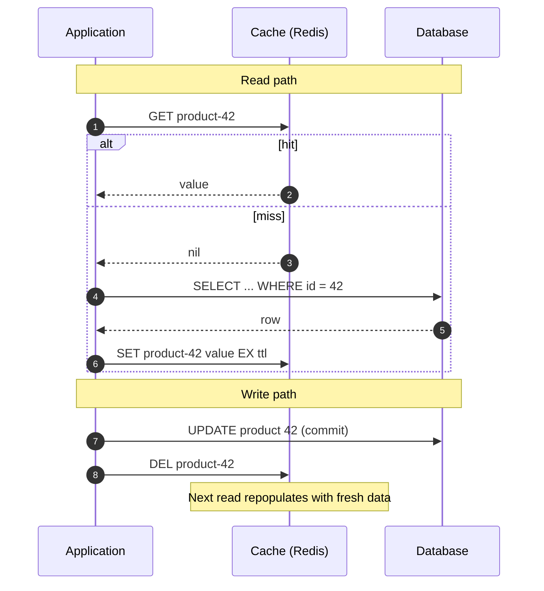
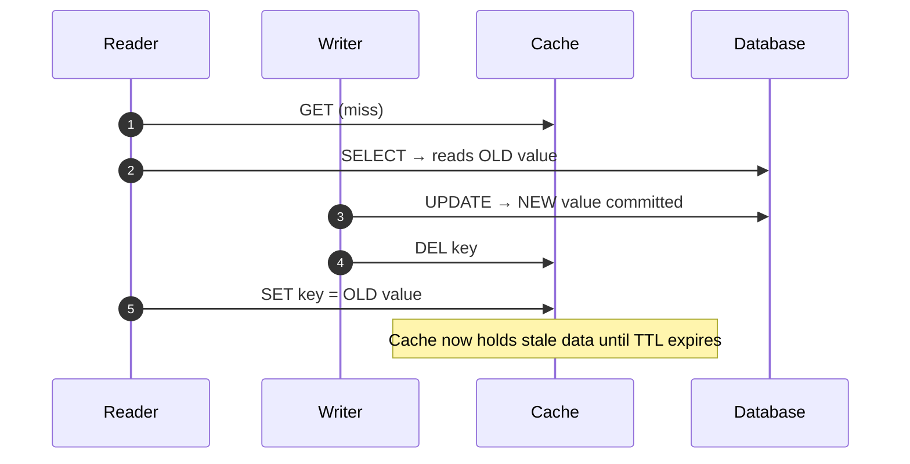

# 5.1 Cache-Aside

[← Thundering Herd](../04-resilience/05-thundering-herd.md) · [Index](../README.md) · Next: [Backend for Frontend →](02-backend-for-frontend.md)

> **In one line:** the application checks the cache first, loads from the database on a miss,
> stores the result, and invalidates the entry when the data changes.

Also called *lazy loading*. The cache sits **beside** the database; the application
orchestrates both.

---

## 1. Problem

Read-heavy workloads repeat the same expensive queries. The database becomes the bottleneck
for data that rarely changes (product details, configuration, user profiles).

## 2. Mechanism



**Invalidate (delete), don't update, on write.** Deleting is idempotent and avoids two writers
racing to set different values; the next reader loads the truth from the database.

### Compared with other caching patterns

| Pattern | Who loads the cache | Write behaviour | Trade-off |
|---|---|---|---|
| **Cache-aside** | Application, on miss | App invalidates | Simple, resilient to cache loss; first read is slow |
| Read-through | Cache library/provider | App invalidates | Same as above with less app code |
| Write-through | — | Write goes to cache, which writes DB synchronously | Cache always warm; slower writes; cache on the write path |
| Write-behind | — | Cache acknowledges, writes DB later | Fast writes; **risk of data loss** |
| Refresh-ahead | Background refresher before expiry | — | No miss penalty for hot keys; wasted refreshes |

---

## 3. Code

```javascript
async function getProduct(id) {
  const key = `product:v2:${id}`;                      // version prefix → safe schema changes

  try {
    const cached = await cache.get(key);
    if (cached !== null) {
      metrics.increment('cache_hits_total', { cache: 'product' });
      return cached === NEGATIVE ? null : JSON.parse(cached);
    }
  } catch (err) {
    metrics.increment('cache_errors_total');           // cache down ≠ feature down: fall through to DB
  }

  metrics.increment('cache_misses_total', { cache: 'product' });
  const product = await singleFlight(key, () => db.products.findById(id));   // one loader per key

  const ttl = 300 * (0.9 + Math.random() * 0.2);       // 5 min ± 10% jitter
  if (product) cache.set(key, JSON.stringify(product), ttl).catch(noop);
  else cache.set(key, NEGATIVE, 30).catch(noop);       // short negative cache for "not found"
  return product;
}

async function updateProduct(id, changes) {
  await db.products.update(id, changes);               // 1. commit the source of truth
  await cache.del(`product:v2:${id}`);                 // 2. then invalidate
}
```

---

## 4. Consistency Hazards

### 4a. The stale-set race



Rare (needs a write to complete inside a read's miss window) but real.

| Mitigation | How |
|---|---|
| **Always set a TTL** | Bounds how long any stale entry can live — the universal safety net |
| **Delayed double delete** | Delete again after a short delay (e.g. 500 ms) to catch in-flight readers |
| **Versioned set** | Store a version with the value; `SET` only if newer (compare-and-set / Lua) |
| **Invalidate from CDC** | Tail the DB log and delete keys in commit order — also covers writes that bypass the app |

### 4b. Delete fails after the DB commit

The database is updated, the cache keeps the old value. Options: retry the delete; publish an
invalidation event via the [outbox](../02-data-consistency/01-transactional-outbox.md) so it
is guaranteed; rely on the TTL as the backstop.

### 4c. Never do "delete cache, then write DB"

A reader between the two steps reloads the old value and caches it for the full TTL.

---

## 5. Failure Modes

| Failure | Mitigation |
|---|---|
| **Cache stampede** (hot key expires) | Single-flight, TTL jitter, stale-while-revalidate, refresh-ahead — see [Thundering Herd](../04-resilience/05-thundering-herd.md#4-cache-stampede-specifically) |
| **Cache penetration** (lookups for keys that don't exist always hit the DB) | Negative caching with short TTL; Bloom filter of valid IDs; validate ID format first |
| **Cache avalanche** (many keys expire together, or cache cluster restarts) | TTL jitter; warm-up; [bulkhead](../04-resilience/03-bulkhead.md) + rate limit on DB loaders |
| **Cache down** | Treat as a miss with a [circuit breaker](../04-resilience/02-circuit-breaker.md) around the cache client; make sure the DB can survive the cold-cache load (or shed) |
| **Hot key** | Local in-process tier in front of Redis; replicate hot keys |
| **Big values** | Slow serialisation and network; cache projections, compress, or split |
| **Memory full** | Set `maxmemory` + eviction policy (LRU/LFU) deliberately; monitor evictions |
| Stale data after deploy changes the value shape | Version prefix in the key |

## 6. Security

| Risk | Control |
|---|---|
| **Cross-user / cross-tenant leakage** — the most common cache security bug | Include tenant and user (or permission scope) in the key for anything personalised: `tenant:{t}:user:{u}:cart`. Never cache an authorised response under a key that omits the authorisation dimension |
| **Cache poisoning** | Build keys only from validated, normalised inputs; never from raw headers/URLs an attacker controls; don't cache error responses or responses influenced by unkeyed inputs |
| **Stale authorisation** | Permission/role/session revocation must invalidate cached entitlements immediately; keep TTLs for auth data very short |
| **Sensitive data at rest in the cache** | Don't cache secrets, full card data or credentials. Encrypt sensitive values; apply the same data-classification rules as the DB |
| **Exposed cache server** | Private network only, authentication/ACLs, TLS in transit, dangerous commands disabled/renamed. An open Redis is a classic breach |
| **Deserialisation** | Store data-only formats (JSON); never native object serialisation of untrusted content |
| **Cache-busting DoS** | Normalise keys (strip unknown query params); negative caching; rate-limit misses for unknown IDs |
| **Timing side channels** | Hit vs miss timing can reveal whether a resource exists — relevant for enumeration-sensitive lookups |
| **Erasure requests** | Deleting a user must purge their cached entries too |

## 7. Performance

- **Effective latency** = `hitRatio × cacheLatency + (1 − hitRatio) × (cacheLatency + dbLatency)`.
  At 95% hits, 1 ms cache and 40 ms DB: ≈ 3 ms average instead of 40 ms.
- **Hit ratio is everything.** Going from 90% to 99% cuts database load by 10×. Conversely a
  drop from 99% to 90% multiplies DB load by 10 — capacity-plan the database for a *cold* cache
  or accept shedding.
- **TTL** trades freshness for hit ratio. Choose per data type: seconds for prices/stock,
  minutes for product details, hours for reference data.
- **Two tiers:** a small in-process cache (microseconds, per instance) in front of a shared
  cache (sub-millisecond, cross-instance). Keep the local TTL very short to limit inconsistency.
- **Batch:** use `MGET`/pipelines for lists; N sequential gets erase the benefit.
- **Cache the right thing:** the rendered/aggregated result the caller needs, not raw rows it
  must re-join.
- **Don't cache what is cheap** (primary-key lookups on a healthy DB may already be ~1 ms) or
  what is unique per request.

## 8. Observability

| Metric | Alert when |
|---|---|
| Hit ratio per cache/keyspace | Drops sharply (deploy changed keys? flush? penetration attack?) |
| Cache latency p99, error rate | Degradation |
| Evictions per second, memory used | Sustained evictions → undersized |
| DB QPS correlated with miss rate | Stampede/avalanche |
| Keys without TTL | Should be zero for cache-aside data |
| Single-flight waiters | High → hot-key contention |

## 9. Checklist

- [ ] Write path: commit DB first, then delete the cache key
- [ ] Every entry has a TTL, with jitter
- [ ] Stampede protection on hot keys
- [ ] Negative caching for not-found
- [ ] Cache failure degrades to the database, behind a breaker
- [ ] Database is sized (or protected) for a cold cache
- [ ] Keys include tenant/user/permission dimensions where data is not public
- [ ] No secrets or highly sensitive data cached unencrypted
- [ ] Key names carry a version prefix
- [ ] Hit ratio, evictions and latency are monitored

---

Next: [Backend for Frontend →](02-backend-for-frontend.md)
