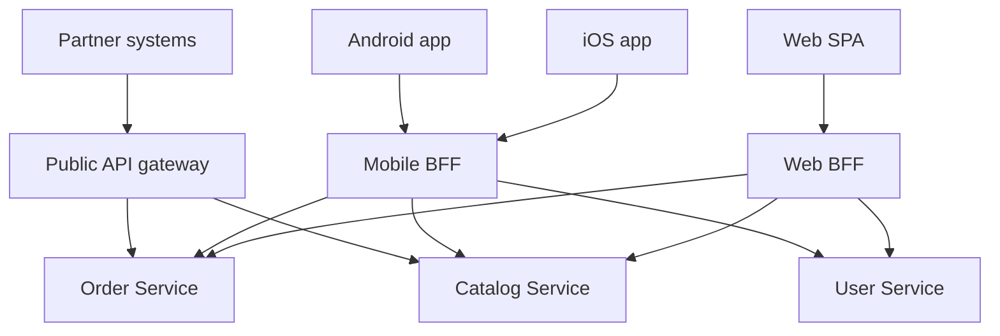
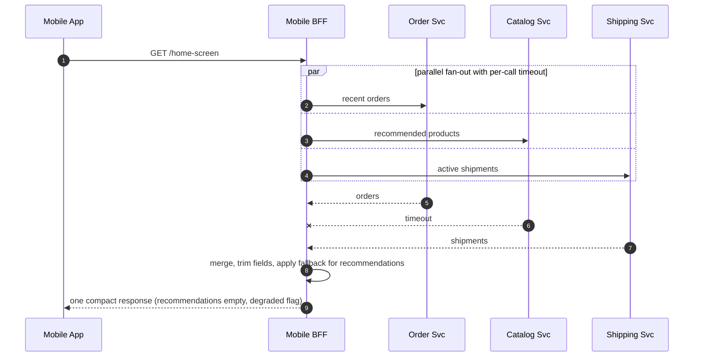
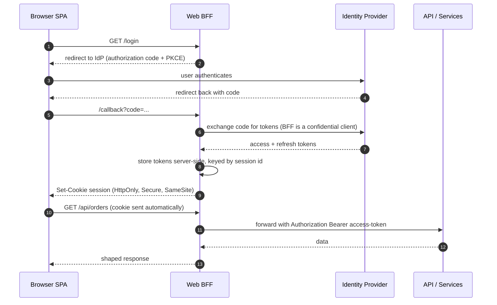

# 5.2 Backend for Frontend (BFF)

[← Cache-Aside](01-cache-aside.md) · [Index](../README.md) · Next: [Leader Election →](03-leader-election.md)

> **In one line:** give each client type (web, iOS, Android, partner) its own thin backend that
> aggregates microservice calls and shapes responses for exactly that client.

---

## 1. Problem

One general-purpose API serves every client badly:

- **Mobile** needs small payloads and few round-trips on slow networks; **web** wants richer data.
- A screen needs data from five services → five requests from the device (chatty).
- Every client change needs a change in a shared API that other clients depend on.
- Browsers cannot safely hold OAuth tokens or secrets.

## 2. Mechanism



### Aggregation



One round-trip from the device; fan-out happens on the fast data-centre network; a failed
optional call degrades instead of failing the screen.

## 3. BFF vs API Gateway

| | API Gateway | BFF |
|---|---|---|
| Purpose | Cross-cutting edge concerns | Client-specific composition |
| Typical logic | TLS, routing, authn, rate limiting, WAF | Aggregation, payload shaping, UI-oriented orchestration, session handling |
| How many | One (or one per zone) | One per client experience |
| Owned by | Platform team | The frontend team that consumes it |

They are usually used together: **client → gateway → BFF → services**.

## 4. What Belongs in a BFF

| Belongs | Does not belong |
|---|---|
| Calling several services and merging results | Business rules (pricing, eligibility, order state) |
| Dropping/renaming fields, pagination shape, image sizes | Its own database of business data |
| Translating protocols (REST/GraphQL outside, gRPC inside) | Cross-service transactions ([sagas](../02-data-consistency/02-saga-pattern.md) live in domain services) |
| Session/token handling for browsers | Logic duplicated between two BFFs — push it down |
| Per-client caching and fallbacks | |

Rule of thumb: if deleting the BFF would lose business behaviour, it is too thick.

---

## 5. Code — Aggregation with Isolation

```javascript
app.get('/home-screen', authenticate, async (req, res) => {
  const ctx = { userId: req.user.id, traceId: req.traceId, deadline: Date.now() + 800 };

  // Fan out in parallel. Each dependency has its own bulkhead + breaker + timeout.
  const [orders, recs, shipments] = await Promise.allSettled([
    ordersClient.recent(ctx),                    // essential
    recommendationsClient.forUser(ctx),          // optional
    shippingClient.active(ctx),                  // optional
  ]);

  if (orders.status === 'rejected') return res.status(503).json({ error: 'temporarily_unavailable' });

  res.json({
    orders: orders.value.map(({ id, status, total }) => ({ id, status, total })),   // trim for mobile
    recommendations: recs.status === 'fulfilled' ? recs.value.slice(0, 6) : [],
    shipments: shipments.status === 'fulfilled' ? shipments.value : [],
    degraded: [recs, shipments].some((r) => r.status === 'rejected'),
  });
});
```

---

## 6. Failure Modes

| Failure | Mitigation |
|---|---|
| One slow downstream stalls the whole screen | Per-call timeout, [bulkhead](../04-resilience/03-bulkhead.md), [breaker](../04-resilience/02-circuit-breaker.md), partial response |
| BFF becomes a monolith with business logic | Keep it thin; review for domain rules creeping in |
| Duplicate logic across web and mobile BFFs | Shared libraries for plumbing; shared *services* for behaviour |
| N+1 downstream calls | Batch endpoints; dataloader pattern; [materialized view](../02-data-consistency/05-event-sourcing-cqrs-materialized-views.md) |
| BFF is a single point of failure | Stateless, horizontally scaled, sessions in a shared store |
| Old mobile app versions in the wild | Version the BFF API; additive changes; sunset policy |
| Retry at BFF *and* gateway *and* client | [Retry at one layer](../04-resilience/01-retry-backoff-jitter.md#4-retry-amplification) |

## 7. Security

The BFF is a major security component, especially for browser apps.



| Topic | Guidance |
|---|---|
| **Token handling (BFF pattern for SPAs)** | Tokens never reach JavaScript. The BFF holds access/refresh tokens server-side; the browser holds only an `HttpOnly; Secure; SameSite` session cookie. This removes token theft via XSS. See the repository's [Web Application Cookie Handbook](../../Web-Application-Cookie-Handbook.md) |
| **CSRF** | Cookie-based sessions reintroduce CSRF: use `SameSite`, an anti-forgery token or custom-header check, and strict CORS |
| **Authorization** | The BFF authenticates and does coarse checks; **each downstream service must still authorize** using the propagated user identity. Never rely on "the BFF already checked" |
| **Identity propagation** | Forward the user's token or exchange it for a narrower downstream token (token exchange); authenticate the BFF itself to services with mTLS/service identity |
| **Over-exposure** | A BFF returns only the fields its client needs — an allow-list, not a pass-through of the service response. This limits accidental data exposure |
| **Attack-surface isolation** | Separate BFFs mean a vulnerability in the partner API does not expose the mobile API; each has its own rate limits and WAF rules |
| **Input validation** | Validate and bound everything at the BFF (sizes, pagination limits, GraphQL depth/complexity) before fan-out multiplies the cost |
| **SSRF** | A BFF that fetches URLs from client input is an SSRF vector; allow-list destinations |
| **Rate limiting** | Per user and per client type; one BFF request may trigger many internal calls — limit by cost |
| **Error hygiene** | Map internal errors to generic client errors; no stack traces, hostnames or downstream bodies |

## 8. Performance

- **Fewer round-trips:** one mobile request instead of five saves connection setup, radio
  wake-ups and several hundred milliseconds on cellular networks.
- **Latency of an aggregate** = slowest *required* call (when parallel), not the sum. Give
  optional calls a shorter timeout than required ones.
- **Smaller payloads:** trimming unused fields and choosing image sizes per device often cuts
  response size by an order of magnitude.
- **Caching:** [cache-aside](01-cache-aside.md) per client shape; HTTP caching/ETags for
  anonymous content; never share cached personalised responses across users.
- **Deadline propagation:** pass the remaining time budget downstream so services stop working
  on a request the BFF has already abandoned.
- **Cost:** an extra network hop (~1 ms inside a data centre) and another deployable to operate.
- **Streaming/partial rendering:** for slow optional sections, return the essentials first.

## 9. Observability

| Metric | Why |
|---|---|
| Latency per BFF endpoint, split by downstream call | Find which dependency dominates |
| Fan-out count per request | Detect N+1 regressions |
| Partial/degraded response ratio | User experience impact of downstream issues |
| Response size by client | Payload bloat |
| Errors by client app version | Bad mobile release vs backend issue |

The BFF is where the **distributed trace starts** — generate/accept the trace ID here and
propagate it on every downstream call.

## 10. Checklist

- [ ] One BFF per client experience, owned by that frontend team
- [ ] No business rules and no business database in the BFF
- [ ] Downstream calls are parallel, each with timeout + bulkhead + breaker
- [ ] Optional data degrades gracefully; response says so
- [ ] Browser tokens stay server-side; cookie is `HttpOnly; Secure; SameSite`; CSRF handled
- [ ] Downstream services re-authorize with propagated identity
- [ ] Responses are allow-listed fields, not pass-through
- [ ] API is versioned for old mobile clients
- [ ] Trace ID created/propagated at the BFF

---

Next: [Leader Election →](03-leader-election.md)
