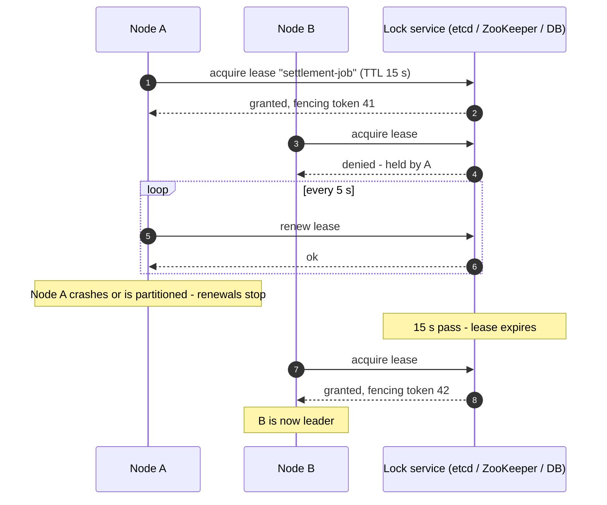
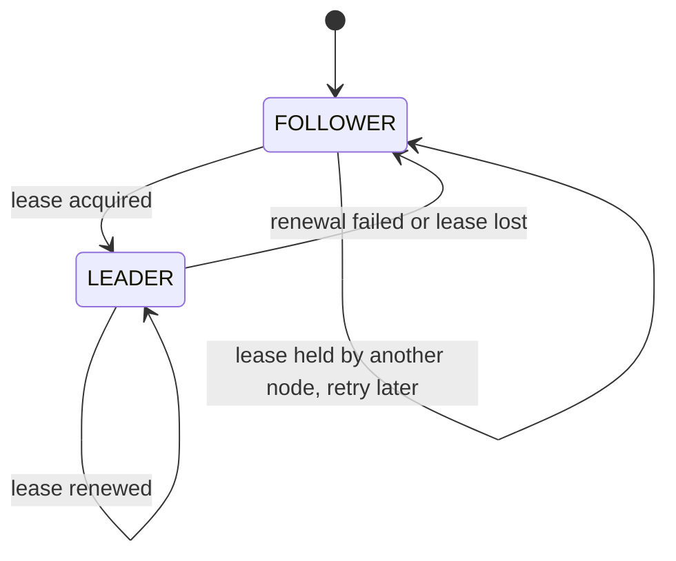
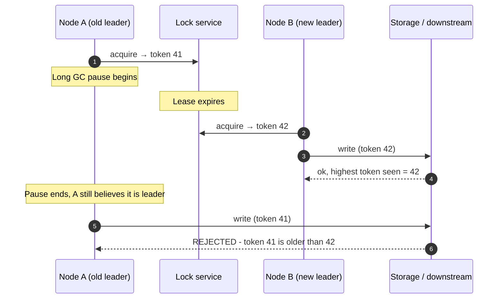

# 5.3 Leader Election

[← Backend for Frontend](02-backend-for-frontend.md) · [Index](../README.md) · Next: [E-commerce Checkout Walkthrough →](../06-putting-it-together/01-ecommerce-checkout-walkthrough.md)

> **In one line:** among several replicas, exactly one holds a time-limited lease and performs
> the singleton work; if it dies, another takes over.

---

## 1. Problem

You run three replicas for availability, but some work must happen **once**:

- Scheduled jobs (nightly settlement, report generation)
- The [TCC reaper](../02-data-consistency/03-try-confirm-cancel.md#5-the-three-edge-cases) and saga recovery scanner
- An ordered [outbox polling relay](../02-data-consistency/01-transactional-outbox.md#5a-polling-publisher)
- Shard/partition assignment, cluster coordination

Run on every replica → duplicated work. Run on one fixed replica → single point of failure.

## 2. Mechanism — Leases



Key parameters: **lease TTL** (how long failover takes) and **renew interval** (typically
TTL ÷ 3). The leader must stop working as soon as it cannot renew.

### Node state machine



---

## 3. The Hard Part: Two Leaders at Once

A lease is a promise based on clocks. A leader can be *paused* (GC, VM migration, CPU
starvation) past its lease expiry, wake up, and continue acting as leader while a new leader
is already active — **split brain**. No timeout tuning removes this completely.



**Fencing tokens** fix it: the lock service issues a monotonically increasing number with each
grant; the protected resource remembers the highest it has seen and rejects anything lower.
Correctness is enforced at the resource, not by the (fallible) belief of the leader.

If the resource cannot check tokens, make the work **idempotent** so that two leaders
overlapping is harmless — which is the usual answer for cron-style jobs.

---

## 4. Implementation Options

| Mechanism | Safety | Notes |
|---|---|---|
| **etcd** lease + election API | Strong (Raft consensus) | Revision number usable as fencing token |
| **ZooKeeper** ephemeral sequential nodes | Strong (ZAB consensus) | `zxid` / sequence as fencing token; Curator recipes |
| **Consul** sessions + KV lock | Strong (Raft) | |
| **Kubernetes `Lease`** object (client-go leader election) | Strong (backed by etcd) | Easiest inside Kubernetes |
| **Database** row lock / advisory lock / lease row | As strong as the DB | No new infrastructure; good default for small systems |
| **Redis** `SET key value NX PX ttl` | **Best-effort** | Single Redis is not consensus: failover can lose the lock; fine for *efficiency* (avoid duplicate work), not for *correctness* |

> **Correction to the reading notes:** "Redis locks" are not consensus. ZooKeeper and etcd run
> a consensus protocol; a Redis lock is a lease on one node (or a best-effort multi-node
> algorithm). Use Redis locking only where two simultaneous leaders would be merely wasteful,
> and add fencing or idempotency where it would be harmful.

### Simple database lease

```sql
CREATE TABLE leader_leases (
    name          TEXT PRIMARY KEY,
    holder        TEXT        NOT NULL,
    fencing_token BIGINT      NOT NULL,
    expires_at    TIMESTAMPTZ NOT NULL
);
INSERT INTO leader_leases VALUES ('settlement-job', 'none', 0, now()) ON CONFLICT DO NOTHING;

-- Acquire or renew in one atomic statement. Uses the DATABASE clock, not the node's clock.
UPDATE leader_leases
   SET holder        = $1,
       expires_at    = now() + interval '15 seconds',
       fencing_token = CASE WHEN holder = $1 THEN fencing_token ELSE fencing_token + 1 END
 WHERE name = 'settlement-job'
   AND (holder = $1 OR expires_at < now())
RETURNING fencing_token;      -- 1 row = you are the leader; 0 rows = someone else is
```

```javascript
async function leaderLoop(nodeId, work) {
  let controller = null;
  while (true) {
    const { rows } = await db.query(ACQUIRE_OR_RENEW_SQL, [nodeId]).catch(() => ({ rows: [] }));
    const isLeader = rows.length === 1;

    if (isLeader && !controller) {                    // just became leader
      controller = new AbortController();
      work({ fencingToken: rows[0].fencing_token, signal: controller.signal }).catch(log.error);
      metrics.gauge('is_leader', 1);
    } else if (!isLeader && controller) {             // lost leadership: stop immediately
      controller.abort();
      controller = null;
      metrics.gauge('is_leader', 0);
    }
    await sleep(5000 + Math.random() * 500);          // renew at TTL/3, with jitter
  }
}
```

For short jobs, a PostgreSQL session-level advisory lock (`pg_try_advisory_lock`) is even
simpler: the lock disappears automatically when the connection drops.

### Do you need a leader at all?

| Goal | Simpler alternative |
|---|---|
| Don't process the same row twice | `SELECT ... FOR UPDATE SKIP LOCKED` — all replicas work in parallel |
| Don't process the same message twice | [Competing consumers](../03-messaging/02-competing-consumers.md) + [idempotency](../03-messaging/01-idempotent-consumer.md) |
| Run a job once per schedule | Unique `(job, scheduled_time)` row as a claim; or the platform scheduler (Kubernetes CronJob) |
| Split work between nodes | Partition assignment (Kafka consumer groups) instead of one leader |

---

## 5. Failure Modes

| Failure | Mitigation |
|---|---|
| **Split brain** (two leaders) | Fencing tokens at the resource; idempotent work |
| Leader hangs but keeps renewing (renewal on a separate healthy thread) | Tie renewal to work progress/health; watchdog |
| Lock service unavailable | Leader must **step down** when it cannot renew; decide whether the job may pause |
| Failover too slow | Shorter TTL (but more false failovers) |
| Flapping leadership | TTL comfortably above worst-case pause + network jitter |
| Clock drift between nodes | Use the lock service's clock; never compare node wall-clocks |
| Work interrupted mid-way at failover | Checkpoint progress; make steps idempotent/resumable |
| All replicas start together and stampede the lock | Jittered acquisition |
| No leader for a long time, unnoticed | Alert on `sum(is_leader) == 0` and on job freshness |

## 6. Security

- **The leader usually has elevated capability** (runs settlements, moves money, assigns
  shards). Whoever can write the lease can become leader — restrict write access to the lease
  key/table to the service's own identity.
- **Authenticate to the coordination service** (etcd/ZooKeeper/Consul) with TLS client certs
  and ACLs; these stores often also hold configuration and secrets, and are high-value targets.
- **Never expose the coordination store** to the public network.
- **Lease-holder identity** should come from an authenticated workload identity, not a
  self-declared hostname.
- **Denial of service by lease hogging:** a compromised or buggy node that keeps renewing while
  doing no work blocks the job for everyone. Monitor *work progress*, not only lease ownership,
  and have an audited way to revoke a lease.
- **Fencing tokens also defend against replay** of delayed or stale commands at the resource.
- **Audit leadership changes** — unexpected transitions are both a reliability and a security signal.

## 7. Performance

- **Singleton = no horizontal scaling.** The leader is a throughput ceiling; keep leader-only
  work minimal (coordination, scheduling) and hand the heavy lifting to workers.
- **Failover time ≈ lease TTL + detection + start-up.** With TTL 15 s expect 15–20 s without a
  leader. Decide whether the job tolerates that.
- **Renew traffic** is tiny (one small write per TTL/3 per candidate), but with many leases
  batch or share a session.
- **Short TTL** → fast failover but sensitive to pauses and network blips; **long TTL** → stable
  but slow failover. Typical values: 10–30 s.
- **Graceful hand-off:** release the lease on `SIGTERM` so a rolling deploy does not wait for expiry.
- **Sharded leadership:** elect a leader per partition/tenant to spread load instead of one
  global leader.

## 8. Observability

| Metric | Alert when |
|---|---|
| `sum(is_leader)` per lease | `== 0` for > 2× TTL (no leader) or `> 1` (split brain) |
| Leadership transitions per hour | Flapping |
| Lease renewal latency / failures | Lock service degradation |
| Time since last successful job run | Exceeds schedule + tolerance — the metric that matters most |
| Rejected stale-token writes | > 0 means fencing just saved you; investigate the pause |

## 9. Checklist

- [ ] Confirmed a leader is really needed (vs `SKIP LOCKED` / idempotent workers)
- [ ] Lease has a TTL; leader stops work when renewal fails
- [ ] Fencing token enforced at the resource, or leader work is idempotent
- [ ] Lock service clock used for expiry
- [ ] Lease released on graceful shutdown
- [ ] Alerts for zero leaders, multiple leaders and stale job output
- [ ] Write access to the lease restricted to the service identity
- [ ] Redis-based locks used only where duplicate leadership is harmless

---

Next: [E-commerce Checkout Walkthrough →](../06-putting-it-together/01-ecommerce-checkout-walkthrough.md)
