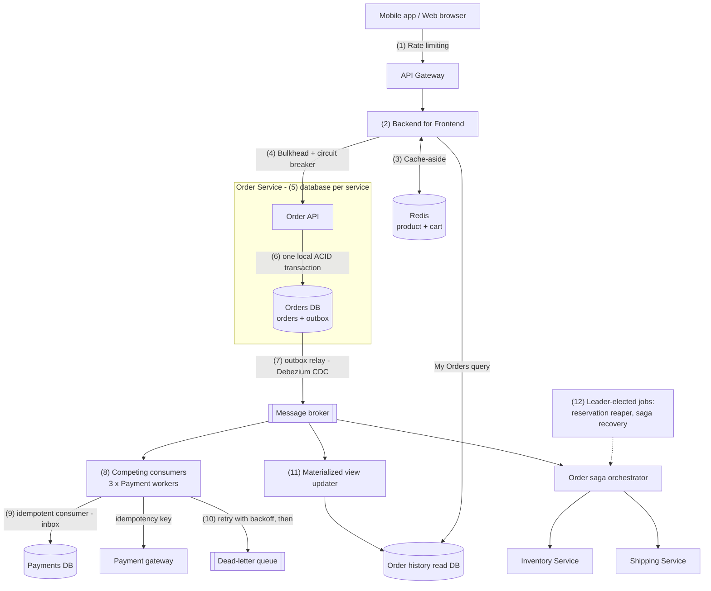
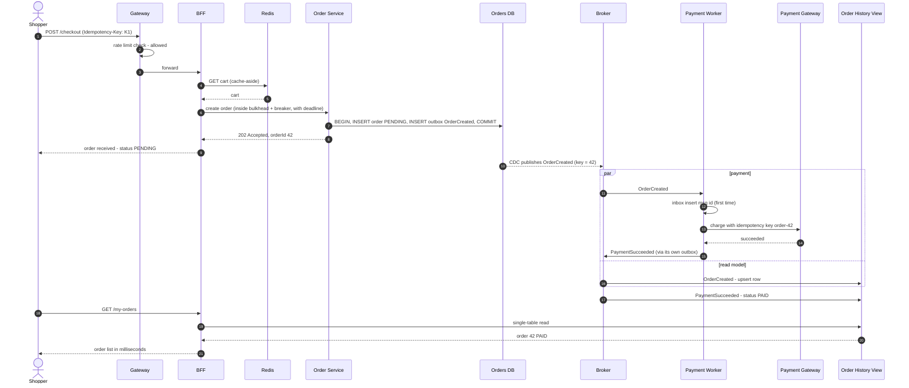
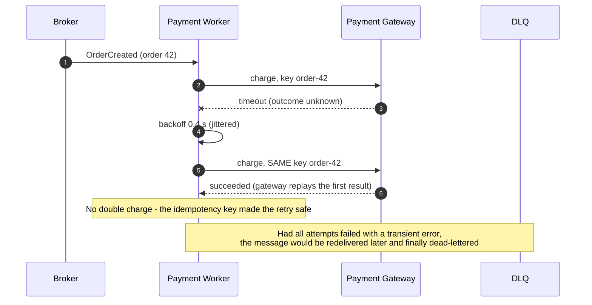

# 6.1 E-commerce Checkout — The Patterns in One Request

[← Leader Election](../05-performance-api-coordination/03-leader-election.md) · [Index](../README.md) · Next: [Frameworks and Tooling →](02-frameworks-and-tooling.md)

The patterns do not live in isolation. Edge patterns protect incoming traffic; data and
messaging patterns coordinate the backend. This chapter follows one "Buy Now" click end to end.

---

## 1. Architecture

## 2. Happy Path

## 3. Step-by-Step

| # | Stage | Patterns | What they guarantee |
|---|---|---|---|
| 1 | **Edge** | [Rate limiting](../04-resilience/04-rate-limiting.md) | Bots and runaway clients are dropped before they cost anything |
| 2 | **API shaping** | [BFF](../05-performance-api-coordination/02-backend-for-frontend.md) + [Cache-aside](../05-performance-api-coordination/01-cache-aside.md) | One compact call from the device; cart/product reads don't hit the DB |
| 3 | **Synchronous protection** | [Bulkhead](../04-resilience/03-bulkhead.md) + [Circuit breaker](../04-resilience/02-circuit-breaker.md) | Slow recommendations can't block checkout; a down tax API returns a fallback rate at once |
| 4 | **Atomic persistence** | [Database per service](../02-data-consistency/04-database-per-service.md) + [Transactional outbox](../02-data-consistency/01-transactional-outbox.md) | The order and its `OrderCreated` event are saved together — no lost orders |
| 5 | **Parallel, safe processing** | [Competing consumers](../03-messaging/02-competing-consumers.md) + [Idempotent consumer](../03-messaging/01-idempotent-consumer.md) | Payment scales horizontally; redeliveries never double-charge |
| 6 | **Failure handling** | [Retry with backoff](../04-resilience/01-retry-backoff-jitter.md) + [DLQ](../03-messaging/03-dead-letter-queues.md) | Gateway blips are retried; poison messages are isolated |
| 7 | **Fast reads** | [Materialized view](../02-data-consistency/05-event-sourcing-cqrs-materialized-views.md) | "My Orders" is a single-table read, no cross-service joins |
| 8 | **Business transaction** | [Saga](../02-data-consistency/02-saga-pattern.md) (+ [TCC](../02-data-consistency/03-try-confirm-cancel.md) for stock holds) | Stock, payment and shipping either all complete or are compensated |
| 9 | **Housekeeping** | [Leader election](../05-performance-api-coordination/03-leader-election.md) | Reaper and recovery jobs run on exactly one node |

---

## 4. Failure Walkthroughs

### 4a. Payment gateway times out

### 4b. What each failure looks like to the shopper

| Failure | Patterns that respond | Shopper sees |
|---|---|---|
| Bot flood on `/checkout` | Rate limit, load shedding | Normal experience; bots get 429 |
| Redis down | Cache-aside falls through to DB behind a breaker | Slightly slower pages |
| Recommendation service slow | Bulkhead full → empty fallback | Page without recommendations |
| Tax API down | Breaker open → cached/default rate, order flagged | Checkout works; tax reconciled later |
| Order Service crashes after commit | Outbox row is durable; relay publishes on recovery | Order appears; payment slightly delayed |
| Broker down | Outbox accumulates; relay resumes | Order stays PENDING longer |
| Payment worker crashes mid-message | Redelivery + inbox dedup + gateway key | Charged exactly once |
| Card declined | Business rejection → `PaymentDeclined` event → saga compensates stock | "Payment failed, please try another card" |
| Malformed event after a bad deploy | Permanent error → DLQ → alert → fix → replay | Delay for affected orders only |
| Shipping can't schedule | Saga compensation: refund, release stock | Order cancelled with refund notice |
| Read model lagging | Read-your-writes token / command response used for the confirmation page | Confirmation page is correct immediately |
| Service recovers after outage | Jitter + half-open probes + bulkhead | Gradual recovery, no second outage |

---

## 5. Security View of the Flow

```mermaid
flowchart LR
    U["User"] -->|"TLS, session cookie<br/>HttpOnly Secure SameSite"| GW["Gateway<br/>WAF, rate limit, authn"]
    GW -->|"validated identity"| BFF["BFF<br/>CSRF check, input validation,<br/>field allow-list"]
    BFF -->|"mTLS + user token"| OS["Order Service<br/>authorizes user for this cart"]
    OS -->|"least-privilege DB role"| DB[("Orders DB<br/>encrypted at rest")]
    DB -->|"CDC role: outbox table only"| K[["Broker<br/>TLS, per-topic ACLs"]]
    K -->|"consume-only credential"| PW["Payment worker<br/>validates schema + tenant"]
    PW -->|"tokenised card reference only"| PG["Payment gateway"]
```

| Trust boundary | Control |
|---|---|
| Internet → gateway | TLS, WAF, bot detection, per-identity rate limits |
| Browser → BFF | Tokens kept server-side; cookie flags; CSRF defence |
| BFF → services | Service identity (mTLS) **and** end-user identity; each service re-authorizes |
| Service → DB | Per-service credentials; no cross-service table access |
| DB → broker | Minimal event payloads (IDs, amounts — never card numbers); CDC limited to the outbox table |
| Broker → consumers | Per-topic ACLs; schema validation; tenant check |
| Worker → payment gateway | Tokenised payment method; idempotency key; secrets from a vault |
| Operators → DLQ / replay / breaker overrides | Authorization + audit trail |

Client-side idempotency also matters: the `Idempotency-Key` header on `POST /checkout`
prevents a double order when the shopper double-taps or the app retries.

Full treatment: [Security](../07-cross-cutting/01-security.md).

## 6. Performance View of the Flow

| Path | Budget (illustrative) | What keeps it there |
|---|---|---|
| `POST /checkout` (synchronous part) | ~150–300 ms | Only one local DB transaction on the critical path; payment is asynchronous |
| Cart/product read | ~5 ms | Cache-aside at high hit ratio |
| Order → event on broker | < 1 s | CDC relay |
| Payment completion | 1–3 s | Competing consumers scaled on lag |
| "My Orders" | ~10 ms | Materialized view, single indexed read |

Design choices that buy this:

- **Return `202 Accepted` early.** The shopper is not kept waiting on the payment gateway.
- **Asynchronous by default** after the first commit — the broker absorbs spikes (load levelling).
- **Scale each stage independently:** BFF on request rate, payment workers on queue age,
  read DB on query load.
- **Every synchronous hop has a timeout** derived from an end-to-end deadline.

The numbers are illustrative targets, not measurements. Derive real budgets from your own SLOs
— see [Performance](../07-cross-cutting/02-performance.md).

## 7. What to Watch

One dashboard row per stage:

| Stage | Golden signal |
|---|---|
| Edge | 429 ratio, request rate by client type |
| BFF | p99 latency, degraded-response ratio |
| Sync calls | Breaker state, bulkhead saturation |
| Order DB | Commit latency, **outbox oldest-unpublished age** |
| Broker | Consumer lag / age of oldest message |
| Payment | Success ratio, retry ratio, duplicate-skip count |
| DLQ | Depth (alert at > 0) |
| Read model | Projection lag |
| Saga | In-flight age, compensation rate, `NEEDS_ATTENTION` count |
| Business | Orders created vs orders paid — the end-to-end truth |

The last row is the most valuable alert in the system: if *orders created* and *orders paid*
diverge, something in the pipeline is broken, whichever component it is.

---

Next: [Frameworks and Tooling →](02-frameworks-and-tooling.md)
