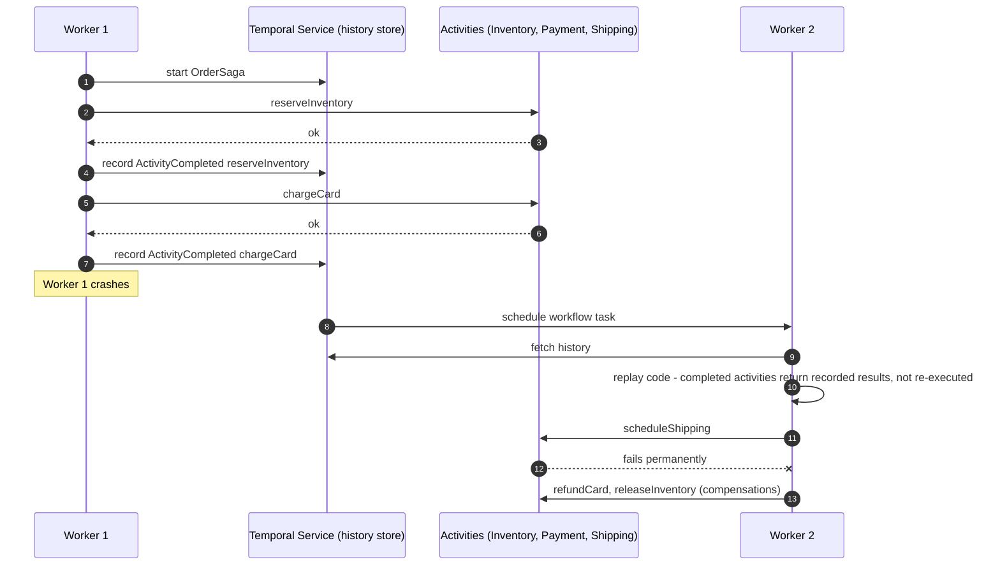
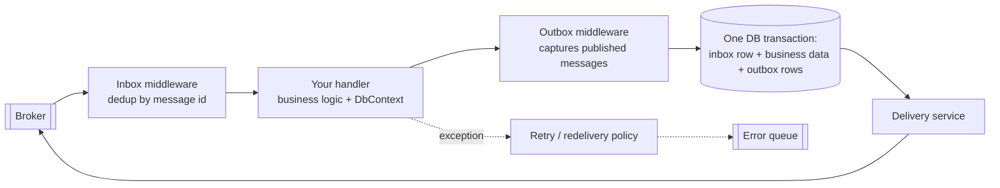
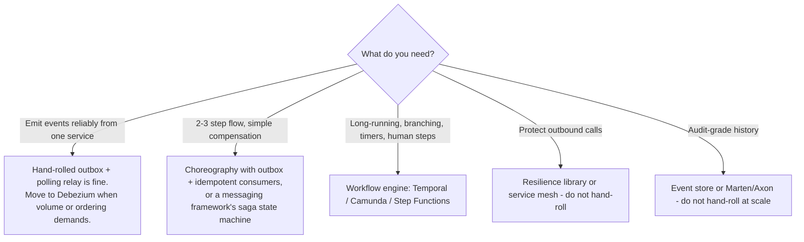

# 6.2 Frameworks and Tooling

[← Checkout Walkthrough](01-ecommerce-checkout-walkthrough.md) · [Index](../README.md) · Next: [Security →](../07-cross-cutting/01-security.md)

The code in this handbook is deliberately hand-written to expose the mechanics. In production,
prefer a maintained framework: state machines, retry loops, outbox pollers and breakers all
have subtle edge cases (several are flagged in the "Notes on the original snippet" boxes).

---

## 1. Map: Pattern → Tool

| Pattern | Options |
|---|---|
| **Saga orchestration / durable workflows** | Temporal, Camunda (Zeebe), AWS Step Functions, Azure Durable Functions, Netflix Conductor |
| **Saga + messaging middleware** | MassTransit, NServiceBus, Wolverine (.NET) · Axon Framework, Eventuate Tram (Java) |
| **Transactional outbox via CDC** | Debezium (+ Outbox Event Router), database-native change streams |
| **Outbox / inbox built in** | MassTransit, NServiceBus, Wolverine, Eventuate Tram, Axon |
| **TCC / distributed transaction coordinator** | Apache Seata (TCC, Saga and AT modes) |
| **Event sourcing** | EventStoreDB/KurrentDB, Axon Server, Marten (.NET on PostgreSQL) |
| **Circuit breaker, retry, bulkhead, rate limiter** | Resilience4j (Java), Polly / `Microsoft.Extensions.Resilience` (.NET), Opossum / Cockatiel (Node.js) |
| **Resilience in the platform** | Service mesh: Envoy / Istio / Linkerd (timeouts, retries, outlier detection, connection limits) |
| **Rate limiting** | API gateways (Kong, Envoy, NGINX, cloud gateways), Redis-based limiters |
| **Dead-letter queues** | Native in SQS, RabbitMQ, Azure Service Bus; framework-level on Kafka (Spring Kafka, Kafka Connect) |
| **Leader election** | etcd, ZooKeeper (Curator), Consul, Kubernetes `Lease` |
| **Cache** | Redis / Valkey, Memcached; in-process Caffeine (Java), `IMemoryCache` (.NET) |

---

## 2. Temporal — Durable Execution

Temporal persists every step of a workflow's execution history. If a worker crashes mid-saga,
another worker **replays the history** to rebuild in-memory state and continues from the exact
point of failure.



The saga from [chapter 2.2](../02-data-consistency/02-saga-pattern.md) as a workflow — note
there is no saga table and no recovery scanner; durability is the runtime's job:

```typescript
import { proxyActivities } from '@temporalio/workflow';

const act = proxyActivities<Activities>({
  startToCloseTimeout: '30 seconds',
  retry: { initialInterval: '1s', backoffCoefficient: 2, maximumAttempts: 5,
           nonRetryableErrorTypes: ['CardDeclined', 'OutOfStock'] },
});

export async function orderSaga(order: Order): Promise<void> {
  const compensations: Array<() => Promise<void>> = [];
  try {
    await act.reserveInventory(order);
    compensations.unshift(() => act.releaseInventory(order));

    await act.chargeCard(order);
    compensations.unshift(() => act.refundCard(order));

    await act.scheduleShipping(order);
    await act.markCompleted(order.id);
  } catch (err) {
    for (const compensate of compensations) await compensate();   // reverse order
    await act.markFailed(order.id);
    throw err;
  }
}
```

| You still own | Why |
|---|---|
| **Idempotent activities** | Activities are retried: at-least-once execution |
| **Deterministic workflow code** | Replay must take the same path: no direct I/O, random or wall-clock in workflow code |
| **Workflow versioning** | Long-running workflows outlive deployments |
| **Payload hygiene** | History stores inputs/outputs — encrypt or reference sensitive data (data converter / codec) |

**Camunda / Zeebe** covers the same ground with BPMN models, which suits flows that business
analysts need to read or that include human tasks.

---

## 3. Debezium — Outbox via CDC

Debezium tails the database transaction log (PostgreSQL WAL, MySQL binlog) and streams
`outbox` inserts to Kafka. No polling worker, minimal load on the database.

```json
{
  "name": "orders-outbox-connector",
  "config": {
    "connector.class": "io.debezium.connector.postgresql.PostgresConnector",
    "plugin.name": "pgoutput",
    "database.hostname": "orders-db",
    "database.dbname": "orders",
    "database.user": "debezium_outbox",
    "table.include.list": "public.outbox",
    "topic.prefix": "orders",
    "transforms": "outbox",
    "transforms.outbox.type": "io.debezium.transforms.outbox.EventRouter",
    "transforms.outbox.table.field.event.key": "aggregate_id",
    "transforms.outbox.route.by.field": "aggregate_type",
    "transforms.outbox.route.topic.replacement": "${routedByValue}.events"
  }
}
```

Illustrative — check property names against the Debezium version you deploy, and supply the
password through a secret provider rather than inline.

| Operational point | Detail |
|---|---|
| **Replication slot lag** | If the connector stops, the database retains WAL until the disk fills. Alert on slot lag — the single most important Debezium alert |
| **Limit the capture** | Include only the `outbox` table; grant the connector role only what it needs |
| **Ordering** | Log order = commit order; key by aggregate ID for per-aggregate ordering in Kafka |
| **Delivery** | At-least-once → consumers stay idempotent |
| **Outbox cleanup** | Rows can be deleted right after insert (even in the same transaction): the log still carries the insert |
| **Schema changes** | Coordinate outbox column changes with connector configuration |

---

## 4. MassTransit / NServiceBus / Axon

These frameworks wrap handlers in middleware that provides inbox, outbox, retries, sagas and
error queues with configuration instead of code.



What you configure rather than write:

| Concern | Typical configuration |
|---|---|
| Outbox + inbox | Enable the transactional outbox for a database context; set duplicate-detection window |
| Retry | Immediate retries + delayed redelivery schedule; exception filters for non-retryable types |
| Saga | Declarative state machine: states, events, correlation ID, persistence store |
| DLQ | Faulted messages moved to an `_error` queue with exception headers |

The .NET stack in this repository (ASP.NET Core) pairs naturally with **MassTransit** or
**NServiceBus** for messaging and **Polly / `Microsoft.Extensions.Http.Resilience`** for HTTP
resilience.

---

## 5. Resilience Libraries

Declarative equivalents of the hand-written [breaker](../04-resilience/02-circuit-breaker.md),
[bulkhead](../04-resilience/03-bulkhead.md) and [retry](../04-resilience/01-retry-backoff-jitter.md):

| Feature | Resilience4j | Polly v8 | Opossum |
|---|---|---|---|
| Circuit breaker (rate-based, slow calls) | Yes | Yes | Yes |
| Retry with backoff + jitter | Yes | Yes | No (compose separately) |
| Bulkhead / concurrency limiter | Semaphore + thread pool | Concurrency limiter | Capacity option |
| Rate limiter | Yes | Yes | No |
| Timeout | TimeLimiter | Yes | Yes |
| Fallback | Yes | Yes | Yes |
| Metrics | Micrometer | .NET metering / OpenTelemetry | Events / Prometheus plugin |

**Library vs service mesh:** a mesh gives uniform timeouts, retries and outlier detection
without code changes and across languages. A library knows about *business* context —
fallbacks, which errors are retryable, idempotency. Most teams use the mesh for the baseline
and a library where fallbacks matter. Do not configure retries in both without a budget
([retry amplification](../04-resilience/01-retry-backoff-jitter.md#4-retry-amplification)).

---

## 6. Build vs Buy



| Factor | Favour hand-rolled | Favour framework |
|---|---|---|
| Team size / ops capacity | Small; cannot run another platform | Platform team exists |
| Number of services using it | One or two | Many — standardise |
| Flow complexity | Linear, few steps | Timers, branches, retries, versions |
| Failure cost | Low | Money, compliance |
| Lock-in tolerance | Low | Acceptable for the leverage gained |

## 7. Security and Operations Notes

- **Workflow history and broker topics store payloads.** Treat the workflow engine, Kafka and
  Connect clusters as data stores holding production data: encrypt, restrict, set retention.
- **Connector and worker credentials are powerful** (read the log; execute any activity).
  Least privilege, secret manager, rotation.
- **Admin UIs** (Temporal Web, Camunda Operate, Kafka UI, RabbitMQ management) can view
  payloads and often re-run or terminate work. Put them behind SSO and audit their use.
- **Supply chain:** these frameworks sit on your critical path. Pin versions, track advisories,
  test upgrades under failure injection.
- **Every framework is still at-least-once.** None of them removes the need for idempotent
  handlers.

---

Next: [Security →](../07-cross-cutting/01-security.md)
