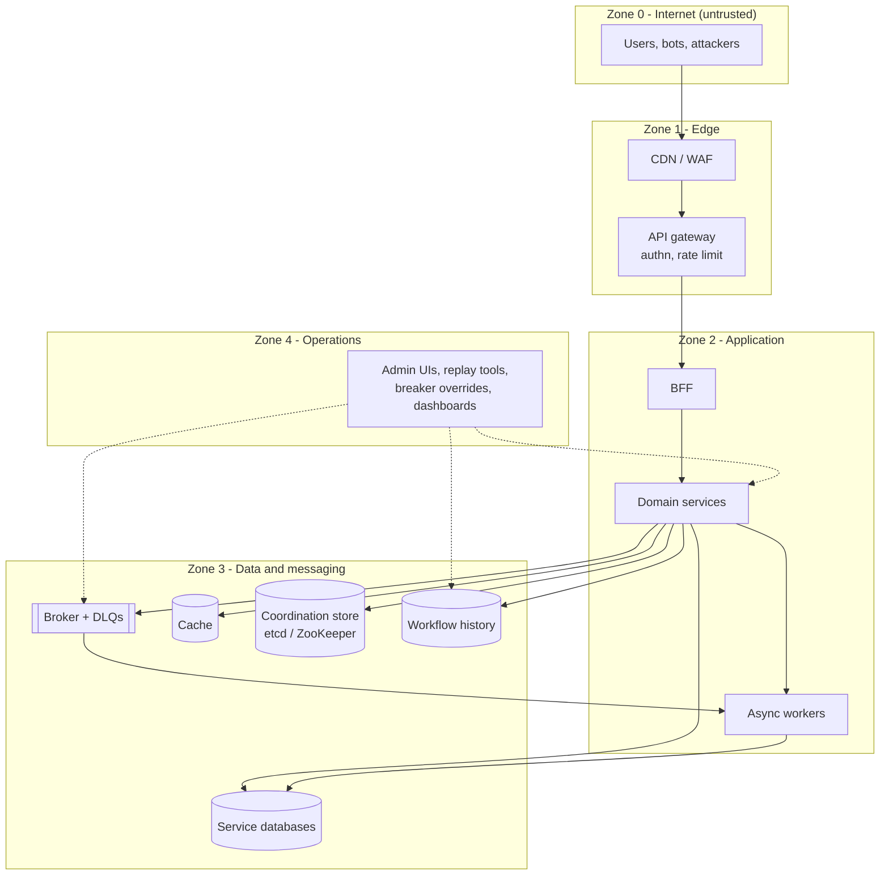
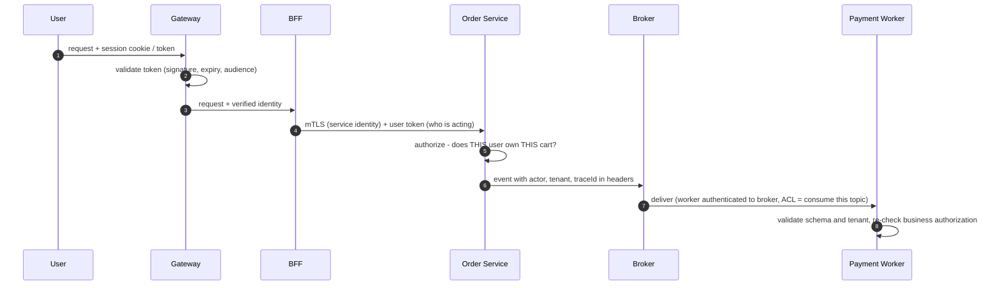
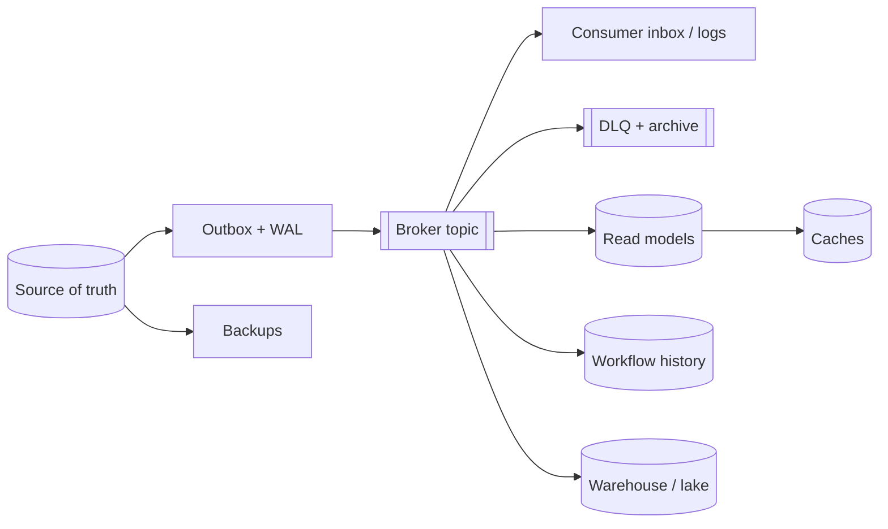

# 7.1 Security Across the Patterns

[← Frameworks and Tooling](../06-putting-it-together/02-frameworks-and-tooling.md) · [Index](../README.md) · Next: [Performance →](02-performance.md)

Each pattern chapter has its own security section. This chapter looks across them: the trust
boundaries a distributed system creates, the threats that are specific to asynchronous
architectures, and a consolidated control list.

---

## 1. Why Distribution Changes the Threat Model

| Monolith | Distributed system |
|---|---|
| One process, one database, one perimeter | Many network hops; every hop is an attack surface |
| Function calls are trusted | Every call needs authentication and authorization |
| Data in one place | Data copied into events, outboxes, logs, caches, read models, DLQs, workflow histories |
| A request is handled while the user is present | Work happens later, by a worker, without the user's session |
| Failure → error | Failure → fallback, retry, replay: each can be abused |

## 2. Trust Boundaries

Zone 3 and Zone 4 are where distributed systems are typically weakest: brokers, caches and
admin tools are often deployed with default credentials "because they're internal".

---

## 3. Threats by Pattern (STRIDE)

| Pattern | Spoofing | Tampering | Repudiation | Information disclosure | Denial of service | Elevation of privilege |
|---|---|---|---|---|---|---|
| **Outbox / events** | Forged events from a compromised producer | Event altered in transit or in the outbox | Who emitted this? | PII in payloads, WAL, topic, consumer logs | Outbox/WAL growth fills disk | CDC role over-privileged (reads all tables) |
| **Saga** | Fake compensation request (`refund`) | Amount changed in a compensation | Disputed refund without a saga log | Saga state exposes addresses/amounts | Many sagas started, never finished | Orchestrator identity used to call anything |
| **TCC** | `confirm` for someone else's transaction ID | Amount supplied at Confirm | — | Reservation tables | **Reservation exhaustion** (hold all stock) | — |
| **Idempotency** | Guessing another tenant's key | Key reused with a different body | — | Cached response replayed to wrong caller | Pre-registering keys to block requests | — |
| **Competing consumers** | Rogue consumer joins the group | Malicious payload → deserialization exploit | — | Any consumer can read every message on the topic | Poison messages crash workers | Worker has the union of all handlers' permissions |
| **DLQ** | — | Edited message replayed | Who replayed what? | Least-protected copy of production data | Flood of poison messages | Replay = inject into production |
| **Retry** | — | — | — | Bodies logged per attempt | **Amplification** of attacker-induced slowness | — |
| **Circuit breaker** | — | — | — | Breaker names/hosts in errors | Attacker trips breaker for everyone | **Fail-open** on auth/fraud check |
| **Bulkhead** | — | — | — | — | One tenant fills the shared pool | — |
| **Rate limiting** | Spoofed `X-Forwarded-For` | — | — | 429 behaviour reveals account existence | Limiter store exhaustion; lockout abuse | Key rotation to bypass |
| **Cache-aside** | — | **Cache poisoning** | — | **Cross-tenant leakage via key** | Cache-busting / penetration | Stale permissions served |
| **BFF** | Session hijack | CSRF | — | Over-exposed fields; tokens in browser | Expensive fan-out per request | "BFF checked it" → services skip authz |
| **Event sourcing / views** | Forged events | History rewritten | *(mitigated: append-only log is strong evidence)* | PII is immutable; views bypass authz | Unbounded streams | Read model without row-level checks |
| **Leader election** | Rogue node takes the lease | Stale leader writes | — | Coordination store holds secrets | Lease hogging | Leader has elevated capabilities |

---

## 4. Core Controls

### 4.1 Authenticate every hop (zero trust)

- **Service-to-service:** mutual TLS or signed workload tokens. Network location is not identity.
- **Two identities travel together:** *which service* is calling and *on whose behalf*.
- **Each service authorizes for itself.** Upstream checks are defence in depth, not a substitute.

### 4.2 Authorization for asynchronous work

A worker processes a message minutes or days later with no user session. Decide explicitly:

| Approach | Use |
|---|---|
| Carry **actor + tenant + authorised scope** in message headers; worker re-validates against current state | Default |
| Re-check that the action is still permitted at processing time (account still active, order still pending) | Anything involving money or access |
| Do **not** embed long-lived user tokens in messages | Tokens leak via logs, DLQs and replays |
| Sign critical commands (HMAC/JWS) so the consumer can verify origin and integrity | High-value flows, cross-boundary topics |

Replays (DLQ redrive, event replay, saga recovery) run with **today's** rules against
**yesterday's** intent — make sure stale commands are rejected, not blindly executed.

### 4.3 Data protection in events and copies

Every pattern copies data. Map it:

| Principle | Practice |
|---|---|
| **Minimise** | Events carry identifiers and the facts consumers need — not whole records. Never card numbers, passwords, tokens or secrets |
| **Classify** | Tag fields (public / internal / personal / sensitive); let tooling enforce where each class may flow |
| **Encrypt** | TLS everywhere in transit; at rest for DBs, brokers, caches, backups; field-level encryption for sensitive values |
| **Retain deliberately** | Topic retention, DLQ retention, inbox pruning, workflow history TTL, log retention — all are data-retention decisions |
| **Erase** | Deletion requests must reach every copy: events (crypto-shredding), views, caches, DLQs, archives |
| **Keep it out of logs** | Structured logging with an allow-list of fields; mask by default |

### 4.4 Idempotency keys as a security control

- Scope to `(tenant or caller, key)`.
- Bind to a **hash of the request**; reject reuse with a different body.
- Use unguessable keys (UUIDv4 or better) for client-supplied keys.
- Expire them; an old key must not resurrect an old response forever.
- Prevents double-spend and makes retries safe — a financial control, not a convenience.

### 4.5 Fail closed where it matters

| Dependency unavailable | Safe fallback |
|---|---|
| Authentication / token introspection | Deny (optionally accept still-valid cached validation for a very short TTL) |
| Authorization / policy service | Deny |
| Fraud / sanctions / risk check | Deny or hold for manual review — never auto-approve |
| Rate limiter store, on login/OTP/payment | Strict local limit or deny |
| Audit log sink | Block the sensitive operation or buffer durably — don't proceed unaudited |
| Recommendations, analytics, enrichment | Fail open (degrade) |

### 4.6 Availability is a security property

Resilience patterns are DoS defences. Review them as such:

- **Rate limit + load shedding** at the edge, cost-aware.
- **Bulkheads** per tenant and per expensive operation.
- **Timeouts and bounded queues** everywhere — unbounded resources are DoS vectors.
- **Retry budgets** so your own clients cannot amplify an attack.
- **TTL on reservations** (TCC) and per-user reservation caps.
- **Message size, depth and schema limits** to stop poison payloads at the door.

### 4.7 Secure the infrastructure the patterns add

| Component | Minimum bar |
|---|---|
| Message broker | TLS, authentication, per-topic/queue ACLs, no anonymous access, encryption at rest |
| Cache | Private network, auth/ACL, TLS, no dangerous commands exposed |
| CDC / connectors | Dedicated role limited to the outbox publication; secrets from a vault |
| Coordination store | mTLS, ACLs; never internet-reachable |
| Workflow engine | Payload encryption/codec, namespace isolation, SSO on the UI |
| Admin & replay tooling | SSO + MFA, role-based access, **audit log of every replay, override and manual compensation** |
| Secrets | Central secret manager, short-lived credentials, rotation; never in events, config repos or images |

### 4.8 Integrity and audit

- Append-only stores (event log, saga log, outbox) with no `UPDATE`/`DELETE` grants for the application role.
- Optional hash-chaining or signed events for tamper evidence.
- Correlate everything with a trace/correlation ID so an action can be followed from HTTP
  request to final side effect.
- **Reconciliation jobs** are a detective control: compare ledgers with gateway reports,
  frozen balances with open reservations, orders with payments.

---

## 5. Multi-Tenancy Checklist

- [ ] Tenant ID is in every token, message header, cache key, idempotency key and log line
- [ ] Every query and every consumer filters by tenant; row-level security where available
- [ ] Per-tenant rate limits and bulkheads
- [ ] Per-tenant encryption keys for high-sensitivity data
- [ ] A poison message or bad data from one tenant cannot stall others (per-tenant queues or parking)
- [ ] Circuit breakers are not tripped globally by one tenant's failing requests

## 6. Security Review Questions for a Design

1. For each arrow in the diagram: how is the caller authenticated, and who authorizes?
2. What personal or sensitive data is in each event? Who can read that topic? How long is it kept?
3. If a message is replayed a week later, what happens?
4. If each dependency is down, does the fallback fail open or closed — and is that right?
5. What can one tenant do to hurt another (capacity, cache, breaker, queue)?
6. Who can replay a DLQ, force a breaker, edit a saga, or become leader — and is it logged?
7. Where are the secrets, and what can each credential reach if stolen?
8. How does a deletion request propagate to every copy?

---

Next: [Performance →](02-performance.md)
