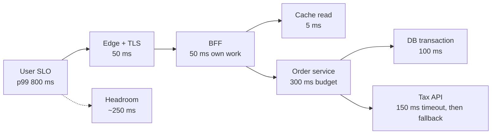
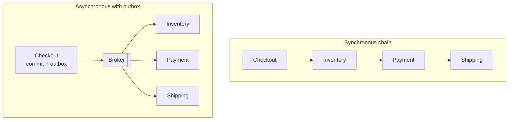
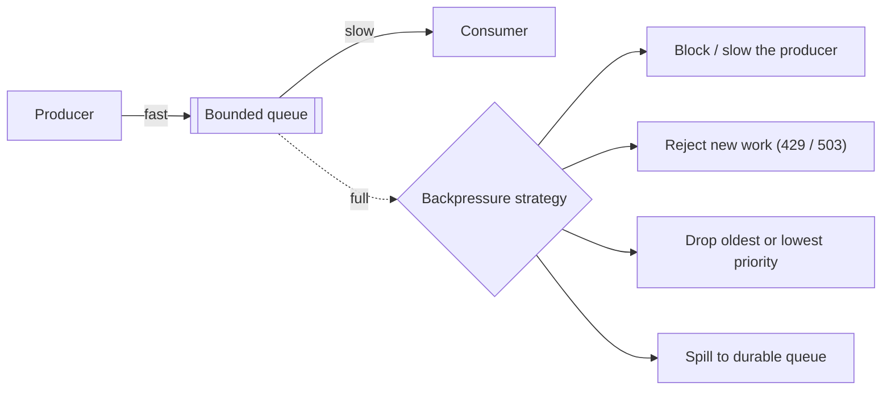

# 7.2 Performance and Capacity

[← Security](01-security.md) · [Index](../README.md) · Next: [Observability and Alerting →](03-observability-and-alerting.md)

Each pattern chapter has its own performance section. This chapter gives the shared mental
models: where time goes, how to size things, and what each pattern costs.

---

## 1. Four Laws Worth Memorising

| Law | Statement | Use it for |
|---|---|---|
| **Little's Law** | `in-flight = arrival rate × latency` | Sizing bulkheads, thread and connection pools |
| **Utilisation and queueing** | Wait time grows non-linearly as utilisation → 100% | Run pools at ~60–70%, not 95% |
| **Serial availability** | `A_total = A₁ × A₂ × … × Aₙ` | Why synchronous chains are fragile |
| **Tail at scale** | With *n* parallel calls, `P(at least one slow) = 1 − (1 − p)ⁿ` | Why fan-out makes p99 the common case |

Worked examples:

- 200 req/s × 150 ms = **30** requests in flight → a pool of 20 is undersized, 45 gives headroom.
- Five synchronous dependencies at 99.9% each → 99.5% combined (≈ 3.6 hours/month instead of 43 minutes).
- A page that fans out to 20 services, each slow 1% of the time → 18% of page loads hit at least one slow call.

## 2. Latency Budget

Start from the user-facing objective and divide it up. Every hop gets a timeout from the budget.

Rules:

1. **Timeout < caller's remaining budget.** A callee timeout longer than the caller's is wasted work.
2. **Propagate the deadline** (header / gRPC deadline) so downstream services stop early.
3. **Derive timeouts from measured p99**, plus margin — not round numbers like 30 s.
4. **Parallelise independent calls**; latency becomes the max, not the sum.
5. **Move work off the synchronous path**: commit locally, return `202`, finish asynchronously.

## 3. Sync vs Async

| | Synchronous chain | Asynchronous |
|---|---|---|
| User-perceived latency | Sum of all hops | First local commit only |
| Availability | Product of all hops | First service only (others catch up) |
| Spike handling | Every service must handle peak | Broker buffers; consumers work at their own pace (load levelling) |
| Consistency | Immediate | Eventual (must design UI for it) |
| Debuggability | Simple stack trace | Needs tracing and correlation IDs |

## 4. Cost of Each Pattern

| Pattern | Hot-path cost | Hidden cost | Biggest win |
|---|---|---|---|
| Transactional outbox | +1 insert in an existing transaction | Table/WAL growth; relay lag | No lost events without 2PC |
| Saga | Sum of steps (or max if parallel) | Compensations; saga-state writes per step | No distributed locks |
| TCC | 2 round-trips per participant | Held resources reduce sellable capacity | Isolation without long DB locks |
| Idempotent consumer (inbox) | +1 PK insert per message | Inbox table pruning | Safe retries everywhere |
| Natural idempotency | None | — | Free |
| Competing consumers | — | Rebalances; ordering constraints | Linear throughput scaling |
| DLQ | None on success | Detection delay = retry schedule | Queue never blocked |
| Retry | None on success | Load multiplication under failure | Transparent recovery from blips |
| Circuit breaker | Nanoseconds–microseconds | Tuning; fallback capacity | Timeouts replaced by instant rejection |
| Bulkhead | Counter increment | Partitioned capacity can sit idle | One failure doesn't spread |
| Rate limiting | One cache round-trip (or local) | Shared-store dependency | Protects capacity and budget |
| Cache-aside | Sub-millisecond per read | Staleness; cold-start load on DB | Order-of-magnitude read latency/DB load reduction |
| BFF | One extra hop | Another service to run | Fewer client round-trips, smaller payloads |
| Event sourcing | Stream load per command | Projection lag; rebuild time; storage growth | Cheap appends; O(1) reads from views |
| Materialized view | None on read | Write amplification (each event updates N views) | No joins, no cross-service calls |
| Leader election | None for followers | Singleton throughput ceiling; failover gap | Exactly-one semantics for jobs |

## 5. Sizing Cheat Sheet

| Resource | Starting formula | Then check |
|---|---|---|
| **Bulkhead / concurrency limit** | `peak rate × p99 latency × 1.5` | ≤ dependency's capacity ÷ caller instances |
| **DB connection pool** | Small: often `2 × cores` on the DB side is more than enough in total | Sum over all instances ≤ DB `max_connections` minus admin headroom |
| **Worker count** | `arrival rate × mean processing time ÷ 0.7` | Downstream can absorb that concurrency |
| **Kafka partitions** | `target throughput ÷ per-consumer throughput`, rounded up generously | Partition count caps consumer parallelism; increasing later disturbs key ordering |
| **Queue length (in-process)** | `acceptable wait × throughput` | Wait must be shorter than the caller's timeout |
| **Circuit-breaker timeout** | Healthy p99 × ~1.5–2 | In-flight during an outage = `rate × timeout` must fit the bulkhead |
| **Retry delay cap** | Typical recovery time of the dependency | Total (attempts + delays) < overall deadline |
| **Cache TTL** | Tolerable staleness for that data type | Hit ratio and DB load at that TTL |
| **Lease TTL** | Tolerable time without a leader | > worst-case pause + network jitter |
| **TCC reservation TTL** | Longest legitimate checkout × safety factor | ≫ coordinator's phase-2 retry window |
| **Inbox retention** | Max redelivery + replay window | Table size |

## 6. Common Bottlenecks and Fixes

| Symptom | Likely cause | Fix |
|---|---|---|
| p99 ≫ p50 on an aggregate endpoint | Fan-out tail latency | Tighter per-call timeouts; hedged reads; fewer required calls; fallbacks |
| Throughput flat despite more app instances | DB connection limit or lock contention | Connection pooler; shorter transactions; reduce hot-row updates |
| Consumer lag grows, CPU idle | I/O-bound handler, low concurrency | More concurrent handlers per worker; batching |
| Lag grows on one partition only | Hot key | Re-key; split the tenant; dedicated partition handling |
| DB CPU spikes periodically | Cache stampede / synchronised TTLs / cron alignment | Jitter; single-flight; refresh-ahead |
| Latency rises, then everything times out | Queueing with no shedding | Bounded queues; load shedding; bulkheads |
| Outbox lag grows | Relay single-threaded or DB bloat | Batch + parallel relays (`SKIP LOCKED`); CDC; purge published rows |
| Command latency grows over months | Long event streams | Snapshots; smaller aggregates |
| Recovery from outage takes longer than the outage | Retry storm / thundering herd | Jitter, budgets, gradual ramp |
| Hot row contention (inventory, counters, wallet) | Every transaction updates one row | Shorter transactions; striped/bucketed counters; append-only ledger with periodic rollup |

## 7. Backpressure

A system without backpressure converts overload into latency, then into collapse.

- Bound **every** queue, buffer and pool. Decide the overflow policy on purpose.
- Pull-based consumption (workers fetch when ready) gives natural backpressure.
- The durable broker is your big buffer; in-process queues should be tiny.
- Propagate overload signals upstream (`429`/`503` + `Retry-After`) rather than absorbing silently.

## 8. Load and Resilience Testing

| Test | What it proves |
|---|---|
| **Load test at expected peak** | Latency budget holds; pools are sized |
| **Stress to failure** | The system degrades (sheds) rather than collapses; find the knee |
| **Soak (hours)** | No leaks: bulkhead slots, connections, inbox/outbox growth |
| **Spike** | Autoscaling lag, queue buffering, rate limits |
| **Dependency latency injection** | Bulkheads + breakers actually isolate; fallbacks carry the load |
| **Dependency kill + restore** | No thundering herd on recovery; breaker closes cleanly |
| **Cold cache start** | Database survives; stampede protection works |
| **Kill a worker / relay / leader mid-operation** | Idempotency, redelivery and failover behave |
| **Backlog replay** | Rate-limited redrive doesn't overload downstream |
| **Projection rebuild** | Fits within the recovery objective |

Measure from the **client's point of view** with open-loop load (fixed arrival rate), or
queueing delay will be hidden (coordinated omission). Report percentiles, never only averages.

## 9. Performance Checklist

- [ ] End-to-end latency budget documented; every hop has a derived timeout
- [ ] Deadlines propagate downstream
- [ ] Only one local transaction on the synchronous critical path
- [ ] Pools and bulkheads sized from peak rate × p99
- [ ] All queues bounded with an explicit overflow policy
- [ ] Autoscaling driven by lag/queue age for consumers
- [ ] Database sized (or protected) for a cold cache
- [ ] Batch I/O in relays, consumers and projectors
- [ ] Jitter on all TTLs, retries and schedules
- [ ] Failure-injection tests are part of the release process

---

Next: [Observability and Alerting →](03-observability-and-alerting.md)
