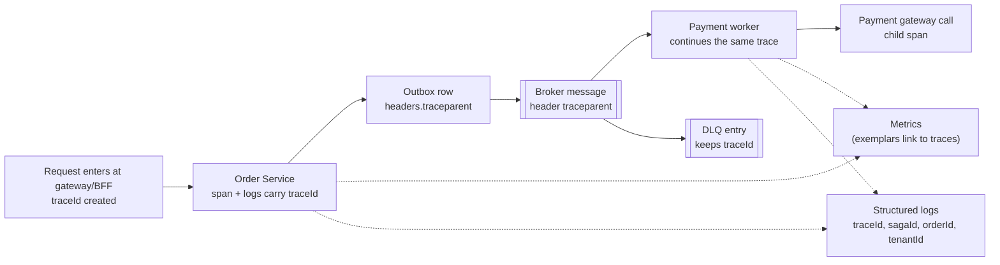
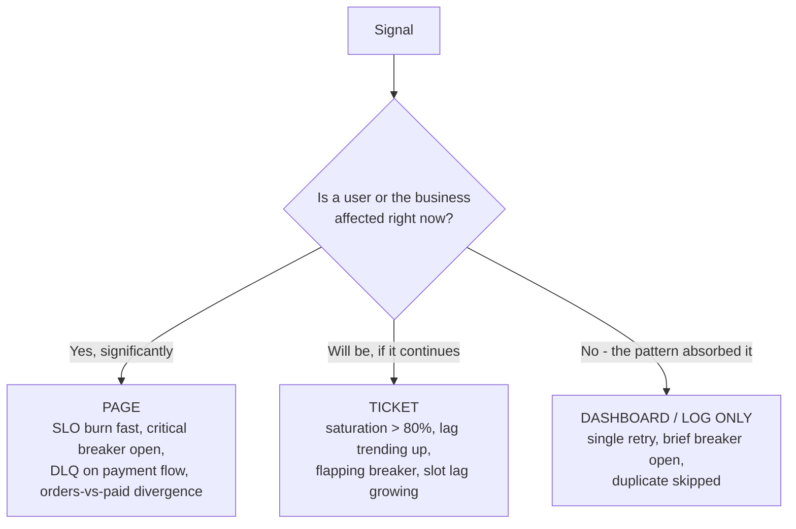
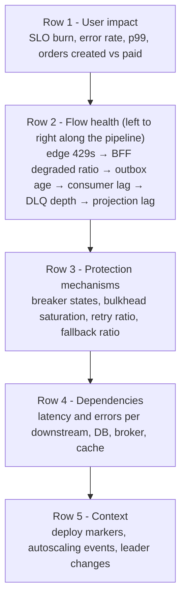

# 7.3 Observability and Alerting

[← Performance](02-performance.md) · [Index](../README.md) · Next: [Production Readiness Checklist →](04-production-readiness-checklist.md)

Every pattern in this handbook turns a loud failure (an exception) into a quiet one (a retry,
a fallback, a parked message). That is good for users and dangerous for operators: **if the
quiet failures are not measured, the system degrades invisibly.**

---

## 1. Three Pillars, One Correlation ID



| Pillar | Answers | Rules |
|---|---|---|
| **Metrics** | *Is something wrong? How much?* | Low-cardinality labels; rates, ratios and percentiles; drive alerts |
| **Traces** | *Where in the flow?* | Propagate W3C `traceparent` through HTTP **and** message headers; span per attempt |
| **Logs** | *What exactly happened?* | Structured (JSON); always include `traceId`, business keys; no secrets/PII |

Asynchronous hops break tracing unless you carry the context in the **outbox row and the
message headers**. Do this from day one — retrofitting is painful.

Business correlation keys to put on every log line and span: `orderId`, `sagaId` /
`transactionId`, `messageId`, `tenantId`.

---

## 2. Signals per Pattern

| Pattern | Key metric(s) | Healthy looks like | Alert when |
|---|---|---|---|
| **Outbox** | `outbox_oldest_unpublished_age_seconds`, unpublished count, CDC slot lag | Age near zero | Age > freshness SLO; slot lag growing |
| **Saga** | In-flight count, oldest in-flight age, compensation rate, stuck count | Completes within seconds/minutes | Stuck > 0; compensation rate spike |
| **TCC** | Reservations by status, reaper cancellations, frozen-vs-reserved delta | Few `TRIED`, delta = 0 | Reaper rate up; delta ≠ 0 |
| **Idempotent consumer** | Duplicates skipped, inbox size | Low steady duplicate rate | Duplicate spike |
| **Competing consumers** | Lag, **age of oldest message**, processing p99, redeliveries | Lag oscillates near zero | Age > SLO; p99 near visibility timeout |
| **DLQ** | Depth, arrival rate, oldest age | Zero | Depth > 0 |
| **Retry** | Retry ratio, exhausted attempts | < few % | Ratio > 10%; budget exhausted |
| **Circuit breaker** | State, transitions, fallback ratio, rejected calls | Closed | Open > N min; flapping; fallback ratio high |
| **Bulkhead** | Saturation, queue depth, rejections | < 70% | > 80% sustained; rejections on critical pool |
| **Rate limiting** | 429 ratio, top throttled clients, limiter errors | Small, stable | Spike on auth endpoints; paying tenant throttled |
| **Cache-aside** | Hit ratio, evictions, latency | High, stable hit ratio | Hit-ratio drop; eviction surge |
| **BFF** | Endpoint p99, degraded-response ratio, fan-out count | — | Degraded ratio up |
| **Event sourcing / views** | Projection lag, concurrency conflicts, stream load time | Lag in ms–s | Lag > SLO |
| **Leader election** | `sum(is_leader)`, transitions, time since last job success | Exactly 1 | 0 or > 1; job stale |

Detailed breaker metrics and Prometheus rules: [Circuit Breaker §6](../04-resilience/02-circuit-breaker.md#6-monitoring-and-alerts).

---

## 3. Lag Is the Universal Async Metric

For anything asynchronous, measure **time**, not just count:

| Count-based | Time-based (prefer) |
|---|---|
| 10,000 messages in queue | Oldest message is 4 minutes old |
| 300 unpublished outbox rows | Oldest unpublished row is 45 seconds old |
| Projection is 2,000 events behind | Read model is 12 seconds stale |

Count depends on traffic volume; age maps directly to user impact and to an SLO.

---

## 4. SLOs and Alerting Strategy

Define a small number of user-centric objectives, then alert on **burning the error budget**.

| SLI | Example SLO |
|---|---|
| Checkout availability | 99.9% of `POST /checkout` succeed (non-5xx) over 30 days |
| Checkout latency | 99% complete in < 800 ms |
| Order-to-paid freshness | 99% of orders reach `PAID`/`FAILED` within 60 s |
| Read-model freshness | 99% of events projected within 5 s |



| Principle | Why |
|---|---|
| **Page on symptoms, ticket on causes** | Users feel error rate and latency, not CPU |
| **Multi-window burn-rate alerts** | Catch fast burns quickly and slow burns eventually, with few false positives |
| **Every alert has a runbook link and an owner** | An alert nobody can act on is noise |
| **Use `for:` durations** | Resilience patterns self-heal within seconds; don't page for that |
| **Aggregate across instances** | One pod's breaker ≠ an incident |
| **Alert on absence** | No heartbeat from the relay/leader/job is a failure too |
| **Business invariants** | Orders created vs paid; ledger vs gateway report — catches what component metrics miss |

### Example rules (Prometheus syntax; metric names are illustrative)

```yaml
groups:
  - name: async-pipeline
    rules:
      - alert: OutboxLagHigh
        expr: outbox_oldest_unpublished_age_seconds > 60
        for: 5m
        labels: { severity: page }
        annotations: { summary: "Events from {{ $labels.service }} are not being published" }

      - alert: ConsumerOldestMessageAge
        expr: queue_oldest_message_age_seconds{queue="payments"} > 120
        for: 5m
        labels: { severity: page }

      - alert: DeadLettersPresent
        expr: dlq_depth{flow="payment"} > 0
        for: 1m
        labels: { severity: page }

      - alert: SagaStuck
        expr: saga_needs_attention_count > 0
        labels: { severity: page }

      - alert: ProjectionLagHigh
        expr: projection_lag_seconds{projection="order_history"} > 30
        for: 10m
        labels: { severity: ticket }

      - alert: BulkheadSaturated
        expr: bulkhead_active / bulkhead_max > 0.8
        for: 10m
        labels: { severity: ticket }

      - alert: RetryRatioHigh
        expr: sum by (operation) (rate(retries_total[5m])) / sum by (operation) (rate(requests_total[5m])) > 0.1
        for: 10m
        labels: { severity: ticket }

      - alert: NoLeader
        expr: sum by (lease) (is_leader) == 0
        for: 1m
        labels: { severity: page }

      - alert: MultipleLeaders
        expr: sum by (lease) (is_leader) > 1
        labels: { severity: page }

      - alert: OrdersNotBeingPaid          # business invariant: catches anything the others miss
        expr: |
          (sum(increase(orders_created_total[15m])) - sum(increase(orders_settled_total[15m])))
            / clamp_min(sum(increase(orders_created_total[15m])), 1) > 0.2
        for: 10m
        labels: { severity: page }
```

---

## 5. Dashboards

Lay dashboards out in the order an incident is investigated:



## 6. Tracing Tips for These Patterns

| Situation | Practice |
|---|---|
| Retries | One span per attempt, tagged `retry.attempt`; parent span shows total |
| Breaker rejection | Span event `circuit.open` — otherwise a fast failure looks like a healthy fast call |
| Fallback used | Tag `fallback=true`, `fallback.source=cache|default` |
| Outbox → broker → consumer | Inject context when writing the outbox row; extract in the consumer; use span **links** for batch consumers |
| Saga | One trace (or linked traces) per saga, `sagaId` attribute on every span |
| DLQ replay | New trace **linked** to the original; tag `replay=true` |
| Sampling | Always keep traces with errors, fallbacks or high latency (tail-based sampling) |

## 7. Logging Rules

- Log **state transitions**, not chatter: breaker opened, saga compensating, message dead-lettered, leader acquired.
- One structured event per transition with machine-readable fields (`event`, `from`, `to`, IDs).
- Duplicates skipped and single retries → `DEBUG`/metrics, not `WARN`.
- **Never** log secrets, tokens, full card data or full message payloads. Mask by default.
- Log levels should mean something: `ERROR` = needs human attention.

## 8. Checklist

- [ ] Trace context flows through outbox rows and message headers
- [ ] Every async stage exposes an *age/lag* metric
- [ ] Every resilience component exposes state, saturation and rejection metrics
- [ ] Fallback usage is counted and visible
- [ ] DLQ depth alerts exist for every queue
- [ ] SLOs defined; paging alerts are symptom-based
- [ ] At least one end-to-end business-invariant alert
- [ ] Alerts have owners and runbooks
- [ ] Dashboards include deploy markers
- [ ] Logs are structured, correlated and free of sensitive data

---

Next: [Production Readiness Checklist →](04-production-readiness-checklist.md)
