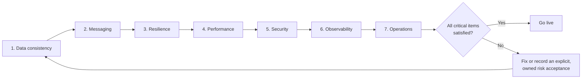

# 7.4 Production Readiness Checklist

[← Observability](03-observability-and-alerting.md) · [Index](../README.md) · Next: [Cheat Sheet →](../08-reference/01-cheat-sheet.md)

A consolidated review list. Use it for design reviews and before go-live. Each item links back
to the chapter that explains it.

---

## 1. Review Flow

---

## 2. Data Consistency

- [ ] Each table has exactly one owning service; no cross-service DB access — [2.4](../02-data-consistency/04-database-per-service.md)
- [ ] No dual writes: every "save + publish" goes through an outbox — [2.1](../02-data-consistency/01-transactional-outbox.md)
- [ ] Outbox row and business row share one connection and one transaction
- [ ] Multi-service business transactions are modelled as a saga or TCC with a named owner — [2.2](../02-data-consistency/02-saga-pattern.md), [2.3](../02-data-consistency/03-try-confirm-cancel.md)
- [ ] Saga state is persisted; orchestrator resumes after a crash
- [ ] Every compensable step has a tested, idempotent compensation
- [ ] Pivot (irreversible) step identified and placed last
- [ ] TCC reservations have TTLs, a reaper, and empty-cancel / late-try guards
- [ ] Intermediate states (`PENDING`, `RESERVED`) are explicit in the domain model
- [ ] Reconciliation job exists for money and stock

## 3. Messaging

- [ ] Every message has a producer-assigned unique ID — [3.1](../03-messaging/01-idempotent-consumer.md)
- [ ] Every consumer is idempotent (inbox, natural idempotency or provider key)
- [ ] External side effects use persisted idempotency keys
- [ ] Ordering requirement stated; partition key chosen accordingly — [3.2](../03-messaging/02-competing-consumers.md)
- [ ] Handlers tolerate out-of-order and stale messages
- [ ] Ack after processing; handler timeout < visibility timeout
- [ ] Max delivery attempts and DLQ configured on every queue — [3.3](../03-messaging/03-dead-letter-queues.md)
- [ ] Errors classified transient / permanent / business
- [ ] Rate-limited, audited replay tool exists and has been used in a drill
- [ ] Event schemas are versioned; consumers ignore unknown fields
- [ ] Workers shut down gracefully

## 4. Resilience

- [ ] Every remote call has a timeout — no defaults, no infinite waits
- [ ] Retries: only retryable errors, backoff + jitter, capped attempts, overall deadline — [4.1](../04-resilience/01-retry-backoff-jitter.md)
- [ ] Retries at one layer only, or a retry budget
- [ ] Circuit breaker per dependency with a deliberate fallback — [4.2](../04-resilience/02-circuit-breaker.md)
- [ ] Bulkhead per dependency; critical and optional work isolated — [4.3](../04-resilience/03-bulkhead.md)
- [ ] Rate limits per identity; load shedding by priority — [4.4](../04-resilience/04-rate-limiting.md)
- [ ] All queues, pools and buffers are bounded
- [ ] Jitter on TTLs, cron schedules, reconnects and token refresh — [4.5](../04-resilience/05-thundering-herd.md)
- [ ] Cache failure degrades to the database safely — [5.1](../05-performance-api-coordination/01-cache-aside.md)
- [ ] Singleton jobs use leader election with fencing or idempotency — [5.3](../05-performance-api-coordination/03-leader-election.md)
- [ ] Failure-injection tests: kill dependency, slow dependency, kill worker, kill leader, cold cache

## 5. Performance

- [ ] Latency budget per user journey; timeouts derived from it — [7.2](02-performance.md)
- [ ] Synchronous path contains only what must be synchronous
- [ ] Pools/bulkheads sized from peak rate × p99
- [ ] Consumers autoscale on lag or message age
- [ ] Outbox, inbox, saga and reservation tables have purge/partition strategies
- [ ] Database sized or protected for a cold cache
- [ ] Load, stress, soak and spike tests done; breaking point known
- [ ] Projection rebuild time measured

## 6. Security

- [ ] Every hop authenticated (mTLS / workload identity); every service authorizes for itself — [7.1](01-security.md)
- [ ] Per-service least-privilege credentials for DB, broker, cache
- [ ] Events contain no secrets, credentials or raw card data; PII minimised
- [ ] Encryption in transit and at rest for DBs, broker, cache, backups, DLQs
- [ ] Idempotency keys scoped per tenant and bound to request hash
- [ ] Compensation/refund/confirm endpoints restricted to the coordinator identity; amounts from own records
- [ ] Security-relevant fallbacks fail closed
- [ ] Cache keys include tenant/user/permission dimensions
- [ ] Browser tokens held server-side by the BFF; CSRF defence in place — [5.2](../05-performance-api-coordination/02-backend-for-frontend.md)
- [ ] Rate limits on login/OTP/reset, fail-closed
- [ ] Admin, replay and override tools behind SSO with audit logs
- [ ] Data-erasure path reaches events, views, caches, DLQs and archives
- [ ] Retention set for topics, DLQs, logs, workflow history

## 7. Observability

- [ ] Trace context propagated through HTTP, outbox and message headers — [7.3](03-observability-and-alerting.md)
- [ ] Lag/age metric for outbox, each queue and each projection
- [ ] Breaker state, bulkhead saturation, retry ratio, fallback ratio exported
- [ ] DLQ depth alert on every queue
- [ ] SLOs defined; paging alerts are symptom-based with runbooks
- [ ] End-to-end business-invariant alert (e.g. orders created vs paid)
- [ ] Alerts for "no leader", "relay heartbeat missing", "job stale"
- [ ] Structured logs with correlation IDs and no sensitive data

## 8. Operations

- [ ] Runbooks: breaker open, DLQ non-empty, outbox lag, stuck saga, consumer lag, no leader
- [ ] Manual compensation procedure documented and access-controlled
- [ ] Rolling deploys are compatible with in-flight messages and sagas (old and new versions coexist)
- [ ] Schema/contract changes follow expand → migrate → contract
- [ ] Backup and restore tested per service; event replay reconciles after restore
- [ ] Capacity headroom and scaling limits known
- [ ] On-call owns each queue, DLQ and scheduled job by name
- [ ] Game day / chaos exercise completed

---

## 9. "What Happens If…" Drill

Ask these in every design review. A good design has a specific answer for each.

| Question | Good answer mentions |
|---|---|
| The process crashes between *any* two lines? | Local transaction boundaries; outbox; resumable saga |
| The same message arrives twice? Ten times? | Inbox / conditional update / provider key |
| Messages arrive out of order? | Version checks; tombstones; partition key |
| A dependency is slow (not down) for 10 minutes? | Timeout, bulkhead, breaker, fallback |
| The dependency comes back? | Half-open probes, jitter, gradual ramp |
| A message can never be processed? | DLQ, alert, replay |
| The cache is empty? | Stampede protection; DB protected |
| A step succeeds but the response is lost? | Idempotency key; retry safe |
| The compensation fails? | Retry forever; human escalation |
| Two nodes both think they are leader? | Fencing token; idempotent work |
| One tenant sends 100× normal traffic? | Per-tenant limits and bulkheads |
| An operator replays last week's DLQ? | Idempotent, staleness check, rate limit, audit |
| We need to delete a customer's data? | Data map; crypto-shredding; purge of copies |

---

Next: [Cheat Sheet →](../08-reference/01-cheat-sheet.md)
