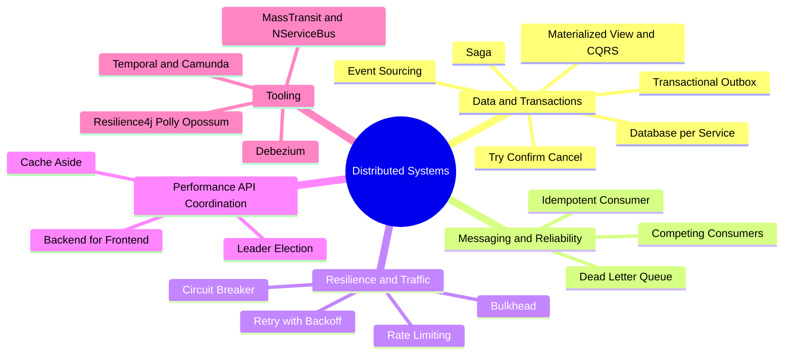
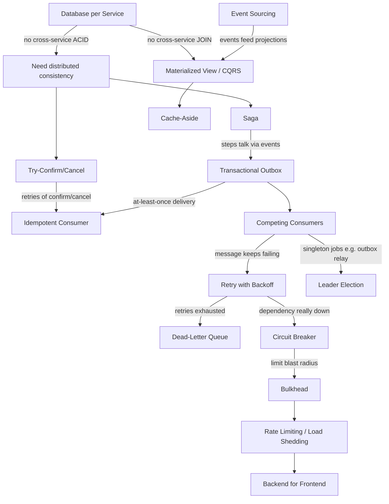
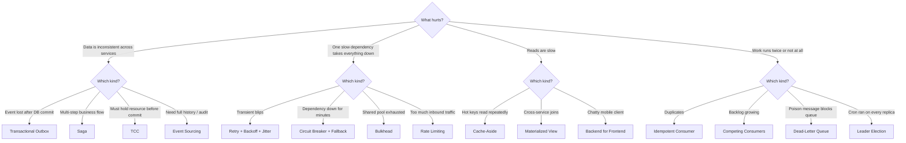

# Distributed Systems Patterns Handbook

A structured handbook built from reading notes on distributed transactions, messaging
reliability and resilience patterns. Every chapter follows the same shape so you can scan it
quickly:

> **Problem → Mechanism → Diagrams → Code → Failure modes → Security → Performance → Observability → Checklist**

Diagrams are [Mermaid](https://mermaid.js.org/) and render directly on GitHub.
Code samples are Node.js / PostgreSQL / Python, kept dependency-free so the mechanics are visible.

---

## Directory Map

```text
Distributed-Systems-Patterns-Handbook/
├── README.md                                  ← you are here (index, mind map, reading paths)
├── 01-foundations/
│   └── 01-distributed-transactions-primer.md  dual-write, delivery semantics, 2PC vs Saga vs TCC
├── 02-data-consistency/
│   ├── 01-transactional-outbox.md             atomic "save + publish"
│   ├── 02-saga-pattern.md                     orchestration, choreography, compensation
│   ├── 03-try-confirm-cancel.md               reserve → confirm / cancel
│   ├── 04-database-per-service.md             data ownership and its consequences
│   └── 05-event-sourcing-cqrs-materialized-views.md
├── 03-messaging/
│   ├── 01-idempotent-consumer.md              inbox table, natural idempotency, API keys
│   ├── 02-competing-consumers.md              parallel workers, ordering, rebalancing
│   └── 03-dead-letter-queues.md               poison messages, triage, replay
├── 04-resilience/
│   ├── 01-retry-backoff-jitter.md
│   ├── 02-circuit-breaker.md                  states, fallbacks, monitoring and alerts
│   ├── 03-bulkhead.md
│   ├── 04-rate-limiting.md
│   └── 05-thundering-herd.md                  how the four patterns combine
├── 05-performance-api-coordination/
│   ├── 01-cache-aside.md
│   ├── 02-backend-for-frontend.md
│   └── 03-leader-election.md
├── 06-putting-it-together/
│   ├── 01-ecommerce-checkout-walkthrough.md   the patterns in one request
│   └── 02-frameworks-and-tooling.md           Temporal, Debezium, MassTransit, Resilience4j…
├── 07-cross-cutting/
│   ├── 01-security.md                         threat model across all patterns
│   ├── 02-performance.md                      capacity, latency budgets, tuning
│   ├── 03-observability-and-alerting.md       metrics, traces, alert rules
│   └── 04-production-readiness-checklist.md
└── 08-reference/
    ├── 01-cheat-sheet.md                      all comparison tables in one place
    └── 02-glossary.md
```

---

## Mind Map



## How the Patterns Depend on Each Other

One decision — *each service owns its database* — creates the problems the other patterns solve.



---

## The 12 Infographic Patterns → Where to Read

| # | Pattern | Category | One-line mechanism | Chapter |
|---|---------|----------|--------------------|---------|
| 1 | Event Sourcing | Data | Append-only event log is the source of truth | [02/05](02-data-consistency/05-event-sourcing-cqrs-materialized-views.md) |
| 2 | Circuit Breaker | Resilience | Fail fast when a dependency is down; probe for recovery | [04/02](04-resilience/02-circuit-breaker.md) |
| 3 | Retry with Backoff | Resilience | Exponential delay + jitter for transient errors | [04/01](04-resilience/01-retry-backoff-jitter.md) |
| 4 | Bulkhead | Resilience | Isolated concurrency budget per dependency | [04/03](04-resilience/03-bulkhead.md) |
| 5 | Rate Limiting | Traffic | Cap requests per client per window | [04/04](04-resilience/04-rate-limiting.md) |
| 6 | Cache-Aside | Performance | Read cache → miss → load DB → fill cache | [05/01](05-performance-api-coordination/01-cache-aside.md) |
| 7 | Idempotent Consumer | Messaging | Track processed message IDs; ignore duplicates | [03/01](03-messaging/01-idempotent-consumer.md) |
| 8 | Backend for Frontend | API | One tailored gateway per client type | [05/02](05-performance-api-coordination/02-backend-for-frontend.md) |
| 9 | Database per Service | Data | Private schema per service | [02/04](02-data-consistency/04-database-per-service.md) |
| 10 | Leader Election | Coordination | Exactly one active node for singleton work | [05/03](05-performance-api-coordination/03-leader-election.md) |
| 11 | Competing Consumers | Messaging | Many workers drain one queue | [03/02](03-messaging/02-competing-consumers.md) |
| 12 | Materialized View | Performance | Precomputed read model kept fresh by events | [02/05](02-data-consistency/05-event-sourcing-cqrs-materialized-views.md) |

Not on the infographic but covered here because they complete the picture:
[Transactional Outbox](02-data-consistency/01-transactional-outbox.md),
[Saga](02-data-consistency/02-saga-pattern.md),
[TCC](02-data-consistency/03-try-confirm-cancel.md),
[Dead-Letter Queues](03-messaging/03-dead-letter-queues.md),
[Thundering Herd](04-resilience/05-thundering-herd.md).

---

## Reading Paths

| If you want to… | Read in this order |
|---|---|
| **Understand the core problem first** | [Primer](01-foundations/01-distributed-transactions-primer.md) → [Outbox](02-data-consistency/01-transactional-outbox.md) → [Idempotent Consumer](03-messaging/01-idempotent-consumer.md) |
| **Design a multi-service business transaction** | [Primer](01-foundations/01-distributed-transactions-primer.md) → [Saga](02-data-consistency/02-saga-pattern.md) → [TCC](02-data-consistency/03-try-confirm-cancel.md) → [Frameworks](06-putting-it-together/02-frameworks-and-tooling.md) |
| **Stop cascading failures** | [Retry](04-resilience/01-retry-backoff-jitter.md) → [Circuit Breaker](04-resilience/02-circuit-breaker.md) → [Bulkhead](04-resilience/03-bulkhead.md) → [Thundering Herd](04-resilience/05-thundering-herd.md) |
| **Build fast read models** | [Database per Service](02-data-consistency/04-database-per-service.md) → [Event Sourcing + CQRS](02-data-consistency/05-event-sourcing-cqrs-materialized-views.md) → [Cache-Aside](05-performance-api-coordination/01-cache-aside.md) |
| **See everything in one system** | [E-commerce checkout walkthrough](06-putting-it-together/01-ecommerce-checkout-walkthrough.md) |
| **Prepare for a design review / interview** | [Cheat sheet](08-reference/01-cheat-sheet.md) → [Production checklist](07-cross-cutting/04-production-readiness-checklist.md) |
| **Review security or performance only** | [Security](07-cross-cutting/01-security.md) · [Performance](07-cross-cutting/02-performance.md) · [Observability](07-cross-cutting/03-observability-and-alerting.md) |

---

## Pattern Picker



---

## Five Rules That Underlie Every Chapter

1. **The network lies.** A timeout tells you nothing about whether the other side did the work.
   Every remote call has three outcomes: success, failure, *unknown*.
2. **At-least-once + idempotency = effectively-once.** Exactly-once *delivery* is not available
   across system boundaries; exactly-once *effect* is, if every handler is idempotent.
3. **Only a single local transaction is atomic.** Anything that must happen together has to be
   written in one local ACID transaction (that is the whole trick behind Outbox and Inbox).
4. **Bound everything.** Every call needs a timeout, every queue a maximum size, every retry a
   limit, every reservation a TTL. Unbounded anything becomes an outage.
5. **A failure you cannot see is a failure you will repeat.** Every pattern here emits state
   (breaker open, DLQ depth, outbox lag) that must be on a dashboard with an alert.

---

*Corrections to the original reading notes are called out in each chapter under
**"Notes on the original snippet"** — for example the race in the hand-rolled bulkhead, the
non-atomic balance check in the TCC `try`, and Kafka not having a native DLQ.*
