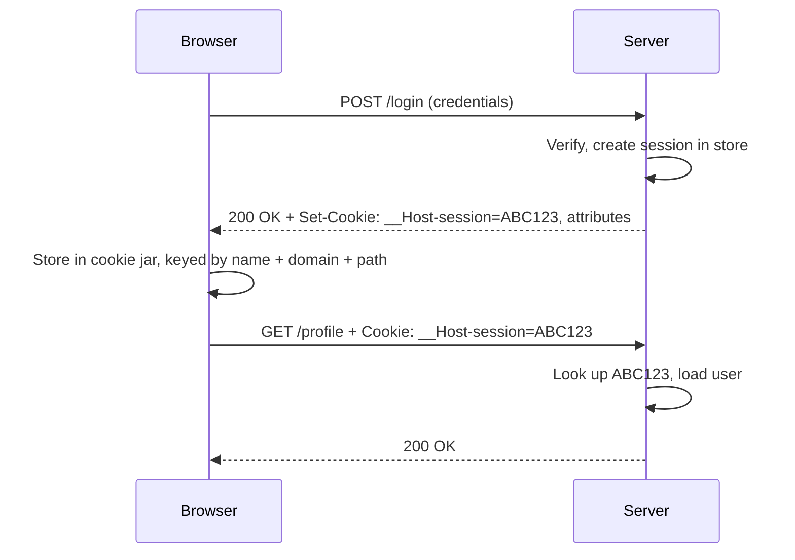
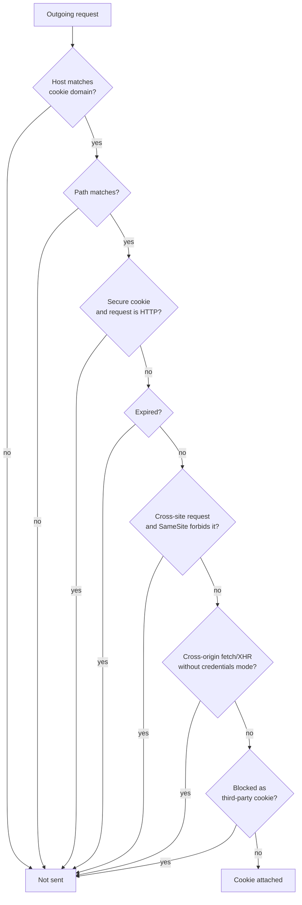
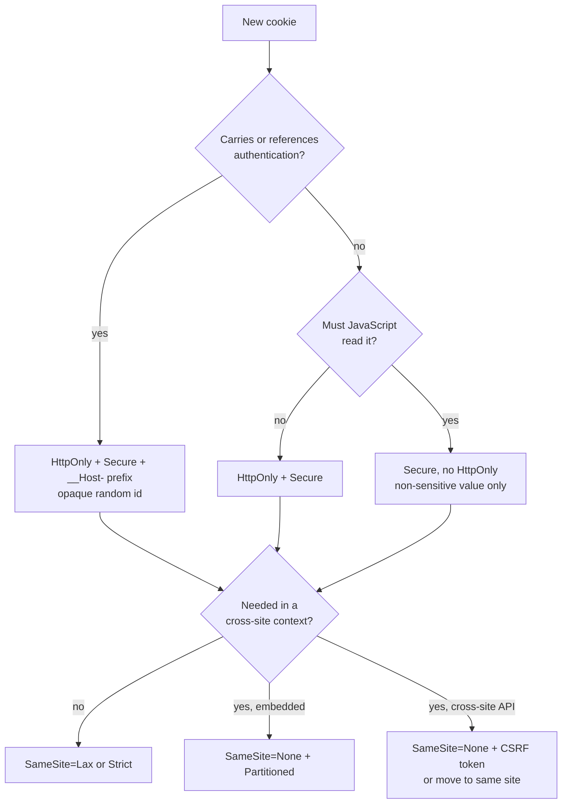
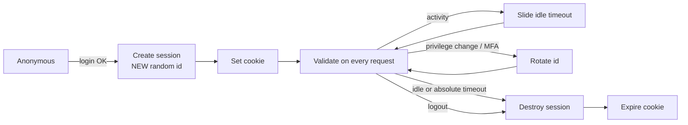
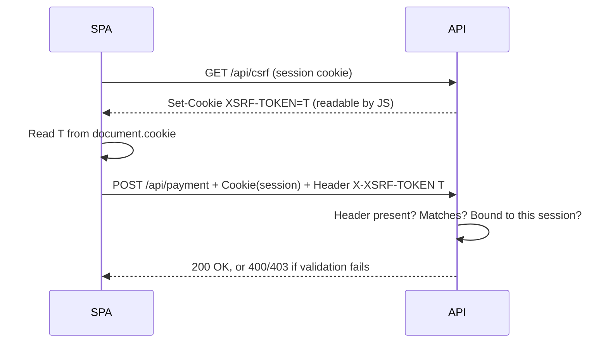

# Web Application Cookie Handbook & Playbook

A focused deep dive on one topic: **the cookie**. The Enterprise Security Architecture
Handbook covers the wide picture (Keycloak, BFF, MFA, payments). This document goes down
one level and answers: *what exactly is a cookie, how does the browser decide to store and
send it, how does it get attacked, and what do I configure, test and debug?*

- **Part A – Handbook** (sections 1–12): how cookies work and why.
- **Part B – Playbook** (sections 13–20): recipes, decision tables, debugging and incident steps.

---

## Table of Contents

**Part A – Handbook**

1. [The 60-Second Summary](#1-the-60-second-summary)
2. [What a Cookie Is](#2-what-a-cookie-is)
3. [Anatomy of `Set-Cookie`](#3-anatomy-of-set-cookie)
4. [Scope: Which Requests Get the Cookie](#4-scope-which-requests-get-the-cookie)
5. [Lifetime, Limits and Deletion](#5-lifetime-limits-and-deletion)
6. [Security Attributes](#6-security-attributes)
7. [SameSite in Depth](#7-samesite-in-depth)
8. [Cookie Prefixes](#8-cookie-prefixes)
9. [Cookies and Cross-Origin Requests (CORS)](#9-cookies-and-cross-origin-requests-cors)
10. [Third-Party Cookies and Partitioning](#10-third-party-cookies-and-partitioning)
11. [What Goes Inside a Cookie](#11-what-goes-inside-a-cookie)
12. [Threat Catalogue](#12-threat-catalogue)

**Part B – Playbook**

13. [Play 1 – Choose the Right Cookie Recipe](#13-play-1--choose-the-right-cookie-recipe)
14. [Play 2 – Session Cookie Lifecycle](#14-play-2--session-cookie-lifecycle)
15. [Play 3 – CSRF Protection for a Cookie-Authenticated SPA](#15-play-3--csrf-protection-for-a-cookie-authenticated-spa)
16. [Play 4 – ASP.NET Core 8 + Angular 18 Implementation](#16-play-4--aspnet-core-8--angular-18-implementation)
17. [Play 5 – Debugging: "My Cookie Is Not Set / Not Sent"](#17-play-5--debugging-my-cookie-is-not-set--not-sent)
18. [Play 6 – Testing and Verification](#18-play-6--testing-and-verification)
19. [Play 7 – Incident Response: Suspected Session Theft](#19-play-7--incident-response-suspected-session-theft)
20. [Review Checklist, Anti-Patterns, Interview Questions, Cheat Sheet](#20-review-checklist-anti-patterns-interview-questions-cheat-sheet)

[Appendix – Review of the sample app in this repository](#appendix--review-of-the-sample-app-in-this-repository)

---

# Part A – Handbook

## 1. The 60-Second Summary

The production-grade authentication cookie:

```http
Set-Cookie: __Host-session=<128+ bit random id>; Path=/; Secure; HttpOnly; SameSite=Lax; Max-Age=1800
```

| Piece | What it buys you |
|---|---|
| `__Host-` prefix | Browser guarantees: `Secure`, `Path=/`, no `Domain` → a sibling subdomain cannot plant or overwrite it |
| Opaque random id | Nothing to read, forge or tamper with; all state lives on the server |
| `Secure` | Never travels over plain HTTP |
| `HttpOnly` | JavaScript (and therefore XSS) cannot read it |
| `SameSite=Lax` | Not attached to cross-site POSTs, iframes, images, `fetch` |
| `Max-Age` | Bounded lifetime in the browser (the server must enforce its own timeout too) |

Three rules that cause most real-world cookie bugs:

1. **Cookies are sent automatically.** That is their feature and the root cause of CSRF.
2. **Cookie scope is not origin scope.** Cookies ignore port, and can span subdomains. "Same-site" ≠ "same-origin".
3. **Every attribute on a cookie is a request to the browser, not a server-side control.** Expiry, flags and scope must be backed by server-side validation.

---

## 2. What a Cookie Is

HTTP is stateless. A cookie is a small `name=value` pair the server asks the browser to
store and to attach to later requests. It is defined by RFC 6265 (and its in-progress
revision, "6265bis", which is what browsers actually implement).



Things to notice:

- The server sends **attributes** (`Secure`, `Path`, …) but the browser sends back **only `name=value`**.
  The server can never see which attributes a received cookie was stored with.
- One `Set-Cookie` header per cookie. Multiple cookies come back in a single `Cookie: a=1; b=2` header.
- A cookie's identity in the jar is the tuple **(name, domain, path)** (plus the partition key for partitioned cookies).
  Two cookies with the same name but different path or domain coexist, and both are sent.

### Common uses

| Use | Example | Notes |
|---|---|---|
| Session / authentication | `__Host-session` | The security-critical case; most of this handbook |
| CSRF token delivery | `XSRF-TOKEN` | Deliberately readable by JS |
| Preferences | `theme=dark`, `lang=ta` | Low sensitivity |
| Load-balancer affinity | `AWSALB`, `ARRAffinity` | Set by infrastructure |
| Analytics / advertising | `_ga` | Subject to consent rules |

---

## 3. Anatomy of `Set-Cookie`

```http
Set-Cookie: <name>=<value>; Domain=<d>; Path=<p>; Expires=<date>; Max-Age=<seconds>;
            Secure; HttpOnly; SameSite=<Strict|Lax|None>; Partitioned
```

| Attribute | Controls | If omitted |
|---|---|---|
| `Domain` | Which hosts receive it | **Host-only**: exact host that set it, no subdomains (the safer default) |
| `Path` | URL path prefix that must match | Directory of the URL that set it |
| `Expires` / `Max-Age` | Lifetime | **Session cookie**: removed when the browser session ends |
| `Secure` | HTTPS only | Sent over HTTP too |
| `HttpOnly` | Hidden from JavaScript | Readable via `document.cookie` |
| `SameSite` | Whether it rides cross-site requests | Chromium treats as `Lax`; other browsers differ → **always set it explicitly** |
| `Partitioned` | Separate jar per top-level site (CHIPS) | Unpartitioned |

**Value rules.** Cookie values may not contain whitespace, commas, semicolons, double
quotes or backslashes. Use base64url or percent-encoding for anything that is not a simple token.

**Who can set a cookie.**

- Server: `Set-Cookie` response header (the only way to create an `HttpOnly` cookie).
- JavaScript: `document.cookie = "theme=dark; Path=/; Secure; SameSite=Lax"` or the async Cookie Store API.

---

## 4. Scope: Which Requests Get the Cookie

For each outgoing request the browser attaches a cookie only if **all** of these match:



### Domain matching

| Set by | `Domain` attribute | Sent to |
|---|---|---|
| `app.company.com` | *(omitted)* | `app.company.com` only |
| `app.company.com` | `company.com` | `company.com` and **every** subdomain |
| `app.company.com` | `other.com` | Rejected |
| `app.company.com` | `com` / `github.io` | Rejected (Public Suffix List) |

A `Domain` cookie widens your attack surface to every subdomain, including the forgotten
marketing site and anything vulnerable to subdomain takeover. Prefer host-only cookies.

### Path matching

`Path=/api` matches `/api` and `/api/orders`, not `/apix`. **Path is not a security
boundary**: any page on the same origin can obtain cookies for another path (e.g. by iframe).
Use it for tidiness and to limit where a refresh cookie is transmitted, not for isolation.

### Site vs origin — the vocabulary that matters

| Term | Definition | Example |
|---|---|---|
| **Origin** | scheme + host + port | `https://app.company.com:443` |
| **Site** | scheme + registrable domain (eTLD+1) | `https://company.com` |

| From → To | Same origin? | Same site? |
|---|---|---|
| `https://app.company.com` → `https://api.company.com` | No | **Yes** |
| `https://app.company.com` → `https://app.company.com:8443` | No | **Yes** (port ignored) |
| `http://app.company.com` → `https://app.company.com` | No | **No** (schemeful same-site) |
| `https://company.com` → `https://company.co.in` | No | No |
| `https://alice.github.io` → `https://bob.github.io` | No | No (`github.io` is a public suffix) |

Consequences:

- Cookies are **not isolated by port**. Two apps on `host:3000` and `host:4000` share a jar.
- CORS works on **origins**; SameSite works on **sites**. A sibling subdomain is cross-origin
  (CORS applies) but same-site (SameSite gives no protection against it).

---

## 5. Lifetime, Limits and Deletion

### Session vs persistent

| Type | How | Reality |
|---|---|---|
| Session cookie | No `Expires` / `Max-Age` | "Until browser closes" — but session-restore features can keep it alive for weeks |
| Persistent cookie | `Max-Age=1800` or `Expires=<date>` | `Max-Age` wins if both are present. Chromium caps lifetime at 400 days |

Client-side expiry is a hint. **The server must enforce its own idle and absolute timeouts**
against the session record; an attacker replaying a stolen cookie ignores `Max-Age`.

### Limits

| Limit | Typical value |
|---|---|
| Size per cookie (name + value) | ~4096 bytes |
| Cookies per domain | From ~50 (RFC minimum) to ~180 (Chromium); oldest are evicted |
| Total `Cookie` header | Bounded by server/proxy header limits (often 8–16 KB) → `431` / `400` errors |

Every cookie is uploaded on every matching request, including images and API calls. Large
cookies are a performance tax and an outage risk ("request header too large").

### Deleting a cookie

There is no delete command. Overwrite it with an expired cookie whose **name, Domain and
Path are identical** to the original (and with `Secure` / prefix rules still satisfied):

```http
Set-Cookie: __Host-session=; Path=/; Secure; HttpOnly; SameSite=Lax; Max-Age=0
```

On logout, additionally consider:

```http
Clear-Site-Data: "cookies", "storage"
```

Deleting the browser's copy is cosmetic unless the **server-side session is destroyed** too.

---

## 6. Security Attributes

### `Secure`

- Sent only over HTTPS (and `http://localhost` in most browsers, for development).
- An insecure origin cannot overwrite a `Secure` cookie of the same name.
- Pair with **HSTS** (`Strict-Transport-Security`) so the browser never makes the first plain-HTTP request.

### `HttpOnly`

- Invisible to `document.cookie`, the Cookie Store API and any injected script.
- **What it does not do:** it does not stop XSS. Injected script can still *use* the session by
  issuing same-origin requests from the victim's browser. `HttpOnly` prevents **exfiltration**
  of the credential, which limits the attack to the lifetime of the open page. It is essential, not sufficient.

### `SameSite`

Summarised here, detailed in section 7.

| Value | Sent on cross-site requests? |
|---|---|
| `Strict` | Never |
| `Lax` | Only top-level navigations with safe methods (clicking a link, `GET`) |
| `None` | Always — requires `Secure` |

### Which flag stops which attack

| Attack | `Secure` | `HttpOnly` | `SameSite` | `__Host-` | Still needed |
|---|:-:|:-:|:-:|:-:|---|
| Network sniffing | ✅ | | | | HSTS, TLS everywhere |
| Cookie theft via XSS | | ✅ | | | CSP, output encoding |
| XSS riding the session | | ❌ | ❌ | | Fix the XSS; step-up auth for sensitive actions |
| CSRF from another site | | | ✅ (partial) | | CSRF token / Origin check |
| CSRF from sibling subdomain | | | ❌ | | CSRF token, subdomain hygiene |
| Cookie tossing / fixation from subdomain | | | | ✅ | Rotate id at login |
| Replay of a stolen cookie | | | | | Short TTL, server-side revocation, anomaly detection |

---

## 7. SameSite in Depth

### Behaviour matrix

Request made **from `https://evil.example` to `https://bank.com`**:

| Request type | `Strict` | `Lax` | `None` |
|---|:-:|:-:|:-:|
| User clicks a link (`GET`, top-level) | ❌ | ✅ | ✅ |
| `window.location` / redirect (`GET`, top-level) | ❌ | ✅ | ✅ |
| `<form method="GET">` top-level | ❌ | ✅ | ✅ |
| `<form method="POST">` | ❌ | ❌ | ✅ |
| `<iframe>`, ``, `<script>` | ❌ | ❌ | ✅ |
| `fetch` / XHR with credentials | ❌ | ❌ | ✅ |

### Choosing a value

| Value | Choose when | Trade-off |
|---|---|---|
| `Strict` | High-value action cookies; apps never entered via external links | Arriving from email, chat or an SSO redirect, the first page load has **no cookie** → user appears logged out |
| `Lax` | Default for session cookies | State-changing `GET` endpoints remain exposed — never mutate on `GET` |
| `None; Secure` | Cookie genuinely needed in a cross-site context: embedded widget, cross-site SSO/IdP iframe, API on a different registrable domain | No CSRF protection from the attribute; subject to third-party cookie blocking |

A common pattern is **two cookies**: a `Lax` cookie that lets the page render as logged-in
after an inbound link, and a `Strict` cookie required for sensitive operations.

### Sharp edges

- **Explicit beats default.** Browsers disagree on what a missing `SameSite` means. Chromium's
  "Lax by default" also permits top-level cross-site POSTs for ~2 minutes after the cookie is
  set (a compatibility exception for SSO). Setting `SameSite=Lax` explicitly removes that window.
- **Schemeful same-site.** `http://x.com` → `https://x.com` is cross-site. Mixed-scheme dev setups break `Strict`/`Lax` cookies.
- **Redirect chains.** With `Strict`, a request that reaches you *via* a cross-site redirect is still cross-site.
- **SameSite is not same-origin.** `blog.company.com` can send same-site requests to `app.company.com`. If any subdomain
  can host attacker-controlled content, SameSite does not protect you.
- **It is defence in depth.** Keep a real CSRF control (section 15).

---

## 8. Cookie Prefixes

Because the server cannot see a received cookie's attributes, it cannot tell a cookie it set
from one planted by a sibling subdomain or by an HTTP downgrade. Prefixes move that
guarantee into the **name**, enforced by the browser at storage time.

| Prefix | Browser accepts the cookie only if… |
|---|---|
| `__Secure-` | It has `Secure` and was set from an HTTPS origin |
| `__Host-` | It has `Secure`, was set from HTTPS, has `Path=/`, and has **no `Domain`** attribute |

```http
Set-Cookie: __Host-session=ABC123; Path=/; Secure; HttpOnly; SameSite=Lax
```

`__Host-` gives you a cookie that is locked to one exact host. Use it for session cookies
unless you have a real need to share across subdomains (then use `__Secure-`).

---

## 9. Cookies and Cross-Origin Requests (CORS)

Navigations, forms and images send cookies subject only to SameSite. Script-initiated
cross-origin requests have an extra gate — **credentials mode** — on both sides.

**Client must opt in**

```ts
fetch('https://api.company.com/orders', { credentials: 'include' });
// Angular
this.http.get(url, { withCredentials: true });
```

**Server must opt in**

```http
Access-Control-Allow-Origin: https://app.company.com     ← exact origin, never *
Access-Control-Allow-Credentials: true
Vary: Origin
```

| Symptom | Cause |
|---|---|
| Response arrives but `Set-Cookie` is ignored | Request was made without `credentials: 'include'` / `withCredentials` |
| Request is sent with cookie, but JS gets a CORS error | Missing `Allow-Credentials: true`, or `Allow-Origin: *` |
| Works in dev, fails in prod | Dev was same-site (`localhost`), prod is cross-site and the cookie is `Lax`/`Strict` |

Important distinctions:

- **CORS does not prevent the request being sent** (for "simple" requests) — it only prevents
  the calling script from *reading the response*. CORS is not a CSRF defence on its own.
- **Never reflect an arbitrary `Origin` together with `Allow-Credentials: true`.** That lets any website read authenticated responses.
- **Simplest architecture: make it same-origin.** Serve the SPA and API from one origin via a
  reverse proxy or BFF (`/` → SPA, `/api` → API). No CORS, no `SameSite=None`, no third-party cookie problems.

---

## 10. Third-Party Cookies and Partitioning

A cookie is **first-party** when its site matches the top-level page's site, **third-party**
otherwise (e.g. a cookie for `widget.com` used inside an iframe on `shop.com`). Same cookie, different context.

| Browser | Default treatment of third-party cookies |
|---|---|
| Safari (ITP) | Blocked |
| Firefox (Total Cookie Protection) | Partitioned per top-level site |
| Brave | Blocked |
| Chrome | Allowed by default, user-controllable; blocked in Incognito. Verify current behaviour before relying on it |

**Design assumption for new systems: third-party cookies do not work.** Options when you
truly need cross-site state:

| Technique | What it is |
|---|---|
| **CHIPS** (`Partitioned` attribute) | Third-party cookie with a separate jar per top-level site. Good for embedded widgets, chat, maps. Requires `Secure`; use with `SameSite=None` |
| **Storage Access API** | Embedded frame asks the user for access to its unpartitioned cookies |
| **Top-level redirect flows** | Standard OIDC redirects: cookies are first-party at each hop |
| **Same-site deployment** | Put the app and API under one registrable domain |

```http
Set-Cookie: __Host-widget=xyz; Path=/; Secure; HttpOnly; SameSite=None; Partitioned
```

Impact on SSO: silent token renewal through a hidden IdP iframe depends on third-party
cookies and fails in Safari/Firefox. This is one more reason the BFF pattern (server-side
refresh token + first-party session cookie) is the recommended SPA architecture.

---

## 11. What Goes Inside a Cookie

### Option A — Opaque reference (recommended)

```text
Cookie:  __Host-session=u7Gk2…(random)        Store (Valkey/Redis):  session:u7Gk2… → { userId, roles, csrf, createdAt, lastSeenAt, amr }
```

- Small, nothing to tamper with, instantly revocable, roles change immediately.
- Cost: a store lookup per request, and the store must be highly available.

### Option B — Self-contained, protected value

The state itself lives in the cookie, encrypted and signed by the server (ASP.NET Core's
default cookie authentication ticket works this way; so does a JWT in a cookie).

- No store needed; scales trivially.
- **Cannot be revoked server-side** without extra machinery; logout only deletes the browser's copy.
- Grows with every claim; risks hitting the 4 KB limit; stale roles until expiry.
- Key management becomes critical (rotation, sharing across instances).

### Rules for any value

| Rule | Why |
|---|---|
| Session ids from a CSPRNG, ≥128 bits | Unguessable |
| Never put secrets, PII, roles or flags in plaintext | Users can read and edit their own cookies |
| If the client must hold data, **sign** (integrity) or **encrypt + sign** (confidentiality) it | Base64 is not protection |
| Never trust `isAdmin=true`, `mfaValidated=true`, `price=10` from a cookie | "Never trust the browser" |
| Keep it small | Sent on every request |

---

## 12. Threat Catalogue

| # | Threat | How it works | Primary mitigations |
|---|---|---|---|
| 1 | **Session hijacking (network)** | Cookie captured over HTTP / hostile Wi-Fi | `Secure`, HSTS, TLS everywhere |
| 2 | **Session theft via XSS** | Script reads `document.cookie` and exfiltrates it | `HttpOnly`, CSP, output encoding, Trusted Types |
| 3 | **Session riding via XSS** | Script issues authenticated requests in-page | Eliminate XSS; step-up auth on sensitive actions |
| 4 | **CSRF** | Another site triggers a request; browser attaches the cookie | CSRF token, `SameSite`, Origin / `Sec-Fetch-Site` checks |
| 5 | **Session fixation** | Attacker makes the victim use a session id the attacker knows, then waits for login | Issue a **new id at login** and at every privilege change; never accept ids from URLs |
| 6 | **Cookie tossing** | Compromised/hostile subdomain sets a `Domain=company.com` cookie that shadows yours | `__Host-` prefix, subdomain hygiene |
| 7 | **Cookie jar overflow** | Attacker script sets hundreds of cookies to evict yours, then plants its own | `__Host-` prefix, fix the injection point |
| 8 | **Cookie bomb (DoS)** | Oversized cookies make every request exceed header limits | Don't let user input flow into cookie values; size caps |
| 9 | **Subdomain takeover** | Dangling DNS record lets an attacker host content on `x.company.com`, which receives `Domain` cookies and is same-site | Host-only cookies, DNS inventory |
| 10 | **Stolen cookie replay (infostealer malware)** | Malware copies the cookie jar from disk; bypasses passwords and MFA | Short TTL, server-side revocation, re-auth for sensitive actions, anomaly detection, device-bound sessions where available |
| 11 | **Tampering / privilege escalation** | User edits a cookie carrying state | Opaque ids or signed/encrypted values; server-side authorization |
| 12 | **Leakage via logs and caches** | `Cookie` / `Set-Cookie` recorded by proxies, APM, or cached by a CDN | Redact headers in logs; `Cache-Control: no-store` on authenticated responses; never cache `Set-Cookie` |
| 13 | **Login CSRF** | Attacker logs the victim into the *attacker's* account | CSRF-protect the login endpoint too |

---

# Part B – Playbook

## 13. Play 1 – Choose the Right Cookie Recipe

| Purpose | Recipe |
|---|---|
| **Session (default)** | `__Host-session=<id>; Path=/; Secure; HttpOnly; SameSite=Lax; Max-Age=1800` |
| **Session, high security** (banking, admin) | Same, `SameSite=Strict`, shorter TTL, plus a `Lax` "hint" cookie if inbound links must look logged-in |
| **BFF refresh/long-lived handle** | `__Host-refresh=<id>; Path=/; Secure; HttpOnly; SameSite=Strict` (cannot narrow `Path` with `__Host-`; use `__Secure-` + `Path=/auth/refresh` if you prefer path-limiting) |
| **CSRF token (double-submit)** | `XSRF-TOKEN=<token>; Path=/; Secure; SameSite=Lax` — **not** HttpOnly, the SPA must read it |
| **UI preference** | `theme=dark; Path=/; Secure; SameSite=Lax; Max-Age=31536000` |
| **Shared across subdomains** | `__Secure-sso=<id>; Domain=company.com; Path=/; Secure; HttpOnly; SameSite=Lax` — accept the wider attack surface knowingly |
| **Embedded third-party widget** | `__Host-widget=<id>; Path=/; Secure; HttpOnly; SameSite=None; Partitioned` |
| **Cross-site API (different registrable domain)** | `SameSite=None; Secure; HttpOnly` + mandatory CSRF token + strict CORS allow-list. Prefer re-architecting to same-site |

Decision flow:



---

## 14. Play 2 – Session Cookie Lifecycle



| Step | Do |
|---|---|
| **Create** | Generate the id with a CSPRNG (≥128 bits) *after* successful authentication. Discard any pre-login id (fixation defence) |
| **Store** | Server-side record: user id, creation time, last-seen time, auth methods (`amr`), CSRF secret, optionally client hints (UA, coarse IP) |
| **Validate** | Every request: exists? not past idle timeout? not past absolute timeout? user still active? |
| **Timeouts** | Enforce **both** on the server. Typical: idle 15–30 min, absolute 8–12 h; high-risk apps much shorter |
| **Rotate** | New id at login, on role/privilege change, after step-up MFA, and periodically for long sessions |
| **Logout** | Delete the server record **first**, then expire the cookie, then `Clear-Site-Data`. With SSO, also end the IdP session |
| **Revoke** | Support "sign out everywhere": index sessions by user id; call it on password change and on incident |

Server-side validation sketch:

```csharp
var s = await store.GetAsync(sessionId);
if (s is null) return Unauthorized();
var now = clock.UtcNow;
if (now - s.LastSeenAt > IdleTimeout || now - s.CreatedAt > AbsoluteTimeout)
{
    await store.DeleteAsync(sessionId);
    return Unauthorized();
}
s.LastSeenAt = now;            // sliding window
await store.SaveAsync(s);
```

---

## 15. Play 3 – CSRF Protection for a Cookie-Authenticated SPA

**When is CSRF protection required?** Whenever the browser attaches the credential
automatically: cookies, HTTP Basic, client certificates. A bearer token that JavaScript adds
to an `Authorization` header is not sent automatically, so it is not CSRF-prone (it has XSS exposure instead).

Layer the defences:

| Layer | Control | Notes |
|---|---|---|
| 1 | **No state change on `GET`/`HEAD`/`OPTIONS`** | Makes `SameSite=Lax` meaningful |
| 2 | **`SameSite=Lax` or `Strict`** on the session cookie | Blocks the classic cross-site form POST |
| 3 | **CSRF token** on every unsafe method | The primary control |
| 4 | **Origin verification** | Reject unsafe requests whose `Origin` is not in the allow-list, or whose `Sec-Fetch-Site` is `cross-site` |
| 5 | **Re-authentication / step-up** for critical actions | Payment, password or e-mail change |

### Token patterns

| Pattern | How | Use when |
|---|---|---|
| **Synchronizer token** | Random token stored in the server session; client echoes it in a header; server compares | You have server-side sessions (best option) |
| **Signed double-submit cookie** | Token in a JS-readable cookie *and* in a header; server checks they match and that the token is HMAC-bound to the session | Stateless backends. The naive unsigned variant is defeated by cookie tossing |
| **Custom request header only** | Require e.g. `X-Requested-With`; cross-site forms cannot set custom headers without a CORS preflight | Minimum bar for pure JSON APIs with a strict CORS policy |



Why this works: an attacker's page can make the browser *send* your cookies, but the
same-origin policy stops it from *reading* them, so it cannot copy the token into a header.

Checklist:

- Compare tokens in constant time.
- Issue a fresh token after login (tokens are bound to the user identity).
- Protect login and logout endpoints as well.
- Return `403`/`400` without detail; log the failure with the request `Origin`.
- An XSS vulnerability defeats every CSRF defence — CSRF protection assumes no XSS.

---

## 16. Play 4 – ASP.NET Core 8 + Angular 18 Implementation

Matches the stack of the sample in `SecureCookieUIandWebApi/`.

### 16.1 Cookie authentication (API)

```csharp
builder.Services
    .AddAuthentication(CookieAuthenticationDefaults.AuthenticationScheme)
    .AddCookie(options =>
    {
        options.Cookie.Name         = "__Host-session";
        options.Cookie.HttpOnly     = true;
        options.Cookie.SecurePolicy = CookieSecurePolicy.Always;
        options.Cookie.SameSite     = SameSiteMode.Lax;      // or Strict
        options.Cookie.Path         = "/";                   // required by __Host-
        options.Cookie.IsEssential  = true;

        options.ExpireTimeSpan    = TimeSpan.FromMinutes(30); // idle timeout
        options.SlidingExpiration = true;

        // An API must answer 401/403, not redirect to a login page
        options.Events.OnRedirectToLogin = ctx =>
        {
            ctx.Response.StatusCode = StatusCodes.Status401Unauthorized;
            return Task.CompletedTask;
        };
        options.Events.OnRedirectToAccessDenied = ctx =>
        {
            ctx.Response.StatusCode = StatusCodes.Status403Forbidden;
            return Task.CompletedTask;
        };
    });
```

Notes specific to ASP.NET Core:

- The default cookie is **Option B** from section 11: an encrypted, signed ticket protected by
  the Data Protection API. In a multi-instance deployment, persist and share the Data
  Protection key ring, or cookies issued by one instance are rejected by another.
- `SignOutAsync` only tells the browser to drop the cookie. A copied ticket stays valid until
  it expires. For true server-side revocation set `options.SessionStore` to an `ITicketStore`
  backed by Redis/Valkey (cookie then carries only a key), or validate a per-user security
  stamp in `OnValidatePrincipal`.
- There is no built-in absolute timeout with sliding expiration: store the issue time in
  `AuthenticationProperties` and reject old tickets in `OnValidatePrincipal`.

### 16.2 Login and logout

```csharp
[HttpPost("login")]
[AllowAnonymous]
public async Task<IActionResult> Login([FromBody] LoginRequest request)
{
    var user = await _users.ValidateAsync(request.Username, request.Password);
    if (user is null) return Unauthorized();            // generic message, rate-limited

    var identity = new ClaimsIdentity(
        new[] { new Claim(ClaimTypes.NameIdentifier, user.Id), new Claim(ClaimTypes.Name, user.Name) },
        CookieAuthenticationDefaults.AuthenticationScheme);

    await HttpContext.SignInAsync(                      // await — never .Wait()
        CookieAuthenticationDefaults.AuthenticationScheme,
        new ClaimsPrincipal(identity),
        new AuthenticationProperties { IssuedUtc = DateTimeOffset.UtcNow });

    return NoContent();
}

[HttpPost("logout")]
public async Task<IActionResult> Logout()
{
    await HttpContext.SignOutAsync(CookieAuthenticationDefaults.AuthenticationScheme);
    Response.Headers.Append("Clear-Site-Data", "\"cookies\", \"storage\"");
    return NoContent();
}
```

### 16.3 Antiforgery for the SPA

```csharp
builder.Services.AddAntiforgery(o => o.HeaderName = "X-XSRF-TOKEN");

// Endpoint the SPA calls at startup and again right after login
app.MapGet("/api/csrf", (IAntiforgery antiforgery, HttpContext ctx) =>
{
    var tokens = antiforgery.GetAndStoreTokens(ctx);
    ctx.Response.Cookies.Append("XSRF-TOKEN", tokens.RequestToken!, new CookieOptions
    {
        HttpOnly = false,              // Angular must read it
        Secure   = true,
        SameSite = SameSiteMode.Lax,
        Path     = "/"
    });
    return Results.NoContent();
});

// Validate every unsafe request
app.Use(async (ctx, next) =>
{
    var m = ctx.Request.Method;
    var safe = HttpMethods.IsGet(m) || HttpMethods.IsHead(m) || HttpMethods.IsOptions(m) || HttpMethods.IsTrace(m);
    if (!safe)
    {
        try { await ctx.RequestServices.GetRequiredService<IAntiforgery>().ValidateRequestAsync(ctx); }
        catch (AntiforgeryValidationException)
        {
            ctx.Response.StatusCode = StatusCodes.Status400BadRequest;
            return;
        }
    }
    await next();
});
```

(With MVC you can instead use `AddControllersWithViews()` and `[AutoValidateAntiforgeryToken]`.)

### 16.4 Middleware order

```csharp
app.UseHsts();
app.UseHttpsRedirection();
app.UseCors();              // only if cross-origin; before auth
app.UseAuthentication();
// antiforgery validation middleware here (after authentication)
app.UseAuthorization();
app.MapControllers();
```

### 16.5 CORS (only if the SPA is on another origin)

```csharp
policy.WithOrigins("https://app.company.com")          // explicit list, from configuration
      .AllowCredentials()
      .WithMethods("GET", "POST", "PUT", "PATCH", "DELETE")
      .WithHeaders("Content-Type", "X-XSRF-TOKEN");
```

### 16.6 Angular

```ts
// app.config.ts
provideHttpClient(
  withXsrfConfiguration({ cookieName: 'XSRF-TOKEN', headerName: 'X-XSRF-TOKEN' }),
  withInterceptors([credentialsInterceptor]),
)

// credentials.interceptor.ts — only needed for cross-origin API calls
export const credentialsInterceptor: HttpInterceptorFn = (req, next) =>
  next(req.clone({ withCredentials: true }));
```

Angular's built-in XSRF support adds the header **only to mutating requests sent to
relative / same-origin URLs**. If the API is called through an absolute cross-origin URL the
header is silently omitted. The clean fix is to make the API same-origin:

```jsonc
// proxy.conf.json  (ng serve --proxy-config proxy.conf.json --ssl)
{ "/api": { "target": "https://localhost:44322", "secure": false, "changeOrigin": true } }
```

and call `/api/auth/login` instead of `https://localhost:44322/api/auth/login`. In
production, the same shape is provided by the reverse proxy / BFF.

SPA rules:

- Never store session ids or tokens in `localStorage` / `sessionStorage`.
- Discover login state by calling `GET /api/me`, not by reading a cookie.
- On `401`, clear client state and route to login; on `400/403` from antiforgery, refresh the token once and retry.

---

## 17. Play 5 – Debugging: "My Cookie Is Not Set / Not Sent"

**Tools:** DevTools → *Application → Cookies* (stored jar); *Network → request → Cookies*
tab (enable "show filtered out request cookies"; a ⚠ tooltip states the exact reason a cookie
was blocked); *Issues* panel.

### Cookie is not stored

| Check | Typical cause |
|---|---|
| Is `Set-Cookie` in the response at all? | Proxy/CDN stripped it; exception before sign-in; response served from cache |
| `Secure` on an `http://` page? | Rejected (except `localhost`) |
| `SameSite=None` without `Secure`? | Rejected |
| `__Host-` rules violated? | Has `Domain`, `Path` ≠ `/`, or not HTTPS |
| `Domain` not a parent of the response host? | Rejected |
| Cross-origin `fetch` without `credentials: 'include'`? | `Set-Cookie` ignored |
| Cross-site response and third-party cookies blocked? | Safari / Firefox / Incognito |
| TLS terminated at a proxy and the app thinks it is HTTP? | Framework drops/refuses `Secure`; configure forwarded headers (`UseForwardedHeaders`) |
| Cookie too large or too many? | Silently dropped / evicts others |

### Cookie is stored but not sent

| Check | Typical cause |
|---|---|
| Host / path mismatch | Host-only cookie for `api.` being expected on `app.`; `Path=/api` vs `/Api` (paths are case-sensitive) |
| Cross-site request with `Lax`/`Strict` | SPA and API on different sites, or `http` ↔ `https` mix (schemeful same-site) |
| Missing `withCredentials` | Cross-origin XHR sends no cookies by default |
| Expired | Clock skew, short `Max-Age` |
| Arrived via external link with `Strict` | First navigation has no cookie; reload "fixes" it |
| In an iframe on another site | Third-party context: needs `SameSite=None` (+ `Partitioned`) |

### Cookie is sent but the server rejects it

| Check | Typical cause |
|---|---|
| Different instance | Data Protection keys / session store not shared across nodes |
| Restarted app | Keys held in memory only |
| Duplicate cookie names | Old cookie with another path/domain shadows the new one — inspect the raw `Cookie` header |
| Middleware order | `UseAuthentication` after the endpoint, or after `UseAuthorization` |

### Cannot delete the cookie

`Path` / `Domain` of the deleting `Set-Cookie` differ from the original, or the delete lacks
`Secure` for a `Secure`/prefixed cookie.

---

## 18. Play 6 – Testing and Verification

### Manual

```bash
# Inspect flags on the login response
curl -i -X POST https://app.example.test/api/auth/login \
  -H 'Content-Type: application/json' -d '{"username":"u","password":"p"}'
```

```bash
# Unsafe request without CSRF header must fail
curl -i -X POST https://app.example.test/api/orders -b 'cookies.txt'
```

```bash
# Cross-origin read must not be allowed for unknown origins
curl -i https://app.example.test/api/me -H 'Origin: https://evil.example' -b 'cookies.txt'
```

### Test cases

| # | Test | Expected |
|---|---|---|
| 1 | Session cookie flags | `Secure`, `HttpOnly`, explicit `SameSite`, `__Host-` prefix |
| 2 | `document.cookie` in console | Session cookie absent |
| 3 | Session id before vs after login | Different (no fixation) |
| 4 | Replay cookie after logout | `401` |
| 5 | Wait past idle timeout | `401` |
| 6 | Sliding session past absolute timeout | `401` |
| 7 | POST without / with wrong CSRF token | `400`/`403` |
| 8 | Cross-site auto-submitting form (host an HTML file on another origin) | No state change |
| 9 | `GET` on every state-changing route | `405` / no effect |
| 10 | Request with `Origin: https://evil.example` | No `Access-Control-Allow-Origin` echo |
| 11 | Plain `http://` request | Redirect; no cookie transmitted; HSTS header present |
| 12 | Change password | Other sessions revoked |
| 13 | Authenticated responses | `Cache-Control: no-store` |
| 14 | Application and proxy logs | No cookie values |
| 15 | Safari + Firefox + Chrome Incognito | Login works (no third-party cookie dependency) |

### Automated

- Integration test asserting the exact `Set-Cookie` attributes on login (fails the build if a flag is dropped).
- OWASP ZAP baseline scan in CI (flags missing cookie attributes and anti-CSRF tokens).
- Playwright test for login → inbound-link navigation → logout → replay.

---

## 19. Play 7 – Incident Response: Suspected Session Theft

| Phase | Actions |
|---|---|
| **Detect** | Same session id from distant IPs/ASNs or different user agents; impossible travel; activity after logout; user reports; cookie values found in logs or a stealer dump |
| **Contain** | Revoke the affected sessions server-side. If the scope is unknown: revoke all sessions for the user; if signing/encryption keys may be exposed: rotate keys (invalidates **every** session) |
| **Eradicate** | Find the vector — XSS (review CSP reports, recent deploys), malware on the device, logged headers, a compromised subdomain, missing `Secure`/HSTS |
| **Recover** | Force re-authentication with MFA; reset credentials if also exposed; review actions performed during the window and reverse fraudulent ones |
| **Learn** | Shorten TTLs; add step-up auth to sensitive actions; add detection for session-attribute drift; redact cookies in logs; add the missing regression test |

Prerequisites you must have **before** the incident: server-side session store or revocation
mechanism, sessions indexed by user, audit log linking actions to session ids (store a hash
of the id, not the id), and a tested key-rotation procedure.

---

## 20. Review Checklist, Anti-Patterns, Interview Questions, Cheat Sheet

### Architecture review checklist

**Cookie definition**

- [ ] Session cookie is `Secure`, `HttpOnly`, explicit `SameSite`
- [ ] `__Host-` (or `__Secure-`) prefix used
- [ ] No `Domain` attribute unless cross-subdomain sharing is a documented requirement
- [ ] Value is an opaque random id, or an encrypted + signed ticket with managed keys
- [ ] No PII, roles, flags or tokens readable in any cookie
- [ ] Total cookie size well under 4 KB

**Session**

- [ ] New id at login and privilege change
- [ ] Idle **and** absolute timeouts enforced server-side
- [ ] Logout destroys the server-side session
- [ ] "Sign out everywhere" exists and runs on password change

**Request forgery and cross-origin**

- [ ] No state changes on `GET`
- [ ] CSRF token validated on all unsafe methods, including login/logout
- [ ] `Origin` / `Sec-Fetch-Site` validated or CORS allow-list is explicit
- [ ] No wildcard or reflected origin with credentials
- [ ] App works with third-party cookies blocked

**Transport and platform**

- [ ] HTTPS only, HSTS enabled
- [ ] CSP deployed (XSS defeats cookie protections)
- [ ] `Cache-Control: no-store` on authenticated responses
- [ ] Cookies redacted from logs, traces and error reports
- [ ] Key ring / session store shared across instances
- [ ] Consent obtained for non-essential (analytics/marketing) cookies; strictly necessary cookies documented

### Anti-patterns

| ❌ Anti-pattern | ✅ Instead |
|---|---|
| Token or session id in `localStorage` | `HttpOnly` cookie via BFF |
| `role=admin` / `mfaValidated=true` in a cookie | Server-side session state |
| `SameSite=None` "to make it work" | Fix the topology: same-site deployment or proxy |
| `Access-Control-Allow-Origin` reflecting any origin + credentials | Explicit allow-list |
| `Domain=.company.com` by default | Host-only `__Host-` cookie |
| Relying on `SameSite` as the only CSRF defence | Token + SameSite + Origin check |
| Logout that only deletes the cookie | Destroy the server-side session |
| Same session id before and after login | Regenerate |
| State-changing `GET /delete?id=1` | `POST`/`DELETE` with CSRF token |
| Trusting cookie `Max-Age` for expiry | Server-side timeouts |
| Path used as a security boundary | Separate origins |
| Logging full request headers | Redact `Cookie` / `Set-Cookie` |

### Interview questions

**Why can't the server tell whether a received cookie was `Secure` or `HttpOnly`?**
The browser returns only `name=value`. That is the reason cookie prefixes exist.

**Does `HttpOnly` prevent XSS?**
No. It prevents script from reading the cookie; injected script can still send authenticated requests.

**Difference between same-site and same-origin?**
Origin = scheme + host + port. Site = scheme + registrable domain. `a.x.com` and `b.x.com` are same-site, cross-origin.

**Is `SameSite=Lax` enough to stop CSRF?**
It stops cross-site POSTs, but not attacks from sibling subdomains or state-changing GETs. Use it with a CSRF token.

**Why is a session id different from a CSRF token?**
The session id is sent automatically and proves who the user is. The CSRF token must be attached deliberately by code that can read it, proving the request came from your application.

**When is CSRF protection unnecessary?**
When no credential is attached automatically, e.g. a bearer token added to the `Authorization` header by JavaScript.

**How do you delete a cookie?**
Re-set it with the same name, domain and path and `Max-Age=0`, and invalidate it server-side.

**What does `__Host-` guarantee?**
The cookie was set over HTTPS by exactly this host, with `Path=/` and no `Domain`; a subdomain cannot overwrite it.

**Why does a cross-origin `fetch` not send cookies?**
Credentials mode defaults to `same-origin`. It needs `credentials: 'include'` plus `Access-Control-Allow-Credentials: true` and a non-wildcard allowed origin.

**Session cookie vs JWT in a cookie?**
Opaque id: small, revocable, needs a store. JWT/ticket: stateless, larger, not revocable without extra machinery.

**What is CHIPS?**
The `Partitioned` attribute: a third-party cookie stored in a separate jar per top-level site, so it cannot be used for cross-site tracking.

**Why does `SameSite=Strict` make users look logged out after clicking an e-mail link?**
The navigation is cross-site, so the cookie is withheld on that first request.

### Cheat sheet

```text
THE COOKIE
==========
Set-Cookie: __Host-session=<random>; Path=/; Secure; HttpOnly; SameSite=Lax; Max-Age=1800

ATTRIBUTES
==========
Secure      -> HTTPS only                 (stops sniffing)
HttpOnly    -> no JavaScript access       (stops theft via XSS, not XSS itself)
SameSite    -> Strict | Lax | None        (cross-site sending; None requires Secure)
Domain      -> omit = exact host only     (set = all subdomains)
Path        -> tidiness, NOT security
Max-Age     -> browser hint               (server enforces the real timeout)
Partitioned -> per-top-level-site jar     (embedded / third-party use)
__Host-     -> Secure + Path=/ + no Domain, enforced by the browser

VOCABULARY
==========
Origin = scheme + host + port            -> CORS, same-origin policy
Site   = scheme + registrable domain     -> SameSite
Cookies ignore port. Subdomains are same-site.

WHO PROVES WHAT
===============
Session cookie -> who you are            (sent automatically)
CSRF token     -> request came from my app (sent deliberately)
CORS           -> who may READ a response (not who may SEND a request)

LIFECYCLE
=========
login  -> new id      |  privilege change -> rotate
idle + absolute timeout on the server
logout -> destroy server session, then expire cookie

GOLDEN RULES
============
1. Never trust anything stored in the browser.
2. Never change state on GET.
3. Prefer same-origin SPA + API; avoid SameSite=None.
4. Assume third-party cookies are blocked.
5. Every cookie flag needs a server-side control behind it.
```

---

## Appendix – Review of the sample app in this repository

Observations on `SecureCookieUIandWebApi/` measured against this handbook. The sample
already sets `HttpOnly`, `SecurePolicy.Always`, `SameSite=Strict` and a 30-minute expiry, and
uses `withCredentials` with a credentialed CORS policy — a sound starting point.

| # | Where | Observation | Suggested change | Section |
|---|---|---|---|---|
| 1 | `Program.cs` | Cookie named `AuthCookie` | Rename to `__Host-session` (set `Cookie.Path = "/"`) | 8 |
| 2 | `Program.cs` | `LoginPath = "/api/Auth/Login"`: an unauthenticated API call gets a `302` redirect to a POST-only endpoint | Return `401`/`403` from `OnRedirectToLogin` / `OnRedirectToAccessDenied` | 16.1 |
| 3 | `Program.cs` | No antiforgery; CSRF defence rests on `SameSite=Strict` alone | Add antiforgery token endpoint + validation | 15, 16.3 |
| 4 | `Program.cs` | CORS origin `http://localhost:4200` while the API is `https://localhost:44322`. Different schemes are cross-site under schemeful same-site, so a `Strict` cookie may not be sent from the Angular dev server | Serve Angular over HTTPS (`ng serve --ssl`) or, better, use the dev proxy so everything is same-origin | 4, 7, 16.6 |
| 5 | `Program.cs` | `AllowAnyHeader().AllowAnyMethod()` with credentials; origin hard-coded | Explicit methods/headers; origins from configuration | 9, 16.5 |
| 6 | `Program.cs` | `AddControllers()` registered twice; no `UseHsts()` | Remove duplicate; add HSTS outside Development | 16.4 |
| 7 | `AuthController.cs` | `SignInAsync(...).Wait()` / `SignOutAsync(...).Wait()` block the thread | Make actions `async` and `await` | 16.2 |
| 8 | `AuthController.cs` | Stateless ticket: logout removes the browser copy only; a copied cookie stays valid up to 30 minutes (and slides) | `ITicketStore` session store or `OnValidatePrincipal` check; absolute timeout | 11, 14, 16.1 |
| 9 | `AuthController.cs` | Hard-coded `test` / `password`; no rate limiting | Fine for a demo; replace with a real user store and add login throttling before any reuse | 12 |
| 10 | `auth.service.ts` | Absolute API URL hard-coded; Angular's XSRF interceptor will not attach a header to it | Relative `/api/...` URLs through a proxy; `withXsrfConfiguration` | 16.6 |
| 11 | `app.config.ts` | `withCredentials` repeated per call | Central interceptor (or none once same-origin) | 16.6 |

---

*End of Handbook*
