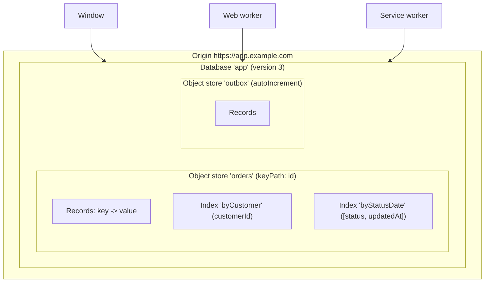
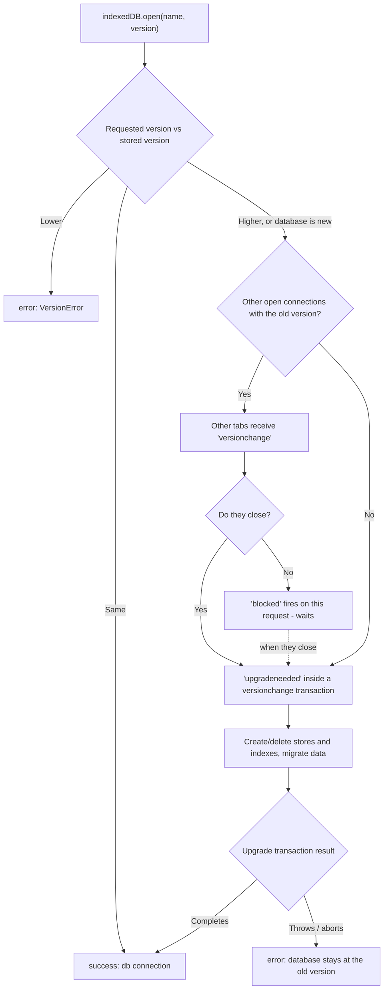
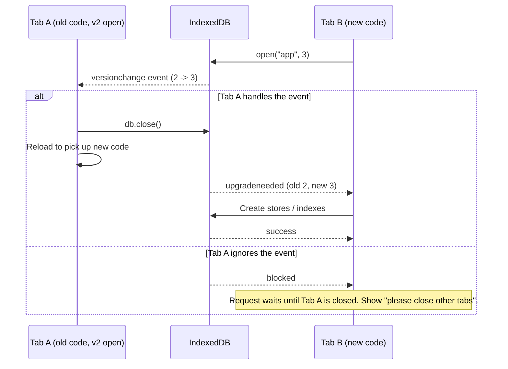
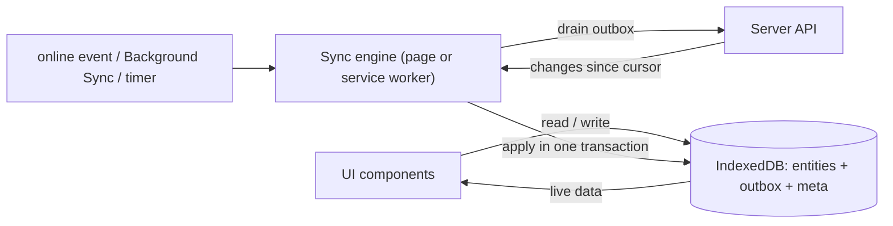
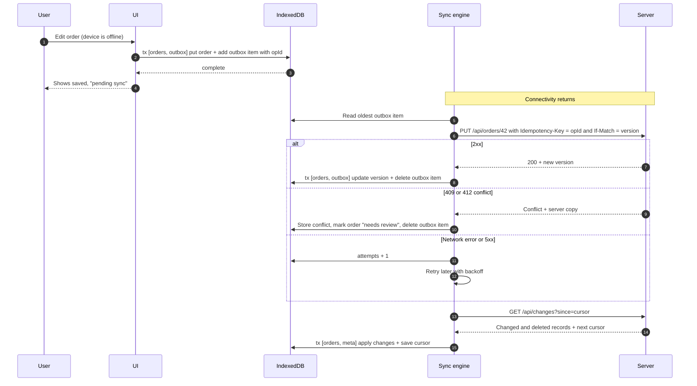
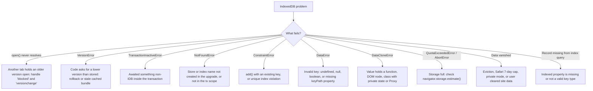

# Web Application IndexedDB Handbook

IndexedDB is the browser's built-in database: asynchronous, transactional, indexed, able to
hold large amounts of structured and binary data, and available in workers. It is the
foundation of offline-capable web applications. Its raw API is event-based and has several
sharp edges; this handbook explains the model, the rules that cause most bugs, and the
patterns that work in production.

Related handbooks: [Cookies](Web-Application-Cookie-Handbook.md) ·
[Sessions](Web-Application-Session-Handbook.md) ·
[Local Storage](Web-Application-LocalStorage-Handbook.md)

---

## Table of Contents

1. [The 60-Second Summary](#1-the-60-second-summary)
2. [What IndexedDB Is](#2-what-indexeddb-is)
3. [Core Concepts](#3-core-concepts)
4. [Opening and Versioning](#4-opening-and-versioning)
5. [Transactions](#5-transactions)
6. [CRUD, Indexes, Ranges and Cursors](#6-crud-indexes-ranges-and-cursors)
7. [Quota, Persistence and Eviction](#7-quota-persistence-and-eviction)
8. [Decision Matrices](#8-decision-matrices)
9. [Offline-First Sync (Outbox Pattern)](#9-offline-first-sync-outbox-pattern)
10. [Security](#10-security)
11. [Performance](#11-performance)
12. [Angular 18 Implementation](#12-angular-18-implementation)
13. [Debugging](#13-debugging)
14. [Testing](#14-testing)
15. [Review Checklist, Anti-Patterns, Cheat Sheet](#15-review-checklist-anti-patterns-cheat-sheet)

---

## 1. The 60-Second Summary

- IndexedDB is an **asynchronous, transactional object database** per origin. It stores
  JavaScript values (objects, arrays, `Date`, `Blob`, `ArrayBuffer`, `Map`, `Set`,
  `CryptoKey`) without JSON conversion.
- Data lives in **object stores** (like tables) addressed by a **key**, with optional
  **indexes** for lookups by other properties.
- Everything happens inside a **transaction**. A transaction **commits automatically** when
  it has no pending requests — so never `await` a `fetch` or timer inside one.
- The schema changes only in an **upgrade** triggered by opening with a higher **version**.
  Write upgrades as cumulative `if (oldVersion < n)` steps.
- Handle **multiple tabs**: close the connection on `versionchange`, or upgrades will block.
- Capacity is large (a share of the disk), but storage is **best effort** and can be
  evicted. The server remains the source of truth.
- It is **not encrypted** and is readable by any script in the origin. Do not store
  credentials; encrypt sensitive offline data and delete it on logout.
- Use a thin promise wrapper (`idb`) or Dexie rather than the raw event API.

---

## 2. What IndexedDB Is



| Property | IndexedDB |
|---|---|
| Model | Key → value object stores with secondary indexes; no SQL, no joins |
| API | Asynchronous (requests and events); promise wrappers available |
| Scope | Origin; shared by all tabs and workers of that origin |
| Values | Anything the structured-clone algorithm supports |
| Transactions | ACID within one database; `readonly`, `readwrite`, `versionchange` |
| Capacity | Typically up to a large fraction of free disk (see section 7) |
| Available in | Window, web worker, shared worker, service worker |
| Sent to server | Never |

When it is the right tool: offline data, large lists, drafts with attachments, caches of
API entities, queues of pending mutations, data shared with a service worker, storing
non-extractable crypto keys.

---

## 3. Core Concepts

| Concept | Meaning | SQL analogy |
|---|---|---|
| **Database** | Named, versioned container. One origin can have many. | Database |
| **Object store** | Collection of records | Table |
| **Key** | Unique identifier of a record in a store | Primary key |
| **Key path** | Property of the value used as key (`'id'`, `'a.b'`, or an array of paths) | PK column |
| **Key generator** | `autoIncrement: true` — the store assigns increasing numbers | Identity column |
| **Index** | Alternative ordering/lookup by another property; `unique`, `multiEntry` | Secondary index |
| **Transaction** | Atomic unit over one or more stores | Transaction |
| **Request** | One asynchronous operation; fires `success` or `error` | Statement |
| **Cursor** | Iterator over a store or index in key order | Cursor |
| **Key range** | `IDBKeyRange.bound/only/lowerBound/upperBound` | `WHERE k BETWEEN …` |
| **Version** | Positive integer; raising it runs the upgrade | Migration number |

Valid key types and their sort order: `Number` < `Date` < `String` < binary (`ArrayBuffer`)
< `Array`. Booleans, `null`, `undefined` and objects are **not** valid keys — a record
whose indexed property is `true` or `null` is simply absent from that index.

Four ways to define a store's keys:

| `keyPath` | `autoIncrement` | Behaviour |
|---|---|---|
| — | — | Out-of-line key: supply it with every `put(value, key)` |
| `'id'` | — | In-line key: value must contain `id` |
| — | `true` | Store generates the key; value can be anything |
| `'id'` | `true` | Store generates the key and writes it into `value.id` |

Prefer **in-line keys with client-generated UUIDs** (`crypto.randomUUID()`) for data that
syncs with a server; auto-increment numbers collide across devices.

---

## 4. Opening and Versioning

### Open flow



### Raw API

```ts
const req = indexedDB.open('app', 2);

req.onupgradeneeded = (e) => {
  const db = req.result;
  const tx = req.transaction!;               // the versionchange transaction
  if (e.oldVersion < 1) {
    const orders = db.createObjectStore('orders', { keyPath: 'id' });
    orders.createIndex('byCustomer', 'customerId');
  }
  if (e.oldVersion < 2) {
    tx.objectStore('orders').createIndex('byStatusDate', ['status', 'updatedAt']);
    db.createObjectStore('outbox', { keyPath: 'seq', autoIncrement: true });
  }
};
req.onblocked = () => console.warn('Another tab is holding an old version open');
req.onerror = () => console.error(req.error);
req.onsuccess = () => {
  const db = req.result;
  db.onversionchange = () => { db.close(); location.reload(); };   // let other tabs upgrade
};
```

### With the `idb` wrapper (recommended)

```ts
// app-db.ts
import { openDB, DBSchema, IDBPDatabase } from 'idb';

export interface Order {
  id: string;                       // crypto.randomUUID()
  customerId: string;
  status: 'draft' | 'submitted' | 'shipped';
  total: number;
  updatedAt: number;                // epoch ms
}

export interface OutboxItem {
  seq?: number;
  opId: string;                     // idempotency key
  method: 'POST' | 'PUT' | 'DELETE';
  url: string;
  body?: unknown;
  createdAt: number;
  attempts: number;
}

interface AppDb extends DBSchema {
  orders: {
    key: string;
    value: Order;
    indexes: { byCustomer: string; byStatusDate: [string, number] };
  };
  outbox: { key: number; value: OutboxItem };
  meta: { key: string; value: unknown };
}

export function openAppDb(userId: string): Promise<IDBPDatabase<AppDb>> {
  return openDB<AppDb>(`app-${userId}`, 3, {
    upgrade(db, oldVersion, _newVersion, tx) {
      if (oldVersion < 1) {
        const orders = db.createObjectStore('orders', { keyPath: 'id' });
        orders.createIndex('byCustomer', 'customerId');
      }
      if (oldVersion < 2) {
        tx.objectStore('orders').createIndex('byStatusDate', ['status', 'updatedAt']);
        db.createObjectStore('outbox', { keyPath: 'seq', autoIncrement: true });
      }
      if (oldVersion < 3) {
        db.createObjectStore('meta');
      }
    },
    blocked() { console.warn('Upgrade blocked by another tab'); },
    blocking(_cur, _blocked, event) {
      (event.target as IDBDatabase).close();  // this tab holds an old version: release it
      location.reload();
    },
    terminated() { console.error('Connection closed unexpectedly by the browser'); },
  });
}
```

### Versioning rules

- Versions are integers that only go up. There is no downgrade: opening with a lower
  version fails with `VersionError`, so a rollback deployment must keep the higher number.
- Write **cumulative** steps (`if (oldVersion < n)`), never `switch` without fall-through.
  A user may jump from version 1 to 5.
- Stores and indexes can only be created or deleted inside the upgrade.
- Data migration inside the upgrade must use the **upgrade transaction** and only
  IndexedDB requests — no `fetch`, no other awaits.
- A key path or `autoIncrement` setting cannot be altered; create a new store, copy, delete the old.
- Keep long data migrations out of the upgrade where possible (other tabs are blocked);
  migrate lazily or in a background step tracked in a `meta` store.

### Multi-tab upgrade sequence



---

## 5. Transactions

| Mode | Can do | Concurrency |
|---|---|---|
| `readonly` | Read | Many may run at once on the same stores |
| `readwrite` | Read and write | One at a time per overlapping store scope; others queue |
| `versionchange` | Schema changes plus read/write | Exclusive for the whole database |

### The auto-commit rule

A transaction stays **active** only while it has pending requests or while one of its
request callbacks is running. When control returns to the event loop with nothing pending,
it **commits**. Any later request on it throws `TransactionInactiveError`.

```ts
// WRONG: the transaction commits while fetch is in flight
const tx = db.transaction('orders', 'readwrite');
const order = await tx.store.get(id);
const fresh = await fetch(`/api/orders/${id}`).then(r => r.json());   // tx is now dead
await tx.store.put({ ...order, ...fresh });                           // TransactionInactiveError

// RIGHT: do the network work first, then one short transaction
const fresh = await fetch(`/api/orders/${id}`).then(r => r.json());
const tx = db.transaction('orders', 'readwrite');
const order = await tx.store.get(id);
await tx.store.put({ ...order, ...fresh });
await tx.done;
```

### Atomic multi-store write

```ts
// Save the order locally AND queue the server call, or do neither
async function saveOrder(db: IDBPDatabase<AppDb>, order: Order): Promise<void> {
  const tx = db.transaction(['orders', 'outbox'], 'readwrite');
  tx.objectStore('orders').put(order);
  tx.objectStore('outbox').add({
    opId: crypto.randomUUID(),
    method: 'PUT',
    url: `/api/orders/${order.id}`,
    body: order,
    createdAt: Date.now(),
    attempts: 0,
  });
  await tx.done;            // resolves on 'complete'; rejects on 'abort' / 'error'
}
```

Rules:

- **Success of a request is not success of the transaction.** Data is durable only after
  `complete` (`await tx.done`).
- An unhandled request error aborts the whole transaction; call `event.preventDefault()`
  (raw API) or catch the promise to continue.
- `tx.abort()` rolls everything back.
- Keep transactions short; a long `readwrite` blocks every other writer on those stores.
- List only the stores you need; scope determines locking.
- `db.transaction(stores, 'readwrite', { durability: 'relaxed' })` skips waiting for the
  OS flush (faster; a power loss may lose the last writes). Use `'strict'` for data that
  cannot be re-created.

---

## 6. CRUD, Indexes, Ranges and Cursors

```ts
// Create / update
await db.add('orders', order);        // fails with ConstraintError if the key exists
await db.put('orders', order);        // insert or replace (whole value, not a patch)

// Read
const one  = await db.get('orders', id);
const all  = await db.getAll('orders');
const some = await db.getAll('orders', IDBKeyRange.bound('a', 'f'), 100);  // range + limit
const n    = await db.count('orders');

// Delete
await db.delete('orders', id);
await db.clear('orders');

// Index lookup
const mine = await db.getAllFromIndex('orders', 'byCustomer', customerId);

// Compound index: all 'submitted' orders updated in the last 7 days
const weekAgo = Date.now() - 7 * 86_400_000;
const recent = await db.getAllFromIndex(
  'orders', 'byStatusDate',
  IDBKeyRange.bound(['submitted', weekAgo], ['submitted', Infinity]),
);
```

### Key ranges

| Range | Matches |
|---|---|
| `IDBKeyRange.only(x)` | `k = x` |
| `IDBKeyRange.lowerBound(x)` | `k ≥ x` |
| `IDBKeyRange.lowerBound(x, true)` | `k > x` |
| `IDBKeyRange.upperBound(y)` | `k ≤ y` |
| `IDBKeyRange.bound(x, y)` | `x ≤ k ≤ y` |
| `IDBKeyRange.bound(x, y, true, true)` | `x < k < y` |
| `IDBKeyRange.bound('abc', 'abc￿')` | String prefix `abc…` |

### Cursors

```ts
// Iterate newest-first and stop early
const tx = db.transaction('orders');
let cursor = await tx.store.index('byStatusDate').openCursor(null, 'prev');
const page: Order[] = [];
while (cursor && page.length < 50) {
  page.push(cursor.value);
  cursor = await cursor.continue();
}

// Update or delete while iterating (readwrite)
const tx2 = db.transaction('orders', 'readwrite');
for await (const c of tx2.store.index('byStatusDate').iterate(IDBKeyRange.only(['draft', 0]))) {
  await c.delete();
}
await tx2.done;
```

### Keyset pagination (do not use offsets)

```ts
async function nextPage(db: IDBPDatabase<AppDb>, after?: [string, number], size = 50) {
  const range = after ? IDBKeyRange.lowerBound(after, true) : undefined;
  const rows = await db.getAllFromIndex('orders', 'byStatusDate', range, size);
  const last = rows.at(-1);
  return { rows, next: last ? ([last.status, last.updatedAt] as [string, number]) : undefined };
}
```

`cursor.advance(n)` for "page 200" walks over every skipped record; a key range starts at
the right place directly. (If index keys are not unique, add the primary key to the
compound index so the page boundary is unambiguous.)

### Index options

| Option | Effect |
|---|---|
| `unique: true` | A second record with the same index key fails with `ConstraintError` |
| `multiEntry: true` | For an array property (`tags: ['a','b']`), one index entry per element |
| Compound key path `['status','updatedAt']` | Sorted by first, then second; supports equality on leading parts + range on the last |

What IndexedDB cannot do natively: joins, `OR` across indexes, full-text search, `LIKE
'%x%'`, aggregate functions, sorting by a property that has no index. Do these in code, or
design an index for them.

---

## 7. Quota, Persistence and Eviction

| Browser | Approximate limit per origin (best effort) |
|---|---|
| Chrome / Edge | Up to about 60% of total disk |
| Firefox | The smaller of about 10% of disk or 10 GiB (per site group) |
| Safari 17+ | Up to about 60% of disk for browser tabs; lower for embedded web views |

Limits change between versions; measure instead of assuming:

```ts
const { usage = 0, quota = 0 } = await navigator.storage.estimate();
console.log(`${(usage / 1e6).toFixed(1)} MB of ${(quota / 1e6).toFixed(0)} MB`);

// Ask the browser not to evict this origin under storage pressure
const persisted = (await navigator.storage.persisted()) || (await navigator.storage.persist());
```

| Topic | Behaviour |
|---|---|
| Over quota | The transaction aborts with `QuotaExceededError`. Handle it on `tx.done`. |
| Eviction | Under disk pressure the browser deletes **all** data of the least-recently-used non-persistent origins. It never deletes part of an origin. |
| Persistence | `persist()` is granted by heuristics (Chrome: installed PWA, engagement, notifications permission) or a prompt (Firefox). |
| Safari ITP | Script-writable storage is removed after 7 days of browser use without interaction with the site. Installed home-screen apps are exempt. |
| Private mode | Works in current browsers with a smaller quota; data is discarded when the private session ends. |
| Third-party iframes | Storage is partitioned by top-level site. |

Design for loss: detect an empty database, re-sync from the server, and never let the
client hold the only copy of data that matters — except the outbox, which is why outbox
size and age should be monitored and surfaced to the user.

---

## 8. Decision Matrices

### Which browser storage

| Requirement | `localStorage` | IndexedDB | Cache API | OPFS (file system) |
|---|---|---|---|---|
| A few small preferences | **Best** | Overkill | No | No |
| Thousands of structured records | No | **Best** | No | Possible |
| Query by several fields | No | **Best** | No | No |
| Blobs / files attached to records | No | **Best** | OK | **Best** for very large files |
| HTTP responses for offline pages | No | Possible | **Best** | No |
| Use from a service worker | No | **Yes** | **Yes** | Yes (async API) |
| Atomic multi-record updates | No | **Yes** | No | No |
| Does not block the main thread | No | **Yes** | **Yes** | **Yes** |
| SQLite (WASM) backing store | No | Possible | No | **Best** |

### Raw API or library

| Option | Size (min+gzip) | Use when |
|---|---|---|
| Raw IndexedDB | 0 | Tiny use, or writing a library |
| **`idb`** | ~1 KB | Default: same model, promises and TypeScript types |
| **Dexie** | ~30 KB | Rich queries, live queries, bulk helpers, simpler migrations |
| RxDB / TanStack DB / PouchDB | Larger | Reactive collections or built-in replication protocols |
| SQLite WASM on OPFS | ~400 KB+ | Real SQL, joins, complex reporting offline |

### Key strategy

| Strategy | Pros | Cons | Use for |
|---|---|---|---|
| Client UUID (`crypto.randomUUID()`) | No collisions across devices; create offline | Random order | Synced entities |
| Sortable id (UUIDv7 / ULID) | Unique **and** time-ordered | Needs a small generator | Synced entities shown by creation time |
| `autoIncrement` | Simple, ordered | Local only | Outbox, logs |
| Server id | Matches backend | Not available offline | Read-only caches |
| Compound `[tenantId, id]` | Natural partitioning and range scans | More verbose | Multi-tenant caches |

### Should this data be stored offline at all

| Data | Store? | Condition |
|---|---|---|
| Public catalogue / reference data | Yes | Version and refresh |
| User's own work items, drafts | Yes | Per-user database, deleted on logout |
| Personal or confidential business data | Only if offline is a requirement | Encrypt (section 10), minimise, set retention |
| Access/refresh tokens, passwords | **No** | Use `HttpOnly` cookie / BFF |
| Payment card data, health records | **No** by default | Requires specific compliance design |

---

## 9. Offline-First Sync (Outbox Pattern)

The UI reads and writes only the local database. A background process pushes queued
mutations to the server and pulls remote changes.





```ts
// sync.ts
export async function drainOutbox(db: IDBPDatabase<AppDb>): Promise<void> {
  // One drain at a time across all tabs
  await navigator.locks.request('outbox-drain', { ifAvailable: true }, async (lock) => {
    if (!lock) return;

    for (;;) {
      const [item] = await db.getAll('outbox', undefined, 1);      // oldest first
      if (!item) return;

      let res: Response;
      try {
        res = await fetch(item.url, {                              // outside any transaction
          method: item.method,
          credentials: 'include',
          headers: { 'Content-Type': 'application/json', 'Idempotency-Key': item.opId },
          body: item.body === undefined ? undefined : JSON.stringify(item.body),
        });
      } catch {
        return;                                                    // offline: stop, retry later
      }

      if (res.status >= 500 || res.status === 429) {
        await db.put('outbox', { ...item, attempts: item.attempts + 1 });
        return;                                                    // back off
      }
      if (res.status === 401) return;                              // session ended: keep queue

      // 2xx, or a 4xx that will never succeed: remove from the queue
      if (!res.ok) await recordFailure(db, item, res);
      await db.delete('outbox', item.seq!);
    }
  });
}

addEventListener('online', () => void drainOutbox(db));
```

Design rules:

- **Idempotency key per operation** so a retry after a lost response does not apply twice.
- **Ordered, serial** delivery; later operations may depend on earlier ones.
- **Conflict policy decided up front**: last-write-wins, server-wins, field merge, or user
  resolution. Send a version/ETag so the server can detect conflicts.
- **Deletes are records too** (tombstones) so the pull step can remove local data.
- **Local write + outbox entry in one transaction**; server success + outbox removal in one transaction.
- Use the Web Locks API (or a leader tab) so several tabs do not drain the same queue.
- Background Sync in a service worker can drain after the tab closes (Chromium only);
  always keep the foreground path as well.

---

## 10. Security

IndexedDB has **the same exposure as `localStorage`**: origin-scoped, readable by every
script running in the origin, stored unencrypted in the browser profile.

### Threat catalogue

| Threat | How it works | Controls |
|---|---|---|
| **XSS / malicious dependency** | Script opens the database and uploads its contents | CSP, Trusted Types, dependency hygiene; store the minimum; no credentials |
| **Data at rest** | Files in the profile are plaintext; readable by malware, other OS users, backups, forensic tools | Device encryption; application-level encryption for sensitive fields; retention limits |
| **Shared device / user switch** | User B opens the app and sees User A's cached data | Per-user database name; delete on logout; `Clear-Site-Data` |
| **Tampering** | User edits records in DevTools (prices, roles, sync cursors) | Server validates every mutation; client data is untrusted |
| **Poisoned sync data** | Malicious record from the server/other user rendered as HTML | Validate on ingest; encode on output |
| **Schema confusion** | Old code reads new-shaped data after partial rollout | Version handling, `versionchange` reload |
| **Quota exhaustion** | Script or bug fills storage; writes fail | Handle `QuotaExceededError`; cap caches; monitor `estimate()` |
| **Stale authorisation** | Data cached while the user had access remains after access is revoked | Server-driven purge on sync; short retention; wipe on `401`/`403` for the scope |
| **Shared origin** | Another app on the same origin opens your database | One origin per app |

### Storing keys safely: non-extractable `CryptoKey`

IndexedDB can store a WebCrypto `CryptoKey` object directly. If the key was created with
`extractable: false`, script can **use** it but can never read its bytes — an attacker with
XSS cannot export it for use elsewhere.

```ts
// crypto-store.ts — encrypt sensitive fields before they reach IndexedDB
async function getOrCreateKey(db: IDBPDatabase<AppDb>): Promise<CryptoKey> {
  const existing = (await db.get('meta', 'dek')) as CryptoKey | undefined;
  if (existing) return existing;

  const key = await crypto.subtle.generateKey(
    { name: 'AES-GCM', length: 256 },
    false,                                   // non-extractable
    ['encrypt', 'decrypt'],
  );
  await db.put('meta', key, 'dek');          // structured clone stores the key handle
  return key;
}

export async function seal(key: CryptoKey, data: unknown) {
  const iv = crypto.getRandomValues(new Uint8Array(12));           // unique per record
  const plain = new TextEncoder().encode(JSON.stringify(data));
  const cipher = await crypto.subtle.encrypt({ name: 'AES-GCM', iv }, key, plain);
  return { iv, cipher };                                           // store both
}

export async function open<T>(key: CryptoKey, box: { iv: Uint8Array; cipher: ArrayBuffer }): Promise<T> {
  const plain = await crypto.subtle.decrypt({ name: 'AES-GCM', iv: box.iv }, key, box.cipher);
  return JSON.parse(new TextDecoder().decode(plain)) as T;
}
```

What this does and does not achieve:

| Scenario | Protected? |
|---|---|
| Copy of the database files examined without the browser's key storage | Partly — depends on how the browser protects key material on that platform |
| XSS exports the key to use elsewhere | Yes — key is non-extractable |
| XSS decrypts data **while running in the page** | **No** — it can call `decrypt` like your code |
| Stronger at-rest protection | Derive the key from a user PIN/passphrase (PBKDF2/Argon2) or WebAuthn PRF and keep it in memory only |

Encrypted fields cannot be indexed or range-queried. Keep the indexed properties (ids,
timestamps, status) in clear and encrypt the sensitive payload.

### Logout and user switch

```ts
export async function wipeUserData(userId: string, db?: IDBPDatabase<AppDb>): Promise<void> {
  db?.close();                                           // an open connection blocks deletion
  await new Promise<void>((resolve, reject) => {
    const req = indexedDB.deleteDatabase(`app-${userId}`);
    req.onsuccess = () => resolve();
    req.onerror = () => reject(req.error);
    req.onblocked = () => console.warn('Close other tabs to finish sign-out');
  });
}
```

Server side, add `Clear-Site-Data: "storage"` to the logout response as a second line of
defence; it removes IndexedDB, `localStorage`, `sessionStorage`, Cache API and service
worker registrations for the origin.

Decide deliberately what happens to an **unsent outbox** at logout: block logout until
synced, warn the user, or discard.

---

## 11. Performance

### What costs time

| Cost | Explanation |
|---|---|
| Transaction commit | Each `readwrite` transaction has fixed overhead (and a disk flush with strict durability) |
| Structured clone | Values are serialised on write and deserialised on read, on the calling thread |
| Index maintenance | Every index is updated on every write to the store |
| Request round trips | Each request is an asynchronous hop to the storage thread/process |
| Large values | Reading one property still deserialises the whole record |

### Techniques

| Technique | Effect |
|---|---|
| **Batch writes in one transaction** | Often 10–100× faster than a transaction per record |
| **Do not await each request**; await `tx.done` once | Requests are pipelined; fewer event-loop turns |
| **`durability: 'relaxed'`** for re-creatable data | Avoids waiting for the OS flush |
| **`getAll(range, count)`** instead of a cursor for bulk reads | One request instead of one per row |
| **Key ranges, not offsets** | Starts at the right key; no skipped rows |
| **`openKeyCursor` / `getAllKeys` / `count`** when values are not needed | No value deserialisation |
| **Only the indexes you query** | Each index slows writes and uses disk |
| **Compound indexes** for filter + sort | Avoids filtering in JavaScript |
| **Split hot and cold data** | Small "summary" store for lists; large "detail" store read on demand |
| **Keep blobs separate from metadata** | Listing does not load megabytes |
| **Move heavy work to a web worker** | Clone cost and processing leave the main thread |
| **Open once, reuse the connection** | `open` is slow; share one promise per page |
| **Chunk very large imports** (for example 1 000–5 000 records per transaction) | Bounded memory, UI stays responsive, other writers get a turn |

```ts
// Slow: one transaction and one awaited round trip per record
for (const o of orders) await db.put('orders', o);

// Fast: one transaction, pipelined requests, a single await
async function bulkPut(db: IDBPDatabase<AppDb>, orders: Order[]): Promise<void> {
  const tx = db.transaction('orders', 'readwrite', { durability: 'relaxed' });
  for (const o of orders) tx.store.put(o);     // no await
  await tx.done;
}

// Very large sets: chunk so each transaction stays short
async function importAll(db: IDBPDatabase<AppDb>, orders: Order[], chunk = 2000): Promise<void> {
  for (let i = 0; i < orders.length; i += chunk) {
    await bulkPut(db, orders.slice(i, i + chunk));
    await new Promise(r => setTimeout(r));     // yield to the UI
  }
}
```

Pitfalls:

- A long-running `readwrite` transaction blocks all other writers to those stores,
  including other tabs.
- `getAll()` without a limit on a large store allocates everything at once.
- Storing one huge array as a single record means every change rewrites all of it — the
  `localStorage` anti-pattern in a different API.
- Measure with realistic data volumes and on mid-range mobile hardware; desktop SSDs hide problems.

---

## 12. Angular 18 Implementation

```ts
// app-db.service.ts
@Injectable({ providedIn: 'root' })
export class AppDbService {
  private readonly isBrowser = isPlatformBrowser(inject(PLATFORM_ID));
  private dbPromise?: Promise<IDBPDatabase<AppDb>>;
  private userId?: string;

  /** Call after login. One connection per page, per user. */
  open(userId: string): Promise<IDBPDatabase<AppDb>> {
    if (!this.isBrowser) return Promise.reject(new Error('IndexedDB is not available during SSR'));
    if (this.userId !== userId) {
      void this.dbPromise?.then(db => db.close());
      this.userId = userId;
      this.dbPromise = openAppDb(userId);
    }
    return this.dbPromise!;
  }

  get db(): Promise<IDBPDatabase<AppDb>> {
    if (!this.dbPromise) throw new Error('Database not opened; user is not signed in');
    return this.dbPromise;
  }

  /** Call on logout. */
  async destroy(): Promise<void> {
    const userId = this.userId;
    const db = await this.dbPromise?.catch(() => undefined);
    this.dbPromise = undefined;
    this.userId = undefined;
    if (userId) await wipeUserData(userId, db);
  }
}
```

```ts
// orders.repository.ts
@Injectable({ providedIn: 'root' })
export class OrdersRepository {
  private readonly dbs = inject(AppDbService);
  private readonly changes = new BroadcastChannel('orders-changed');

  /** Bumps whenever any tab writes; components re-query when it changes. */
  readonly revision = signal(0);

  constructor() {
    this.changes.onmessage = () => this.revision.update(n => n + 1);
  }

  async byCustomer(customerId: string): Promise<Order[]> {
    return (await this.dbs.db).getAllFromIndex('orders', 'byCustomer', customerId);
  }

  async save(order: Order): Promise<void> {
    await saveOrder(await this.dbs.db, { ...order, updatedAt: Date.now() });
    this.revision.update(n => n + 1);
    this.changes.postMessage(order.id);       // other tabs
    void drainOutbox(await this.dbs.db);      // try to sync now
  }
}
```

```ts
// orders.component.ts
@Component({
  standalone: true,
  template: `
    @for (o of orders(); track o.id) {
      <app-order-row [order]="o" />
    } @empty {
      <p>No orders yet.</p>
    }
  `,
})
export class OrdersComponent {
  private readonly repo = inject(OrdersRepository);
  readonly customerId = input.required<string>();

  private readonly query = computed(() => ({ id: this.customerId(), rev: this.repo.revision() }));

  readonly orders = toSignal(
    toObservable(this.query).pipe(switchMap(q => this.repo.byCustomer(q.id))),
    { initialValue: [] as Order[] },
  );
}
```

Notes:

- IndexedDB callbacks run through zone.js like any other async API; for heavy cursor loops
  run the work outside Angular (`NgZone.runOutsideAngular`) or in a worker, then set a
  signal once.
- IndexedDB has no built-in change notification across tabs. Use `BroadcastChannel` as
  above, or Dexie's `liveQuery`.
- Guard every entry point for SSR.

---

## 13. Debugging

DevTools: **Application → Storage → IndexedDB** (Chrome/Edge) or **Storage → Indexed DB**
(Firefox, Safari). The view is a snapshot — press refresh after writes.



| Error | Meaning | Fix |
|---|---|---|
| `TransactionInactiveError` | Transaction already committed | No `fetch`/timers inside; restructure |
| `InvalidStateError` | Connection closed, or schema change outside upgrade | Reopen; move change into upgrade |
| `ReadOnlyError` | Write in a `readonly` transaction | Use `'readwrite'` |
| `VersionError` | Requested version < existing | Never lower the version |
| `AbortError` | Transaction aborted (error, quota, explicit) | Inspect `tx.error` |
| `UnknownError` | Disk/IO problem or corrupted profile | Retry; offer "reset local data" |

```js
// Console helpers
await indexedDB.databases();                       // names and versions for this origin
await navigator.storage.estimate();                // usage and quota
indexedDB.deleteDatabase('app-123');               // reset (close other tabs first)
```

---

## 14. Testing

Unit tests run without a browser by using an in-memory implementation.

```ts
// orders.spec.ts (Jest/Vitest)
import 'fake-indexeddb/auto';                 // installs indexedDB, IDBKeyRange, ...
import { IDBFactory } from 'fake-indexeddb';

beforeEach(() => { globalThis.indexedDB = new IDBFactory(); });   // fresh database per test

it('writes order and outbox entry atomically', async () => {
  const db = await openAppDb('u1');
  await saveOrder(db, { id: 'o1', customerId: 'c1', status: 'draft', total: 10, updatedAt: 1 });

  expect(await db.get('orders', 'o1')).toMatchObject({ customerId: 'c1' });
  expect(await db.count('outbox')).toBe(1);
});

it('upgrades from v1 without losing data', async () => {
  // Build a v1 database exactly as the old release did
  const v1 = await openDB('app-u1', 1, {
    upgrade(d) { d.createObjectStore('orders', { keyPath: 'id' }).createIndex('byCustomer', 'customerId'); },
  });
  await v1.put('orders', { id: 'o1', customerId: 'c1', status: 'draft', total: 1, updatedAt: 1 });
  v1.close();

  const db = await openAppDb('u1');           // current version
  expect(await db.get('orders', 'o1')).toBeDefined();
  expect([...db.objectStoreNames]).toEqual(expect.arrayContaining(['orders', 'outbox', 'meta']));
});
```

| # | Test | Expected |
|---|---|---|
| 1 | Fresh install | All stores and indexes exist |
| 2 | Upgrade from **every** released version | Data preserved, new schema present |
| 3 | Transaction aborted midway | No partial writes in any store |
| 4 | Two tabs, one upgrades (Playwright, two pages) | Old tab closes/reloads; no permanent block |
| 5 | Offline edit, then online | Outbox drains in order; server called once per `opId` |
| 6 | Server returns 409 | Conflict is recorded; queue continues |
| 7 | Quota exceeded (mock) | Error surfaced; app stays usable |
| 8 | Database deleted behind the app's back | App re-syncs from server |
| 9 | Logout | Database for that user no longer listed in `indexedDB.databases()` |
| 10 | Login as a different user | No data from the previous user |
| 11 | 50 000-record import on a throttled CPU | UI stays responsive; completes within budget |
| 12 | Inspect stored data after login | No tokens; sensitive fields encrypted |

Run the end-to-end subset in Chromium, Firefox **and** WebKit; storage behaviour differs
most on Safari.

---

## 15. Review Checklist, Anti-Patterns, Cheat Sheet

### Checklist

- [ ] One module owns `open` and the schema; a single connection is reused
- [ ] Upgrades are cumulative (`if (oldVersion < n)`) and tested from every old version
- [ ] `versionchange`/`blocking` closes the connection; `blocked` informs the user
- [ ] No non-IndexedDB awaits inside a transaction
- [ ] Writes wait for transaction completion (`tx.done`), not just request success
- [ ] Related writes share one transaction; bulk writes are batched
- [ ] Every query is served by a key or index; pagination uses key ranges
- [ ] Only necessary indexes exist; blobs are separated from list data
- [ ] `QuotaExceededError`, missing database and eviction are handled
- [ ] `navigator.storage.persist()` is requested where offline data matters
- [ ] No credentials stored; sensitive fields encrypted; retention defined
- [ ] Database is per user and deleted on logout; `Clear-Site-Data` on the logout response
- [ ] Synced/ingested data is validated; rendered values are encoded
- [ ] Outbox operations are idempotent, ordered, and conflict policy is defined
- [ ] Tested in Chromium, Firefox and WebKit, including private mode

### Anti-patterns

| Anti-pattern | Why it is a problem | Do instead |
|---|---|---|
| `await fetch()` inside a transaction | Transaction auto-commits; `TransactionInactiveError` | Network first, then a short transaction |
| One transaction per record in a loop | Orders of magnitude slower | One transaction, many requests |
| Treating request success as committed | Data lost if the transaction later aborts | Await `complete` |
| Ignoring `versionchange` | New release cannot upgrade while old tabs are open | Close and reload |
| `switch (oldVersion)` without cumulative steps | Skipped migrations for users several versions behind | `if (oldVersion < n)` chain |
| Lowering the version on rollback | `VersionError` for everyone who upgraded | Roll forward |
| Whole collection as one array value | Rewrites everything on each change; no queries | One record per entity |
| `getAll()` then filter/sort in JavaScript | Loads and clones the whole store | Index + key range |
| Offset pagination with `advance(n)` | Cost grows with page number | Keyset pagination |
| Booleans or `null` as index keys | Records silently missing from the index | Use `0`/`1` or strings |
| Tokens or passwords in IndexedDB | Readable by XSS; plaintext on disk | `HttpOnly` cookie / BFF |
| One shared database for all users of the device | Data bleed between accounts | Per-user database, wipe on logout |
| Client as the only copy of important data | Eviction and ITP delete it | Sync to server; request persistence |
| Opening the database on every operation | Slow, connection churn | Cache the open promise |

### Cheat sheet

```text
MODEL     database -> object stores -> records (key -> value) + indexes
OPEN      openDB(name, version, { upgrade, blocked, blocking, terminated })
SCHEMA    only in upgrade; cumulative: if (oldVersion < n) { ... }
KEYS      number < Date < string < binary < array; NOT boolean/null/object
TX        readonly | readwrite | versionchange; auto-commits when idle
RULE      never await fetch/timers inside a transaction
WRITE     add = insert only | put = upsert (whole value) | delete | clear
READ      get | getAll(range, count) | index.getAll | cursor
RANGE     IDBKeyRange.only / lowerBound / upperBound / bound
DURABLE   only after tx 'complete' (await tx.done)
BULK      one tx, no per-request await, durability: 'relaxed', chunk 1-5k
TABS      on versionchange: db.close(); notify with BroadcastChannel
QUOTA     navigator.storage.estimate() / persist(); expect eviction
SECURITY  same exposure as localStorage: no secrets; encrypt PII; wipe on logout
OFFLINE   entity + outbox in one tx; idempotency key; serial drain; tombstones
```

### References

- W3C Indexed Database API 3.0
- WHATWG Storage Standard (quota, persistence, buckets)
- MDN: *IndexedDB API*, *Using IndexedDB*, *Storage quotas and eviction criteria*
- web.dev: *Storage for the web*, *Best practices for persisting application state with IndexedDB*
- `idb` (github.com/jakearchibald/idb), Dexie.js (dexie.org), `fake-indexeddb`
- W3C Web Cryptography API; Web Locks API; Background Synchronization
- OWASP HTML5 Security Cheat Sheet
