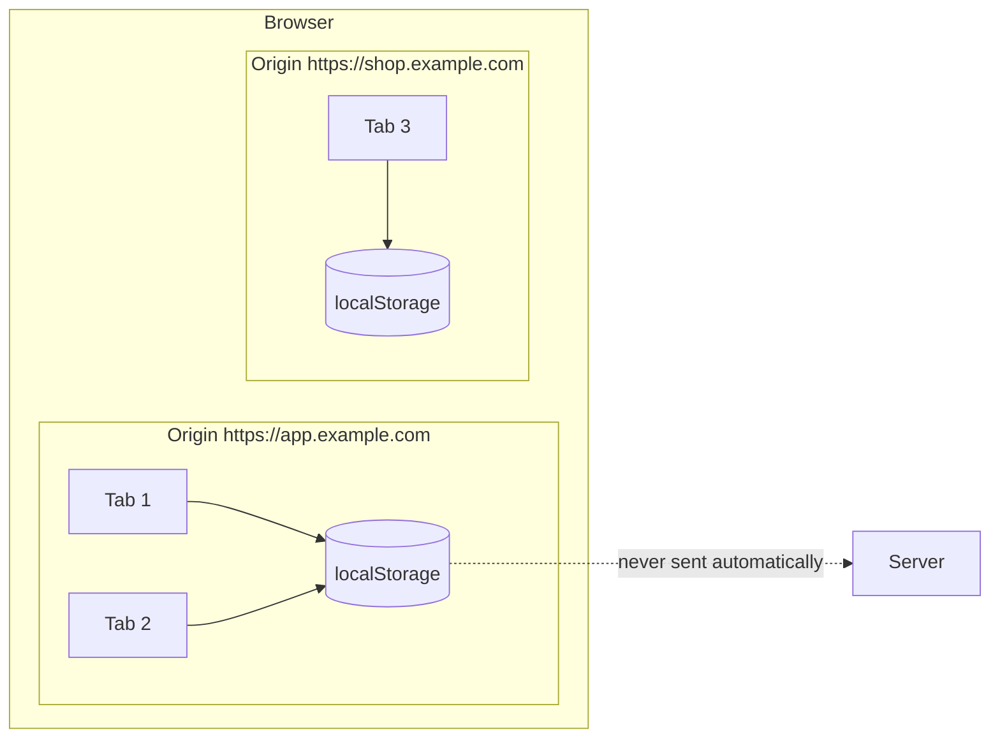
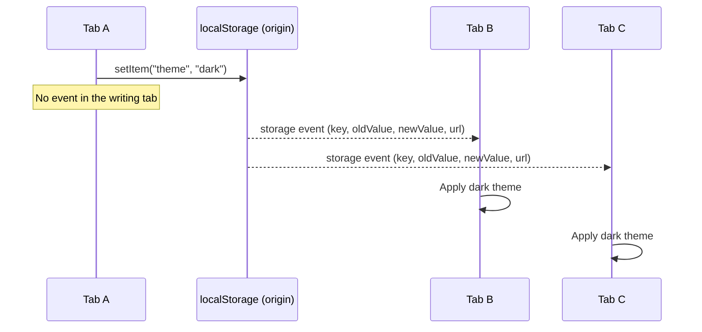
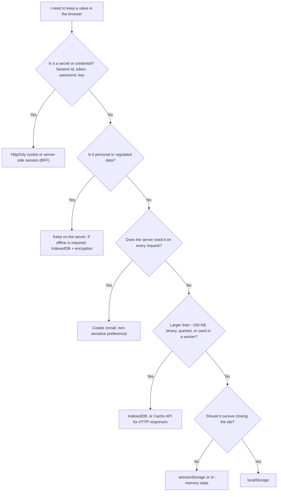
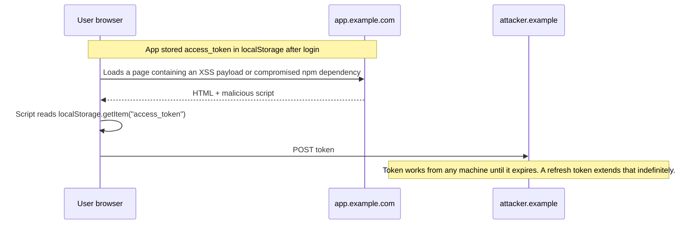
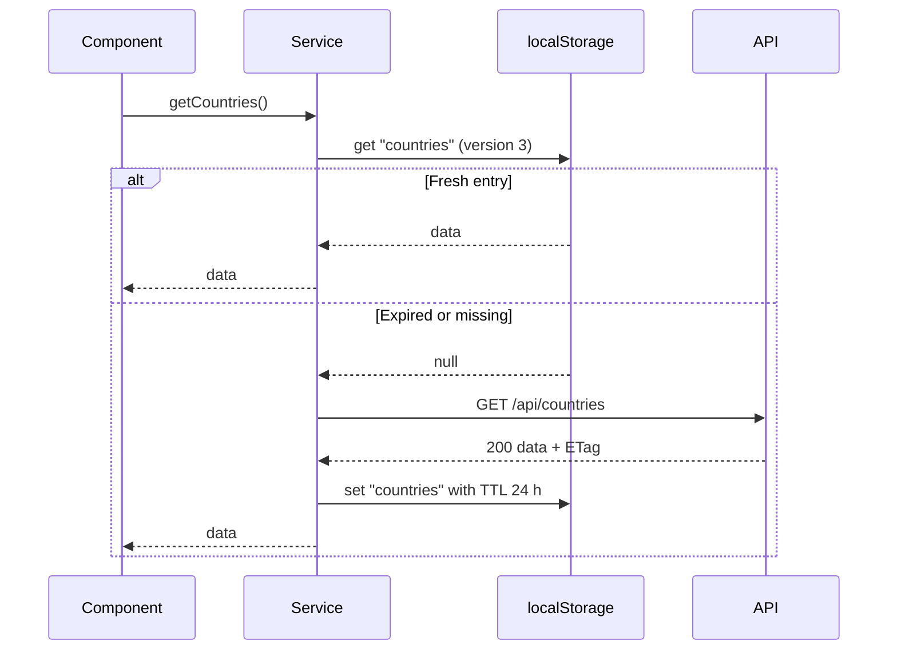
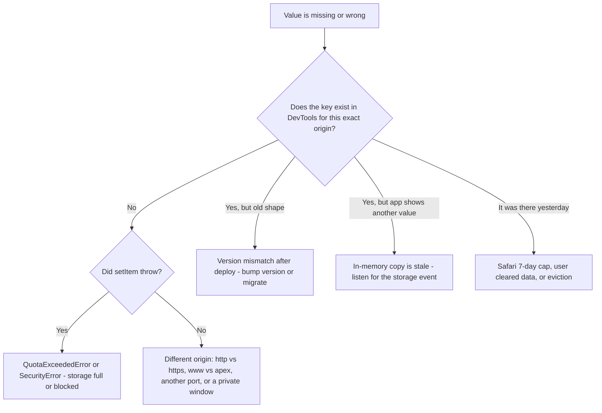

# Web Application Local Storage Handbook

`localStorage` is the simplest persistent store in the browser: a synchronous string
key/value map, scoped to one origin, that survives browser restarts. It is easy to use and
equally easy to misuse. This handbook explains exactly how it behaves, what belongs in it,
what must never go in it, and how to wrap it so that it is safe and fast.

Related handbooks: [Cookies](Web-Application-Cookie-Handbook.md) ·
[Sessions and `sessionStorage`](Web-Application-Session-Handbook.md) ·
[IndexedDB](Web-Application-IndexedDB-Handbook.md)

---

## Table of Contents

1. [The 60-Second Summary](#1-the-60-second-summary)
2. [What Local Storage Is](#2-what-local-storage-is)
3. [The API](#3-the-api)
4. [Scope and Isolation](#4-scope-and-isolation)
5. [Lifetime, Limits and Eviction](#5-lifetime-limits-and-eviction)
6. [The `storage` Event and Cross-Tab Sync](#6-the-storage-event-and-cross-tab-sync)
7. [Decision Matrices](#7-decision-matrices)
8. [Security](#8-security)
9. [Performance](#9-performance)
10. [A Production Wrapper (TypeScript)](#10-a-production-wrapper-typescript)
11. [Angular 18 Implementation](#11-angular-18-implementation)
12. [Common Patterns](#12-common-patterns)
13. [Debugging](#13-debugging)
14. [Testing](#14-testing)
15. [Review Checklist, Anti-Patterns, Cheat Sheet](#15-review-checklist-anti-patterns-cheat-sheet)

---

## 1. The 60-Second Summary

- `localStorage` stores **strings**, per **origin**, with **no expiry**, about **5 MB**.
- It is **synchronous**: every call blocks the main thread. Use it for small, rarely
  written values only.
- **Every script on the page can read all of it.** There is no `HttpOnly` equivalent.
  Never store session identifiers, access/refresh tokens, passwords or personal data.
- Data read from it is **untrusted input**: the user, an extension or an XSS payload may
  have changed it. Validate after `JSON.parse`.
- Always wrap access in `try/catch`: it can throw (`QuotaExceededError`, `SecurityError`)
  or be unavailable (SSR, blocked storage, some private modes).
- Add your own **version** and **expiry** fields; the platform provides neither.
- Use the **`storage` event** (or `BroadcastChannel`) to keep tabs in sync.
- For anything large, structured, binary or needed in a worker: use **IndexedDB**.

---

## 2. What Local Storage Is



| Property | `localStorage` |
|---|---|
| Data model | `string` key → `string` value |
| Scope | Origin (scheme + host + port); shared by all tabs of that origin |
| Lifetime | Until deleted by code, the user, or browser eviction |
| Sent to the server | Never (unlike cookies) |
| API style | Synchronous |
| Available in | Window only — **not** in web workers or service workers |
| Transactions | None; each call is individually atomic |
| Typical capacity | About 5 MB per origin |

### Comparison with its neighbours

| | Cookie | `sessionStorage` | `localStorage` | IndexedDB |
|---|---|---|---|---|
| Capacity | ~4 KB each | ~5 MB | ~5 MB | Large (share of disk) |
| Scope | Domain + path | Origin + tab | Origin | Origin |
| Lifetime | `Max-Age`/session | Tab | Persistent | Persistent |
| Sent with requests | Yes | No | No | No |
| Hidden from JavaScript | Yes with `HttpOnly` | No | No | No |
| API | Header / `document.cookie` | Sync | Sync | Async |
| Data types | String | String | String | Structured clone, blobs |
| Workers | No | No | No | Yes |

---

## 3. The API

```ts
localStorage.setItem('theme', 'dark');          // create or overwrite
const theme = localStorage.getItem('theme');    // 'dark', or null if missing
localStorage.removeItem('theme');               // delete one key
localStorage.clear();                           // delete everything for this origin
localStorage.length;                            // number of keys
localStorage.key(0);                            // name of the n-th key (order is not defined)

// Objects must be serialised
localStorage.setItem('prefs', JSON.stringify({ lang: 'en', dense: true }));
const prefs = JSON.parse(localStorage.getItem('prefs') ?? '{}');
```

Things that surprise people:

- Values are coerced to strings: `setItem('n', 5)` stores `"5"`; `setItem('o', {})` stores
  `"[object Object]"`.
- `getItem` returns `null` for a missing key; `JSON.parse(null)` returns `null`, but
  `JSON.parse('')` and `JSON.parse('undefined')` throw.
- Property access (`localStorage.theme = 'dark'`) works but collides with built-in names
  such as `length` and `key`. Use the methods.
- `JSON.stringify` drops `undefined` and functions, turns `Date` into a string, and cannot
  represent `Map`, `Set`, `BigInt` or cyclic structures.

---

## 4. Scope and Isolation

The boundary is the **origin**, which is stricter than the cookie boundary (site/domain).

| Page | Shares storage with `https://app.example.com`? |
|---|---|
| `https://app.example.com/other/path` | Yes — path does not matter |
| `http://app.example.com` | No — different scheme |
| `https://app.example.com:8443` | No — different port |
| `https://www.example.com` | No — different host |
| `https://example.com` | No — different host |

Consequences:

- A compromised sibling subdomain **cannot** read your `localStorage` (it can often set
  cookies for the parent domain).
- Several apps hosted under **paths of one origin** (`/app1`, `/app2`) share one
  `localStorage` and can read and overwrite each other's keys. Prefix keys, or better,
  give each app its own origin.
- **Third-party iframes** get *partitioned* storage in current browsers: an embedded
  `widget.com` frame sees a different `localStorage` on each top-level site.
- **Private/incognito windows** get a separate, empty store that is discarded when the
  last private window closes.
- `file://` pages and sandboxed iframes without `allow-same-origin` have opaque origins;
  access may throw `SecurityError`.

---

## 5. Lifetime, Limits and Eviction

| Topic | Behaviour |
|---|---|
| Expiry | None built in. Implement your own timestamp. |
| Quota | About 5 MB per origin. Some browsers count UTF-16 code units, so budget for **~2.5 million characters** of keys + values to be safe. |
| Over quota | `setItem` throws `QuotaExceededError`; the old value is kept. |
| Eviction | Storage is "best effort" by default: under disk pressure the browser may clear an origin's data. `navigator.storage.persist()` asks for exemption. |
| Safari ITP | Script-writable storage (including `localStorage`) is deleted after **7 days of browser use without user interaction** with the site. Installed home-screen web apps are exempt. |
| User action | "Clear site data", profile reset, or uninstalling the browser removes it. |
| Server action | The `Clear-Site-Data: "storage"` response header clears it for the origin. |

Treat `localStorage` as a **cache of things you can afford to lose**, never as the only
copy of important data.

---

## 6. The `storage` Event and Cross-Tab Sync

When one document changes `localStorage`, the browser fires a `storage` event in **every
other** same-origin document. The tab that made the change does not receive it.



```ts
window.addEventListener('storage', (e: StorageEvent) => {
  if (e.storageArea !== localStorage) return;
  if (e.key === null) { /* clear() was called */ return; }
  if (e.key === 'app:v1:theme') applyTheme(e.newValue);
});
```

| Event field | Meaning |
|---|---|
| `key` | Changed key; `null` when `clear()` was called |
| `oldValue` / `newValue` | Previous and new string; `null` when absent/removed |
| `url` | URL of the document that made the change |
| `storageArea` | `localStorage` or `sessionStorage` |

Notes:

- Setting a key to the value it already has fires no event.
- Two tabs writing the same key at the same time: last write wins, no merge.
- For messaging that is not really storage ("logout now"), prefer `BroadcastChannel`; it
  needs no dummy keys and also works in workers.

---

## 7. Decision Matrices

### Should this value go in `localStorage`?



### Storage choice by requirement

| Requirement | Cookie | `sessionStorage` | `localStorage` | IndexedDB | Cache API | Memory |
|---|---|---|---|---|---|---|
| Authentication credential | **Yes** (`HttpOnly`) | No | No | No | No | Short-lived only |
| Theme, language, layout | OK | No | **Yes** | Overkill | No | No |
| Per-tab wizard draft | No | **Yes** | No | No | No | Lost on reload |
| Feature-flag / config cache | No | OK | **Yes** (with TTL) | OK | No | OK |
| Offline data, large lists | No | No | No | **Yes** | No | No |
| Files, images, blobs | No | No | No | **Yes** | **Yes** (responses) | No |
| Access from service worker | No | No | No | **Yes** | **Yes** | No |
| Cross-tab notification | No | No | **Yes** (`storage` event) | No | No | `BroadcastChannel` |
| Server must read it | **Yes** | No | No | No | No | No |

### Data classification

| Data | In `localStorage`? | Reason |
|---|---|---|
| UI preferences (theme, density, last tab) | Yes | Harmless if read or lost |
| Dismissed-banner flags, onboarding progress | Yes | Harmless |
| Cached public reference data (countries, units) | Yes, with TTL and version | Can be re-fetched |
| Non-sensitive draft text | Yes, with care | Consider shared devices |
| Email address, name, user id | Avoid | Personal data readable by any script |
| Access token / refresh token / ID token | **No** | Full account compromise via XSS |
| Session identifier | **No** | Same |
| Card numbers, health data, national ids | **No** | Regulated; plaintext on disk |
| Authorization decisions (`isAdmin: true`) | **No** as a source of truth | User can edit it; server must decide |

---

## 8. Security

### Threat catalogue

| Threat | How it works | Controls |
|---|---|---|
| **XSS exfiltration** | Injected script runs `JSON.stringify(localStorage)` and posts it out | Store nothing valuable; CSP; output encoding; Trusted Types |
| **Third-party script access** | Analytics, chat widgets and their dependencies run in your origin and can read everything | Minimise third-party scripts; Subresource Integrity; load risky widgets in a cross-origin iframe |
| **Tampering** | User or script edits values to change behaviour (`role=admin`, price, feature flags) | Server enforces every decision; validate shape and range after reading |
| **Stored XSS via storage** | App writes a stored value into `innerHTML` | Treat as untrusted input; never render as HTML |
| **Persistence after logout** | Next user of a shared device finds drafts or cached data | Clear app keys on logout; `Clear-Site-Data: "storage"` |
| **Data at rest** | Values are plaintext files in the browser profile; readable by malware, backups, forensic tools | Do not store sensitive data |
| **Shared origin** | Another app on the same origin reads or overwrites keys | One origin per app; key prefix |
| **Prototype pollution on load** | `Object.assign(config, JSON.parse(raw))` with `__proto__` keys | Schema validation; build objects from known fields |
| **Denial of service** | Script fills the 5 MB quota so your writes fail | Handle `QuotaExceededError`; keep critical flows independent of storage |

### Why tokens do not belong here



With an `HttpOnly` cookie, the same XSS can still send requests *from the victim's browser
while the page is open*, but it cannot carry the credential away. That is a meaningful
reduction in impact, and it is why the BFF pattern keeps tokens on the server.

### "But I will encrypt it"

Encrypting a value in `localStorage` with a key that is also available to JavaScript adds
nothing: the attacker's script runs in the same context and calls the same decrypt
function. Encryption is only meaningful when the key is something the script cannot export
(a non-extractable WebCrypto `CryptoKey` held in IndexedDB) or is derived from a user
secret that is not stored. Even then, XSS can use the key while the page is open.

### Rules

1. Classify before you store (section 7).
2. Validate everything you read: type, shape, range, length.
3. Never place stored values into `innerHTML`, `eval`, URLs or script contexts.
4. Clear your keys on logout and on user switch.
5. Deploy a Content Security Policy that blocks inline script and unknown origins.
6. Do not make security decisions from stored flags.

---

## 9. Performance

`localStorage` is synchronous. The call does not return until the data is available, and
nothing else can run on the main thread meanwhile.

| Cost | Detail | Guidance |
|---|---|---|
| **First access** | The browser loads the origin's entire store from disk into memory | Keep the total store small (tens of KB). Avoid touching it before first paint. |
| **Every read/write** | Blocks the main thread; writes are flushed to disk by the browser | Never call inside loops, scroll/mousemove handlers or animation frames |
| **Serialisation** | `JSON.stringify`/`parse` of a large object can take longer than the storage call | Store small objects; split by key rather than one giant blob |
| **Whole-value rewrite** | Changing one field rewrites the whole value | One key per independent piece of state |
| **Cross-tab fan-out** | Each write raises a `storage` event in every other tab | Debounce writes |
| **Quota** | Large values push other data out and risk `QuotaExceededError` | Budget per feature; move anything over ~100 KB to IndexedDB |
| **Workers** | Not available | Use IndexedDB when work moves off the main thread |

Practical techniques:

```ts
// 1. Read once, keep in memory, write behind
const cache = new Map<string, unknown>();

// 2. Debounce frequent writes (for example a draft while typing)
let handle: ReturnType<typeof setTimeout> | undefined;
function saveDraft(text: string): void {
  clearTimeout(handle);
  handle = setTimeout(() => localStorage.setItem('app:v1:draft', text), 500);
}

// 3. Flush when the page is hidden; 'beforeunload' is unreliable on mobile
document.addEventListener('visibilitychange', () => {
  if (document.visibilityState === 'hidden') flushPendingWrites();
});

// 4. Defer non-critical reads until after first render
requestIdleCallback?.(() => warmPreferences());
```

Rule of thumb: a few keys, each under a few KB, read at startup and written on user action.
Beyond that, use IndexedDB.

---

## 10. A Production Wrapper (TypeScript)

The wrapper adds what the platform lacks: namespacing, versioning, expiry, validation,
failure handling and an in-memory fallback.

```ts
// safe-storage.ts
interface Envelope<T> {
  v: number;          // schema version of this entry
  e: number | null;   // expiry, epoch milliseconds; null = never
  d: T;               // data
}

export interface StoreOptions<T> {
  version: number;
  ttlMs?: number;
  /** Return the validated value, or null if the raw value is not acceptable. */
  validate: (raw: unknown) => T | null;
}

export class SafeStorage {
  private readonly memory = new Map<string, string>();
  private readonly backend: Storage | null;

  constructor(private readonly namespace: string, backend?: Storage) {
    this.backend = backend ?? SafeStorage.detect();
  }

  /** Feature detection: storage may be missing (SSR) or blocked (throws). */
  private static detect(): Storage | null {
    try {
      const probe = '__probe__';
      globalThis.localStorage.setItem(probe, '1');
      globalThis.localStorage.removeItem(probe);
      return globalThis.localStorage;
    } catch {
      return null;
    }
  }

  private key(name: string): string {
    return `${this.namespace}:${name}`;
  }

  get<T>(name: string, opts: StoreOptions<T>): T | null {
    const k = this.key(name);
    let raw: string | null;
    try {
      raw = this.backend ? this.backend.getItem(k) : this.memory.get(k) ?? null;
    } catch {
      raw = this.memory.get(k) ?? null;
    }
    if (raw === null) return null;

    try {
      const env = JSON.parse(raw) as Envelope<unknown>;
      const expired = typeof env.e === 'number' && env.e < Date.now();
      if (env.v !== opts.version || expired) {
        this.remove(name);
        return null;
      }
      const value = opts.validate(env.d);
      if (value === null) this.remove(name);
      return value;
    } catch {
      this.remove(name);            // corrupted entry
      return null;
    }
  }

  set<T>(name: string, value: T, opts: Pick<StoreOptions<T>, 'version' | 'ttlMs'>): boolean {
    const env: Envelope<T> = {
      v: opts.version,
      e: opts.ttlMs ? Date.now() + opts.ttlMs : null,
      d: value,
    };
    const k = this.key(name);
    const raw = JSON.stringify(env);
    try {
      if (!this.backend) throw new Error('no storage');
      this.backend.setItem(k, raw);
      return true;
    } catch {
      // QuotaExceededError, SecurityError or no backend: keep working for this page load
      this.memory.set(k, raw);
      return false;
    }
  }

  remove(name: string): void {
    const k = this.key(name);
    this.memory.delete(k);
    try { this.backend?.removeItem(k); } catch { /* ignore */ }
  }

  /** Remove only this namespace; never call localStorage.clear() in shared origins. */
  clearNamespace(): void {
    this.memory.clear();
    if (!this.backend) return;
    try {
      const prefix = `${this.namespace}:`;
      const doomed: string[] = [];
      for (let i = 0; i < this.backend.length; i++) {
        const k = this.backend.key(i);
        if (k?.startsWith(prefix)) doomed.push(k);
      }
      doomed.forEach(k => this.backend!.removeItem(k));
    } catch { /* ignore */ }
  }
}
```

Usage:

```ts
type Theme = 'light' | 'dark' | 'system';
const isTheme = (x: unknown): Theme | null =>
  x === 'light' || x === 'dark' || x === 'system' ? x : null;

const store = new SafeStorage('myapp');

store.set('theme', 'dark', { version: 1 });
const theme = store.get('theme', { version: 1, validate: isTheme }) ?? 'system';

// Cached reference data with a 24-hour TTL
store.set('countries', countries, { version: 3, ttlMs: 24 * 60 * 60 * 1000 });
```

Bumping `version` invalidates old entries after a deployment that changes the shape, which
removes a whole class of "works for new users, crashes for returning users" bugs.

---

## 11. Angular 18 Implementation

```ts
// storage.tokens.ts — injectable, SSR-safe, replaceable in tests
export const BROWSER_STORAGE = new InjectionToken<Storage | null>('BROWSER_STORAGE', {
  providedIn: 'root',
  factory: () => {
    if (!isPlatformBrowser(inject(PLATFORM_ID))) return null;   // SSR: no window
    try { return window.localStorage; } catch { return null; }   // blocked storage
  },
});
```

```ts
// preferences.service.ts — signal-backed, persisted, synchronised across tabs
type Theme = 'light' | 'dark' | 'system';

@Injectable({ providedIn: 'root' })
export class PreferencesService {
  private readonly store = new SafeStorage('myapp', inject(BROWSER_STORAGE) ?? undefined);
  private readonly document = inject(DOCUMENT);
  private readonly opts = { version: 1, validate: isTheme };

  readonly theme = signal<Theme>(this.store.get('theme', this.opts) ?? 'system');

  constructor() {
    // Persist and apply whenever the signal changes
    effect(() => {
      const theme = this.theme();
      this.store.set('theme', theme, this.opts);
      this.document.documentElement.dataset['theme'] = theme;
    });

    // Follow changes made in other tabs
    const win = this.document.defaultView;
    if (win) {
      fromEvent<StorageEvent>(win, 'storage')
        .pipe(
          filter(e => e.key === 'myapp:theme' || e.key === null),
          takeUntilDestroyed(),
        )
        .subscribe(() => this.theme.set(this.store.get('theme', this.opts) ?? 'system'));
    }
  }
}
```

```ts
// On logout: remove app data, keep harmless device preferences if desired
logout(): void {
  this.http.post('/api/auth/logout', null).subscribe(() => {
    this.storage.clearNamespace();
    sessionStorage.clear();
    void this.router.navigate(['/login']);
  });
}
```

Avoiding a flash of the wrong theme: the preference must be applied before Angular
bootstraps. Put a tiny inline script in `index.html` (allowed through CSP with a nonce or
hash) that reads the key and sets `data-theme` on `<html>`.

---

## 12. Common Patterns

### Stale-while-revalidate cache for reference data



### Cross-tab logout signal

```ts
// Tab that logs out
localStorage.setItem('myapp:logout', String(Date.now()));
localStorage.removeItem('myapp:logout');

// Every tab
addEventListener('storage', e => {
  if (e.key === 'myapp:logout' && e.newValue) location.assign('/login');
});
```

### Schema migration

```ts
const MIGRATIONS: Record<number, (old: any) => any> = {
  1: p => ({ ...p, density: 'comfortable' }),          // v1 -> v2
  2: p => ({ theme: p.theme, layout: { density: p.density } }), // v2 -> v3
};

function migrate(env: { v: number; d: unknown }, target: number): unknown {
  let { v, d } = env;
  while (v < target) d = MIGRATIONS[v++](d);
  return d;
}
```

### Quota-aware write with eviction of your own cache keys

```ts
function setWithEviction(key: string, value: string, evictable: string[]): boolean {
  for (let attempt = 0; attempt <= evictable.length; attempt++) {
    try { localStorage.setItem(key, value); return true; }
    catch (err) {
      const full = err instanceof DOMException && err.name === 'QuotaExceededError';
      if (!full || attempt === evictable.length) return false;
      localStorage.removeItem(evictable[attempt]);     // drop oldest cache entry, retry
    }
  }
  return false;
}
```

---

## 13. Debugging

DevTools: **Application → Storage → Local Storage** (Chrome/Edge), **Storage** tab
(Firefox, Safari). Values can be edited in place, which is also how a user tampers with them.



| Symptom | Likely cause |
|---|---|
| `ReferenceError: localStorage is not defined` | Code runs during SSR or in a worker |
| `SecurityError` on access | Storage blocked by settings, sandboxed iframe, `file://` |
| `QuotaExceededError` | Over ~5 MB, or a private mode with a tiny quota |
| Stored `"[object Object]"` | Missing `JSON.stringify` |
| `SyntaxError` in `JSON.parse` | Corrupted or hand-edited value, or an old plain-string format |
| Different values in dev and prod | Different origins (`localhost:4200` vs the real host) |
| Embedded widget lost its data | Third-party storage partitioning |
| `storage` event never fires | Listening in the same tab that writes; or value unchanged |
| Data gone after a week on iOS | Safari ITP 7-day cap |

Useful console snippets:

```js
// Size per key, largest first (approximate UTF-16 bytes)
Object.entries(localStorage)
  .map(([k, v]) => [k, (k.length + v.length) * 2])
  .sort((a, b) => b[1] - a[1]);

// Overall usage and quota for the origin (all storage types)
await navigator.storage.estimate();
```

---

## 14. Testing

Inject storage (section 11) so tests can replace it; do not reach for the global.

```ts
// Unit test with a fake Storage
class FakeStorage implements Storage {
  private m = new Map<string, string>();
  get length() { return this.m.size; }
  clear() { this.m.clear(); }
  getItem(k: string) { return this.m.get(k) ?? null; }
  key(i: number) { return [...this.m.keys()][i] ?? null; }
  removeItem(k: string) { this.m.delete(k); }
  setItem(k: string, v: string) { this.m.set(k, String(v)); }
}

it('drops entries written by an older schema version', () => {
  const fake = new FakeStorage();
  fake.setItem('myapp:theme', JSON.stringify({ v: 0, e: null, d: 'dark' }));
  const store = new SafeStorage('myapp', fake);
  expect(store.get('theme', { version: 1, validate: isTheme })).toBeNull();
  expect(fake.getItem('myapp:theme')).toBeNull();
});
```

| # | Test | Expected |
|---|---|---|
| 1 | Storage unavailable (backend `null`) | App works with in-memory fallback |
| 2 | `setItem` throws `QuotaExceededError` | No crash; write reported as failed |
| 3 | Corrupted JSON in a key | Entry removed, default used |
| 4 | Value of wrong type/shape | Rejected by validator |
| 5 | Entry past its TTL | Treated as missing |
| 6 | Entry with an old version | Migrated or discarded |
| 7 | Change in tab A (Playwright, two pages in one context) | Tab B updates |
| 8 | After logout | No app keys remain |
| 9 | Security scan of stored keys after login | No tokens, ids or personal data |
| 10 | SSR render | No access to `window` |

---

## 15. Review Checklist, Anti-Patterns, Cheat Sheet

### Checklist

- [ ] No credentials, tokens, session ids or personal data in `localStorage`
- [ ] All access goes through one wrapper with `try/catch`
- [ ] Keys are namespaced (`app:feature:name`)
- [ ] Every entry has a version; cached data has a TTL
- [ ] Values are validated after `JSON.parse`
- [ ] Stored values are never rendered as HTML
- [ ] No reads/writes in hot paths; frequent writes are debounced
- [ ] Total footprint is small (tens of KB); large data lives in IndexedDB
- [ ] App works when storage is unavailable, full or cleared
- [ ] App keys are cleared on logout and user switch
- [ ] Cross-tab behaviour is defined (`storage` event or `BroadcastChannel`)
- [ ] CSP is deployed; third-party scripts are minimised
- [ ] SSR and workers do not touch `localStorage`

### Anti-patterns

| Anti-pattern | Why it is a problem | Do instead |
|---|---|---|
| JWT in `localStorage` | Stolen by any XSS or compromised dependency | `HttpOnly` cookie / BFF |
| `isAdmin` or price read from storage and trusted | User-editable | Server decides |
| One giant `appState` blob | Slow serialise, whole-value rewrites, version pain | Small independent keys |
| `localStorage.clear()` on logout in a shared origin | Deletes other apps' data | Clear your namespace |
| Bare `JSON.parse(localStorage.getItem(k))` | Throws on corrupt data; no validation | Wrapper with validator |
| Writing on every keystroke or scroll | Main-thread jank, event storm in other tabs | Debounce, flush on hide |
| Using it as a database | No queries, no transactions, 5 MB | IndexedDB |
| Assuming data is permanent | Eviction, ITP, user clearing | Server is the source of truth |
| "Encrypting" with a key in the bundle | No protection against script in the same origin | Do not store the secret |
| Accessing at module top level | Breaks SSR, tests and workers | Inject, guard |

### Cheat sheet

```text
WHAT      string -> string, per origin, persistent, ~5 MB, synchronous
SCOPE     scheme + host + port; all tabs share; path is ignored
NOT IN    workers, service workers, SSR
STORE     preferences, flags, small public caches (with TTL + version)
NEVER     tokens, session ids, passwords, PII, authorization flags
READ      try -> getItem -> JSON.parse -> check version/expiry -> validate
WRITE     try -> JSON.stringify -> setItem -> catch QuotaExceededError
SYNC      'storage' event fires in OTHER tabs only; BroadcastChannel for messages
LOGOUT    remove own namespace; Clear-Site-Data: "storage"
PERF      few small keys, read once, debounce writes, nothing in hot paths
BIGGER    IndexedDB (data) or Cache API (responses)
```

### References

- WHATWG HTML Standard, *Web storage*
- WHATWG Storage Standard (quota, buckets, persistence)
- MDN: `Window.localStorage`, `StorageEvent`, *Storage quotas and eviction criteria*
- OWASP HTML5 Security Cheat Sheet, *Local Storage*
- OWASP Cross-Site Scripting Prevention Cheat Sheet
- WebKit blog: *Full Third-Party Cookie Blocking and More* (7-day cap on script-writable storage)
