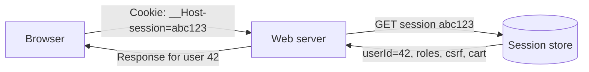
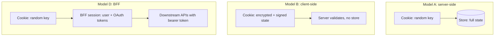
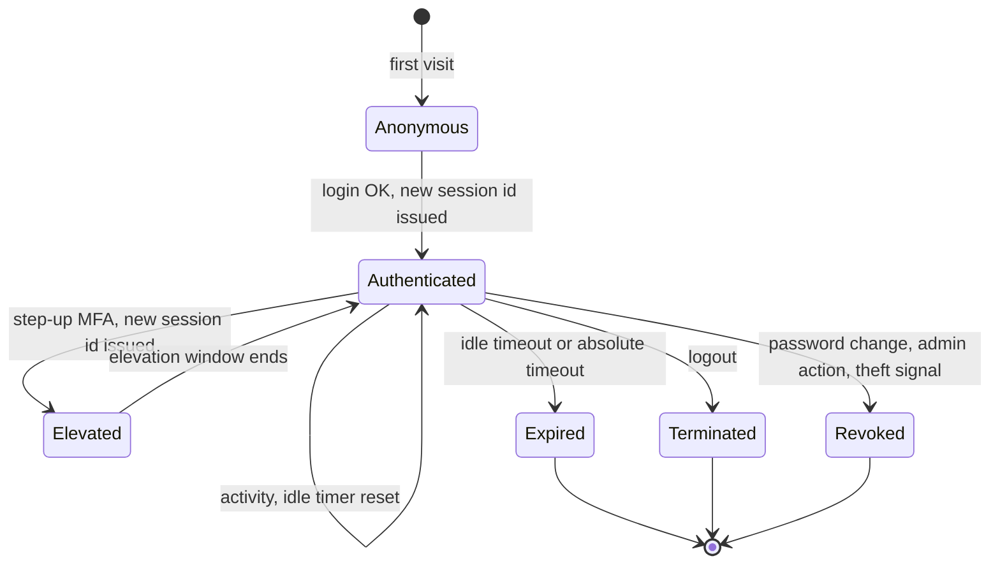
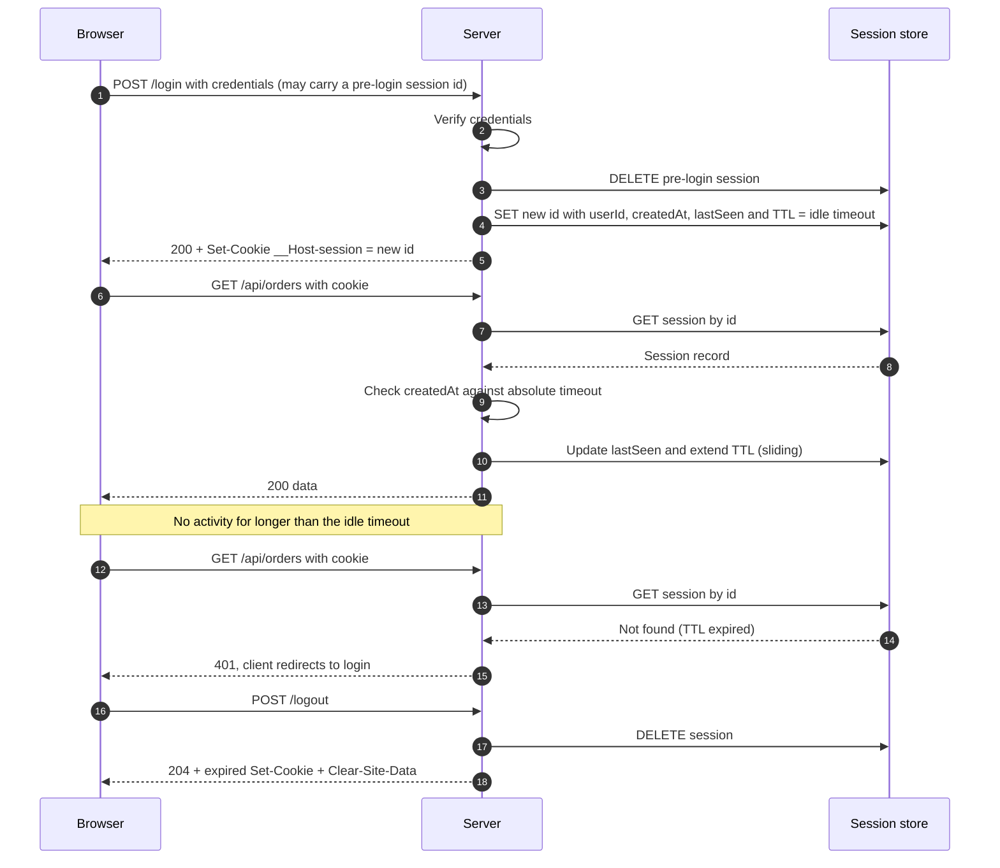
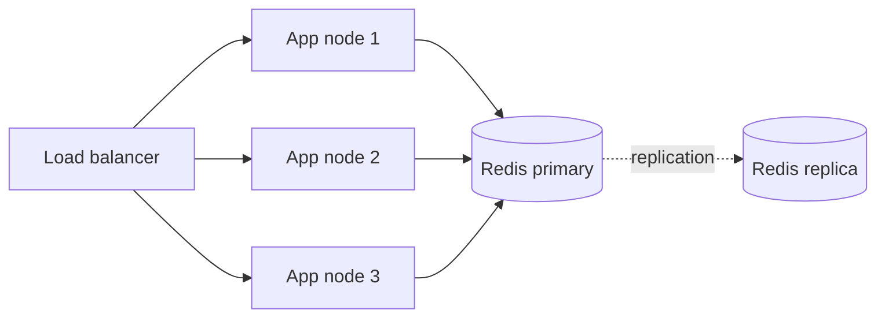
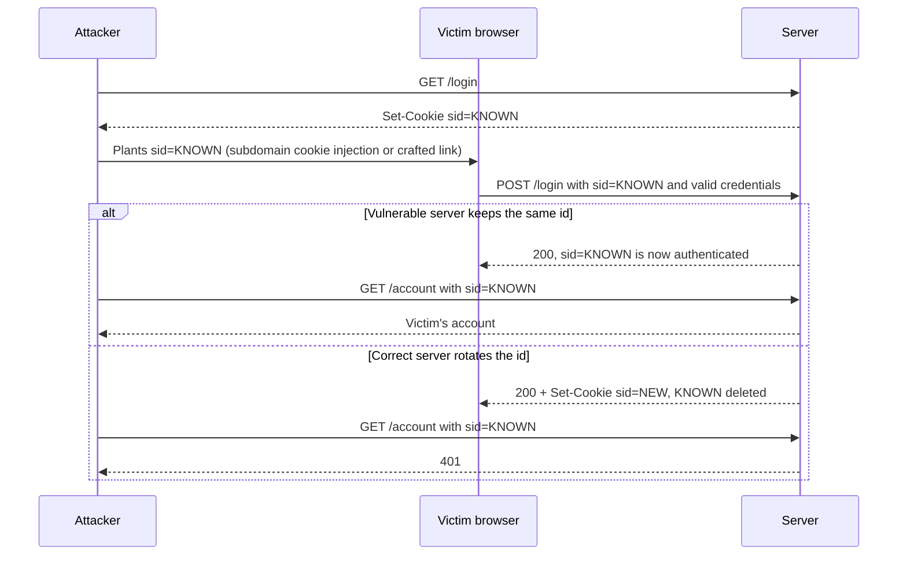
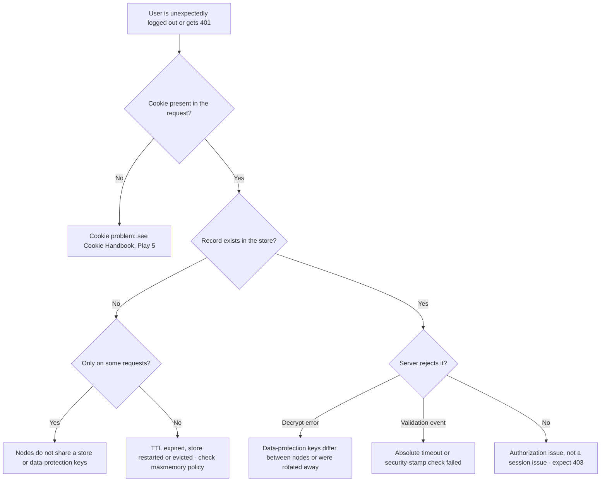

# Web Application Session Handbook

HTTP is stateless: every request arrives with no memory of the previous one. A **session**
is the mechanism that links a series of requests to one user and one piece of server-held
(or client-held) state. The Cookie Handbook explains the *carrier* (the cookie). This
document explains the *thing being carried*: how a session is created, stored, renewed,
scaled, attacked and destroyed.

The word "session" is used for two different things, and this handbook covers both:

| Term | Where it lives | What it is |
|---|---|---|
| **Web session** (sections 2–8) | Server (or a protected cookie) | The user's logged-in state and per-user server data |
| **`sessionStorage`** (section 9) | Browser, one tab | A per-tab key/value store in the Web Storage API |

---

## Table of Contents

1. [The 60-Second Summary](#1-the-60-second-summary)
2. [What a Session Is](#2-what-a-session-is)
3. [Session Models](#3-session-models)
4. [The Session Identifier](#4-the-session-identifier)
5. [Session Lifecycle](#5-session-lifecycle)
6. [Timeouts](#6-timeouts)
7. [Session Stores and Scaling](#7-session-stores-and-scaling)
8. [Decision Matrices](#8-decision-matrices)
9. [`sessionStorage` – the Browser's Per-Tab Session](#9-sessionstorage--the-browsers-per-tab-session)
10. [Security](#10-security)
11. [Performance](#11-performance)
12. [ASP.NET Core 8 Implementation](#12-aspnet-core-8-implementation)
13. [Angular 18 Implementation](#13-angular-18-implementation)
14. [Debugging](#14-debugging)
15. [Testing](#15-testing)
16. [Review Checklist, Anti-Patterns, Cheat Sheet](#16-review-checklist-anti-patterns-cheat-sheet)

---

## 1. The 60-Second Summary

- A session is **server state + an identifier the browser sends back**. The identifier
  travels in a cookie: `__Host-session=<random>; Path=/; Secure; HttpOnly; SameSite=Lax`.
- The identifier is **random, opaque and meaningless** (at least 128 bits from a CSPRNG).
  Everything that matters stays on the server.
- **Issue a new identifier at every privilege change** (login, MFA step-up, role change).
  This is the fix for session fixation.
- Enforce **two timeouts**: idle (for example 15–30 minutes) and absolute (for example 8 hours).
  Enforce them on the server; the browser clock and cookie expiry are not controls.
- **Logout destroys the server record**, not only the cookie.
- With more than one server instance, use a **distributed store** (Redis) rather than
  in-memory state with sticky routing.
- Keep the session **small** (IDs and flags, not object graphs). It is read on every request.
- `sessionStorage` is **not** a place for the session identifier or tokens. It is a per-tab
  scratchpad for non-sensitive UI state.

---

## 2. What a Session Is



Three parts make a session:

| Part | Example | Owner |
|---|---|---|
| **Identifier** | `abc123…` (opaque random string) | Issued by the server, held by the browser |
| **Carrier** | Cookie (recommended), never the URL | Browser |
| **State** | User id, auth time, roles, CSRF secret, cart id | Server store (or encrypted in the cookie) |

A session is not the same as authentication. An anonymous visitor can have a session (a
cart). Authentication *binds an identity to a session*; from then on, holding the
identifier is equivalent to being that user. This is why session theft equals account
takeover for as long as the session lives.

---

## 3. Session Models

### Model A — Server-side session (reference)

The cookie holds only a random key. The state lives in a store.

- Revocation is immediate: delete the record.
- The cookie is small and reveals nothing.
- Costs one store lookup per request.

### Model B — Client-side session (self-contained)

The state itself is placed in the cookie, encrypted and signed by the server (ASP.NET Core
cookie authentication does this by default; a JWT in a cookie is a signed-only variant).

- No store, no lookup, scales trivially.
- **Cannot be revoked before it expires** without adding a server-side list, which turns it
  back into Model A.
- Size grows with claims; every request carries the full payload (4 KB cookie limit).

### Model C — Hybrid

A short-lived self-contained token (5–15 minutes) plus a server-side record that is checked
when the short token is renewed. Revocation takes effect within one renewal window.

### Model D — BFF (Backend for Frontend) for SPAs

The SPA holds only a session cookie. The BFF holds OAuth access and refresh tokens in its
server-side session and calls downstream APIs on behalf of the browser. No tokens reach
JavaScript. This is the recommended model for a browser SPA that uses OAuth/OIDC.



---

## 4. The Session Identifier

| Property | Requirement | Reason |
|---|---|---|
| Entropy | At least 64 bits effective; use 128 bits or more | Makes guessing infeasible |
| Source | Cryptographically secure generator (`RandomNumberGenerator`, `crypto.randomBytes`) | `Random`, timestamps and counters are predictable |
| Content | Opaque, no user id, no role, no encoding of data | Nothing to read, nothing to tamper with |
| Name | Generic (`__Host-session`), not `JSESSIONID`/`ASP.NET_SessionId` | Avoids framework fingerprinting |
| Transport | Cookie with `Secure; HttpOnly; SameSite` | Not readable by script, not sent over HTTP |
| Never | URL query string, `localStorage`, logs, analytics, error pages | These leak through history, `Referer`, XSS and log access |
| Acceptance | Server accepts only identifiers it generated (strict mode) | Blocks attacker-chosen identifiers |
| Storage | Store a **hash** of the identifier as the lookup key when practical | A store dump does not yield usable sessions |

---

## 5. Session Lifecycle

### State diagram



### Sequence — login, use, renewal, logout



### Rules for each stage

| Stage | Rule |
|---|---|
| Creation | Create lazily. Do not create a store record for every anonymous hit (bots will fill the store). |
| Login | Always issue a **new** identifier and delete the old record. Copy across only what is needed (for example the cart id). |
| Privilege change | New identifier on MFA step-up, role change, impersonation start/stop. |
| Use | Validate on every request: exists, not past absolute timeout, user still active. |
| Renewal | Slide the idle timer on activity. Background polling should **not** count as activity. |
| Logout | Delete the server record, expire the cookie, send `Clear-Site-Data: "cache", "storage"` when appropriate. |
| Global events | Password change, MFA reset, account disable: delete **all** sessions for the user. |

---

## 6. Timeouts

| Timeout | Meaning | Typical values |
|---|---|---|
| **Idle** | Maximum gap between requests | 2–5 min high-value (banking, admin); 15–30 min standard apps |
| **Absolute** | Maximum total lifetime regardless of activity | 4–8 hours for a working day; shorter for high-value |
| **Renewal** | Rotate the identifier periodically while active | Optional; every 15–60 minutes |
| **Elevation** | How long a step-up (MFA) stays valid | 5–15 minutes |

- The server decides. A cookie `Max-Age` is a hint to the browser and can be edited by the user.
- Show a warning before idle expiry and offer "stay signed in" (one request that slides the timer).
- "Remember me" is a separate long-lived, revocable token that creates a new *short* session
  and should require re-authentication for sensitive actions. Do not implement it by making
  the main session last 30 days.

---

## 7. Session Stores and Scaling



| Store | Works with many nodes | Survives restart | Latency | Use when |
|---|---|---|---|---|
| In-memory (per process) | Only with sticky routing | No | Lowest | Local development, single instance |
| Sticky sessions + in-memory | Yes, with caveats | No | Lowest | Legacy apps; avoid for new work |
| Redis / Valkey | Yes | Yes with persistence or replication | ~1 ms | Default choice |
| SQL database | Yes | Yes | Several ms | Redis is not available; low traffic |
| Encrypted cookie (Model B) | Yes | Yes | None | Small state, no revocation need |

Sticky sessions fail in three ways: a node restart logs out its users, load becomes uneven,
and autoscaling in or out moves users to nodes that do not know them.

Design points for a distributed store:

- Use the store's own TTL for the idle timeout; let records expire without a cleanup job.
- Keep a secondary index `user:{id}:sessions` (a set of session keys) so "log out everywhere"
  and "list my devices" are possible.
- Decide what happens when the store is down: **fail closed** (treat as logged out) for
  authenticated areas.
- Data-protection keys used to encrypt cookies must be shared by all nodes
  (in ASP.NET Core: `PersistKeysTo…`), otherwise a cookie issued by node 1 is rejected by node 2.

---

## 8. Decision Matrices

### Which session model

| Requirement | A: Server-side | B: Client-side cookie | C: Hybrid | D: BFF |
|---|---|---|---|---|
| Immediate revocation | Yes | No | Within renewal window | Yes |
| No shared infrastructure | No | Yes | No | No |
| Large per-user state | Yes | No (4 KB) | Yes | Yes |
| SPA calling OAuth-protected APIs | Possible | Possible | Possible | **Best** |
| "List/kill my sessions" feature | Yes | No | Yes | Yes |
| Lowest per-request latency | One lookup | **Best** | Mostly no lookup | One lookup |
| Regulated / high-value app | **Best** | Avoid | Acceptable | **Best** |

### Where to put a piece of state

| State | Put it in | Not in |
|---|---|---|
| Session identifier | `HttpOnly` cookie | URL, `localStorage`, `sessionStorage` |
| User id, roles, auth time, MFA level | Server session | Client-readable storage |
| OAuth access/refresh tokens | Server session (BFF) | Browser storage |
| CSRF secret | Server session | — |
| Shopping cart | Database keyed by user or cart id; id in session | Whole cart inside the session |
| Multi-step form draft (one tab) | `sessionStorage` | Server session (causes cross-tab collisions) |
| Theme, language | `localStorage` or a preference cookie | Server session |
| Large lists, search results | Cache or database | Session |

---

## 9. `sessionStorage` – the Browser's Per-Tab Session

`sessionStorage` is the Web Storage area scoped to **one tab and one origin**.

| Property | Behaviour |
|---|---|
| Scope | Origin (scheme + host + port) **and** the tab (top-level browsing context) |
| Lifetime | Until the tab closes. Survives reload and back/forward. Restored with "reopen closed tab" in most browsers. |
| Another tab, same site | Gets its own empty `sessionStorage` |
| Duplicated tab / `window.open` with opener | Starts with a **copy**; the copies then diverge |
| `target="_blank"` links | Imply `noopener`, so the new tab starts empty |
| Sent to server | Never |
| Capacity | About 5 MB per origin per tab |
| API | Synchronous, strings only, same API as `localStorage` |
| Workers | Not available |

```ts
// Save a wizard draft for this tab only
sessionStorage.setItem('checkout.draft', JSON.stringify({ step: 2, address }));

// Restore after reload
const raw = sessionStorage.getItem('checkout.draft');
const draft = raw ? JSON.parse(raw) : null;

// Clean up when the flow completes
sessionStorage.removeItem('checkout.draft');
```

Good uses: wizard progress, scroll position, unsaved filter state, the OIDC `state`/PKCE
`code_verifier` during a redirect in a public client, a one-time "return to" URL.

Bad uses: session identifiers, access tokens, personal data. Any script running on the page
(XSS, a compromised dependency, a browser extension) can read it.

---

## 10. Security

### Threat catalogue

| Threat | How it works | Controls |
|---|---|---|
| **Session hijacking** | Attacker obtains the identifier (XSS, network sniffing, malware, log leak) | `HttpOnly`, `Secure`, HSTS, CSP, short timeouts, never log the identifier |
| **Session fixation** | Attacker plants a known identifier before the victim logs in | New identifier at login; accept only server-issued identifiers; `__Host-` prefix |
| **Prediction / brute force** | Weak or sequential identifiers | CSPRNG, 128 bits, rate limiting |
| **CSRF** | Another site makes the browser send an authenticated request | `SameSite=Lax` or `Strict`, anti-forgery token, check `Origin` |
| **XSS riding the session** | Script cannot read an `HttpOnly` cookie but can send requests as the user | Output encoding, CSP, Trusted Types, re-authentication for sensitive actions |
| **Insufficient logout** | Cookie removed but the server record stays valid | Delete the record; test by replaying the old cookie |
| **Missing expiry** | Sessions live for days | Idle and absolute timeouts on the server |
| **Session puzzling** | The same session key is used for different meanings in different flows (for example `userId` set during password reset is trusted as "logged in") | Separate keys per flow; one explicit "authenticated" flag set only at login |
| **Concurrent-session abuse** | Stolen credentials used in parallel unnoticed | Session list per user, new-device notification, optional limit |
| **Store compromise** | Attacker reads Redis | Network isolation, AUTH/TLS, store hashed keys, encrypt sensitive values |
| **Deserialization attacks** | Session payload deserialized with an unsafe formatter | JSON or framework serializers only; never `BinaryFormatter` |
| **Shared-device exposure** | Next user presses Back and sees cached pages | `Cache-Control: no-store` on authenticated responses, `Clear-Site-Data` on logout |

### Fixation — attack and fix



### Detection and response

- Log session creation, destruction, timeout and rejection with a **hash** of the identifier,
  user id, IP and user agent.
- Treat a sudden change of user agent or an impossible geography jump as a signal: require
  re-authentication rather than silently continuing. Do not hard-bind sessions to IP
  addresses; mobile and corporate networks change them legitimately.
- Provide "sign out of all devices". Invoke it automatically on password change.

---

## 11. Performance

| Topic | Guidance |
|---|---|
| **Payload size** | The session is loaded and deserialized on every request that touches it. Keep it under a few KB: ids and flags, not entities. |
| **Lookup cost** | Redis in the same network zone adds about 1 ms. A cross-region store adds tens of ms to every request. Co-locate. |
| **Write amplification** | Sliding expiry means a write per request. Slide only when a meaningful share of the window has passed (ASP.NET Core cookie auth renews after 50%), or use a TTL-touch command (`EXPIRE`/`GETEX`) instead of rewriting the value. |
| **Static assets** | Do not load the session for images, scripts and health checks. Order middleware so static files are served first. |
| **Anonymous traffic** | Create sessions lazily. A crawler should not create a million empty records. |
| **Concurrency** | Parallel requests from one SPA page share a session. Stores without locking are last-write-wins; stores with locking (classic ASP.NET) serialize requests and hurt throughput. Prefer read-mostly sessions and write through explicit endpoints. |
| **Serialization** | Use a compact serializer (System.Text.Json, MessagePack). Avoid storing large strings or collections. |
| **Connection reuse** | One multiplexed Redis connection per process; never connect per request. |
| **Cookie size (Model B)** | A 3 KB cookie on 50 requests per page is 150 KB of upload. Move claims server-side if the cookie grows. |
| **Memory sizing** | `records = concurrent users × sessions per user`; `memory ≈ records × (payload + ~100 B overhead)`. 1 M sessions × 1 KB ≈ 1 GB. |
| **Timeouts as capacity control** | Halving the idle timeout roughly halves the number of live records. |

---

## 12. ASP.NET Core 8 Implementation

ASP.NET Core has **two separate features** that are both called "session":

| Feature | Purpose | Cookie |
|---|---|---|
| Cookie authentication (`AddCookie`) | Who the user is | Auth cookie (encrypted ticket, or a key when `SessionStore` is set) |
| Session state (`AddSession`) | Per-visitor key/value data | `.AspNetCore.Session` |

They are independent. Signing out does not clear session state, and session state must
never be used as proof of login.

### 12.1 Server-side authentication sessions (Model A)

```csharp
// RedisTicketStore.cs
public sealed class RedisTicketStore(IDistributedCache cache) : ITicketStore
{
    public async Task<string> StoreAsync(AuthenticationTicket ticket)
    {
        var key = "auth:" + Convert.ToHexString(RandomNumberGenerator.GetBytes(32)); // 256 bits
        await RenewAsync(key, ticket);
        return key;
    }

    public Task RenewAsync(string key, AuthenticationTicket ticket)
    {
        var options = new DistributedCacheEntryOptions();
        if (ticket.Properties.ExpiresUtc is { } expires)
            options.SetAbsoluteExpiration(expires);
        return cache.SetAsync(key, TicketSerializer.Default.Serialize(ticket), options);
    }

    public async Task<AuthenticationTicket?> RetrieveAsync(string key)
    {
        var bytes = await cache.GetAsync(key);
        return bytes is null ? null : TicketSerializer.Default.Deserialize(bytes);
    }

    public Task RemoveAsync(string key) => cache.RemoveAsync(key);
}
```

```csharp
// Program.cs
builder.Services.AddStackExchangeRedisCache(o =>
{
    o.Configuration = builder.Configuration.GetConnectionString("Redis");
    o.InstanceName = "app:";
});
builder.Services.AddSingleton<ITicketStore, RedisTicketStore>();

builder.Services.AddAuthentication(CookieAuthenticationDefaults.AuthenticationScheme)
    .AddCookie(o =>
    {
        o.Cookie.Name = "__Host-session";
        o.Cookie.HttpOnly = true;
        o.Cookie.SecurePolicy = CookieSecurePolicy.Always;
        o.Cookie.SameSite = SameSiteMode.Lax;
        o.ExpireTimeSpan = TimeSpan.FromMinutes(20);   // idle timeout
        o.SlidingExpiration = true;                    // renewed after 50% of the window

        // APIs return status codes, not redirects
        o.Events.OnRedirectToLogin = ctx => { ctx.Response.StatusCode = 401; return Task.CompletedTask; };
        o.Events.OnRedirectToAccessDenied = ctx => { ctx.Response.StatusCode = 403; return Task.CompletedTask; };

        // Absolute timeout
        o.Events.OnValidatePrincipal = async ctx =>
        {
            var started = ctx.Properties.Items.TryGetValue("session_start", out var s)
                ? DateTimeOffset.Parse(s!, CultureInfo.InvariantCulture)
                : DateTimeOffset.MinValue;

            if (DateTimeOffset.UtcNow - started > TimeSpan.FromHours(8))
            {
                ctx.RejectPrincipal();
                await ctx.HttpContext.SignOutAsync();
            }
        };
    });

// Wire the store into the cookie options
builder.Services.AddOptions<CookieAuthenticationOptions>(CookieAuthenticationDefaults.AuthenticationScheme)
    .Configure<ITicketStore>((o, store) => o.SessionStore = store);
```

```csharp
// Login: SignInAsync issues a new key and removes the previous one (fixation defence)
var identity = new ClaimsIdentity(claims, CookieAuthenticationDefaults.AuthenticationScheme);
var props = new AuthenticationProperties();
props.Items["session_start"] = DateTimeOffset.UtcNow.ToString("O", CultureInfo.InvariantCulture);
await HttpContext.SignInAsync(new ClaimsPrincipal(identity), props);

// Logout: removes the store record and expires the cookie
await HttpContext.SignOutAsync();
HttpContext.Session.Clear();                                   // if session state is used
Response.Headers.Append("Clear-Site-Data", "\"cache\", \"storage\"");
```

### 12.2 Session state (per-visitor data)

```csharp
builder.Services.AddSession(o =>
{
    o.IdleTimeout = TimeSpan.FromMinutes(20);
    o.Cookie.Name = "__Host-state";
    o.Cookie.HttpOnly = true;
    o.Cookie.SecurePolicy = CookieSecurePolicy.Always;
    o.Cookie.SameSite = SameSiteMode.Lax;
    o.Cookie.IsEssential = true;
});

app.UseStaticFiles();      // before session: assets do not touch the store
app.UseRouting();
app.UseAuthentication();
app.UseAuthorization();
app.UseSession();          // after routing, before endpoints
app.MapControllers();
```

```csharp
await HttpContext.Session.LoadAsync();              // async load; otherwise the first access is synchronous
HttpContext.Session.SetString("cart.id", cartId);
var cart = HttpContext.Session.GetString("cart.id");
```

Notes:

- `AddSession` uses whichever `IDistributedCache` is registered. With only
  `AddDistributedMemoryCache` it is per-process and lost on restart.
- Session state is **non-locking**: two parallel requests that both write will overwrite each other.
- An empty session is not persisted and no cookie is sent until something is written.

### 12.3 Multi-node requirements

```csharp
builder.Services.AddDataProtection()
    .PersistKeysToStackExchangeRedis(redis, "app:dp-keys")
    .SetApplicationName("my-app");
```

---

## 13. Angular 18 Implementation

The SPA never sees the session identifier. Its jobs are: send cookies, react to `401`,
warn before idle expiry, and keep tabs consistent.

```ts
// auth.interceptor.ts
export const authInterceptor: HttpInterceptorFn = (req, next) => {
  const session = inject(SessionService);
  return next(req.clone({ withCredentials: true })).pipe(
    catchError((err: HttpErrorResponse) => {
      if (err.status === 401) session.onExpired();
      return throwError(() => err);
    }),
  );
};
```

```ts
// session.service.ts
@Injectable({ providedIn: 'root' })
export class SessionService {
  private readonly router = inject(Router);
  private readonly http = inject(HttpClient);
  private readonly channel = new BroadcastChannel('session');
  private readonly idleMs = 20 * 60_000;
  private readonly warnMs = 2 * 60_000;
  private timer?: ReturnType<typeof setTimeout>;

  readonly warning = signal(false);

  constructor() {
    // Another tab logged out or expired: follow it
    this.channel.onmessage = ({ data }) => { if (data === 'ended') this.toLogin(); };

    // User activity in this tab resets the local countdown
    fromEvent(document, 'click').pipe(throttleTime(30_000)).subscribe(() => this.arm());
    this.arm();
  }

  /** Called from the warning dialog: one cheap request slides the server timer. */
  stayAlive(): void {
    this.http.post('/api/session/touch', null).subscribe(() => this.arm());
  }

  logout(): void {
    this.http.post('/api/auth/logout', null).subscribe(() => this.onExpired());
  }

  onExpired(): void {
    this.channel.postMessage('ended');
    this.toLogin();
  }

  private arm(): void {
    clearTimeout(this.timer);
    this.warning.set(false);
    this.timer = setTimeout(() => this.warning.set(true), this.idleMs - this.warnMs);
  }

  private toLogin(): void {
    sessionStorage.clear();
    void this.router.navigate(['/login']);
  }
}
```

The client timer is a convenience for the user. The server enforces the real timeout and
answers `401` when the session is gone.

---

## 14. Debugging



| Symptom | Likely cause |
|---|---|
| Logged out after every deployment | In-memory store, or data-protection keys not persisted |
| Works on one node, 401 on another | No shared store / keys; sticky routing hiding the problem |
| Session never expires | Background polling keeps sliding the idle timer; no absolute timeout |
| Data "disappears" intermittently | Two parallel requests overwrite each other (last write wins) |
| Redis memory grows without bound | Sessions created for anonymous/bot traffic; TTL missing |
| Logout works but Back shows data | Missing `Cache-Control: no-store` |
| Old cookie still works after logout | Server record not deleted (Model B without a revocation list) |

---

## 15. Testing

```bash
# 1. Identifier changes at login (fixation)
curl -sk -c jar.txt https://localhost:5001/api/public > /dev/null
curl -sk -b jar.txt -c jar.txt -X POST https://localhost:5001/api/auth/login \
     -H 'Content-Type: application/json' -d '{"username":"u","password":"p"}' -D - | grep -i set-cookie

# 2. Logout invalidates on the server: replay the old cookie
cp jar.txt old.txt
curl -sk -b jar.txt -X POST https://localhost:5001/api/auth/logout
curl -sk -b old.txt -o /dev/null -w '%{http_code}\n' https://localhost:5001/api/me   # expect 401
```

| # | Test | Expected |
|---|---|---|
| 1 | Session id before and after login | Different |
| 2 | Replay cookie after logout | 401 |
| 3 | Wait past idle timeout | 401 |
| 4 | Keep active past absolute timeout | 401 |
| 5 | Send an invented session id | 401, and no record created under that id |
| 6 | Change password in browser A | Browser B's session is rejected |
| 7 | Restart an app node | Users stay logged in |
| 8 | Stop the session store | Authenticated endpoints fail closed |
| 9 | Inspect identifier entropy (Burp Sequencer or 10 000 samples) | No pattern, 128+ bits |
| 10 | Search logs and URLs for the identifier | Not present |

---

## 16. Review Checklist, Anti-Patterns, Cheat Sheet

### Checklist

- [ ] Identifier: CSPRNG, 128+ bits, opaque, generic name
- [ ] Cookie: `__Host-` prefix, `Secure`, `HttpOnly`, `SameSite=Lax` or stricter
- [ ] New identifier at login and at every privilege change
- [ ] Idle timeout and absolute timeout enforced server-side
- [ ] Logout deletes the server record; "log out everywhere" exists
- [ ] Password/MFA change revokes all sessions
- [ ] Distributed store; data-protection keys shared; fail closed when the store is down
- [ ] Session payload is small and holds no secrets it does not need
- [ ] No identifier in URLs, logs, analytics or browser storage
- [ ] CSRF protection on all state-changing requests
- [ ] `Cache-Control: no-store` on authenticated responses
- [ ] Session events are logged with a hashed identifier

### Anti-patterns

| Anti-pattern | Why it is a problem | Do instead |
|---|---|---|
| Session id in the URL | Leaks through history, logs, `Referer`, shared links | Cookie |
| Token or session id in `localStorage`/`sessionStorage` | Readable by any script | `HttpOnly` cookie or BFF |
| Same identifier before and after login | Session fixation | Rotate |
| Logout that only deletes the cookie | Stolen copy still works | Delete the server record |
| 30-day main session for "remember me" | Long theft window | Separate revocable token + short session |
| Whole user/cart object graph in session | Slow, stale, large | Store ids; load from cache or DB |
| In-memory sessions behind a load balancer | Random logouts | Distributed store |
| Using session state as proof of identity | Session puzzling | Authentication scheme decides identity |
| Hard IP binding | Breaks mobile users | Risk-based re-authentication |
| Heartbeat request that slides the idle timer | Session never expires | Exclude polling from renewal |

### Cheat sheet

```text
ID        128+ bit CSPRNG, opaque, cookie only
COOKIE    __Host-session; Path=/; Secure; HttpOnly; SameSite=Lax
LOGIN     verify -> delete old record -> new id -> set cookie
REQUEST   lookup -> check absolute timeout -> slide idle TTL
LOGOUT    delete record -> expire cookie -> Clear-Site-Data
REVOKE    password/MFA change -> delete all sessions for user
TIMEOUTS  idle 15-30 min (2-5 high value) | absolute 4-8 h
STORE     Redis with TTL, shared DP keys, fail closed
SIZE      ids and flags only, a few KB at most
TAB STATE sessionStorage: per tab, per origin, never secrets
```

### References

- OWASP Session Management Cheat Sheet
- OWASP ASVS v4, section V3 (Session Management)
- NIST SP 800-63B, section 7 (Session Management)
- RFC 6265bis (HTTP State Management Mechanism)
- Microsoft Learn: *Session and state management in ASP.NET Core*; *Use cookie authentication without ASP.NET Core Identity*
- MDN: `Window.sessionStorage`, `Clear-Site-Data`
