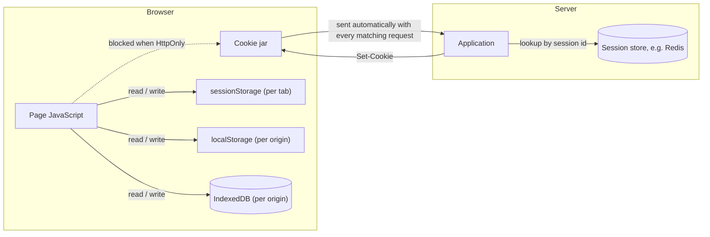
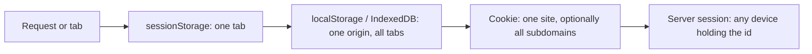
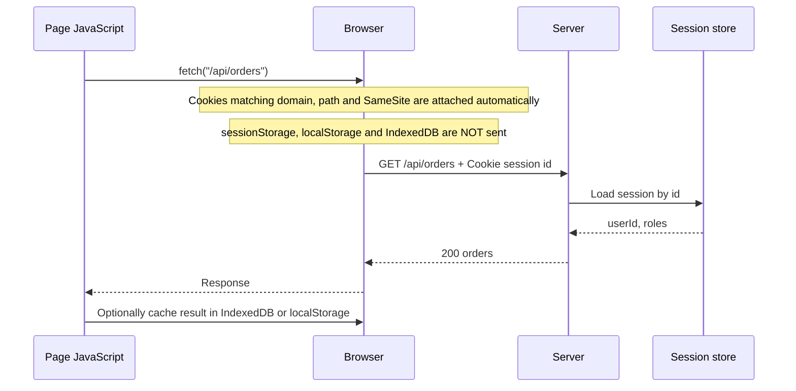
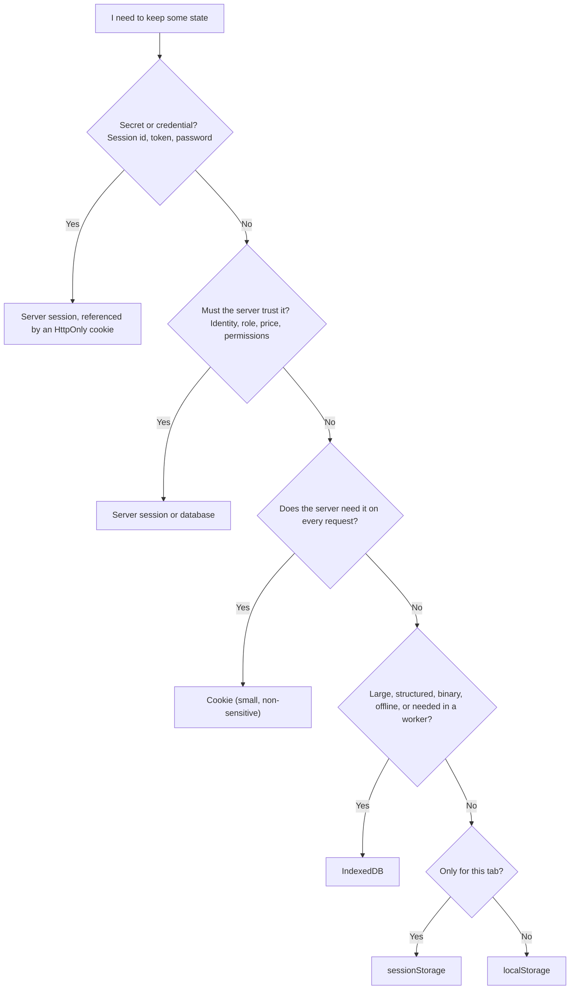
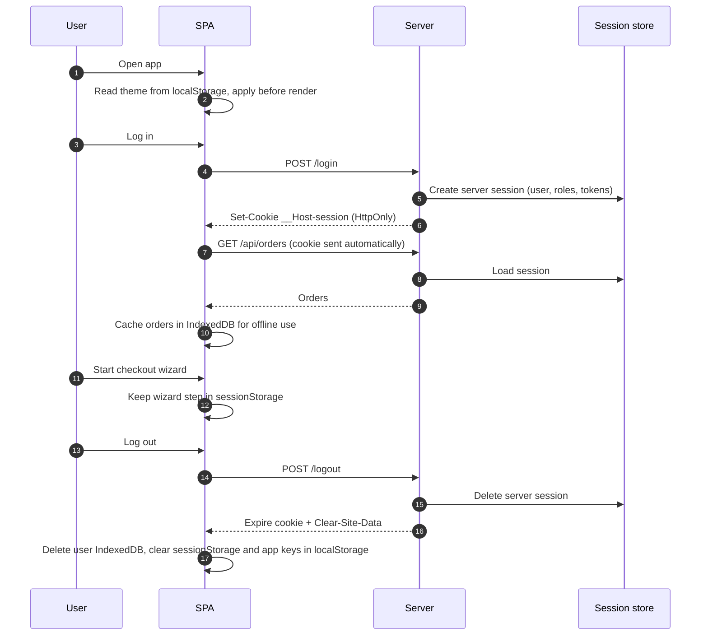

# Cookie vs Session vs Local Storage vs IndexedDB

One page that puts the four state mechanisms next to each other. Each has its own handbook
for depth:

- [Cookie Handbook](Web-Application-Cookie-Handbook.md)
- [Session Handbook](Web-Application-Session-Handbook.md) (server-side session and `sessionStorage`)
- [Local Storage Handbook](Web-Application-LocalStorage-Handbook.md)
- [IndexedDB Handbook](Web-Application-IndexedDB-Handbook.md)

"Session" means two things, so it has two columns throughout: the **server session** (state
held on the server, found through a cookie) and **`sessionStorage`** (a per-tab store in
the browser).

---

## Table of Contents

1. [The 60-Second Summary](#1-the-60-second-summary)
2. [Where Each One Lives](#2-where-each-one-lives)
3. [Feature Comparison](#3-feature-comparison)
4. [Scope and Lifetime](#4-scope-and-lifetime)
5. [What Happens on a Request](#5-what-happens-on-a-request)
6. [Decision Guide](#6-decision-guide)
7. [Security Comparison](#7-security-comparison)
8. [Performance Comparison](#8-performance-comparison)
9. [API Side by Side](#9-api-side-by-side)
10. [How They Work Together](#10-how-they-work-together)
11. [Common Mistakes](#11-common-mistakes)
12. [Cheat Sheet](#12-cheat-sheet)

---

## 1. The 60-Second Summary

| Mechanism | One-line description | Use it for |
|---|---|---|
| **Cookie** | Small value the browser sends to the server automatically | The session identifier; small values the server must see |
| **Server session** | Per-user state kept on the server, keyed by a cookie | Identity, roles, tokens, CSRF secret, anything that must be trusted |
| **`sessionStorage`** | Per-tab string store in the browser | Wizard progress, per-tab UI state |
| **`localStorage`** | Persistent per-origin string store in the browser | Preferences, flags, small public caches |
| **IndexedDB** | Asynchronous transactional database in the browser | Offline data, large or structured data, blobs |

The single most important rule: **only an `HttpOnly` cookie is hidden from JavaScript**.
Everything in `sessionStorage`, `localStorage` and IndexedDB can be read by any script
running on the page, so credentials never go there.

---

## 2. Where Each One Lives



---

## 3. Feature Comparison

| Feature | Cookie | Server session | `sessionStorage` | `localStorage` | IndexedDB |
|---|---|---|---|---|---|
| Stored in | Browser | Server | Browser | Browser | Browser |
| Capacity | ~4 KB per cookie | Limited by the server | ~5 MB | ~5 MB | Large share of disk |
| Data types | String | Any (serialised) | String | String | Objects, blobs, dates, keys |
| Sent with HTTP requests | Yes, automatically | Only the id (in a cookie) | No | No | No |
| Readable by server | Yes | Yes | No | No | No |
| Readable by JavaScript | Yes, unless `HttpOnly` | No | Yes | Yes | Yes |
| API style | HTTP header / `document.cookie` | Server framework | Synchronous | Synchronous | Asynchronous |
| Queries and indexes | No | Depends on store | No | No | Yes |
| Transactions | No | Depends on store | No | No | Yes |
| Built-in expiry | Yes (`Max-Age`/`Expires`) | Yes (timeouts) | Tab close | No | No |
| Shared across tabs | Yes | Yes | No | Yes | Yes |
| Change notification | No | No | No | `storage` event | No (use `BroadcastChannel`) |
| Web / service workers | No | n/a | No | No | Yes |
| Server can revoke | Yes (expire it) | Yes, immediately | No | Only via `Clear-Site-Data` | Only via `Clear-Site-Data` |
| Works offline | n/a | No | Yes | Yes | Yes |

---

## 4. Scope and Lifetime

| | Cookie | Server session | `sessionStorage` | `localStorage` | IndexedDB |
|---|---|---|---|---|---|
| **Boundary** | Domain + path (can span subdomains) | Whoever presents the id | Origin + tab | Origin | Origin |
| **Subdomains share it** | If `Domain` is set | Follows the cookie | No | No | No |
| **Ends when** | Expiry, or browser close for session cookies | Idle/absolute timeout, logout, revocation | Tab closes | Deleted | Deleted |
| **Survives reload** | Yes | Yes | Yes | Yes | Yes |
| **Survives browser restart** | Only persistent cookies | Yes, if the cookie does | No | Yes | Yes |
| **Private window** | Separate, discarded at end | New session | Separate, discarded | Separate, discarded | Separate, discarded |
| **Browser may evict** | Rarely (count limits) | No | No | Yes, under disk pressure | Yes, under disk pressure |
| **Safari 7-day cap** | Applies to script-set cookies | No | n/a | Yes | Yes |

Origin means scheme + host + port. `https://app.example.com` and
`https://api.example.com` can share a cookie but never share `localStorage` or IndexedDB.



---

## 5. What Happens on a Request



Consequences:

- Cookies add bytes to **every** request to their scope; the browser stores add none.
- Because cookies are sent automatically, they need CSRF protection. The browser stores
  are not sent automatically, so they have no CSRF exposure — but they are fully exposed to XSS.

---

## 6. Decision Guide



### By use case

| Use case | Best choice | Why not the others |
|---|---|---|
| Login state / session identifier | `HttpOnly` cookie → server session | Browser stores are readable by script |
| OAuth access and refresh tokens | Server session (BFF) | XSS in any browser store means token theft |
| User roles and permissions | Server session | Client copies can be edited |
| CSRF token | Server session + header | — |
| Theme, language, layout | `localStorage` | Cookie only if the server renders with it |
| Language needed for server-side rendering | Cookie | Server cannot read `localStorage` |
| "Remember this device" | Persistent `HttpOnly` cookie | — |
| Multi-step form in one tab | `sessionStorage` | `localStorage` would leak between tabs |
| OIDC `state` / PKCE verifier during redirect | `sessionStorage` | Short-lived, per tab |
| Shopping cart (logged in) | Server database, id in session | Must survive devices |
| Shopping cart (anonymous) | `localStorage`, or server with a cookie id | — |
| Cached reference data, small | `localStorage` with TTL | — |
| Cached API entities, large lists | IndexedDB | 5 MB and sync API are limits |
| Offline drafts with attachments | IndexedDB | Needs blobs and transactions |
| Queue of offline mutations | IndexedDB | Needs transactions and worker access |
| Cross-tab "logout" signal | `localStorage` event or `BroadcastChannel` | — |
| Analytics / consent flag | Cookie or `localStorage` | Depends on whether the server reads it |

### Scored matrix

Rated 1 (poor) to 5 (excellent) for a typical web application.

| Criterion | Cookie | Server session | `sessionStorage` | `localStorage` | IndexedDB |
|---|---|---|---|---|---|
| Safe for credentials | 4 (`HttpOnly`) | 5 | 1 | 1 | 1 |
| Trustworthy (tamper-proof) | 2 (unless signed) | 5 | 1 | 1 | 1 |
| Capacity | 1 | 4 | 3 | 3 | 5 |
| Read/write speed in the browser | 3 | n/a | 4 | 4 | 4 |
| Does not block the main thread | 3 | 5 | 2 | 2 | 5 |
| No per-request network cost | 1 | 3 | 5 | 5 | 5 |
| Works offline | 1 | 1 | 4 | 4 | 5 |
| Simplicity | 3 | 3 | 5 | 5 | 2 |
| Server-side revocation | 4 | 5 | 1 | 1 | 1 |

---

## 7. Security Comparison

| Threat | Cookie | Server session | `sessionStorage` | `localStorage` | IndexedDB |
|---|---|---|---|---|---|
| **XSS reads the data** | No, with `HttpOnly` | No | Yes | Yes | Yes |
| **XSS uses the data in place** | Yes (requests ride the cookie) | Yes (through the cookie) | Yes | Yes | Yes |
| **CSRF** | Yes — needs `SameSite` + token | Yes (through the cookie) | No | No | No |
| **Network interception** | Yes without `Secure` | Id exposed without `Secure` | No (never sent) | No | No |
| **User tampering** | Yes, unless signed/encrypted | No | Yes | Yes | Yes |
| **Sibling subdomain attack** | Yes (cookie tossing) unless `__Host-` | Through the cookie | No | No | No |
| **Plaintext on disk** | Yes (browser may encrypt) | Server side only | In memory / session files | Yes | Yes |
| **Left behind on shared device** | Until expiry | Until timeout | Until tab closes | Until cleared | Until cleared |
| **Fixation** | Yes — rotate id at login | Yes — rotate id at login | No | No | No |

### Main control for each

| Mechanism | Must-have controls |
|---|---|
| Cookie | `__Host-` prefix, `Secure`, `HttpOnly`, `SameSite=Lax` or stricter, short lifetime |
| Server session | Random 128-bit id, new id at login, idle + absolute timeout, delete on logout |
| `sessionStorage` | No secrets; validate what you read |
| `localStorage` | No secrets or personal data; validate; clear app keys on logout |
| IndexedDB | No credentials; per-user database; encrypt sensitive fields; delete on logout |
| All browser stores | Content Security Policy, output encoding, minimal third-party scripts, `Clear-Site-Data` on logout |

Two attacks, two different victims:

- **CSRF** attacks what the browser sends **automatically** → cookies.
- **XSS** attacks what scripts can **read** → `sessionStorage`, `localStorage`, IndexedDB and non-`HttpOnly` cookies.

Moving a token from a cookie to `localStorage` to "avoid CSRF" swaps a problem with
well-known fixes for a worse one.

---

## 8. Performance Comparison

| Aspect | Cookie | Server session | `sessionStorage` | `localStorage` | IndexedDB |
|---|---|---|---|---|---|
| Cost per HTTP request | Bytes added to every request in scope | One store lookup (~1 ms with nearby Redis) | None | None | None |
| Main-thread blocking | `document.cookie` is synchronous | None in the browser | Synchronous | Synchronous; first access loads the whole store | Asynchronous |
| Good size per item | Under 1 KB | A few KB | Up to ~100 KB | Up to ~100 KB | KB to many MB |
| Bulk reads/writes | Not suitable | Not suitable | Slow (stringify everything) | Slow (stringify everything) | Fast when batched in one transaction |
| Lookup by field | No | No | No | No | Yes, with indexes |
| Scaling concern | Header size, number of cookies | Store memory, shared across nodes | None | None | Quota, eviction |

Rules of thumb:

- Keep cookies few and small; a 3 KB cookie on 50 requests is 150 KB of upload per page.
- Keep the server session to ids and flags; it is loaded on every request.
- Never touch `localStorage`/`sessionStorage` in loops, scroll handlers or animation frames; debounce writes.
- In IndexedDB, batch many writes in one transaction and use key ranges instead of loading everything.

---

## 9. API Side by Side

```ts
// Cookie (server sets it; JavaScript usually should not touch auth cookies)
// Set-Cookie: __Host-session=abc; Path=/; Secure; HttpOnly; SameSite=Lax
document.cookie = 'lang=en; Path=/; Max-Age=31536000; Secure; SameSite=Lax';
const lang = document.cookie.split('; ').find(c => c.startsWith('lang='))?.split('=')[1];

// sessionStorage (this tab only)
sessionStorage.setItem('wizard.step', '2');
const step = sessionStorage.getItem('wizard.step');

// localStorage (all tabs, persistent)
localStorage.setItem('app:theme', JSON.stringify({ v: 1, d: 'dark' }));
const theme = JSON.parse(localStorage.getItem('app:theme') ?? 'null')?.d ?? 'system';

// IndexedDB (with the idb wrapper)
const db = await openDB('app', 1, {
  upgrade(d) { d.createObjectStore('orders', { keyPath: 'id' }); },
});
await db.put('orders', { id: 'o1', total: 42, updatedAt: Date.now() });
const order = await db.get('orders', 'o1');
```

```csharp
// Server session (ASP.NET Core)
HttpContext.Session.SetString("cart.id", cartId);          // session state
var cartId = HttpContext.Session.GetString("cart.id");
var userId = User.FindFirstValue(ClaimTypes.NameIdentifier); // identity from the auth cookie/session
```

---

## 10. How They Work Together

A typical single-page application uses all of them, each for what it is good at.



| Layer | Holds |
|---|---|
| Cookie | Opaque session id only |
| Server session | Who the user is, what they may do, their tokens |
| `sessionStorage` | This tab's in-progress work |
| `localStorage` | Device preferences |
| IndexedDB | Offline copy of the user's data and pending changes |

---

## 11. Common Mistakes

| Mistake | Why it is wrong | Do instead |
|---|---|---|
| JWT or session id in `localStorage`/`sessionStorage` | Any XSS or compromised dependency steals it | `HttpOnly` cookie + server session |
| Auth cookie without `HttpOnly`/`Secure`/`SameSite` | Readable by script, sent over HTTP, CSRF | Set all three; use `__Host-` |
| Trusting `isAdmin` from any browser store | The user can edit it | Server decides |
| Large data in cookies | 4 KB limit; slows every request | Server session or IndexedDB |
| Whole object graphs in the server session | Slow on every request, stale data | Store ids, load on demand |
| Using `localStorage` as a database | 5 MB, synchronous, no queries | IndexedDB |
| Using `sessionStorage` to share state between tabs | It is per tab | `localStorage` or `BroadcastChannel` |
| Assuming browser storage is permanent | Eviction, Safari 7-day cap, user clearing | Server is the source of truth |
| Logout that only removes the cookie | Server session and local data remain | Delete server session and client data |
| Same session id before and after login | Session fixation | Issue a new id at login |
| Expecting `localStorage` in SSR or workers | Not available there | Guard access; use IndexedDB in workers |

---

## 12. Cheat Sheet

```text
                 COOKIE        SERVER SESSION   sessionStorage   localStorage   IndexedDB
Lives in         browser       server           browser/tab      browser        browser
Size             ~4 KB         server limit     ~5 MB            ~5 MB          large
Sent to server   automatic     id only          never            never          never
JS can read      not HttpOnly  no               yes              yes            yes
Lifetime         Max-Age       timeouts         tab              until cleared  until cleared
Scope            domain+path   id holder        origin+tab       origin         origin
API              header        framework        sync             sync           async + tx
Main risk        CSRF          hijack/fixation  XSS              XSS            XSS
Use for          session id    identity, trust  per-tab state    preferences    offline data
Never for        big data      big data         secrets          secrets        secrets
```

Pick in this order:

1. Secret or must be trusted → **server session**, reached through an **`HttpOnly` cookie**.
2. Server needs it on each request, small and harmless → **cookie**.
3. Large, structured, offline or used in a worker → **IndexedDB**.
4. One tab only → **`sessionStorage`**.
5. Otherwise, small and harmless → **`localStorage`**.
